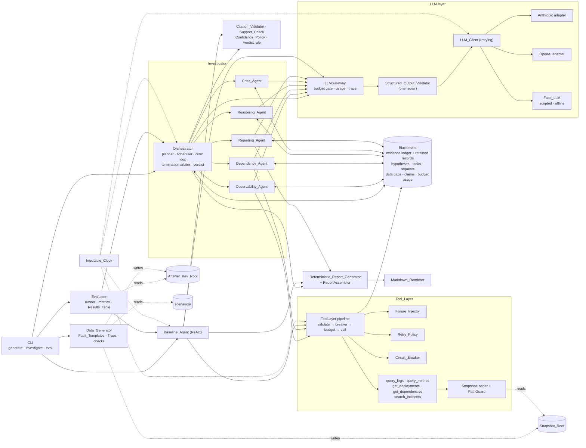
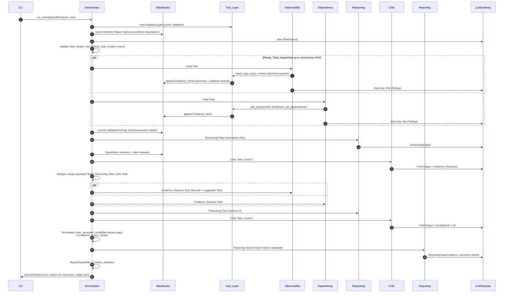

# Design Document: Incident Investigator

## Overview

The Incident Investigator is a read-only, asyncio-based Python 3.11+ system. Six agents work over one shared Blackboard. They investigate one fixed, synthetic Incident_Snapshot through five typed Tools and produce one Investigation_Report (JSON + Markdown). The report has ranked, evidence-cited Hypotheses, Facts vs Assumptions, Data_Gaps and Recommended_Actions. A single-agent ReAct Baseline_Agent uses the same Tool_Layer, LLM_Client, Citation_Validator, Confidence_Policy, report model and configuration. A Data_Generator builds 12 scenarios from parametric Scenario_Specs. An Evaluator, the only reader of Answer_Keys, scores both systems without an LLM judge.

No agent framework is used. The orchestration, retries, circuit breaking, budgets and termination are plain asyncio code, so they can be reviewed and tested directly. Every boundary type is a Pydantic v2 model. Every time read or sleep goes through an Injectable_Clock, and every random choice comes from a hash of the Seed. This makes runs reproducible, and the tests never sleep on the real clock.

### Research findings that shape the design

- Both official provider SDKs retry failed requests internally by default. The adapters build their clients with `max_retries=0` and a per-request timeout, so all LLM retries and backoff happen in our `LLM_Client` through the Injectable_Clock (Req 5.7) ([Microsoft Q&A on OpenAI client retries](https://learn.microsoft.com/en-us/answers/questions/5537197/openai-base-client-retrying-request-to-chat-comple), [OpenAI community thread](https://community.openai.com/t/openai-base-client-retrying-request-to-chat-completions-in-x-seconds/1355000)).
- The Anthropic Python SDK has an async client and reports `usage.input_tokens` / `usage.output_tokens`. OpenAI Chat Completions reports `usage.prompt_tokens` / `usage.completion_tokens`. The adapters map both to one `TokenCount` (Req 5.3; Assumption 17) ([Anthropic Python SDK docs](https://platform.claude.com/docs/en/cli-sdks-libraries/sdks/python)).
- In Hypothesis, `derandomize=True` makes example generation deterministic. Combined with `database=None`, repeated invocations generate identical examples (Req 30.3) ([Hypothesis settings](https://hypothesis.readthedocs.io/en/latest/tutorial/settings.html)).

Content was rephrased for compliance with licensing restrictions.

### Decisions this design settles

| # | Open point from requirements | Decision | Section |
|---|---|---|---|
| D1 | Tool_Request rejection precedence | input validation → Circuit_Breaker → Tool_Call Budget, applied to every attempt | Tool_Layer pipeline |
| D2 | Support_Check rule set | Deterministic predicates over the cited Evidence_Item, its retained records and the citing statement's structure | Support_Check |
| D3 | Observation_Summary algorithm | Count, span, per-tool top-K entries with a fixed ordering, an allowlist of key attributes, and metric stats | Observation_Summary |
| D4 | Fake_LLM modes | `ScriptedFakeLLM` for tests; `OfflineResponder` derives output only from the prompt's context block | Fake_LLM |
| D5 | Prompt construction and isolation | Per-agent builders with a fixed context block. Isolation is enforced by root disjointness, a path guard, an import-boundary test, a config projection and canary scans | Prompts; Answer-key isolation |
| D6 | Scenario → Fault_Template/Trap mapping and verification | One template per fault kind. Each Scenario_Spec names its catalogue condition; condition checks run before any write | Data_Generator |
| D7 | Deterministic report output | Copies Blackboard state. Emits one `mitigation` (conclusive only) plus `further_investigation` actions per missing-evidence entry | Report |
| D8 | Several Hypothesis revisions with stale ranks | The *active set* is the latest completed Reasoning output, ranked 1..N. Omitted Hypotheses become *superseded* and are reported separately | Blackboard |
| D9 | Metric/dependency records that aggregate snapshot records | Tool records carry `constituent_ids`. Evidence `source_record_ids` lists each record ID followed by its constituents | Tools |
| D10 | Mandatory first-task Tool_Requests (Req 8.2, 9.2, 9.6) and the first request for Evidence_Request Tasks (Req 8.7, 9.7) | Code issues them before the LLM step loop | Agents |
| D11 | Hypothesis IDs (Req 10.8) and the sufficiency flag (Req 10.9) | Assigned and enforced by code after citation validation, not trusted from the LLM | Reasoning_Agent |
| D12 | Where Confidence_Policy results live | A separate `ConfidenceAdjustment` per Hypothesis. Revisions stay immutable | Confidence_Policy |
| D13 | Termination "same check" | Defined check points; at each check, conditions are evaluated in the Req 18.7 order | Termination |

## Architecture

### Component view



Specialist agents are the only Investigator agents that hold a Tool port. The Reasoning, Critic and Reporting agents get no Tool port, so they make zero Tool_Requests by construction (Req 10.6, 12.1). Agents never write to the Blackboard directly. They return outcomes, and the Orchestrator commits them after citation validation. The Tool_Layer is the only writer of Evidence_Items and tool Data_Gaps.

### Package layout and import rules

```
src/incident_investigator/
  models/        vocab, incident, snapshot, tools, evidence, claims, hypothesis, tasks,
                 critic, gaps, budget, outputs (agent/baseline LLM outputs), report, trace,
                 config, scenario, answer_key, results
  clock.py       Clock protocol, SystemClock, FakeClock
  llm/           base.py (LLMClient, LLMRequest, LLMResponse, errors), retrying.py,
                 anthropic.py, openai.py, fake.py (ScriptedFakeLLM), offline.py (OfflineResponder),
                 validator.py (StructuredOutputValidator), gateway.py (LLMGateway)
  tools/         snapshot.py (loader, PathGuard), impl.py (5 pure tool functions),
                 summary.py, injector.py, retry.py, breaker.py, layer.py (ToolLayer)
  state/         blackboard.py, citations.py, support.py (Support_Check), confidence.py, verdict.py
  orchestrator/  graph.py, planner.py, scheduler.py, critic_loop.py, termination.py, run.py
  agents/        base.py, observability.py, dependency.py, reasoning.py, critic.py, reporting.py,
                 prompts/ (templates + builders)
  baseline/      react.py
  report/        assembler.py, deterministic.py, markdown.py, writer.py (RunOutputSink)
  datagen/       catalogue.py, topology.py, templates/, traps.py, noise.py, checks.py, generator.py
  evaluation/    runner.py, metrics.py, isolation.py, results.py
  redact.py      SecretRedactor
  cli.py
```

Import rules, enforced by an AST-scanning test:

- `models` imports nothing from the project except `models`.
- `evaluation` is imported only by `cli` (and tests) (Req 24.9).
- The Investigator packages (`tools`, `state`, `orchestrator`, `agents`, `baseline`, `llm`, `report`) do not import `datagen`, `evaluation`, `models.answer_key` or `models.scenario`.
- `datagen` is the only package that opens files under `scenarios/`. `evaluation` is the only non-test package that opens files under the Answer_Key_Root (Req 24.4).

### Run lifecycle (Investigator, with one Critic feedback round)



### Concurrency and time model

- One asyncio event loop per Run. There are no threads. Agent Task attempts run as `asyncio.Task`s owned by the scheduler.
- Blackboard compound operations (append evidence + assign ID, budget increments, revision append) run under one `asyncio.Lock`. Plain reads take no lock and return immutable (frozen) models.
- The Clock protocol has `now()` for aware UTC timestamps, `monotonic()` for durations, `sleep()`, and `wait_for(aw, timeout)`. `SystemClock` wraps `datetime.now(UTC)`, `time.monotonic` and `asyncio`. `FakeClock` keeps virtual time: `sleep()` parks the caller on a heap. In `auto_advance` mode, a driver coroutine advances virtual time to the earliest deadline after the loop has run `settle_rounds` (default 20) consecutive idle iterations with no clock activity. Ties wake in registration order. Tests can also call `advance(dt)` by hand. All other awaits in a Run are in-memory, so idle detection is deterministic.
- Backoff, breaker cooldowns, per-Task timeouts, LLM timeouts and the wall-clock watchdog all use the Clock (Req 15.11, 30.5).

### Thin end-to-end slice first

The module boundaries are ports, so minimal versions can be plugged in first and widened later without changing interfaces:

1. `models/` (all shared models and vocabularies), `clock.py`, `config` loader.
2. `tools/`: `SnapshotLoader` + `PathGuard`, `query_logs` only in `ToolRegistry`, a `ToolLayer` with the full pipeline shape but a no-op injector, an always-closed breaker and `max_attempts=1`, plus `ObservationSummarizer`.
3. `llm/`: `LLMClient`, `ScriptedFakeLLM`, `StructuredOutputValidator`, `LLMGateway`.
4. `state/`: `Blackboard`, `CitationValidator`, `ConfidencePolicy`, the verdict rule.
5. `agents/`: all six agents in minimal form (opening requests + one findings call; Reasoning; Critic accept-or-request; Reporting), the Default_Task_Graph, one Critic_Round.
6. `report/`: `ReportAssembler`, `DeterministicReportGenerator`, `MarkdownRenderer`, `RunOutputSink`.
7. `datagen/`: one Fault_Template (`config_regression`) and one scenario (`bad-config-deploy`).
8. `cli investigate` with `provider = "fake"`.

Then expand: the remaining four tools; injector, retry and breaker; the planner; the full critic loop with dedupe; budgets, timeouts and termination; the Baseline_Agent; the remaining templates, traps and the 12 scenarios; the Evaluator; the provider adapters; docs.

## Components and Interfaces

Signatures are Python 3.11 and abbreviated. Model types are defined in Data Models.

### Injectable_Clock (`clock.py`)

```python
class Clock(Protocol):
    def now(self) -> datetime: ...                    # aware UTC
    def monotonic(self) -> float: ...
    async def sleep(self, seconds: float) -> None: ...
    async def wait_for(self, aw: Awaitable[T], timeout: float) -> T: ...   # raises ClockTimeout

class SystemClock(Clock): ...
class FakeClock(Clock):
    def __init__(self, start: datetime, *, auto_advance: bool = True, settle_rounds: int = 20): ...
    def advance(self, seconds: float) -> None: ...
```

### LLM layer (`llm/`)

```python
class LLMRequest(StrictModel):
    caller: Caller                      # AgentName or "baseline"
    call_kind: CallKind                 # plan, specialist_step, specialist_findings, reasoning,
                                        # critic, reporting, baseline_step, repair
    model: str
    system: str                         # Prompt_Template text
    user: str                           # rendered run-time content incl. the <context> JSON block
    output_schema: dict[str, JsonValue] # model_json_schema() of the expected output model
    max_output_tokens: int = 4096
    temperature: float = 0.0

class LLMResponse(StrictModel):
    text: str
    usage: TokenCount
    provider: Literal["anthropic", "openai", "fake"]
    duration_s: float

class LLMErrorCategory(StrEnum): RATE_LIMIT, SERVER, TIMEOUT, AUTH, BAD_REQUEST, OTHER
class LLMCallError(Exception): category: LLMErrorCategory; attempts: int   # message is redacted

class LLMClient(Protocol):
    async def complete(self, request: LLMRequest) -> LLMResponse: ...

class AnthropicAdapter(LLMClient): ...  # AsyncAnthropic(api_key=env, max_retries=0); maps SDK errors
class OpenAIAdapter(LLMClient): ...     # AsyncOpenAI(api_key=env, max_retries=0); json_object format

class RetryingLLMClient(LLMClient):
    """Retries RATE_LIMIT, SERVER, TIMEOUT up to llm_max_attempts (Req 5.7, 5.8).
    Per-attempt timeout = clock.wait_for(inner.complete(r), llm_request_timeout_s).
    Wait before retry k = min(llm_max_delay_s, llm_base_delay_s * 2**(k-1))."""
    def __init__(self, inner: LLMClient, clock: Clock, settings: LLMSettings): ...
```

`build_llm_client(config, clock, env)` picks the adapter from `config.llm.provider`. API keys are read only from `ANTHROPIC_API_KEY` / `OPENAI_API_KEY` (Req 5.9). The fake provider never reads the environment (Req 5.11).

**Fake_LLM (D4).** Both modes implement `LLMClient`. Both record every `LLMRequest` in arrival order (`.prompts`, Req 30.4) and return synthetic usage: `input = ceil(len(system + user) / 4)`, `output = ceil(len(text) / 4)`, unless a script entry overrides it.

```python
class ScriptEntry(StrictModel):
    caller: Caller; call_kind: CallKind | None = None
    text: str | None = None                     # or respond(request) -> str
    usage: TokenCount | None = None
    delay_s: float = 0.0                        # served through FakeClock.sleep
    raise_category: LLMErrorCategory | None = None

class ScriptedFakeLLM(LLMClient):
    """Mode (a), per-test. Entries are consumed FIFO per (caller, call_kind), falling back to caller only.
    Missing entry -> FakeScriptExhausted naming the caller (Req 5.12)."""
    def __init__(self, entries: Sequence[ScriptEntry], clock: Clock): ...

class OfflineResponder(LLMClient):
    """Mode (b), provider = "fake" in investigate/eval. Parses only the <context> JSON block
    of request.user and emits a schema-valid answer for request.call_kind."""
```

`OfflineResponder` rules. They are deterministic and use only prompt content. They never use Answer_Keys, scenario names, `datagen` or `evaluation`, and an import test enforces this:

- `plan`: one Observability and one Dependency Task, then Reasoning, Critic, Reporting (the same shape as the default graph).
- `specialist_step`: finish right away. Findings are one Claim per non-error observation of the Task. The Claim takes service/signal from the query and the onset from the first ERROR record timestamp; it gets a no-onset marker when there are no ERROR records.
- `reasoning`: score each Component named in evidence summaries. +2 per ERROR-level top value, +3 per change event before the report start, +1 per dependency mention. Map the cause type with a generic keyword table over summary text (e.g. "certificate" → `certificate_expiry`, "no space" → `disk_full`), falling back to `resource_exhaustion`. Emit the top 2–5 distinct labels with confidence `0.9, 0.6, 0.4, …`, ranked and cited from the same summaries.
- `critic`: apply the Req 11.6 / 11.17 rules first. In Critic_Round 1, request `query_metrics(error_rate)` for the rank-1 Component when it has fewer than two complete, non-historical supporting items. Otherwise accept.
- `reporting`: one `mitigation` for rank 1 citing its support, and `further_investigation` for the others.
- `baseline_step`: a fixed probe sequence (logs, metrics, deployments, dependencies, incidents for the first symptom text), then a final answer using the `reasoning` heuristic.

The README and TECHNICAL_NOTE label offline results as smoke results that do not measure real LLM accuracy.

**Structured_Output_Validator.**

```python
class ValidationContext(StrictModel):     # passed as pydantic `context=`
    ledger: LedgerView                    # evidence ids, tool, reliability, historical
    valid_components: frozenset[str]
    incident_claim_ids: tuple[str, ...]
    latest_hypotheses: tuple[HypothesisRevision, ...]   # active set, rank order
    allowed_tools: frozenset[ToolName] | None
    max_evidence_requests: int
    max_actions: int

class StructuredOutputValidator:
    async def call(self, gateway: "LLMGateway", request: LLMRequest,
                   model: type[M], ctx: ValidationContext) -> M:
        """Parse JSON (the first fenced block or the first top-level object), then
        model.model_validate(obj, context=ctx). On failure send exactly one repair request
        (call_kind=repair) listing each error as `loc: msg`. Validate again. A second
        failure raises StructuredOutputFailure(errors) (an Agent_Failure, Req 5.4–5.6)."""
```

Semantic rules sit in `model_validator(mode="after")` hooks that read `info.context`. For example: Critic acceptance must name the rank-1 Hypothesis; Evidence_Request tools must match the target; `suggested_params` must parse into the Tool input model; Components must be in `valid_components`; all claim IDs must be covered (Req 1.5, 10.1–10.3, 11.1–11.6, 11.16, 11.17, 25.7).

**LLMGateway.** This is the only path agents use to reach the model.

```python
class LLMGateway:
    def __init__(self, client: LLMClient, board: UsageSink, trace: TraceRecorder,
                 limits: BudgetLimits, termination: TerminationArbiter, clock: Clock): ...
    async def structured(self, caller: Caller, kind: CallKind, system: str, user: str,
                         model: type[M], ctx: ValidationContext) -> M: ...
    async def raw(self, request: LLMRequest) -> LLMResponse:
        """Gate: the run is closed -> RunClosed. Caller is not Reporting and
        usage >= tokens - reserve -> BudgetBlocked. usage >= tokens -> BudgetBlocked (Req 18.3, 18.4).
        After the response: record usage per caller, trace llm_call, termination.check()."""
```

`BudgetBlocked` and `RunClosed` are treated as cancellation, not as Agent_Failure.

### Tool_Layer (`tools/`)

```python
class PathGuard:
    def __init__(self, snapshot_root: Path): ...    # root resolved once
    def open_bytes(self, path: Path) -> bytes:
        """resolved = path.resolve(strict=True) (follows symlinks, normalises ..).
        If not resolved.is_relative_to(root), raise PathOutsideRoot(path) before reading (Req 24.3)."""

class SnapshotLoader:
    def load(self, snapshot_dir: Path) -> IncidentSnapshot:
        """Reads snapshot.json and failure_profile.json via PathGuard. Validates the models.
        Raises SnapshotLoadError(path, reason) (Req 2.2, 2.4, 14.9). The result is held in memory
        for the whole Run, so later file changes have no effect (Req 2.3)."""

ToolFn = Callable[[ToolInputBase, IncidentSnapshot], list[ToolRecord]]   # pure, unlimited, sorted
TOOL_REGISTRY: dict[ToolName, ToolFn]
```

Tool semantics (Req 13). Ranges are half-open `[start, end)`. Results are sorted by `(timestamp or MIN, record_id)` and then cut to `limit` with `truncated = len > limit`.

- `query_logs`: service, range, optional level set, case-insensitive substring `text`, exact-match `attributes`.
- `query_metrics`: buckets of `step_seconds` aligned to `range.start`. Each non-empty bucket gives one `MetricBucket` (mean/min/max/count). `constituent_ids` are the raw point IDs.
- `get_deployments`: change events in range, optionally filtered by service and change types.
- `get_dependencies`: BFS over edges up to `depth` in both directions. Upstream means the service depends on the Component. The shortest hop count wins, with ties broken by lowest edge ID. `record_id` is the final-hop edge ID and `constituent_ids` is the path's edge IDs.
- `search_incidents`: past incidents whose title, summary, symptoms or resolution contain at least one whitespace-separated query term (case-insensitive), optionally restricted to `affected_services ∋ service`.

**Source record IDs (D9).** `source_record_ids` is the de-duplicated, order-preserving concatenation of `[r.record_id, *r.constituent_ids]` over the records. Retained-record lookup by any of these IDs returns the containing record. This lets Key_Evidence recall work on raw snapshot IDs (Req 27.5).

**Failure_Injector (Req 14).**

```python
class FailureInjector:
    def __init__(self, seed: int, snapshot: IncidentSnapshot, settings: InjectionSettings): ...
    def outcome(self, tool: ToolName, inp: ToolInputBase, attempt: int) -> InjectedOutcome: ...
    def apply(self, outcome: InjectedOutcome, inp: ToolInputBase,
              uninjected: list[ToolRecord]) -> ToolResult: ...
```

- `key = f"{seed}|{incident_id}|{tool}|{canonical_json(inp)}|{attempt}"`, where `canonical_json` is `json.dumps(inp.model_dump(mode="json"), sort_keys=True, separators=(",", ":"))`. `u(purpose) = int.from_bytes(sha256(key + "|" + purpose).digest()[:8]) / 2**64`.
- A forced Failure_Profile entry for the Tool takes priority. If random injection is off, there is no failure. Otherwise `u("type")` picks timeout `[0, pt)`, partial `[pt, pt+pp)`, stale `[pt+pp, pt+pp+ps)` (with `ps = 0` for get_dependencies and search_incidents), and no failure otherwise.
- Partial: when `n ≤ 1`, return no records. Otherwise `k = 1 + floor(u("k") * (n-1))`. Keep the k records with the smallest `sha256(key|record_id)`, in their original order.
- Stale: `as_of = start + floor(u("asof") * (end-start) in µs)`. Keep records with `timestamp ≤ as_of`. `truncated` is recomputed on the kept list.

The outcome depends only on the key, so it does not depend on caller, order, concurrency or time (Req 14.2).

**Retry_Policy and Circuit_Breaker (Req 15).**

```python
class RetryPolicy:
    def __init__(self, seed: int, max_attempts: int, base_s: float, max_s: float): ...
    def delay(self, tool: ToolName, inp: ToolInputBase, retry_no: int) -> float:
        b = self.base_s * 2 ** (retry_no - 1)
        return min(self.max_s, b + b * u(f"{seed}|{tool}|{canonical_json(inp)}|{retry_no}|jitter"))

class CircuitBreaker:                      # one instance per Run; per-Tool state
    def admit(self, tool: ToolName, now: float) -> Admission: ...   # NORMAL | TRIAL | REJECT
    def record(self, tool: ToolName, admission: Admission, timed_out: bool, now: float) -> None: ...
    def release_trial(self, tool: ToolName) -> None: ...            # trial admitted but budget refused
```

Breaker rules:

- In the closed state, every attempt is admitted. A timed-out return increments `count`. A null-error return sets `count = 0`. When `count ≥ threshold`, the breaker opens (or stays open) with `opened_at = now`.
- In the open state, if `now - opened_at ≥ cooldown` and no trial is in flight, the attempt is admitted as the TRIAL. Otherwise it is rejected.
- A trial that succeeds closes the breaker and resets `count`. A trial that times out increments `count` and restarts the cooldown.
- A non-trial success that arrives while the breaker is open resets `count` but does not close it (Req 15.7).

**ToolLayer pipeline (D1).**

```python
class ToolLayer:
    def __init__(self, snapshot, injector, retry, breaker, ledger: EvidenceSink, gaps: GapSink,
                 budget: ToolBudget, trace: TraceRecorder, termination: TerminationSignal,
                 summarizer: ObservationSummarizer, clock: Clock): ...
    def components(self) -> frozenset[str]: ...      # internal, used for validation context only
    async def request(self, caller: Caller, task_id: str | None,
                      tool: ToolName, params: Mapping[str, JsonValue]) -> Observation: ...

class ScopedToolPort:                                 # what a Specialist receives
    def __init__(self, layer: ToolLayer, caller: AgentName, allowed: frozenset[ToolName]): ...
    async def request(self, task_id: str, tool: ToolName, params) -> Observation: ...  # disallowed -> ToolNotAllowed
```

For each Tool_Request:

1. If the Run is closed, raise `RunClosed`.
2. Validate: parse the Tool input model, check `start < end`, and check that the service (where present) is in the snapshot Components. On failure, return `invalid_input` with each invalid field and trace `tool_rejected`. There is no retry, injection, budget count, Data_Gap or breaker change (Req 13.8).
3. For attempt `k = 1..max_attempts`:
   1. `breaker.admit`. On REJECT, return `circuit_open` and trace the rejection with the time. Record a Data_Gap (`circuit_open`) and stop (Req 15.5, 15.10, 17.1).
   2. `budget.try_reserve()` (atomic). If the budget is exhausted, call `release_trial` if needed, return `budget_exhausted`, record a Data_Gap, and call `termination.signal(TOOL_BUDGET)`. Stop (Req 18.2).
   3. Run the pure tool, then `injector.apply`. Trace `tool_call` (attempt k, flags, duration). Call `breaker.record`.
   4. On timeout with `k < max`, `await clock.sleep(retry.delay(k))` and continue. On timeout with `k = max`, record a Data_Gap (`timeout`) and stop.
   5. On a null error, compute the summary, choose reliability (partial > stale > complete), append the Evidence_Item and retained records, and return the Observation with its Evidence_ID (Req 3.2–3.6, 15.3).

The returned `Observation` has the same format for Specialists and the Baseline_Agent (Req 25.10).

**Observation_Summary (D3).** `ObservationSummarizer(size=K).summarize(result, query) -> ObservationSummary` is a pure function of the result, query and K (Req 3.11):

- `record_count`; `time_span = (min ts, max ts)` over timestamped records, or None.
- `top_values`, at most K entries, with a fixed key and ordering per Tool:
  - logs: `"{level} {service}: {message with digit runs → #}"`, ordered by count desc, then value asc. Each entry has `count` and `first_seen`.
  - metrics: `"{metric_name} {service}"` series entries, plus `metric_stats` (min, max, mean, first, last, `max_at`, `min_at`).
  - deployments: `"{change_type} {service} @{ts}: {summary}"`, latest first, then record ID.
  - dependencies: `"{direction} {component} ({kind}) hops={n}"`, by hops, then component.
  - incidents: `"{record_id} {occurred_at:%Y-%m-%d} {title} [cause={cause_type}]"`, by matched-term count desc, then occurred_at desc.
- `key_attributes`: for the allowlist `service, level, metric_name, change_type, cohort, monitor, status, component, direction`, the sorted distinct values (at most K each).
- `note`: `"no records matched"` for zero records. For error results, it is the error code.
- `truncated` flag. It never contains full records.

### State (`state/`)

```python
class Blackboard:                                   # one per Run (Req 3.1)
    def __init__(self, run_id: str, incident_id: str, report: IncidentReport, clock: Clock): ...
    # writes (async, under lock)
    async def append_evidence(self, tool, query, summary, time_range, reliability,
                              records: tuple[ToolRecord, ...], producer, task_id) -> EvidenceItem
    async def add_gap(self, gap: DataGapDraft) -> DataGap
    async def add_usage(self, caller: Caller, tokens: TokenCount) -> BudgetUsage
    async def add_hypothesis_revisions(self, task_id, drafts_with_ids) -> tuple[HypothesisRevision, ...]
    async def set_claim_statuses(self, updates) -> None
    async def add_findings(self, claims: Sequence[LabelledClaim]) -> None
    async def upsert_task(self, task: Task) -> None
    async def add_evidence_request(self, er: EvidenceRequest) -> None
    async def set_adjustments(self, adj: Sequence[ConfidenceAdjustment]) -> None   # once
    async def set_verdict(self, v: Verdict, acceptance: str | None) -> None        # once
    # reads
    def evidence(self) -> tuple[EvidenceItem, ...]
    def records_for(self, evidence_id: str) -> tuple[ToolRecord, ...]     # no Tool_Call (Req 3.12)
    def record_by_source_id(self, record_id: str) -> ToolRecord | None
    def active_hypotheses(self) -> tuple[HypothesisRevision, ...]          # rank order
    def superseded_hypotheses(self) -> tuple[HypothesisRevision, ...]
    def ledger_view(self) -> LedgerView
    def to_state(self) -> BlackboardState
    @classmethod
    def from_state(cls, s: BlackboardState, clock: Clock) -> "Blackboard"
    # guarded mutation entry points always raise ImmutableEvidenceError (Req 3.7)
    def update_evidence(self, *a, **k) -> NoReturn
    def delete_evidence(self, *a, **k) -> NoReturn
```

Evidence_IDs are `E0001`, `E0002`, … in append order. `EvidenceItem` and `ToolRecord` are frozen models, and the ledger is exposed as tuples, so in-place mutation raises. **Hypothesis revisions (D8).** `add_hypothesis_revisions` appends revision `max + 1` per ID (Req 3.9) and sets `active_hypothesis_ids` to the output's IDs in rank order. IDs not in the output become superseded and keep all revisions. The Baseline_Agent uses its own `Blackboard` instance as its Run_Ledger and never runs the Investigator agents.

**Citation_Validator (Req 4, 1.6, 1.7).** This is a pure function, so it is identical for both systems (Req 4.7):

```python
class CitationValidator:
    def validate(self, output: CitableOutput, ledger: LedgerView, run_hypothesis_ids: frozenset[str],
                 prior_claims: Mapping[str, IncidentClaim], producer: Caller
                 ) -> tuple[CitableOutput, tuple[CitationViolation, ...]]: ...
```

1. For every Claim, Hypothesis list (supporting, contradicting), Recommended_Action and claim-status citation, drop IDs absent from the ledger. Order is preserved, and one violation is recorded per removal.
2. Drop Recommended_Actions whose `hypothesis_id ∉ run_hypothesis_ids`, with one violation each.
3. A claim-status update to `verified` (or `contradicted`) without a remaining non-historical corroborating (or contradicting) ID is replaced by the **entire prior claim record**, including its citations, with a violation. Restoring the whole prior record is what makes a second pass a no-op (Req 4.8).
4. Label each Claim `fact` if it has ≥1 remaining ID, else `assumption` (Req 4.2, 4.3).

**Support_Check (D2).** `SupportCheck.supports(stmt: CitingStatement, e: EvidenceItem, records) -> bool` is used by the Evaluator for citation precision (Req 27.4). Base predicates:

- `CURRENT(e)`: the Tool is not search_incidents.
- `NONEMPTY(e)`: at least one retained record.
- `CONCERNS(e, c)`: `c` (trimmed, case-insensitive) equals `query.service`, or equals a record's `service`/`component`, or occurs as a whole word in a record's message, summary, title or attribute values.
- `COVERS(e, t)`: `time_range` is None or `start ≤ t < end`.

| Citing statement | Supports iff |
|---|---|
| Observability claim, metric signal | CURRENT ∧ tool = query_metrics ∧ query.metric_name = signal ∧ CONCERNS(service) ∧ (onset ⇒ NONEMPTY ∧ COVERS(onset)) |
| Observability claim, log signal | CURRENT ∧ tool = query_logs ∧ CONCERNS(service) ∧ (onset ⇒ ∃ record with level = signal.level and timestamp within ±300 s of onset) |
| Dependency claim: deployment / config / flag | CURRENT ∧ tool = get_deployments ∧ ∃ record with matching change_type, service ∈ components, timestamp = event_time (second precision) |
| Dependency claim: dependency relation | tool = get_dependencies ∧ every claim Component is query.service or a returned component |
| Dependency claim: past incident | tool = search_incidents ∧ NONEMPTY |
| Hypothesis supporting citation; Recommended_Action citation (via its Hypothesis) | CURRENT ∧ NONEMPTY ∧ CONCERNS(hypothesis Component) |
| Hypothesis contradicting citation | CURRENT ∧ CONCERNS(hypothesis Component) |
| Incident claim corroborating | CURRENT ∧ NONEMPTY ∧ (service claim: CONCERNS(affected); symptom claim: tool ∈ {logs, metrics} ∧ CONCERNS(affected); start-time claim: tool ∈ {logs, metrics} ∧ COVERS(start)) |
| Incident claim contradicting | same as corroborating without NONEMPTY |
| Free-text claim (Reporting summary, Baseline claim) | NONEMPTY ∧ (component given ⇒ CONCERNS(component)) |

Historical_Evidence supports only past-incident claims, because it describes a different incident.

**Confidence_Policy (Req 17.4, 17.5, D12).**

```python
def apply_confidence_policy(active: Sequence[HypothesisRevision], superseded: Sequence[HypothesisRevision],
                            gaps: Sequence[DataGap], penalty: float) -> tuple[ConfidenceAdjustment, ...]:
    n = len({g.dedupe_key() for g in gaps})          # (source, canonical query or task id)
    return tuple(ConfidenceAdjustment(h.hypothesis_id, h.revision, h.confidence,
                 max(0.0, h.confidence - penalty * n), penalty, n) for h in (*active, *superseded))
```

**Verdict rule (Req 19.1, 19.2, 25.5).** These are pure functions:

```python
def investigator_verdict(term: TerminationReason, acceptance_id: str | None,
                         active: Sequence[ReportHypothesis], ledger: LedgerView, threshold: float) -> Verdict
def baseline_verdict(declared: Verdict, active: Sequence[ReportHypothesis],
                     ledger: LedgerView, threshold: float) -> Verdict
```

The result is conclusive only if all conditions hold: (critic_accepted ∧ acceptance = rank-1 ID) or the declared outcome is conclusive; adjusted rank-1 confidence ≥ threshold; and rank-1 cites at least one in-ledger, `complete`, non-historical supporting ID.

### Orchestrator (`orchestrator/`)

```python
class TaskGraph:
    def add(self, task: Task) -> None
    def ready(self) -> list[Task]                         # pending ∧ all deps terminal, insertion order
    def transition(self, task_id: str, to: TaskState) -> Task   # allowed edges only (Req 6.9), else IllegalTransition
    @staticmethod
    def validate_plan(plan: PlanOutput, max_initial: int) -> PlanDefect | None   # Req 6.3
    @staticmethod
    def default(incident: IncidentReport) -> "TaskGraph"   # Req 6.7, no LLM

class Planner:
    async def plan(self, ctx: RunContext) -> tuple[TaskGraph, FallbackCause | None]

class Scheduler:
    """Event-driven dispatch. _pump() runs on graph creation, task add and task terminal. It moves
    Ready_Tasks to running in insertion order while running < concurrency_limit (Req 7.1–7.4).
    The Reporting Task is additionally gated on `loop_ended`. Each attempt runs as
    clock.wait_for(agent.run(task, ctx), per_task_timeout_s). Agent_Failure -> one retry, still
    running (Req 16.1). Second failure -> failed + Data_Gap (Req 16.2)."""
    async def run(self, graph: TaskGraph) -> None
    def cancel_all(self, *, include_reporting: bool) -> None

class CriticLoop:
    def on_critic_completed(self, task: Task, out: CriticOutput) -> LoopAction
    def dedupe(self, round_requests: Sequence[EvidenceRequest]) -> tuple[list[EvidenceRequest], list[Duplicate]]

class TerminationArbiter:
    def check(self, point: CheckPoint) -> TerminationReason | None   # first hit ends the loop, once
    def signal(self, cond: Condition) -> None                       # tool budget, watchdog

async def run_investigator(inputs: RunInputs, deps: RunDependencies, sink: RunOutputSink) -> RunResult
```

**Critic loop.** A Critic Task that becomes ready with no Hypotheses is cancelled and the loop ends with `no_hypotheses` (Req 16.7). Otherwise the Critic_Round counter increments at dispatch, and a retry stays in the same round. After a validated output:

- Acceptance → `critic_accepted`.
- Requests in round = budget → `max_critic_rounds` (Req 11.13).
- Otherwise dedupe against completed Evidence_Request Tasks and earlier requests in the same round. A duplicate is the same target and Tool with equal canonical params (Req 11.10, 11.11). If all are duplicates → `duplicate_requests_only`. Otherwise create one Specialist Task per kept request, one Reasoning Task depending on all of them, and one Critic Task depending on that (Req 11.7–11.9, 10.4).

**Termination (D13).** The check points are: after each LLM usage record, after each Tool_Result, after each Task terminal transition or Critic decision, and on watchdog fire. At a check, the conditions are evaluated in Req 18.7 order and the first true one is recorded once. Loop end, in order:

1. Cancel pending and running non-Reporting Tasks.
2. Record Data_Gaps for unfulfilled Evidence_Requests (Req 17.3).
3. Snapshot `loop_end_usage`.
4. Apply the Confidence_Policy once.
5. Set the Verdict once (Req 19.6).
6. Choose the report path:
   - `wall_clock_timeout` → DRG.
   - `tokens − usage < reserve` → cancel the Reporting Task, then DRG (Req 12.7).
   - Otherwise run the Reporting Task (one retry). On failure, record a Data_Gap with `after_verdict = true`, then DRG (Req 12.6, 17.10).

**Watchdog.** `clock.sleep(wall_clock_timeout_s)` from Run start. When it fires: close the ToolLayer and LLMGateway, cancel every Task including Reporting (Req 18.5), run steps 2–5 above if they have not run, then DRG and `sink.write`. There are no awaits on LLMs or tools, so this is bounded and well under 5 s (Req 18.6).

### Agents (`agents/`)

```python
class Agent(ABC):
    name: ClassVar[AgentName]
    @abstractmethod
    async def run(self, task: Task, ctx: AgentContext) -> AgentOutcome: ...

class AgentContext(StrictModel):        # arbitrary_types_allowed
    board: BlackboardReader; llm: LLMGateway; tools: ScopedToolPort | None; clock: Clock
    config: InvestigatorConfig; incident: IncidentReport; components: frozenset[str]
    is_first_task: bool                 # first Task of this agent in the Run
```

| Agent | Tool port | Code-issued requests (D10) | LLM calls | Output |
|---|---|---|---|---|
| Observability | query_logs, query_metrics | First Task: `query_logs(affected, [start − margin, start + 2h), levels=[WARN, ERROR], limit=25)` and `query_metrics(affected, error_rate, same range, step_seconds=600, limit=25)`. Evidence_Request Task: suggested Tool + params first | `specialist_step` until the step limit or a finish; then `specialist_findings` if needed | `ObservabilityFindings` |
| Dependency | get_deployments, get_dependencies, search_incidents | First Task: `get_deployments(affected, [start − change_lookback, start), all change types, limit=25)` and `get_dependencies(affected, depth=5, limit=25)`. Evidence_Request Task: suggested first | same | `DependencyFindings` |
| Reasoning | none | — | `reasoning` | `ReasoningOutput` → code assigns IDs (Req 10.8) and sets `evidence_sufficient = false` where Req 10.9 holds, after citation validation |
| Critic | none | — | `critic` | `CriticOutput` |
| Reporting | none | — | `reporting` | `ReportingOutput` (summary claims, actions) |

Every Tool_Request counts as one step, including rejected ones (Req 8.4, 9.5). Error observations are returned to the LLM step loop and never raise (Req 8.6, 9.8, 17.8). The step schema's `tool` field is a `Literal` of the agent's own Tools, so a disallowed Tool fails validation and triggers repair. `ScopedToolPort` is a second guard. The `start + 2h` end of the opening range is a documented module constant, `OPENING_WINDOW_AFTER = 2h`.

**Prompts (D5).** Each agent has a constant `Prompt_Template` (system text) in `agents/prompts/` and a builder that renders run-time content plus one `<context>…</context>` JSON block. The block is the only part the OfflineResponder reads.

**Token discipline in tool-using prompts.** The Observability, Dependency and Baseline Prompt_Templates instruct the model to set `limit` to 25 or less on every Tool_Request and to narrow results with the Tool's filters (service, time range, levels, text, attributes, metric name, change types, depth) rather than paging through broad queries. Code-issued opening requests follow the same rule (`limit=25`, and `step_seconds=600` for the opening metrics query so a 3 h window fits in 18 buckets). The Tool input models still accept the Req 13.1 range of 1–500, so a larger limit is legal but discouraged; the Run_Trace records the requested limit so overruns are visible. The OfflineResponder uses `limit ≤ 25` in every request it emits.

| Agent | Run-time content |
|---|---|
| Orchestrator plan | Incident_Report; per-Specialist Tools; max initial Tasks; DAG rules |
| Observability / Dependency | Incident_Report; Task brief or Evidence_Request (question, concern, Hypothesis); own Tool schemas and vocabularies (`MetricName`, `LogLevel`, `ChangeType`); this Task's Observations (summary + records up to limit); ID/Tool/summary of other Blackboard evidence; steps remaining |
| Reasoning | Per Req 10.7: each Evidence_Item's ID, Tool, query, reliability and summary (no records); all Data_Gaps; claim statuses; Evidence_Requests; latest Reasoning Hypotheses. Also findings Claims, `valid_components`, the Cause_Type vocabulary |
| Critic | Per Req 11.15: evidence summaries only; active Hypotheses; Data_Gaps; claim statuses; prior requests and their outcomes; round / budget; concern categories and the historical / low-reliability rules; Tools per Specialist; `valid_components` |
| Reporting | Verdict; Termination_Reason; active and superseded Hypotheses with adjusted confidence; evidence summaries; findings; Data_Gaps; missing-evidence list; max actions; categories |
| Baseline | Incident_Report; all five Tool schemas; `valid_components`; full step history (notes + Observations) |

### Baseline_Agent (`baseline/react.py`)

```python
async def run_baseline(inputs: RunInputs, deps: RunDependencies, sink: RunOutputSink) -> RunResult
```

The Baseline_Agent uses the same Tool_Layer stack, configuration fields, Citation_Validator, Confidence_Policy and report model as the Investigator (Req 25.2). Its loop:

1. Record the claims as `unverified` (Req 25.8).
2. While `tool_calls < budget ∧ tokens < token_budget ∧ ¬timeout`, run one `baseline_step` call (+1 repair). On Agent_Failure, retry the step once. A second failure records a Data_Gap (`source = baseline`, step n) and ends with `baseline_failed` → DRG (Req 25.9).
3. A `tool_request` result passes its Observation to the next step. A `final_answer` goes through the Citation_Validator, the Confidence_Policy, `baseline_verdict` and the ReportAssembler, and ends with `final_answer` (Req 25.4).
4. If a limit is reached first → DRG with the matching reason (Req 25.6).

### Report (`report/`)

```python
class ReportAssembler:       # shared by all report paths; copies Blackboard state unchanged (Req 12.2, 19.7)
    def assemble(self, board: BlackboardReader, system: SystemName, built_by: BuiltBy,
                 actions: Sequence[RecommendedAction], extra_claims: Sequence[LabelledClaim],
                 limits: BudgetLimits, now_usage: BudgetUsage) -> InvestigationReport

class DeterministicReportGenerator:
    def build(self, board: BlackboardReader, system: SystemName, limits: BudgetLimits,
              max_actions: int) -> InvestigationReport          # no LLM, no I/O

class MarkdownRenderer:
    def render(self, report: InvestigationReport) -> str        # pure (Req 21.2)

class RunOutputSink(Protocol):
    def write(self, report: InvestigationReport, trace: RunTrace, ledger: BlackboardState) -> None
```

**DRG actions (D7).** Recommended_Actions are built in this order, then de-duplicated by text, run through the Citation_Validator, and capped at `max_recommended_actions`:

1. If the Verdict is conclusive: one `mitigation` for the rank-1 Hypothesis. Its text comes from a per-Cause_Type template table (e.g. `config_error` → "Roll back or correct the configuration change on {component}") and it cites the rank-1 complete, non-historical supporting IDs.
2. One `further_investigation` per unfulfilled Evidence_Request, tied to its Hypothesis: "Answer: {question} using {tool}".
3. One `further_investigation` per Reasoning missing-evidence entry of the active set, tied to its Hypothesis.
4. One `further_investigation` per Data_Gap, tied to the rank-1 Hypothesis: "Re-query {source} for {query} ({reason})".

With no Hypotheses there are zero actions. The missing-evidence list (Req 19.5) uses the same three sources and is filled only when the Verdict is inconclusive. `budget_limit` names the limit and its value at loop end for `max_critic_rounds`, `tool_call_budget_exhausted`, `token_budget_exhausted` and `wall_clock_timeout` (Req 19.4).

**Markdown.** Fixed section order and headings (Req 20.1):

1. Incident
2. Verdict
3. Termination
4. Hypotheses
5. Superseded Hypotheses
6. Facts
7. Assumptions
8. Data Gaps
9. Recommended Actions
10. Incident Report Claims
11. Missing Evidence
12. Budget Usage
13. Evidence Appendix

Lists render in model order and dict keys sorted. Confidence is `f"{c:.2f}"`, timestamps are ISO 8601, and an empty section shows `_No entries._` (Req 21.7). `report.json` is `model_dump_json(indent=2)` plus a newline. `report.md`, `trace.json` and `ledger.json` sit beside it, with the same stem for the two report files (Req 21.1). `load_report(path)` reports the JSON line and column, or Pydantic field paths (Req 21.5, 21.6).

### Data_Generator (`datagen/`)

```python
class FaultTemplate(Protocol):
    name: ClassVar[FaultTemplateName]
    params_model: ClassVar[type[StrictModel]]
    def generate(self, ctx: GenContext, params: StrictModel) -> FaultOutput: ...

class TrapGenerator(Protocol):
    kind: ClassVar[TrapKind]
    def generate(self, ctx: GenContext, herring: RedHerring) -> list[SnapshotRecord]: ...

ConditionCheck = Callable[[GeneratedIncident], list[str]]     # violation messages
CONDITION_CHECKS: dict[CatalogueCondition, ConditionCheck]

def load_scenario_spec(path: Path) -> ScenarioSpec            # Req 22.1, 22.2
def format_scenario_spec(spec: ScenarioSpec) -> str           # canonical JSON (Req 22.3)
def generate(spec: ScenarioSpec, seed: int) -> GeneratedIncident   # in memory, verified
def write_incident(g: GeneratedIncident, snapshot_root: Path, answer_key_root: Path) -> None   # temp dir + rename
```

**Generation steps:**

1. Seeded RNG streams: `random.Random(int(sha256(f"{seed}|{spec.name}|{stream}")))`.
2. Topology: entry load balancer → affected service → peer / upstream services → stores (database, cache, queue, third-party API), exactly `service_count` Components. Names are `{kind-word}-{3 hex}` from a fixed word list.
3. Window: start = `2024-01-01T00:00Z + seeded whole minutes within 30 days`. Onset = start + `symptom_onset_offset_minutes`. Report start = onset + `start_delay_minutes`.
4. Background telemetry: 60-second metric points per Component per kind-specific metric, with jitter; periodic INFO logs.
5. The fault records from the template.
6. The Trap's red herrings.
7. Noise that honours the template's `NoiseConstraints`.
8. Sort and assign record IDs: `{log|met|chg|dep|pin}-{sha256(seed|name|stream|n)[:12]}`. Incident ID: `inc-{sha256(name|seed)[:12]}`. Canary: `CANARY-{sha256("canary"|name|seed).hexdigest()[:48]}`.
9. Verify (below), then write canonical JSON (`sort_keys`, `indent=2`, newline).

**Verification (before any write).**

- Generic checks: Req 22.7–22.9, 22.13, 22.15.
- Leak scan of every Snapshot_Root file: no canary; no scenario or template name; no whole-word `root cause`, `root_cause`, `key_evidence`, `red herring`, `red_herring`, `decoy`, `trap`, `contributing`, `answer key` (Req 24.5, 24.11).
- Each condition listed in `spec.conditions`.

Any violation raises `GenerationError(scenario, seed, [checks])` and nothing is written (Req 22.17, 23.16).

**Scenario catalogue (D6).**

| Scenario_Name | Fault_Template | Root role (kind) | Cause_Type | Trap → decoy | Failure_Profile | Condition check (Req) |
|---|---|---|---|---|---|---|
| bad-config-deploy | config_regression | affected (service) | config_error | none | — | config change on root in window, before onset, in Key_Evidence (23.1) |
| database-failover | database_failover | primary db (database) | database_failover | unrelated_deploy_near_onset (−5 min, non-root) → deploy_regression | — | deploy on non-root exactly onset − 5 min, not in Key_Evidence (23.2) |
| third-party-api-outage | third_party_outage | provider (third_party_api) | third_party_outage | noisy_alerts → network_partition | — | zero change events in window; no forced get_deployments (23.3) |
| slow-memory-leak | memory_leak | upstream (service) | memory_leak | innocent_config_change (−20 min, other) → config_error | — | Key_Evidence change on root ≥ 48 h before onset, inside lookback (23.4) |
| expired-tls-certificate | certificate_expiry | upstream (service) | certificate_expiry | noisy_alerts → network_partition | — | zero deployments on root and on all path Components, lookback start → window end (23.5) |
| cache-stampede | cache_stampede | cache (cache) | cache_stampede | traffic_spike → traffic_attack | — | request_rate peak ≤ 5 min after onset ≥ 5× 30-min pre-onset mean; hit-ratio Key_Evidence ≤ peak (23.6) |
| load-balancer-misconfiguration | lb_misconfiguration | entry lb (load_balancer) | load_balancer_misconfiguration | disagreeing_monitors → network_partition | — | two monitors disagree for ≥ 10 min from onset (23.7) |
| disk-full | disk_full | primary db (database) | disk_full | lookalike_past_incident → memory_leak | — | past incident names affected, lists all symptoms, cause ≠ key, not Key_Evidence (23.8) |
| logs-timeout | connection_pool_exhaustion | primary db (database) | connection_pool_exhaustion | none | query_logs: timeout | only query_logs forced; expected gap (query_logs, timeout); Key_Evidence only metrics, changes, dependency edges (23.9) |
| insufficient-evidence | symptoms_only | — | — (marker) | unrelated_deploy_near_onset → deploy_regression | — | insufficient marker; symptom records only (23.10) |
| feature-flag-rollout | feature_flag_regression | affected (service) | feature_flag_regression | none | — | flag change before onset in Key_Evidence; every root ERROR log ≥ onset has the cohort; non-cohort root logs ≥ onset exist (23.11) |
| cascading-failure | cascading_failure | upstream (service) | resource_exhaustion | none | — | strictly-highest-error Component ≠ root and has root upstream (23.12) |

A catalogue test asserts that the 12 conditions are covered by 12 distinct specs (Req 23.14) and that every vocabulary value used is in `CauseType` (Req 23.13). Templates that need it set `NoiseConstraints`, for example `no_changes_in_window`, `no_deploys_on_path_to_root`, or `no_error_logs_on_root_after_onset`. The checks verify the conditions on the generated output rather than trusting the template. With the defaults (breaker threshold 3 = retry attempts 3), the logs-timeout expected gap reason is `timeout`.

### Evaluator (`evaluation/`)

```python
def run_seed(config_seed: int, scenario: str, run_index: int) -> int:
    return int.from_bytes(sha256(f"{config_seed}|{scenario}|{run_index}".encode()).digest()[:8], "big")

class EvaluationRunner:
    async def run(self, plan: EvalPlan, out_dir: Path) -> ResultsTable
    # Sequential runs ordered by (scenario, run_index, multi before baseline) (Req 26.3).
    # Per run: load snapshot + incident report, RunInputs(seed=run_seed(...)), start the latency clock,
    # run the system with a sink at out/runs/<scenario>/<system>/run-<k>/, score, isolation scan.
    # Any exception -> RunScore(failed=True), then continue (Req 26.7).

def score_run(report: InvestigationReport | None, ledger: BlackboardState | None, trace: RunTrace | None,
              key: AnswerKey, support: SupportCheck) -> RunScore     # pure (Req 27.9)
def aggregate(scores: Sequence[RunScore]) -> list[ResultsRow]       # Req 26.9, 27.8
def render_results_markdown(table: ResultsTable) -> str

class IsolationScanner:  # evaluator-only safeguard: canary / answer-key-root (as configured and resolved)
    def scan(self, texts: Iterable[str]) -> list[str]
```

### CLI (`cli.py`)

```
incident-investigator generate --seed INT [--scenarios DIR] [--snapshot-root DIR] [--answer-key-root DIR]
incident-investigator investigate --incident DIR --system {multi,baseline} --config FILE --out DIR
incident-investigator eval --config FILE --out DIR [--scenario NAME ...] [--system {multi,baseline}] [--runs 1..10]
```

Validation order, all before any Tool_Call, LLM call or output write:

1. argparse (exit 2 with usage).
2. Config load and validation.
3. Root disjointness (Req 24.10).
4. Path checks: the incident dir is under the Snapshot_Root and holds `snapshot.json`; the output dir and Answer_Key_Root are not inside the Snapshot_Root.
5. Scenario names.
6. API key presence for real providers (Req 28.4).

Failures exit 1 with a redacted message. Success exits 0 regardless of the Verdict (Req 28.3). `generate` stops at the first failing scenario (Req 28.8).

### Answer-key isolation, structurally (Req 24)

1. **Separate roots.** The `scenarios/`, `data/snapshots/` and `data/answer_keys/` roots are checked disjoint after `resolve()` (Req 24.2, 24.10).
2. **Path guard.** Every Tool_Layer read goes through `PathGuard` (Req 24.3).
3. **Config projection.** `Config.for_system_under_test() -> InvestigatorConfig` is a separate model with no `answer_key_root` field. `RunInputs` holds only the snapshot dir (opaque incident ID), the Incident_Report, `InvestigatorConfig` and the seed (Req 24.7, 26.10). The traced effective configuration is `InvestigatorConfig` (Req 29.5).
4. **Import boundary.** The AST test described above (Req 24.8, 24.9).
5. **No scenario names in investigator code.** A test collects all string constants and Prompt_Templates in the Investigator packages and asserts that none contains a catalogue Scenario_Name or a generated root Component name (Req 24.8).
6. **Canary checks.** Tests scan Fake_LLM prompts, Tool_Results, Blackboard state, the trace and both reports for every canary and the Answer_Key_Root path (Req 24.6, 30.8). The Evaluator also scans each Run's artifacts and reports `isolation_violations`.

### Secret redaction

`SecretRedactor` is built at startup from the values of `ANTHROPIC_API_KEY` and `OPENAI_API_KEY`. It is applied by `TraceRecorder`, `RunOutputSink`, a `logging.Filter` and CLI error printing, and it replaces any occurrence with `[REDACTED]` (Req 5.10, 31.11).

## Data Models

All shared models live in `models/` and subclass:

```python
class StrictModel(BaseModel):
    model_config = ConfigDict(extra="forbid", frozen=True)
```

They are immutable, and updates use `model_copy(update=...)`. Timestamps are `AwareDatetime`. Collections are tuples to keep order and freeze them. Constrained strings use aliases: `NonBlank(n)` means stripped length ≥ 1 and raw length ≤ n.

### Closed vocabularies (`models/vocab.py`)

```python
class Severity(StrEnum): SEV1 = "sev1"; SEV2 = "sev2"; SEV3 = "sev3"; SEV4 = "sev4"

class CauseType(StrEnum):
    CONFIG_ERROR = "config_error"; DEPLOY_REGRESSION = "deploy_regression"
    DATABASE_FAILOVER = "database_failover"; THIRD_PARTY_OUTAGE = "third_party_outage"
    MEMORY_LEAK = "memory_leak"; CERTIFICATE_EXPIRY = "certificate_expiry"
    CACHE_STAMPEDE = "cache_stampede"; TRAFFIC_ATTACK = "traffic_attack"
    LOAD_BALANCER_MISCONFIGURATION = "load_balancer_misconfiguration"; DISK_FULL = "disk_full"
    CONNECTION_POOL_EXHAUSTION = "connection_pool_exhaustion"
    FEATURE_FLAG_REGRESSION = "feature_flag_regression"
    RESOURCE_EXHAUSTION = "resource_exhaustion"; NETWORK_PARTITION = "network_partition"

class ToolName(StrEnum): QUERY_LOGS = "query_logs"; QUERY_METRICS = "query_metrics"
    GET_DEPLOYMENTS = "get_deployments"; GET_DEPENDENCIES = "get_dependencies"; SEARCH_INCIDENTS = "search_incidents"
class ErrorCode(StrEnum): TIMEOUT = "timeout"; INVALID_INPUT = "invalid_input"
    CIRCUIT_OPEN = "circuit_open"; BUDGET_EXHAUSTED = "budget_exhausted"
class FailureType(StrEnum): TIMEOUT = "timeout"; PARTIAL = "partial_result"; STALE = "stale_data"
class Reliability(StrEnum): COMPLETE = "complete"; PARTIAL = "partial"; STALE = "stale"
class AgentName(StrEnum): ORCHESTRATOR = "orchestrator"; OBSERVABILITY = "observability"
    DEPENDENCY = "dependency"; REASONING = "reasoning"; CRITIC = "critic"; REPORTING = "reporting"
Caller = AgentName | Literal["baseline"]
class SystemName(StrEnum): MULTI = "multi"; BASELINE = "baseline"
class TaskState(StrEnum): PENDING; RUNNING; COMPLETED; FAILED; CANCELLED
class TaskKind(StrEnum): INITIAL; EVIDENCE_REQUEST; REASONING; CRITIC; REPORTING
class ConcernCategory(StrEnum): MISSING_EVIDENCE = "missing_evidence"
    CONTRADICTING_EVIDENCE = "contradicting_evidence"; UNEXPLORED_ALTERNATIVE = "unexplored_alternative"
    TEMPORAL_COINCIDENCE = "temporal_coincidence"; HISTORICAL_ONLY_SUPPORT = "historical_only_support"
    LOW_RELIABILITY_SUPPORT = "low_reliability_support"; UNVERIFIED_REPORT_CLAIM = "unverified_report_claim"
class ActionCategory(StrEnum): MITIGATION; FIX; PREVENTION; FURTHER_INVESTIGATION
class ClaimStatus(StrEnum): UNVERIFIED; VERIFIED; CONTRADICTED
class ClaimLabel(StrEnum): FACT; ASSUMPTION
class Verdict(StrEnum): CONCLUSIVE; INCONCLUSIVE
class TerminationReason(StrEnum):
    CRITIC_ACCEPTED; MAX_CRITIC_ROUNDS; DUPLICATE_REQUESTS_ONLY; TOOL_CALL_BUDGET_EXHAUSTED
    TOKEN_BUDGET_EXHAUSTED; WALL_CLOCK_TIMEOUT; CRITIC_FAILED; NO_HYPOTHESES   # Investigator
    FINAL_ANSWER; BASELINE_FAILED                                             # Baseline only
INVESTIGATOR_REASONS: frozenset[TerminationReason]; BASELINE_REASONS: frozenset[TerminationReason]
class FailureKind(StrEnum): EXCEPTION = "exception"; TASK_TIMEOUT = "per_task_timeout"
    STRUCTURED_OUTPUT = "structured_output"
class ComponentKind(StrEnum): SERVICE; DATABASE; CACHE; LOAD_BALANCER; THIRD_PARTY_API; QUEUE
class LogLevel(StrEnum): DEBUG; INFO; WARN; ERROR
class MetricName(StrEnum): REQUEST_RATE = "request_rate"; ERROR_RATE = "error_rate"
    LATENCY_P99_MS = "latency_p99_ms"; CPU_UTILIZATION = "cpu_utilization"
    MEMORY_UTILIZATION = "memory_utilization"; DISK_UTILIZATION = "disk_utilization"
    CACHE_HIT_RATIO = "cache_hit_ratio"; DB_CONNECTIONS = "db_connections"; REPLICATION_LAG_S = "replication_lag_s"
class ChangeType(StrEnum): DEPLOYMENT = "deployment"; CONFIG_CHANGE = "config_change"
    FEATURE_FLAG_CHANGE = "feature_flag_change"
class FindingType(StrEnum): DEPLOYMENT; CONFIG_CHANGE; FEATURE_FLAG_CHANGE; DEPENDENCY_RELATION; PAST_INCIDENT
class CallKind(StrEnum): PLAN; SPECIALIST_STEP; SPECIALIST_FINDINGS; REASONING; CRITIC; REPORTING
    BASELINE_STEP; REPAIR
```

(Bare enum members use the lowercase member name as value.)

### Incident input and claims (`models/incident.py`)

```python
class IncidentReport(StrictModel):
    title: NonBlank(200)
    symptoms: tuple[NonBlank(500), ...] = Field(min_length=1, max_length=10)
    affected_service: NonBlank(100)
    start_time: AwareDatetime            # a string without an explicit offset is rejected (Req 1.1)
    severity: Severity

class IncidentClaimKind(StrEnum): SYMPTOM; AFFECTED_SERVICE; START_TIME
class IncidentClaim(StrictModel):        # Req 1.4, 1.8
    claim_id: str                        # "IC1".. in order: symptoms, affected service, start time
    kind: IncidentClaimKind
    text: str
    status: ClaimStatus = ClaimStatus.UNVERIFIED
    corroborating_ids: tuple[str, ...] = ()
    contradicting_ids: tuple[str, ...] = ()
    label: ClaimLabel = ClaimLabel.ASSUMPTION

class ClaimStatusUpdate(StrictModel):    # Req 1.5
    claim_id: str; status: ClaimStatus
    corroborating_ids: tuple[str, ...] = (); contradicting_ids: tuple[str, ...] = ()
```

### Snapshot (`models/snapshot.py`)

```python
class TimeRange(StrictModel):            # half-open [start, end); validator: start < end
    start: AwareDatetime; end: AwareDatetime
class Component(StrictModel): name: str; kind: ComponentKind
class DependencyEdge(StrictModel): record_id: str; dependent: str; dependency: str   # dependency is upstream
class LogRecord(StrictModel):
    kind: Literal["log"] = "log"; record_id: str; timestamp: AwareDatetime; service: str
    level: LogLevel; message: str; attributes: dict[str, str] = {}   # e.g. cohort, monitor, status
class MetricPoint(StrictModel):          # 60 s native resolution; snapshot-only type
    record_id: str; timestamp: AwareDatetime; service: str; metric_name: MetricName; value: float
class ChangeEvent(StrictModel):
    kind: Literal["change"] = "change"; record_id: str; timestamp: AwareDatetime; service: str
    change_type: ChangeType; summary: str; attributes: dict[str, str] = {}
class PastIncident(StrictModel):
    kind: Literal["past_incident"] = "past_incident"; record_id: str; occurred_at: AwareDatetime
    title: str; summary: str; affected_services: tuple[str, ...]; symptoms: tuple[str, ...]
    cause_type: CauseType; resolution: str
class ForcedFailure(StrictModel): tool: ToolName; failure_type: FailureType
class FailureProfile(StrictModel):       # validators: <= 1 entry per tool; no STALE for deps/incidents (Req 14.9)
    forced: tuple[ForcedFailure, ...] = ()
class IncidentSnapshot(StrictModel):     # snapshot.json + failure_profile.json
    schema_version: Literal[1] = 1; incident_id: str; telemetry_window: TimeRange
    components: tuple[Component, ...]; dependencies: tuple[DependencyEdge, ...]
    logs: tuple[LogRecord, ...]; metrics: tuple[MetricPoint, ...]
    changes: tuple[ChangeEvent, ...]; past_incidents: tuple[PastIncident, ...]
    failure_profile: FailureProfile
```

On disk under `<Snapshot_Root>/<incident_id>/`: `snapshot.json` (without the failure profile), `failure_profile.json` and `incident_report.json`.

### Tool inputs, records, results (`models/tools.py`)

```python
class ToolInputBase(StrictModel): limit: int = Field(100, ge=1, le=500)
class QueryLogsInput(ToolInputBase):
    tool: Literal["query_logs"] = "query_logs"; service: str; time_range: TimeRange
    levels: tuple[LogLevel, ...] | None = None          # normalised: sorted, de-duplicated, non-empty
    text: str | None = Field(None, min_length=1, max_length=200)
    attributes: dict[str, str] | None = Field(None, max_length=10)
class QueryMetricsInput(ToolInputBase):
    tool: Literal["query_metrics"] = "query_metrics"; service: str; metric_name: MetricName
    time_range: TimeRange; step_seconds: StrictInt = Field(300, ge=60, le=3600)
class GetDeploymentsInput(ToolInputBase):
    tool: Literal["get_deployments"] = "get_deployments"; time_range: TimeRange
    service: str | None = None; change_types: tuple[ChangeType, ...] | None = None   # normalised
class GetDependenciesInput(ToolInputBase):
    tool: Literal["get_dependencies"] = "get_dependencies"; service: str; depth: int = Field(1, ge=1, le=5)
class SearchIncidentsInput(ToolInputBase):
    tool: Literal["search_incidents"] = "search_incidents"
    query: str = Field(min_length=1, max_length=200); service: str | None = None
ToolInput = Annotated[QueryLogsInput | QueryMetricsInput | GetDeploymentsInput
                      | GetDependenciesInput | SearchIncidentsInput, Field(discriminator="tool")]
TOOL_INPUT_MODELS: Mapping[ToolName, type[ToolInputBase]]

class MetricBucket(StrictModel):
    kind: Literal["metric_bucket"] = "metric_bucket"; record_id: str   # "{series}:{epoch}:{step}"
    timestamp: AwareDatetime; service: str; metric_name: MetricName; step_seconds: int
    mean: float; min: float; max: float; count: int; constituent_ids: tuple[str, ...]
class DependencyRecord(StrictModel):
    kind: Literal["dependency"] = "dependency"; record_id: str          # final-hop edge id
    component: str; component_kind: ComponentKind
    direction: Literal["upstream", "downstream"]; hops: int; constituent_ids: tuple[str, ...]
ToolRecord = Annotated[LogRecord | MetricBucket | ChangeEvent | DependencyRecord | PastIncident,
                       Field(discriminator="kind")]

class ToolError(StrictModel): code: ErrorCode; message: str; invalid_fields: tuple[str, ...] = ()
class ToolResult(StrictModel):           # Req 13.2, 13.11: error => no records, flags unset; stale <=> as_of
    tool: ToolName; records: tuple[ToolRecord, ...] = (); error: ToolError | None = None
    partial: bool = False; stale: bool = False; as_of: AwareDatetime | None = None; truncated: bool = False
```

### Evidence and observations (`models/evidence.py`)

```python
class TopValue(StrictModel): value: str; count: int; first_seen: AwareDatetime | None = None
class MetricStats(StrictModel):
    min: float; max: float; mean: float; first: float; last: float
    max_at: AwareDatetime; min_at: AwareDatetime
class ObservationSummary(StrictModel):
    record_count: int; time_span: TimeRange | None = None   # closed span [first, last] stored as start/end
    top_values: tuple[TopValue, ...] = (); key_attributes: dict[str, tuple[str, ...]] = {}
    metric_stats: MetricStats | None = None; note: str | None = None; truncated: bool = False

class EvidenceItem(StrictModel):         # frozen; append-only (Req 3.2, 3.7)
    evidence_id: str; seq: int; tool: ToolName; query: ToolInput; observation: ObservationSummary
    time_range: TimeRange | None; reliability: Reliability; source_record_ids: tuple[str, ...]
    produced_by: Caller; task_id: str | None; recorded_at: AwareDatetime
    @property
    def historical(self) -> bool: return self.tool is ToolName.SEARCH_INCIDENTS

class RetainedRecords(StrictModel): evidence_id: str; records: tuple[ToolRecord, ...]

class Observation(StrictModel):          # delivered to Specialists and the Baseline_Agent (Req 25.10)
    evidence_id: str | None; tool: ToolName; query: ToolInput | None    # None if input unparseable
    raw_params: dict[str, JsonValue]; summary: ObservationSummary; records: tuple[ToolRecord, ...]
    error: ToolError | None; partial: bool; stale: bool; as_of: AwareDatetime | None; truncated: bool

class LedgerView(StrictModel):           # light index for validators
    items: dict[str, tuple[ToolName, Reliability]]    # evidence_id -> (tool, reliability)
```

`time_span` uses `TimeRange` only for its shape. When first = last, the summary stores `end = first + 1 µs`.

### Claims and agent outputs (`models/claims.py`, `models/outputs.py`)

```python
class MetricSignal(StrictModel): kind: Literal["metric"] = "metric"; metric_name: MetricName
class LogSignal(StrictModel):
    kind: Literal["log"] = "log"; level: LogLevel; pattern: str = Field(min_length=1, max_length=200)
class ObservabilityClaim(StrictModel):   # Req 8.3; validator: exactly one of onset / no_onset
    kind: Literal["observability"] = "observability"; text: NonBlank(500); service: str
    signal: Annotated[MetricSignal | LogSignal, Field(discriminator="kind")]
    onset: AwareDatetime | None = None; no_onset: bool = False
    evidence_ids: tuple[str, ...] = Field(min_length=1)
class DependencyClaim(StrictModel):      # Req 9.3, 9.4; context validator: historical <=> all cited are search_incidents
    kind: Literal["dependency"] = "dependency"; text: NonBlank(500)
    components: tuple[str, ...] = Field(min_length=1); finding_type: FindingType
    event_time: AwareDatetime | None = None   # required unless dependency_relation
    historical: bool = False; evidence_ids: tuple[str, ...] = Field(min_length=1)
class ClaimDraft(StrictModel):
    kind: Literal["free"] = "free"; text: NonBlank(500)
    evidence_ids: tuple[str, ...] = (); component: str | None = None
ClaimBody = Annotated[ObservabilityClaim | DependencyClaim | ClaimDraft, Field(discriminator="kind")]

class LabelledClaim(StrictModel):        # stored on the Blackboard after the Citation_Validator
    claim_id: str; producer: Caller; task_id: str | None; body: ClaimBody; label: ClaimLabel

class ToolAction(StrictModel): tool: ToolName; params: dict[str, JsonValue]
class ObservabilityFindings(StrictModel): claims: tuple[ObservabilityClaim, ...] = Field(max_length=20)
class DependencyFindings(StrictModel): claims: tuple[DependencyClaim, ...] = Field(max_length=20)
class SpecialistStep(StrictModel, Generic[F]):   # exactly one of tool_request / findings
    reasoning: str = Field(max_length=1000); tool_request: ToolAction | None = None; findings: F | None = None

class PlannedTask(StrictModel):
    task_id: str = Field(pattern=r"^[A-Za-z0-9_-]{1,40}$"); agent: AgentName
    depends_on: tuple[str, ...] = (); focus: str = Field("", max_length=500); time_range: TimeRange | None = None
class PlanOutput(StrictModel): tasks: tuple[PlannedTask, ...] = Field(min_length=1, max_length=20)

class MissingEvidence(StrictModel): description: NonBlank(500); suggested_tool: ToolName | None = None
class HypothesisDraft(StrictModel):      # Req 10.1-10.3, 10.5; no id in both lists
    hypothesis_id: str | None = None     # Baseline only; Reasoning ids are assigned by code
    component: str; cause_type: CauseType; statement: NonBlank(500)
    supporting_evidence_ids: tuple[str, ...] = (); contradicting_evidence_ids: tuple[str, ...] = ()
    confidence: float = Field(ge=0.0, le=1.0); rank: int = Field(ge=1)
    evidence_sufficient: bool; missing_evidence: tuple[MissingEvidence, ...] = Field((), max_length=10)
    contributing_factors: tuple[str, ...] = Field((), max_length=10)
class ReasoningOutput(StrictModel):      # context: 2..5, unique labels, ranks 1..N, conf non-increasing, all claims
    hypotheses: tuple[HypothesisDraft, ...] = Field(min_length=2, max_length=5)
    claim_statuses: tuple[ClaimStatusUpdate, ...]

class EvidenceRequestDraft(StrictModel): # Req 11.2, 11.4
    target: Literal["observability", "dependency"]; hypothesis_id: str; concern: ConcernCategory
    question: NonBlank(500); suggested_tool: ToolName; suggested_params: dict[str, JsonValue]
    rationale: NonBlank(1000)
class CriticOutput(StrictModel):         # context validator: Req 11.1, 11.3-11.6, 11.16, 11.17
    accept_hypothesis_id: str | None = None; evidence_requests: tuple[EvidenceRequestDraft, ...] = ()

class RecommendedActionDraft(StrictModel):  # Req 12.3-12.5: evidence required unless further_investigation
    text: NonBlank(1000); category: ActionCategory; hypothesis_id: str; evidence_ids: tuple[str, ...] = ()
class ReportingOutput(StrictModel):
    summary_claims: tuple[ClaimDraft, ...] = Field((), max_length=10)
    recommended_actions: tuple[RecommendedActionDraft, ...]     # <= max_recommended_actions (context)

class BaselineFinalAnswer(StrictModel):  # Req 25.7; hypothesis ids required + unique
    outcome: Verdict; hypotheses: tuple[HypothesisDraft, ...] = Field((), max_length=5)
    claim_statuses: tuple[ClaimStatusUpdate, ...]; claims: tuple[ClaimDraft, ...] = ()
    recommended_actions: tuple[RecommendedActionDraft, ...] = ()
class BaselineStep(StrictModel):         # exactly one of tool_request / final_answer
    reasoning_note: str = Field(max_length=1000)
    tool_request: ToolAction | None = None; final_answer: BaselineFinalAnswer | None = None
```

### Hypotheses (`models/hypothesis.py`)

```python
class HypothesisRevision(StrictModel):   # Req 3.9; never mutated
    hypothesis_id: str; revision: int = Field(ge=1); task_id: str | None; recorded_at: AwareDatetime
    component: str; cause_type: CauseType; statement: str
    supporting_evidence_ids: tuple[str, ...]; contradicting_evidence_ids: tuple[str, ...]
    confidence: float; rank: int; evidence_sufficient: bool
    missing_evidence: tuple[MissingEvidence, ...]; contributing_factors: tuple[str, ...]
    @property
    def label(self) -> tuple[str, CauseType]: return (self.component, self.cause_type)

class ConfidenceAdjustment(StrictModel):
    hypothesis_id: str; revision: int; raw_confidence: float; adjusted_confidence: float
    penalty: float; gap_count: int
```

### Tasks, Evidence_Requests, Data_Gaps, budgets (`models/tasks.py`, `critic.py`, `gaps.py`, `budget.py`)

```python
class TaskBrief(StrictModel): focus: str = ""; time_range: TimeRange | None = None
class Task(StrictModel):
    task_id: str; agent: AgentName; kind: TaskKind; depends_on: tuple[str, ...] = ()
    state: TaskState = TaskState.PENDING; attempt: int = 0; critic_round: int | None = None
    evidence_request_id: str | None = None; brief: TaskBrief = TaskBrief(); created_seq: int
class TaskGraphState(StrictModel): tasks: tuple[Task, ...]    # insertion order

class EvidenceRequestStatus(StrEnum): TASKED; DUPLICATE; COMPLETED; FAILED; CANCELLED; UNFULFILLED
class EvidenceRequest(StrictModel):
    request_id: str                       # "ER{round}.{i}"
    critic_round: int; target: Literal["observability", "dependency"]; hypothesis_id: str
    concern: ConcernCategory; question: str; suggested_tool: ToolName; suggested_params: ToolInput
    rationale: str; status: EvidenceRequestStatus; task_id: str | None = None
    duplicate_of: str | None = None       # task id or request id

class DataGap(StrictModel):              # Req 16.2, 17.1, 17.3, 18.2, 25.9
    gap_id: str; source: ToolName | Caller; query: ToolInput | None = None
    task_id: str | None = None; step: int | None = None
    reason: str          # error code | failure kind | "unfulfilled_evidence_request:{id}:{termination}"
    affected_time_range: TimeRange | None = None; recorded_at: AwareDatetime; after_verdict: bool = False
    def dedupe_key(self) -> tuple[str, str]: ...   # (source, canonical query json | task id | step)

class TokenCount(StrictModel): input_tokens: int = 0; output_tokens: int = 0
class BudgetLimits(StrictModel):
    critic_rounds: int; tool_calls: int; tokens: int; wall_clock_s: float; reporting_reserve: int
class BudgetUsage(StrictModel):
    critic_rounds: int = 0; tool_calls: int = 0; tokens: TokenCount = TokenCount()
    per_caller: dict[str, TokenCount] = {}; elapsed_s: float = 0.0
    @property
    def total_tokens(self) -> int: return self.tokens.input_tokens + self.tokens.output_tokens
```

### Blackboard state (`models/blackboard.py`)

```python
class TerminationRecord(StrictModel): reason: TerminationReason; at: AwareDatetime; usage: BudgetUsage
class BlackboardState(StrictModel):      # round-trip target (Req 3.10)
    run_id: str; incident_id: str; incident_report: IncidentReport
    claims: tuple[IncidentClaim, ...]; evidence: tuple[EvidenceItem, ...]
    retained: tuple[RetainedRecords, ...]
    hypotheses: dict[str, tuple[HypothesisRevision, ...]]; active_hypothesis_ids: tuple[str, ...]
    last_reasoning_task_id: str | None = None
    adjustments: tuple[ConfidenceAdjustment, ...] = (); findings: tuple[LabelledClaim, ...] = ()
    tasks: tuple[Task, ...] = (); evidence_requests: tuple[EvidenceRequest, ...] = ()
    data_gaps: tuple[DataGap, ...] = (); budget: BudgetUsage = BudgetUsage()
    termination: TerminationRecord | None = None; critic_acceptance: str | None = None
    verdict: Verdict | None = None
```

### Investigation_Report (`models/report.py`)

```python
class IncidentReference(StrictModel):
    incident_id: str; title: str; affected_service: str; start_time: AwareDatetime; severity: Severity
class ReportHypothesis(StrictModel):
    hypothesis_id: str; rank: int; revision: int; component: str; cause_type: CauseType; statement: str
    supporting_evidence_ids: tuple[str, ...]; contradicting_evidence_ids: tuple[str, ...]
    confidence: float          # adjusted (Req 17.9)
    raw_confidence: float; evidence_sufficient: bool
    missing_evidence: tuple[MissingEvidence, ...]; contributing_factors: tuple[str, ...]
class FactEntry(StrictModel): claim_id: str; producer: Caller; text: str; evidence_ids: tuple[str, ...]
class AssumptionEntry(StrictModel): claim_id: str; producer: Caller; text: str
class RecommendedAction(StrictModel):
    action_id: str; text: str; category: ActionCategory; hypothesis_id: str
    evidence_ids: tuple[str, ...]; producer: Literal["reporting_agent", "deterministic", "baseline"]
class MissingEvidenceEntry(StrictModel):
    source: Literal["evidence_request", "data_gap", "reasoning_agent"]
    hypothesis_id: str | None; description: str; ref: str | None = None
class UsageLine(StrictModel): used: float; limit: float
class BudgetUsageReport(StrictModel):
    tool_calls: UsageLine; tokens: UsageLine; input_tokens: int; output_tokens: int
    critic_rounds: UsageLine; wall_clock_s: UsageLine
class BudgetLimitNote(StrictModel):
    limit: Literal["critic_rounds", "tool_calls", "tokens", "wall_clock_s"]; configured: float; used_at_loop_end: float
class EvidenceAppendixEntry(StrictModel):
    evidence_id: str; tool: ToolName; query: ToolInput; observation: ObservationSummary; reliability: Reliability

class InvestigationReport(StrictModel):  # one schema for both systems and all builders (Req 20.5)
    schema_version: Literal[1] = 1; system: SystemName
    built_by: Literal["reporting_agent", "deterministic", "baseline"]
    incident: IncidentReference; verdict: Verdict; termination_reason: TerminationReason
    budget_limit: BudgetLimitNote | None = None
    hypotheses: tuple[ReportHypothesis, ...]              # active set, rank 1..N
    superseded_hypotheses: tuple[ReportHypothesis, ...]
    facts: tuple[FactEntry, ...]; assumptions: tuple[AssumptionEntry, ...]
    data_gaps: tuple[DataGap, ...]; recommended_actions: tuple[RecommendedAction, ...]
    claim_statuses: tuple[IncidentClaim, ...]; missing_evidence: tuple[MissingEvidenceEntry, ...]
    budget_usage: BudgetUsageReport; evidence_appendix: tuple[EvidenceAppendixEntry, ...]
```

### Run_Trace (`models/trace.py`)

Every event has `seq: int`, `at: AwareDatetime` (Clock) and a `type` discriminator.

```python
RunStarted(system, incident_id, seed, effective_config: dict[str, JsonValue])     # Req 29.5
TaskTransition(task_id, agent, from_state, to_state)                               # Req 6.5, 29.3
ToolCallEvent(caller, task_id, tool, input, attempt, trial: bool, error_code | None,
              partial, stale, truncated, duration_s)
ToolRejected(caller, tool, input: dict, code: ErrorCode, invalid_fields)           # invalid_input / circuit_open / budget_exhausted
LLMCallEvent(caller, call_kind, attempt, input_tokens, output_tokens, duration_s, outcome)
CitationViolationEvent(producer, target_kind, target_id, removed_evidence_id | None,
                       removed_hypothesis_id | None, kept_prior_status: bool)
DuplicateDiscarded(request: EvidenceRequest, matched_task_id | None, matched_request_id | None)
DefaultGraphFallback(cause: Literal["cycle", "duplicate_task_id", "unknown_dependency",
                     "structure", "validation_failed", "llm_failed"], detail: str)
CriticDecision(critic_round, accepted_hypothesis_id | None, evidence_requests: tuple[EvidenceRequest, ...])
AgentFailureEvent(agent | "baseline", task_id | None, step | None, attempt: Literal[1, 2],
                  failure_kind, message)
DataGapRecorded(gap: DataGap); HypothesisRevised(hypothesis_id, revision)
ConfidenceApplied(adjustments, gap_count, penalty); VerdictSet(verdict, conditions: dict[str, bool])
BaselineStepEvent(step, action: Literal["tool", "final"], tool | None)
Termination(reason, usage: BudgetUsage)
RunEnded(termination_reason, critic_rounds: UsageLine, tool_calls: UsageLine, input_tokens: int,
         output_tokens: int, tokens: UsageLine, wall_clock_s: UsageLine)              # Req 29.6
TraceEvent = Annotated[Union[...], Field(discriminator="type")]
class RunTrace(StrictModel): run_id: str; system: SystemName; events: tuple[TraceEvent, ...]
```

### Scenario specs and templates (`models/scenario.py`)

```python
class ComponentRole(StrEnum): ENTRY_LB; AFFECTED; UPSTREAM; PEER; PRIMARY_DB; CACHE; QUEUE; THIRD_PARTY
class FaultTemplateName(StrEnum): CONFIG_REGRESSION; DATABASE_FAILOVER; THIRD_PARTY_OUTAGE; MEMORY_LEAK
    CERTIFICATE_EXPIRY; CACHE_STAMPEDE; LB_MISCONFIGURATION; DISK_FULL; CONNECTION_POOL_EXHAUSTION
    SYMPTOMS_ONLY; FEATURE_FLAG_REGRESSION; CASCADING_FAILURE
class TrapKind(StrEnum): UNRELATED_DEPLOY_NEAR_ONSET; NOISY_ALERTS; DISAGREEING_MONITORS
    LOOKALIKE_PAST_INCIDENT; TRAFFIC_SPIKE; INNOCENT_CONFIG_CHANGE
class CatalogueCondition(StrEnum):       # one per Req 23.1 .. 23.12
    BAD_CONFIG_BASELINE; DB_FAILOVER_DECOY_DEPLOY; THIRD_PARTY_NO_CHANGES; SLOW_LEAK_OLD_CHANGE
    TLS_NO_PATH_DEPLOYS; CACHE_STAMPEDE_PEAK; LB_DISAGREEING_MONITORS; DISK_FULL_LOOKALIKE
    LOGS_TIMEOUT_GAP; INSUFFICIENT_EVIDENCE; FLAG_COHORT_ERRORS; CASCADING_ERROR_LEADER

class RedHerring(StrictModel):
    kind: TrapKind; target_role: ComponentRole | None = None
    offset_minutes: int = 0              # relative to Symptom_Onset
    params: dict[str, JsonValue] = {}
class Trap(StrictModel): red_herrings: tuple[RedHerring, ...] = Field(min_length=1); decoy_cause_type: CauseType
class FaultSpec(StrictModel):            # params validated by the template's params_model
    template: FaultTemplateName; root_role: ComponentRole | None; cause_type: CauseType | None
    params: dict[str, JsonValue] = {}
class IncidentReportSpec(StrictModel):
    title: NonBlank(200); symptoms: tuple[NonBlank(500), ...] = Field(min_length=1, max_length=10)
    severity: Severity; start_delay_minutes: int = Field(2, ge=0)
class NoiseSpec(StrictModel):
    error_logs: int = Field(8, ge=5); change_events: int = Field(4, ge=2); noisy_alerts: int = Field(2, ge=1)
class ScenarioSpec(StrictModel):         # scenarios/<name>.json (Req 22.1-22.4)
    name: str = Field(pattern=r"^[a-z0-9]+(-[a-z0-9]+)*$"); description: str
    service_count: int = Field(ge=8, le=15); telemetry_window_hours: float = Field(ge=2, le=24)
    change_lookback_days: int = Field(7, ge=7, le=30)
    symptom_onset_offset_minutes: int = Field(ge=31)     # validator: < window; leaves 30 min pre-onset
    fault: FaultSpec; trap: Trap | None = None; failure_profile: FailureProfile = FailureProfile()
    report: IncidentReportSpec; noise: NoiseSpec = NoiseSpec()
    conditions: tuple[CatalogueCondition, ...] = ()

class NoiseConstraints(StrictModel):
    no_changes_in_window: bool = False; no_deploys_on_path_to_root: bool = False
    no_error_logs_on_root_after_onset: bool = False
class FaultOutput(StrictModel):
    logs: tuple[LogRecord, ...]; metrics: tuple[MetricPoint, ...]; changes: tuple[ChangeEvent, ...]
    past_incidents: tuple[PastIncident, ...]; key_evidence: tuple[str, ...]
    root_cause: "RootCauseLabel | None"; contributing_factors: tuple[str, ...]
    expected_gaps: tuple["ExpectedDataGap", ...]; noise_constraints: NoiseConstraints
```

### Answer_Key (`models/answer_key.py`)

```python
class RootCauseLabel(StrictModel): component: str; cause_type: CauseType
class ExpectedDataGap(StrictModel): source: ToolName | Caller; reason: str
class AnswerKey(StrictModel):            # <Answer_Key_Root>/<incident_id>.json
    schema_version: Literal[1] = 1; incident_id: str; scenario_name: str; seed: int
    outcome: Literal["root_cause", "insufficient_evidence"]
    root_cause: RootCauseLabel | None    # validator: present <=> outcome == root_cause
    contributing_factors: tuple[str, ...] = (); key_evidence: tuple[str, ...] = ()
    expected_data_gaps: tuple[ExpectedDataGap, ...] = (); decoy_cause_types: tuple[CauseType, ...] = ()
    canary: str = Field(min_length=32)
```

### Results_Table (`models/results.py`)

```python
class MetricKey(StrEnum): TOP1_ACCURACY; TOP3_ACCURACY; CITATION_PRECISION; KEY_EVIDENCE_RECALL
    TOOL_CALLS; LATENCY_S; INPUT_TOKENS; OUTPUT_TOKENS; TOTAL_TOKENS          # accuracy/cost group
    RANKING_HIT_AT_3; OVER_CAUTIOUS_RATE; OVER_CONFIDENT_RATE                # diagnostic group
class MetricStat(StrictModel):
    mean: float | None; spread: float | None; n: int
    status: Literal["ok", "unavailable", "not_applicable"]
class RunScore(StrictModel):
    scenario: str; system: SystemName; run_index: int; seed: int; failed: bool; error: str | None = None
    top1: int; top3: int; hit_at_3: int | None; over_cautious: int | None; over_confident: int | None
    citation_precision: float | None; key_evidence_recall: float | None
    tool_calls: int; latency_s: float; input_tokens: int; output_tokens: int; total_tokens: int
    expected_gaps_found: dict[str, bool] = {}; isolation_violations: tuple[str, ...] = ()
class ResultsRow(StrictModel):
    scenario: str                        # scenario name or "ALL"
    system: SystemName; runs: int; failed_runs: int; metrics: dict[MetricKey, MetricStat]
class ResultsTable(StrictModel):         # results.json; results.md rendered from it (Req 26.5, 31.6)
    provider: str; model: str; seed: int; runs_per_scenario: int; evaluation_date: date
    scenario_count: int; eval_command: str; systems: tuple[SystemName, ...]
    rows: tuple[ResultsRow, ...]; runs: tuple[RunScore, ...]
```

### Configuration (`models/config.py`)

TOML sections map to nested models. All models use `extra="forbid"`, so unknown fields are reported (Req 29.2). Durations are in seconds. `provider` and `model` have no default; every other field has the default below, documented in the README (Req 29.1, 31.1).

| Section.field | Range | Default |
|---|---|---|
| `llm.provider` | anthropic \| openai \| fake | — (required; shipped `config.toml` uses `openai`) |
| `llm.model` | non-empty | — (required; shipped `config.toml` uses `gpt-5.4-mini`) |
| `llm.request_timeout_s` | > 0 | 60 |
| `llm.max_attempts` | int ≥ 1 | 3 |
| `llm.base_delay_s` | > 0 | 1.0 |
| `llm.max_delay_s` | ≥ base | 20.0 |
| `tools.retry.max_attempts` | 1–10 | 3 |
| `tools.retry.base_delay_s` | 0.01–10 | 0.5 |
| `tools.retry.max_delay_s` | base–60 | 8.0 |
| `tools.circuit_breaker.failure_threshold` | 1–20 | 3 |
| `tools.circuit_breaker.cooldown_s` | 0.1–600 | 30 |
| `tools.failure_injection.random_enabled` | bool | true |
| `tools.failure_injection.timeout_p` / `partial_p` / `stale_p` | each 0–1, sum ≤ 1 | 0.05 / 0.05 / 0.05 |
| `orchestrator.concurrency_limit` | 1–16 | 4 |
| `orchestrator.per_task_step_limit` | int ≥ 2 | 6 |
| `orchestrator.per_task_timeout_s` | > 0 | 180 |
| `orchestrator.pre_incident_margin_s` | ≥ 0 | 3600 |
| `orchestrator.change_lookback_s` | > 0 | 604800 (7 days) |
| `orchestrator.max_initial_tasks_per_specialist` | int ≥ 1 | 2 |
| `orchestrator.max_evidence_requests_per_round` | 1–10 | 4 |
| `budgets.critic_rounds` | 1–3 | 3 |
| `budgets.tool_calls` | int ≥ 1 | 60 |
| `budgets.tokens` | int ≥ 1 | 400000 |
| `budgets.wall_clock_timeout_s` | > 0 | 900 |
| `budgets.reporting_reserve_tokens` | 0 – tokens−1 | 20000 |
| `policy.data_gap_penalty` | 0–1 | 0.05 |
| `policy.conclusive_threshold` | 0–1 | 0.6 |
| `report.max_recommended_actions` | int ≥ 1 | 6 |
| `report.observation_summary_size` | 1–20 | 5 |
| `seed` | int | 42 |
| `paths.snapshot_root` | path | `data/snapshots` |
| `paths.answer_key_root` | path, disjoint from snapshot root | `data/answer_keys` |

```python
class Config(StrictModel):
    llm: LLMSettings; tools: ToolSettings = ToolSettings(); orchestrator: OrchestratorSettings = ...
    budgets: BudgetSettings = ...; policy: PolicySettings = ...; report: ReportSettings = ...
    seed: int = 42; paths: PathSettings = PathSettings()
    def for_system_under_test(self) -> "InvestigatorConfig": ...   # drops paths.answer_key_root
class InvestigatorConfig(StrictModel):   # what Runs receive and trace; no answer-key path field exists
    llm: LLMSettings; tools: ToolSettings; orchestrator: OrchestratorSettings; budgets: BudgetSettings
    policy: PolicySettings; report: ReportSettings; seed: int; snapshot_root: Path
def load_config(path: Path) -> Config   # tomllib; ConfigError lists every invalid / unknown / missing field
```

`RunInputs(snapshot_dir: Path, incident_report: IncidentReport, config: InvestigatorConfig)` and `RunResult(report, trace, ledger: BlackboardState, elapsed_s)` are the Run boundary types.

## Correctness Properties

*A property is a characteristic or behavior that should hold true across all valid executions of a system-essentially, a formal statement about what the system should do. Properties serve as the bridge between human-readable specifications and machine-verifiable correctness guarantees.*

The prework covered every acceptance criterion, and the property reflection removed redundancy:

- Truncation is folded into the model-based tool property.
- Failure_Profile validation is folded into spec rejection.
- Observation-format parity is folded into evidence append.
- Token accounting is folded into the LLM gateway property.
- Report-content criteria are combined into one assembly-fidelity property.

The criteria classified as EXAMPLE, EDGE_CASE, INTEGRATION or SMOKE are covered in the Testing Strategy.

### Input, Blackboard and evidence

### Property 1: Incident_Report validation

*For any* candidate Incident_Report (valid, or with one or more fields missing, blank, over-length, out of count bounds, naive-datetime or outside the Severity vocabulary), parsing succeeds iff every Req 1.1 constraint holds. On failure, the error names every invalid or missing field.

**Validates: Requirements 1.1, 1.2**

### Property 2: Initial claims

*For any* valid Incident_Report with k symptoms, Run start records exactly k + 2 claims with unique IDs: one per symptom, one for the affected service and one for the start time. Each has status `unverified`, no citations and the Assumption label.

**Validates: Requirements 1.4, 25.8**

### Property 3: Snapshot_Root is unchanged by runs

*For any* generated Snapshot_Root and any scripted `investigate` or `eval` execution over it (either system, with or without injected failures), the set of file paths and their byte contents are identical before and after.

**Validates: Requirements 2.5**

### Property 4: Successful Tool_Requests append exactly one Evidence_Item

*For any* snapshot and valid Tool input whose final Tool_Call returns a null error (including zero records and partial/stale/truncated results), exactly one Evidence_Item is appended before the Observation is returned. It has:

- a new unique Evidence_ID, which the Observation carries;
- the query equal to the validated input;
- the Observation_Summary;
- the input time range, with end = as_of when stale;
- reliability `partial` if partial, else `stale` if stale, else `complete`;
- source record IDs equal to the ordered union of record and constituent IDs.

The Observation has the same format whether the caller is a Specialist_Agent or the Baseline_Agent.

**Validates: Requirements 3.2, 3.3, 3.4, 3.5, 3.6, 25.3, 25.10**

### Property 5: Evidence is immutable

*For any* Blackboard with any appended Evidence_Items and any attempted field assignment, update or delete on an Evidence_Item, the attempt raises an error and every field of every Evidence_Item stays equal to its inserted value.

**Validates: Requirements 3.7**

### Property 6: Concurrent writes are never lost

*For any* N (1–200) concurrent Evidence_Item appends and M concurrent usage increments with arbitrary amounts, interleaved by `asyncio.gather`, the Blackboard holds exactly N new items with N distinct Evidence_IDs, and usage rises by exactly the sum of the increments.

**Validates: Requirements 3.8**

### Property 7: Hypothesis revisions are append-only and contiguous

*For any* sequence of Reasoning outputs, every Hypothesis ID's revisions are numbered 1, 2, …, k with no gaps. Each output's Hypothesis gets revision max + 1, and every earlier revision stays field-for-field unchanged.

**Validates: Requirements 3.9**

### Property 8: Blackboard round trip

*For any* reachable Blackboard state (evidence with retained records, multi-revision Hypotheses, tasks, requests, gaps, claims, usage), `BlackboardState.model_validate_json(state.model_dump_json())` equals the original, including insertion order.

**Validates: Requirements 3.10**

### Property 9: Observation_Summary is deterministic and bounded

*For any* Tool_Result, query and summary size K (1–20), summarizing twice gives equal summaries, and the summary is unchanged when the result is rebuilt from a re-ordered copy of the same records. `top_values` has at most K entries, each `key_attributes` list has at most K values, `record_count` equals the number of records, and the summary contains no full record (no record ID with its complete field set).

**Validates: Requirements 3.11**

### Property 10: Retained-record lookup

*For any* sequence of appended Evidence_Items, `records_for(id)` returns exactly that Tool_Result's records in order. `record_by_source_id(r)` returns the record that contains r for every source record ID r. Neither lookup changes the Tool_Call count or the trace.

**Validates: Requirements 3.12**

### Citations, LLM and structured output

### Property 11: Citation validation labels and removals

*For any* output (Claims, Hypotheses, Recommended_Actions, claim-status updates), Run_Ledger and Hypothesis ID set:

- after validation, every remaining cited ID is in the ledger and the remaining IDs keep their relative order;
- every Recommended_Action references an existing Hypothesis;
- a Claim is a Fact iff at least one cited ID remains, regardless of reliability or historical status;
- a `verified` or `contradicted` status without a remaining non-historical citation of the matching kind is replaced by the prior claim record;
- the number of recorded violations equals the number of removed IDs and actions, plus the number of reverted statuses.

**Validates: Requirements 1.6, 1.7, 4.2, 4.3, 4.4, 4.5, 4.6, 12.3**

### Property 12: Citation validation is producer-independent

*For any* output content, ledger and Hypothesis ID set, validating it as an Investigator agent output and as a Baseline_Agent output yields identical labels, identical retained content and identical violations, apart from the producer field.

**Validates: Requirements 4.7**

### Property 13: Citation validation is idempotent

*For any* output, ledger, Hypothesis ID set and prior claim statuses, `validate(validate(x)) == validate(x)` and the second pass records zero violations.

**Validates: Requirements 4.8**

### Property 14: LLM gateway accounting and budget gate

*For any* sequence of LLM calls with scripted usage, callers and token Budget/reserve:

- `Token_Usage` equals the sum of input and output tokens over all completed calls, including repairs;
- per-caller totals sum to the overall total;
- no call by an agent other than Reporting starts when usage ≥ tokens − reserve;
- no call at all starts when usage ≥ tokens.

**Validates: Requirements 5.3, 18.3, 18.4**

### Property 15: One repair, then failure

*For any* output model and any scripted pair (first text, repair text), each valid or invalid (including empty and non-JSON):

- a valid first text returns with no repair;
- an invalid first text sends exactly one repair prompt, and that prompt contains every validation error's location;
- an invalid repair text raises `StructuredOutputFailure`, and no second repair is sent.

**Validates: Requirements 5.4, 5.5, 5.6**

### Property 16: LLM retry schedule

*For any* sequence of provider outcomes (success, rate-limit, server error, timeout, non-retryable error) and settings (max attempts, base, cap):

- attempts stop at the first success, at the first non-retryable error, or at max attempts;
- the waits on the FakeClock are exactly `min(cap, base·2^(k−1))` for retry k;
- a final failure raises an error naming the provider error category.

**Validates: Requirements 5.7, 5.8**

### Property 17: Secrets never leak

*For any* generated API key value set in the environment and any scripted Run (including LLM errors whose messages embed the key), the key value does not occur in the Run_Trace, either report, captured log output or any CLI error message.

**Validates: Requirements 5.10, 31.11**

### Planning, scheduling and agents

### Property 18: Plan validation

*For any* generated PlanOutput (random DAGs, cycles, self-loops, duplicate IDs, dangling dependencies, wrong agent counts or edges), `validate_plan` accepts iff the Req 6.1 structure holds with between 1 and max initial Tasks per Specialist. A rejected plan dispatches none of its Tasks and the Default_Task_Graph is used.

**Validates: Requirements 6.1, 6.3**

### Property 19: Scheduler trace invariants

*For any* scripted Run (random task durations on the FakeClock, random agent failures, critic outcomes and concurrency limit 1–16), the Run_Trace's Task transitions satisfy all of the following:

- every transition is one of the five allowed edges, and each one has a trace event;
- the pending→running sequence is a topological order of the graph in use, and every dependency of a Task is terminal at its start;
- the Reporting Task starts only after a Termination event;
- the running count never exceeds the limit;
- after every transition, the running count equals `min(limit, running + ready)` for the non-Reporting Tasks.

**Validates: Requirements 6.2, 6.5, 6.6, 6.9, 7.1, 7.3**

### Property 20: Code-issued Tool_Requests

*For any* valid Incident_Report, pre-incident margin, change lookback and Evidence_Request:

- in its first Task, the Observability_Agent first issues `query_logs` and `query_metrics` for the affected service with range `[start − margin, start + 2h)`;
- in its first Task, the Dependency_Agent issues `get_deployments` for `[start − lookback, start)` covering all three change types, and `get_dependencies` for the affected service;
- in an Evidence_Request Task, the first Tool_Request is the suggested Tool with the suggested parameters.

**Validates: Requirements 8.2, 8.7, 9.2, 9.6, 9.7**

### Property 21: Step limit and error tolerance

*For any* step limit L ≥ 2 and scripted step LLM that always requests tools, with any mix of Tool_Result errors (`timeout`, `invalid_input`, `circuit_open`, `budget_exhausted`), a Specialist Task makes exactly L Tool_Requests, completes with findings, and raises no Agent_Failure.

**Validates: Requirements 8.4, 8.5, 8.6, 9.5, 9.8, 17.8**

### Property 22: Reasoning output validation

*For any* generated ReasoningOutput and context, the validator accepts iff all of the following hold:

- 2–5 Hypotheses;
- distinct Root_Cause_Labels;
- Components in the dependency map;
- ranks form a permutation of 1..N with Confidence non-increasing by rank;
- no Evidence_ID in both of a Hypothesis's lists;
- missing-evidence lists of at most 10 entries;
- a status for every Incident_Report claim.

**Validates: Requirements 1.5, 10.1, 10.2, 10.3, 10.5**

### Property 23: Critic output validation

*For any* generated CriticOutput and Blackboard context, the validator accepts iff all of the following hold:

- exactly one of an acceptance of the rank-1 ID, or 1..max Evidence_Requests;
- each request names a latest Hypothesis, a Tool of its target and parameters valid for that Tool;
- acceptance is not used when rank-1's non-historical support is empty or all `partial`/`stale`;
- in those two cases, a request with concern `historical_only_support` or `low_reliability_support` for the rank-1 ID is present.

**Validates: Requirements 11.1, 11.2, 11.3, 11.4, 11.5, 11.6, 11.16, 11.17**

### Property 24: Specialist, Reporting and Baseline output validation

*For any* generated findings, ReportingOutput or BaselineFinalAnswer:

- the validator accepts Observability claims iff each names one service, one signal, exactly one of onset / no-onset, and ≥ 1 citation;
- it accepts Dependency claims iff Components are non-empty, the event time is present unless the type is dependency relation, and historical ⇔ every citation is search_incidents;
- it accepts Reporting output iff it has ≤ max actions and every mitigation/fix/prevention action cites ≥ 1 ID;
- it accepts a Baseline answer iff it has ≤ 5 Hypotheses meeting the Reasoning rank rules, a status for every claim with citations for verified/contradicted, and valid actions.

**Validates: Requirements 8.3, 9.3, 9.4, 12.1, 12.4, 25.7**

### Property 25: Reasoning and Critic prompts carry summaries, not records

*For any* Blackboard state, the Reasoning and Critic prompts contain, for every Evidence_Item, its Evidence_ID, Tool, canonical query, reliability and serialized Observation_Summary. The Reasoning prompt also contains every Data_Gap, claim status, Evidence_Request and active Hypothesis. Neither prompt contains any retained record's full serialization.

**Validates: Requirements 10.7, 11.15**

### Property 26: Hypothesis identity and sufficiency are code-enforced

*For any* Blackboard Hypotheses and Reasoning output:

- each output Hypothesis gets the existing ID with the same Root_Cause_Label, or a fresh ID never used in the Run;
- after citation validation, `evidence_sufficient` is false whenever no remaining supporting ID is `complete` and non-historical.

**Validates: Requirements 10.8, 10.9**

### Property 27: Critic loop graph growth and unfulfilled requests

*For any* sequence of Critic outcomes (requests with random duplicates, acceptances, failures) up to the round budget:

- each non-terminal round with kept requests adds one Specialist Task per kept request, one Reasoning Task depending on exactly those Tasks, and one Critic Task depending on that Reasoning Task;
- at most one Reasoning Task is pending at any time;
- at loop end, every kept request whose Task is neither completed nor failed (including final-round requests) has exactly one Data_Gap naming the request and the Termination_Reason.

**Validates: Requirements 10.4, 11.7, 11.8, 11.9, 17.3**

### Property 28: Evidence_Request de-duplication

*For any* set of completed Evidence_Request Tasks and a round's requests (with parameters varied by JSON key order, defaults written explicitly or omitted, and level-list order), a request is discarded iff an earlier request in the round or a completed Task has the same target, the same Tool and equal canonical parsed parameters.

**Validates: Requirements 11.10**

### Property 29: Report assembly fidelity

*For any* final Blackboard (any Verdict, Termination_Reason, Hypotheses, adjustments, gaps including post-verdict gaps, claims and evidence), the report built by the ReportAssembler (Reporting path) or the DRG has all of the following:

- Verdict and Termination_Reason equal to the Blackboard's;
- active Hypotheses at their highest revision in ascending rank 1..N, with Confidence equal to the adjusted value;
- every Data_Gap, every claim status, and the incident reference;
- every labelled Claim in exactly one of Facts or Assumptions, matching its label;
- every Evidence_Item exactly once in the appendix;
- budget usage with its limits;
- when inconclusive, a missing-evidence list equal to the unfulfilled Evidence_Requests ∪ Data_Gaps ∪ the latest Reasoning missing-evidence entries, each labelled with its source.

**Validates: Requirements 1.8, 12.2, 17.6, 17.9, 17.11, 19.3, 19.5, 19.7, 20.2, 20.3, 20.4, 20.6, 20.7**

### Tools, failures, retries and budgets

### Property 30: Tool semantics match a reference model

*For any* generated snapshot (records placed on range boundaries, duplicate timestamps, mixed services and attributes) and valid input to each of the five Tools, the result equals a naive reference implementation of Req 13.3–13.7. The reference uses half-open ranges, filters, aggregation buckets, BFS depth and direction, and term matching. It sorts by (timestamp, record_id) and cuts to the limit, with `truncated` set iff the matches exceed the limit. Zero matches give an empty result with all flags unset.

**Validates: Requirements 13.3, 13.4, 13.5, 13.6, 13.7, 13.9, 13.12, 13.13**

### Property 31: Invalid Tool input is rejected without side effects

*For any* invalid Tool input (missing field, wrong type, limit outside 1–500, start ≥ end, unknown service, other out-of-bound values), the Tool_Layer returns `invalid_input` naming each invalid field. The Tool_Call count, Consecutive_Failure_Count, Data_Gaps, injector invocation count and ledger are all unchanged, and one rejection trace event is recorded.

**Validates: Requirements 13.1, 13.8**

### Property 32: Tools are idempotent

*For any* snapshot and valid input with no injected failure, two Tool_Requests return identical records in identical order with identical `truncated` flags.

**Validates: Requirements 13.10**

### Property 33: Failure injection is deterministic

*For any* Seed, snapshot, probabilities, random-injection flag, Tool, input and attempt number, the injected outcome (type, records, as_of) is identical:

- across repeated evaluations;
- across inputs equal after validation (re-ordered keys, explicit defaults);
- across callers;
- under any permutation or concurrent interleaving of other Tool_Calls.

**Validates: Requirements 14.2**

### Property 34: Injected outcomes have the specified shape

*For any* uninjected result of n records:

- an injected timeout returns `timeout`, no records, flags unset and no Evidence_Item;
- an injected partial returns a strict, order-preserving subset with ≥ 1 record when n ≥ 2 and 0 records when n ≤ 1, with partial set and stale unset;
- an injected stale returns `start ≤ as_of < end` and exactly the records with timestamp ≤ as_of, with stale set and partial unset;
- every error result has zero records and all flags unset.

**Validates: Requirements 13.2, 13.11, 14.3, 14.4, 14.5**

### Property 35: Outcome selection rules

*For any* settings and inputs:

- a Tool with a Failure_Profile forced failure gets that failure on every attempt and Seed;
- with random injection disabled, no other Tool gets any failure;
- `get_dependencies` and `search_incidents` never get stale-data;
- every selected outcome is one of {timeout, partial, stale, none}.

**Validates: Requirements 14.1, 14.6, 14.7**

### Property 36: Failure-type distribution (lower priority)

*For any* Seed and probability triple, over 10,000 distinct (input, attempt) combinations for one non-forced Tool, each failure type's share is within 0.03 of its applicable probability, and is exactly 0 when that probability is 0.0.

**Validates: Requirements 14.8**

### Property 37: Invalid Scenario_Specs and Failure_Profiles are rejected

*For any* Scenario_Spec or Failure_Profile mutated to break one Req 22.2 or Req 14.9 constraint, loading fails with an error naming each invalid field and the violated constraint, and no output files are written. The constraints are: service count, window, lookback, Cause_Type, Fault_Template, unknown Tool, bad failure type, stale for deps/incidents, and duplicate per-Tool entries.

**Validates: Requirements 14.9, 22.2**

### Property 38: Retry schedule

*For any* Seed, Tool, input, max attempts (1–10), base (0.01–10 s) and cap (base–60 s), and any sequence of attempt outcomes:

- retries happen only after a `timeout` and only while attempts < max;
- the wait before retry k equals `min(cap, b + b·u)` with `b = base·2^(k−1)` and u from the documented hash, so it is identical across Runs;
- the first null-error result (including partial/stale) ends the Tool_Request.

**Validates: Requirements 15.1, 15.2, 15.3**

### Property 39: Circuit_Breaker matches its state-machine model

*For any* interleaved sequence of admit and return events across several Tools on a FakeClock (threshold 1–20, cooldown 0.1–600 s), the breaker's admit/reject decisions and states equal a reference model in which:

- each Tool starts closed with count 0;
- a Tool opens when its count reaches the threshold or its trial times out, and the cooldown starts at that return;
- while a Tool is open, every attempt is rejected except one trial after the cooldown;
- a successful trial closes the Tool;
- state is independent per Tool.

**Validates: Requirements 15.4, 15.5, 15.6, 15.7, 15.8**

### Property 40: Tool_Call accounting and budget limits

*For any* scripted Run with random failures, breaker settings and Tool_Call Budget:

- the recorded Tool_Call count equals the number of `tool_call` trace events (retries and trials included);
- it excludes `invalid_input` and `circuit_open` rejections, each of which has a rejection event;
- it never exceeds the budget;
- every request refused at the limit returns `budget_exhausted` with one Data_Gap;
- Critic_Rounds never exceed the round budget.

**Validates: Requirements 11.14, 15.9, 15.10, 18.2, 18.10**

### Property 41: Data_Gaps exactly for failed Tool_Requests

*For any* Tool_Request outcome, exactly one Data_Gap is recorded (before the Observation is returned, with the Tool, query, reason code and input time range) iff the outcome is `timeout` after the final retry, `circuit_open` or `budget_exhausted`. No Data_Gap is recorded for `invalid_input`, empty, truncated, partial or stale results.

**Validates: Requirements 17.1, 17.7**

### Property 42: Every Run ends with exactly one report

*For any* scripted Run of either system with arbitrary forced Tool failures (including every Tool failing), agent failures on any attempt, and budget and timeout settings, the Run writes exactly one JSON_Report and one Markdown_Report. The report's Termination_Reason belongs to that system's set.

**Validates: Requirements 16.2, 17.2, 18.9**

### Property 43: Confidence_Policy

*For any* ranked active and superseded Hypotheses, penalty p ∈ [0, 1] and Data_Gaps (with duplicates by source and query/task), each adjusted Confidence equals `max(0, C − p·N)`, where N is the number of distinct gap keys. Ranks are unchanged, and adjusted Confidence is non-increasing by rank within the active set.

**Validates: Requirements 17.4, 17.5**

### Termination, verdict and reports

### Property 44: Termination precedence

*For any* set of conditions that hold simultaneously at one check point, the arbiter records exactly one Termination_Reason: the earliest-listed condition in Req 18.7. Later checks never record another reason.

**Validates: Requirements 18.7**

### Property 45: Verdict rules

*For any* constructed final state:

- the Investigator Verdict is conclusive iff the Termination_Reason is critic_accepted, the acceptance names the rank-1 ID, the adjusted rank-1 Confidence ≥ threshold, and rank-1 cites an in-ledger, `complete`, non-historical supporting ID;
- the Baseline_Agent Verdict is conclusive iff the declared outcome is conclusive and the same two Confidence and evidence conditions hold;
- with no Hypotheses, both are inconclusive.

**Validates: Requirements 16.4, 19.1, 19.2, 25.5**

### Property 46: Markdown completeness

*For any* InvestigationReport, the rendered Markdown contains all of the following:

- the Verdict and Termination_Reason;
- every active Hypothesis ID in ascending rank with its rank and Confidence formatted to 2 decimals;
- every Evidence_ID in the JSON;
- every Recommended_Action's Hypothesis ID and category;
- every Data_Gap's source and reason;
- every claim's status;
- a no-entries statement under each empty section heading.

**Validates: Requirements 21.3, 21.7**

### Property 47: Report JSON round trip

*For any* InvestigationReport, `InvestigationReport.model_validate_json(r.model_dump_json()) == r`, with every list order preserved.

**Validates: Requirements 21.4**

### Property 48: Invalid report files are rejected with field paths

*For any* valid report JSON mutated to violate the schema (dropped required field, wrong type, out-of-vocabulary enum, extra field), `load_report` raises an error naming the file and the field path of each invalid field, and returns no report.

**Validates: Requirements 21.5**

### Property 49: Markdown sync (lower priority)

*For any* Run, rendering the report parsed back from `report.json` produces bytes identical to `report.md`.

**Validates: Requirements 21.8**

### Data generation and isolation

### Property 50: Scenario_Spec round trip

*For any* valid Scenario_Spec, `format_scenario_spec` yields a file that validates, and parse(format(parse(file))) equals parse(file).

**Validates: Requirements 22.3, 22.4**

### Property 51: Generator determinism

*For any* valid Scenario_Spec and Seed, two generations (with the FakeClock set to different wall-clock times) write identical file names with byte-identical contents. Distinct (spec, seed) pairs give distinct incident IDs.

**Validates: Requirements 22.6, 22.11**

### Property 52: Generated incidents satisfy structural invariants

*For any* valid Scenario_Spec and Seed, the generator outputs exactly one snapshot, Incident_Report and Answer_Key. The outputs satisfy all of the following:

- the service count matches the spec (8–15);
- every log and metric timestamp is inside `[window start, window end)`;
- change timestamps are inside `[start − lookback, end)` with ≥ 1 before the window start;
- noise minima hold (≥ 5 ERROR logs, ≥ 2 changes, ≥ 1 noisy alert, ≥ 2 distinct values per metric series), with noise outside Key_Evidence;
- red herrings are present and outside Key_Evidence;
- record IDs are unique;
- Key_Evidence IDs exist, and a label implies ≥ 1 key ID;
- the label Component and the affected service are in the dependency map;
- the report start time is in the window;
- the incident ID is opaque;
- the canary is ≥ 32 characters and unique;
- no Snapshot_Root file contains the canary, a scenario or template name, or a banned marker word.

**Validates: Requirements 22.5, 22.7, 22.8, 22.9, 22.10, 22.13, 22.15, 22.16, 24.5, 24.11**

### Property 53: Snapshot round trip

*For any* generated snapshot, writing it under a temporary Snapshot_Root and loading it through `SnapshotLoader` returns a snapshot equal to the original in every record and field.

**Validates: Requirements 22.14**

### Property 54: Catalogue conditions hold for every Seed

*For any* Seed, each of the 12 catalogue scenarios generates successfully and passes its declared condition check (Req 23.1–23.12). Every scenario except insufficient-evidence has a Root_Cause_Label and at least one non-past-incident Key_Evidence ID.

**Validates: Requirements 23.1, 23.2, 23.3, 23.4, 23.5, 23.6, 23.7, 23.8, 23.9, 23.10, 23.11, 23.12, 23.15**

### Property 55: Path guard (lower priority)

*For any* generated layout of the Snapshot_Root and siblings with `..` segments, absolute paths, and file and directory symlinks pointing inside or outside the root, `PathGuard.open_bytes` returns bytes iff the fully resolved target is inside the root. Otherwise it raises an error naming the path and reads no bytes.

**Validates: Requirements 24.3**

### Property 56: Root disjointness (lower priority)

*For any* pair of root paths (equal, nested either way via `..` or symlinks, siblings), the CLI rejects the pair, before any write or call, iff the resolved roots are equal or one contains the other.

**Validates: Requirements 24.10**

### Property 57: Answer-key isolation

*For any* catalogue scenario, Seed and scripted or offline Run of either system, no canary (in any letter case) and no Answer_Key_Root path, as configured or as resolved, occurs in:

- any recorded prompt (including repairs);
- any Tool_Result or Observation;
- the serialized Blackboard or Baseline ledger;
- the Run_Trace;
- either report.

**Validates: Requirements 24.6, 30.8**

### Evaluation and configuration

### Property 58: Run Seed derivation

*For any* configured Seed, scenario and run index, `run_seed` is a pure function of exactly those three values. The Investigator Run and the Baseline Run with the same (scenario, index) receive the same Seed, snapshot and Incident_Report.

**Validates: Requirements 26.2**

### Property 59: Scoring rules

*For any* Answer_Key (label or insufficient marker) and InvestigationReport (any Verdict, 0–5 Hypotheses, Component case and whitespace variants), the scores equal the Req 27 rule tables:

- top-1, top-3 and ranking hit@3;
- the over-cautious and over-confident indicators;
- the match rule (trimmed, lowercased Component; exact Cause_Type).

A failed Run scores 0 for top-1, top-3 and hit@3, and n/a for hit@3 when the key carries the insufficient marker.

**Validates: Requirements 27.1, 27.2, 27.3, 27.13, 27.14, 27.15, 27.16**

### Property 60: Citation precision and Key_Evidence recall

*For any* report, ledger and Answer_Key, citation precision equals V/C over distinct (citing statement, Evidence_ID) pairs outside the appendix, where V is the number of pairs that pass the Support_Check. It is in [0, 1], and it is 0.0 when C = 0 or the Run failed. Key_Evidence recall equals F/K over distinct key IDs found in any Evidence_Item's source IDs. It is in [0, 1], and n/a when K = 0.

**Validates: Requirements 27.4, 27.5, 27.10, 27.11, 27.12**

### Property 61: Scoring is deterministic

*For any* inputs, scoring twice gives identical top-1, top-3, precision, recall, Tool_Call counts and expected-Data_Gap results, with no LLM call.

**Validates: Requirements 27.7, 27.9**

### Property 62: Aggregation

*For any* set of RunScores (including failed Runs, all-failed cells, n/a recall and hit@3), each cell's mean and Spread equal `statistics.mean` and `statistics.stdev` (0.0 for one value) over the included Runs. The "ALL" row pools per-Run values across scenarios. Failed Runs are included in top-1, top-3 and hit@3, and excluded from the other metrics. A cell whose every Run is excluded is reported as unavailable or not applicable.

**Validates: Requirements 26.9, 27.8, 27.17**

### Property 63: Results_Table Markdown matches JSON

*For any* ResultsTable, every metric value, failed-run count and header field (provider, model, Seed, Run count, date, command) in the rendered Markdown matches the JSON value, under the documented formatting.

**Validates: Requirements 26.5**

### Property 64: Configuration validation

*For any* generated TOML config (valid, or with fields out of range, of the wrong type, unknown, or missing without a default), `load_config` accepts iff every Req 29.1 constraint holds, applies the documented defaults to absent fields, and otherwise lists every invalid, unknown or missing field. Concurrency outside 1–16 is always named.

**Validates: Requirements 7.6, 18.1, 29.1, 29.2**

### Property 65: Trace completeness

*For any* scripted Run, the Run_Trace contains:

- exactly one `tool_call` event per Tool_Call (with attempt numbers 1..k per Tool_Request);
- one `tool_rejected` per rejection;
- one `llm_call` per LLM call (token counts equal to the scripted usage);
- one `task_transition` per state change.

Event `seq` values are strictly increasing.

**Validates: Requirements 29.3**

## Error Handling

No Tool or agent error aborts a Run. Every recovered error leaves a trace event and, where the requirements call for it, a Data_Gap. Only startup validation failures (CLI, config, snapshot) and unhandled defects stop a command.

| Error | Where detected | Handling | Data_Gap | Trace event |
|---|---|---|---|---|
| Invalid Incident_Report, config, CLI args, overlapping roots, missing API key | CLI, before any Run | Exit non-zero with a message naming every field or argument. Nothing is written | — | — |
| Snapshot missing, unreadable, invalid, outside the root, or with a bad Failure_Profile | `SnapshotLoader` at Run start | `SnapshotLoadError(path, reason)` before any call. `investigate` exits 1; `eval` records a failed Run | — | — |
| Tool input invalid | ToolLayer step 2 | `invalid_input` Observation. No retry or count. The step counts against the agent's step limit | no | `tool_rejected` |
| Tool timeout (injected) | ToolLayer step 3 | Retry with backoff up to max attempts. The breaker counts each one | on final failure | `tool_call` per attempt |
| Circuit open | ToolLayer step 3.1 | `circuit_open` Observation | yes | `tool_rejected` |
| Tool_Call Budget exhausted | ToolLayer step 3.2 | `budget_exhausted` Observation; termination `tool_call_budget_exhausted` | yes | `tool_rejected`, `termination` |
| Partial / stale result | Injector | Returned as success with matching reliability. Agents and the Critic see the reliability | no | `tool_call` (flags) |
| LLM rate-limit, 5xx or timeout | `RetryingLLMClient` | Retry with backoff on the Clock, then `LLMCallError(category)` | via agent failure | `llm_call` per attempt |
| LLM auth or bad request | Adapter | `LLMCallError(category)` with no retry | via agent failure | `llm_call` |
| Invalid structured output | `StructuredOutputValidator` | One repair, then `StructuredOutputFailure` | via agent failure | `llm_call` (repair) |
| Planning failure | Planner | Default_Task_Graph | no | `default_graph_fallback` |
| Agent exception, per-Task timeout or structured-output failure | Scheduler | Retry once. A second failure → Task `failed`, then dependents proceed. Critic → `critic_failed`. Reporting → DRG | yes (Req 16.2) | `agent_failure` ×2, `task_transition` |
| Baseline step failure | Baseline loop | Retry the step once, then `baseline_failed` → DRG | yes | `agent_failure` |
| Token threshold reached | LLMGateway after a usage record | Termination `token_budget_exhausted`. Reporting runs only if `tokens − usage ≥ reserve`, else DRG | no | `termination` |
| A call starts after a budget or close | LLMGateway / ToolLayer | `BudgetBlocked` / `RunClosed` are treated as cancellation, not failure | no | — |
| Wall-clock timeout | Watchdog | Close the gates, cancel all Tasks, finish loop-end bookkeeping, DRG, write. No LLM or Tool calls; bounded CPU, well under 5 s | unfulfilled Evidence_Requests | `termination`, `run_ended` |
| Citation of an unknown Evidence_ID or Hypothesis | Citation_Validator | Remove it, keep the rest, revert the bad status | no | `citation_violation` |
| Generator check failure | `generate()` | `GenerationError(scenario, seed, checks)`. Nothing is written for that scenario, and `generate` stops | — | — |
| Output path unwritable | `RunOutputSink` / CLI | Exit 1 naming the path; `eval` records a failed Run | — | — |
| Unhandled defect in a Run | CLI / Evaluator | `investigate` exits 1; `eval` records a failed Run and continues | — | partial trace written if possible |

Every message passes through `SecretRedactor` before it is printed or persisted.

## Testing Strategy

### Tooling and configuration

- `pytest` and `pytest-asyncio` (`asyncio_mode = "auto"`), with `hypothesis` for property tests. All versions are pinned with `==` in `pyproject.toml`.
- A Hypothesis profile is registered in `tests/conftest.py`: `max_examples=100`, `derandomize=True`, `database=None`, `deadline=None` (virtual time), `print_blob=True`. Every property test runs at least 100 examples and generates the same examples on every invocation (Req 30.3). If the full suite exceeds the 120 s budget (Req 30.1), the fallback is a documented `heavy` profile (still ≥ 10 examples) used only by the lower-priority properties below. Any use of it is recorded in the README.
- Each property is implemented by one test, tagged with a comment `# Feature: incident-investigator, Property N: <title>`, and named `test_property_NN_<slug>`.
- Guards in `conftest.py`:
  - Autouse fixtures delete `ANTHROPIC_API_KEY` and `OPENAI_API_KEY`.
  - Socket creation is blocked; any attempt fails the test.
  - `time.sleep` and `asyncio.sleep` with a non-zero delay are patched to raise outside `SystemClock` tests (Req 30.5).
- Strategies (`tests/strategies.py`) build small snapshots (8 services, 2 h window, tens of records), Tool inputs, Blackboard states, agent outputs, reports, configs and Scenario_Specs. Generated records are placed on range boundaries so the edge cases (zero matches, ties, empty sections, no citations, no key evidence) come from the generators themselves.

### Unit and example tests

These cover the criteria classified as EXAMPLE or SMOKE:

- CLI paths: Req 1.2, 1.3, 7.6, 21.6, 26.6–26.8, 28.1–28.8.
- Snapshot loading errors: Req 2.2–2.4.
- Default graph and fallback trace: Req 6.4, 6.7, 6.8.
- Parallel dispatch examples: Req 7.2, 7.4, 7.5.
- Critic-loop terminal cases: Req 11.11–11.13.
- Reporting fallbacks: Req 12.6, 12.7.
- Agent failure recovery per agent kind: Req 16.1–16.7.
- Post-verdict gaps: Req 17.10.
- Timeout behaviour, including a real-time check that the DRG builds and writes the largest catalogue report in under 5 s: Req 18.5, 18.6, 18.8.
- Budget-limit naming: Req 19.4.
- Report files: Req 21.1.
- Generator failure: Req 22.17, 23.16.
- Baseline paths: Req 25.1, 25.4, 25.6, 25.9.
- Evaluator orchestration: Req 26.1, 26.3, 26.4, 26.7.
- Trace content: Req 29.4–29.6.
- Fake_LLM prompt recording and missing-script errors: Req 5.12, 30.4.

Req 30.2 asks for at least one test per criterion of Requirements 4, 6, 7, 13, 14 and 15 and of Requirement 27 criteria 1–5 and 13–17. Those tests are either the properties above or table-driven examples, and the four top-1/top-3 combinations of key outcome × Verdict are explicit examples. A traceability test parses test docstrings for `Req X.Y` tags and fails if any of those criteria has no test.

### Termination and verdict scenarios

Scripted end-to-end runs use `ScriptedFakeLLM` and `FakeClock`:

- One Investigator Run per Termination_Reason: critic_accepted, max_critic_rounds, duplicate_requests_only, tool_call_budget_exhausted, token_budget_exhausted, wall_clock_timeout, critic_failed, no_hypotheses.
- One Baseline Run each for final_answer and baseline_failed. Each run asserts exactly one report, and that both the report and the trace carry the reason (Req 30.6).
- Direct verdict tests that build Blackboard and ledger states where exactly one conclusive condition fails. These include the four supporting-evidence variants: absent, partial, stale, historical (Req 30.7).

### End-to-end and isolation tests

- **Thin-slice test.** This is the first end-to-end test: `bad-config-deploy` → `generate` → `investigate --system multi` with `provider = "fake"`. It asserts that the outputs validate and that the report sections are present.
- **Catalogue end-to-end.** For each of the 12 scenarios, one Investigator Run and one Baseline Run with the OfflineResponder. They assert canary absence across prompts, Tool_Results, state, trace and reports (Req 30.8), plus Property 3 (snapshot unchanged).
- **Static checks.** The AST import-boundary test, the scan for scenario names and root Components in investigator string constants and templates, the Fake_LLM import ban, and doc lint (README sections and mermaid fence, TECHNICAL_NOTE headings, limitation sentence, ≤ 500 words, pinned versions, deliverable paths) for Req 24.8, 24.9 and 31.x. The `mermaid` block's syntax (Req 31.2) and the fresh-clone check (Req 31.12) run as a CI job or a manual step, since they need Node or a clean clone.

### Property-to-requirement map

| Property | Requirements | Priority |
|---|---|---|
| 1–2 | 1.1, 1.2, 1.4, 25.8 | normal |
| 3 | 2.5 | normal |
| 4–10 | 3.2–3.12, 25.3, 25.10 | normal |
| 11–13 | 1.6, 1.7, 4.2–4.8, 12.3 | normal |
| 14–17 | 5.3–5.10, 18.3, 18.4, 31.11 | normal |
| 18–19 | 6.1–6.3, 6.5, 6.6, 6.9, 7.1, 7.3 | normal |
| 20–28 | 8.x, 9.x, 10.x, 11.x, 12.1, 12.4, 17.3, 17.8, 25.7 | normal |
| 29 | 1.8, 12.2, 17.6, 17.9, 17.11, 19.3, 19.5, 19.7, 20.2–20.7 | normal |
| 30–35 | 13.x, 14.1–14.7 | normal |
| **36** | **14.8 distribution** | **lower** |
| 37–43 | 14.9, 15.x, 16.2, 17.1–17.7, 18.2, 18.9, 18.10, 22.2 | normal |
| 44–48 | 16.4, 18.7, 19.1, 19.2, 21.3–21.5, 21.7, 25.5 | normal |
| **49** | **21.8 Markdown sync** | **lower** |
| 50–54 | 22.x, 23.x, 24.5, 24.11 | normal |
| **55** | **24.3 path guard / symlinks** | **lower** |
| **56** | **24.10 root disjointness** | **lower** |
| 57 | 24.6, 30.8 | normal |
| 58–63 | 26.2, 26.5, 26.9, 27.x | normal |
| 64–65 | 7.6, 18.1, 29.1–29.3 | normal |

The lower-priority properties are heavyweight. Property 36 hashes 10,000 combinations per example. Property 49 needs full Runs. Properties 55 and 56 build filesystem layouts and symlinks. They are implemented last, after the normal-priority suite passes. Until then they run as example tests.

## Known Limitations

- **Uniform Data_Gap penalty.** The Confidence_Policy subtracts one uniform per-Data_Gap penalty from every Hypothesis, whatever the gap's relevance to that Hypothesis. A logs outage lowers a database-failover Hypothesis as much as a log-based one. This statement must also appear in the Limitations section of `TECHNICAL_NOTE.md` (Req 31.3).
- **Offline Fake_LLM is not a measure of real accuracy.** `OfflineResponder` results from `investigate` / `eval` with `provider = "fake"` come from generic keyword heuristics over prompt content. They demonstrate end-to-end wiring and determinism only. Any committed Results_Table produced with the fake provider is listed as a shortfall in the README Incomplete Functionality section (Req 31.10).
- Support_Check is rule-based and lexical (Component name matching, Tool and type fit). It can accept a weakly relevant citation, or reject a valid one phrased without the Component name.
- The opening query window (`start + 2h`), the opening dependency depth (5) and the Fake_LLM token estimate (`chars / 4`) are fixed constants, not configuration fields, because Req 29.1 closes the field list.
- The expected `query_logs/timeout` gap in `logs-timeout` depends on `failure_threshold ≥ retry.max_attempts`. Otherwise the breaker can turn later failures into `circuit_open`, and the expected-gap metric will show the gap as missing.
- The 5 s report bound after a timeout is enforced by design (no I/O waits besides the final write). It is checked by a real-time test on the largest catalogue scenario, not proven for arbitrarily large snapshots.
