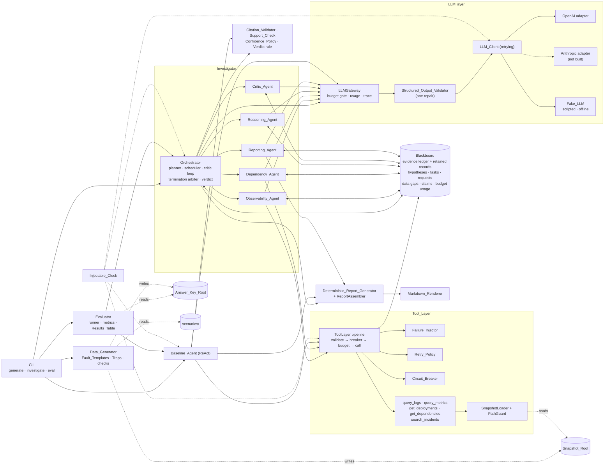

# Incident Investigator

A multi-agent system that investigates a past production incident from simulated logs, metrics, deploy history, service dependencies and past incidents. It finds the probable root cause, or reports "inconclusive" when the evidence is insufficient, and recommends fixes tied to evidence-backed hypotheses. A single-agent ReAct baseline with the same model, tools, budgets and data is the comparison.

Plain Python 3.11+, `asyncio` and Pydantic v2; no agent framework. The binding assumptions are in [ASSUMPTIONS.md](ASSUMPTIONS.md); the spec is in [.kiro/specs/incident-investigator/](.kiro/specs/incident-investigator/).

## Setup

Python 3.11 or later is required (development used 3.12.7).

```bash
python3 -m venv .venv && source .venv/bin/activate
pip install -e ".[dev]"
```

API keys come only from the environment and are never written to traces, reports or logs:

- `OPENAI_API_KEY` for the OpenAI adapter (`llm.provider = "openai"`), used for every real Run.
- `ANTHROPIC_API_KEY` for the Anthropic adapter. That adapter is not built (see Incomplete Functionality); `provider = "anthropic"` stops with an error. The variable is still redacted from outputs if it is set.

`.env` and `.env.*` are git-ignored. One way to load a key for a shell session is `set -a; source .env; set +a`.

### Commands

```bash
# 1. Generate the 12 scenario snapshots and answer keys (seed 42)
incident-investigator generate --seed 42 --config config.toml

# 2. Investigate one incident (bad-config-deploy is inc-e4c5349a46f3 for seed 42)
incident-investigator investigate --incident data/snapshots/inc-e4c5349a46f3 \
    --system multi --config config.toml --out runs/inc-e4c5349a46f3-multi
incident-investigator investigate --incident data/snapshots/inc-e4c5349a46f3 \
    --system baseline --config config.toml --out runs/inc-e4c5349a46f3-baseline

# 3. Evaluate both systems on all 12 scenarios, 3 Runs each
incident-investigator eval --config config.toml --runs 3 --out runs/eval

# 4. Run the test suite (fake LLM, no key, no network)
pytest
```

`investigate` writes `report.json`, `report.md`, `trace.json` and `ledger.json` to `--out`. `eval` also takes `--scenario NAME` (repeatable), `--system multi|baseline` and `--runs 1..10`, and writes `results.md`, `results.json` and one folder per Run under `<out>/runs/<scenario>/<system>/run-<k>/`. Exit status is 0 whenever the reports are written, whatever the Verdict.

`config.fake.toml` is the same configuration with `llm.provider = "fake"`: the rule-based offline responder needs no key and makes no network call. Its results are smoke results; they do not measure real LLM accuracy.

### Configuration

One TOML file holds every field. Unknown, missing or out-of-range fields are all reported by dotted path before any Run starts. Durations are in seconds; relative paths resolve against the config file's directory. `llm.provider` and `llm.model` have no default.

| Field | Range | Default |
|---|---|---|
| `seed` | integer | 42 |
| `llm.provider` | `openai`, `fake` (`anthropic` not built) | required |
| `llm.model` | non-empty | required (`gpt-5.4-mini` in `config.toml`) |
| `llm.request_timeout_s` | > 0 | 60 |
| `llm.max_attempts` | integer ≥ 1 | 3 |
| `llm.base_delay_s` | > 0 | 1.0 |
| `llm.max_delay_s` | ≥ `base_delay_s` | 20.0 |
| `tools.retry.max_attempts` | 1–10 | 3 |
| `tools.retry.base_delay_s` | 0.01–10 | 0.5 |
| `tools.retry.max_delay_s` | `base_delay_s`–60 | 8.0 |
| `tools.circuit_breaker.failure_threshold` | 1–20 | 3 |
| `tools.circuit_breaker.cooldown_s` | 0.1–600 | 30 |
| `tools.failure_injection.random_enabled` | boolean | true |
| `tools.failure_injection.timeout_p` | 0–1 (sum of the three ≤ 1) | 0.05 |
| `tools.failure_injection.partial_p` | 0–1 | 0.05 |
| `tools.failure_injection.stale_p` | 0–1 | 0.05 |
| `orchestrator.concurrency_limit` | 1–16 | 4 |
| `orchestrator.per_task_step_limit` | integer ≥ 2 | 6 |
| `orchestrator.per_task_timeout_s` | > 0 | 180 |
| `orchestrator.pre_incident_margin_s` | ≥ 0 | 3600 |
| `orchestrator.change_lookback_s` | > 0 | 604800 (7 days) |
| `orchestrator.max_initial_tasks_per_specialist` | integer ≥ 1 | 2 |
| `orchestrator.max_evidence_requests_per_round` | 1–10 | 4 |
| `budgets.critic_rounds` | 1–3 | 3 |
| `budgets.tool_calls` | integer ≥ 1 | 60 |
| `budgets.tokens` | integer ≥ 1 | 400000 |
| `budgets.wall_clock_timeout_s` | > 0 | 900 |
| `budgets.reporting_reserve_tokens` | 0 to `tokens` − 1 | 20000 |
| `policy.data_gap_penalty` | 0–1 | 0.05 |
| `policy.conclusive_threshold` | 0–1 | 0.6 |
| `report.max_recommended_actions` | integer ≥ 1 | 6 |
| `report.observation_summary_size` | 1–20 | 5 |
| `paths.snapshot_root` | path | `data/snapshots` |
| `paths.answer_key_root` | path, neither equal to nor inside the snapshot root | `data/answer_keys` |

### OpenAI adapter

`llm/openai.py` (`openai==3.35.1`) calls the Responses API for `gpt-5.4-mini`. The request shape follows the OpenAI documentation as checked in October 2026:

- Responses API rather than Chat Completions. The [model page](https://developers.openai.com/api/docs/models/gpt-5.4-mini) lists both, OpenAI's [model guidance](https://developers.openai.com/api/docs/guides/latest-model/) points reasoning workloads to Responses, and on Chat Completions `max_completion_tokens` with `reasoning_effort="none"` was [reported](https://community.openai.com/t/gpt-5-4-ignores-reasoning-effort-none-when-max-completion-tokens-is-used/1378362) to spend the cap on reasoning tokens.
- `reasoning.effort = "none"` and `temperature = 0.0` (accepted only while effort is `none`, [openai-python #3073](https://github.com/openai/openai-python/issues/3073)); `max_output_tokens` caps each call.
- JSON mode, then Pydantic validation with one repair prompt. `store = false`.
- Token counts come from `usage.input_tokens` and `usage.output_tokens`.

The SDK client runs with `max_retries=0`. `RetryingLLMClient` retries rate-limit, server and timeout errors on the injectable clock, up to `llm.max_attempts`, waiting `min(max_delay_s, base_delay_s · 2^(k-1))` before retry `k`.

## Architecture



### How the agents coordinate

- **Blackboard.** One shared state per Run: the evidence ledger, hypotheses and their revisions, tasks, Evidence_Requests, Data_Gaps, incident-report claim statuses and budget usage. Only the Tool_Layer appends evidence, and it does so from tool results, never from LLM text. Agents return structured outputs; the Orchestrator commits them after the Citation_Validator has removed any cited evidence ID that is not in the ledger. Only evidence IDs (`E0001`, …) count as evidence; every prompt says so, and board-backed prompts label finding (`F…`) and Data_Gap (`G…`) IDs distinctly. A claim that cites ledger evidence is a Fact; everything else is an Assumption.
- **Task_Graph.** The Orchestrator asks the LLM for a plan (1–2 Observability and 1–2 Dependency tasks, one Reasoning task that depends on all of them, one Critic task that depends on Reasoning, and one Reporting task). A plan that fails validation (cycle, duplicate ID, dangling dependency, wrong shape) is replaced by the Default_Task_Graph, with the cause in the trace.
- **Parallel dispatch.** An event-driven scheduler starts every ready task up to `concurrency_limit`. The Specialists run in parallel; Reasoning waits for all of them. Each attempt runs under `per_task_timeout_s`. A failed attempt is retried once; a second failure records a Data_Gap and the dependants still run.
- **Specialists.** The Observability_Agent (`query_logs`, `query_metrics`) and the Dependency_Agent (`get_deployments`, `get_dependencies`, `search_incidents`) start from code-issued opening requests, then run up to `per_task_step_limit` LLM steps, each one tool request or the findings. Tool errors come back as observations, never as agent failures.
- **Critic feedback loop.** The Reasoning_Agent ranks 2–5 competing hypotheses, each with supporting and contradicting evidence IDs. The Critic_Agent either accepts the rank-1 hypothesis or files up to 4 targeted Evidence_Requests (target Specialist, hypothesis, concern, suggested tool and parameters). It may not accept a hypothesis backed only by past incidents or only by partial or stale evidence. Each request becomes a new Specialist task, followed by a new Reasoning task that revises the hypotheses, then the next Critic round. Requests that repeat earlier work are discarded as duplicates.
- **Tool reliability.** The Failure_Injector injects timeouts, partial results and stale data deterministically from the seed. Timeouts are retried with jittered exponential backoff; a per-tool circuit breaker opens after 3 consecutive timeouts and admits one trial call after the cooldown. A request that finally fails becomes a Data_Gap, which lowers every hypothesis's confidence by `data_gap_penalty`. It never aborts the Run.
- **Budgets.** Per Run: at most 3 Critic rounds, 60 tool calls (each retry counts), 400,000 tokens (the last 20,000 reserved for the Reporting_Agent) and 900 s of wall-clock time. All waits use the injectable clock, so tests never sleep.
- **Termination.** The loop ends with exactly one Termination_Reason. When several hold at the same check, the first in this list wins:
  - `critic_accepted`: the Critic accepts the rank-1 hypothesis.
  - `max_critic_rounds`: the Critic files requests in the last allowed round; they are reported as missing evidence.
  - `duplicate_requests_only`: every request in an earlier round was a duplicate.
  - `tool_call_budget_exhausted`: the Tool_Layer rejected a request because the tool-call budget was spent.
  - `token_budget_exhausted`: token usage reached the budget minus the reporting reserve.
  - `wall_clock_timeout`: the watchdog fired; every task is cancelled and the deterministic report is written with no further LLM call.
  - `critic_failed`: the Critic task failed twice.
  - `no_hypotheses`: no hypothesis existed when the Critic would have run.
  - Baseline only: `final_answer` (a validated final answer) and `baseline_failed` (a step failed twice). The baseline can also end with `tool_call_budget_exhausted`, `token_budget_exhausted` or `wall_clock_timeout`.
- **Verdict and report.** The Verdict is conclusive only if the Critic accepted the rank-1 hypothesis (or, for the baseline, its final answer declares conclusive), the adjusted rank-1 confidence is at least `conclusive_threshold`, and rank 1 cites at least one complete, current (non-past-incident) evidence item. Otherwise it is inconclusive. The Reporting_Agent writes the recommended actions; when it fails, its reserve is short or the clock ran out, the Deterministic_Report_Generator builds the report instead. Both copy the Orchestrator's Verdict unchanged.
- **Baseline parity.** The Baseline_Agent is one ReAct loop over all five tools. It uses the same Tool_Layer, budgets, Citation_Validator, Confidence_Policy and report model. Before its first step it issues the same opening tool requests the Specialists make (`agents/opening.py`), counted against its budget. Its prompt carries the same investigation checklist as the Specialist and Reasoning prompts, plus one baseline-only rule: while tool calls remain, query the evidence it would list as missing before declaring inconclusive.

## Dataset

Generated data is not committed. It is reproduced byte for byte from `scenarios/` and one seed:

- Seed: `42`
- Command: `incident-investigator generate --seed 42 --config config.toml`

This writes one snapshot directory per scenario under `data/snapshots/` and one answer key per scenario under `data/answer_keys/`. Only the `evaluation` package reads the answer keys. Each key carries a canary token, and the tests check that it never reaches a prompt, tool result, state, trace or report.

Each incident has 8–15 services, 2–24 h of telemetry and 7–30 days of change history, plus noise and coincidental red herrings. Every scenario's generated data is checked against its catalogue condition before anything is written.

| Scenario | Root cause type | Trap or difficulty |
|---|---|---|
| bad-config-deploy | `config_error` on the affected service | none |
| database-failover | `database_failover` on the primary database | unrelated deploy 5 min before onset |
| third-party-api-outage | `third_party_outage` | noisy alerts, no changes in the window |
| slow-memory-leak | `memory_leak` upstream | innocent config change near onset; the real change is ≥ 48 h old |
| expired-tls-certificate | `certificate_expiry` upstream | noisy alerts, no deploys on the path |
| cache-stampede | `cache_stampede` | traffic spike |
| load-balancer-misconfiguration | `load_balancer_misconfiguration` | two monitors disagree |
| disk-full | `disk_full` on the primary database | look-alike past incident |
| logs-timeout | `connection_pool_exhaustion` | `query_logs` always times out |
| insufficient-evidence | none: only "inconclusive" is correct | unrelated deploy near onset |
| feature-flag-rollout | `feature_flag_regression` | errors only in one cohort |
| cascading-failure | `resource_exhaustion` upstream | the loudest service is a victim |

## Evaluation

Scoring uses the answer key's structured fields only (no LLM judge). Top-1 counts a Run as correct when the Verdict is conclusive and the rank-1 hypothesis matches the key's component and cause type, or when the key marks the evidence insufficient and the Verdict is inconclusive. An inconclusive Verdict with the right rank-1 hypothesis scores 0 and counts as over-cautious. Ranking hit@3 ignores the Verdict.

### Run

- Command: `incident-investigator eval --config config.toml --out runs/eval-full --runs 3`. The two Results_Tables were then copied from `runs/eval-full/` (git-ignored) to [`results/`](results/).
- Provider and model: OpenAI `gpt-5.4-mini`. Seed: `42`. Date: 2026-10-20.
- Code: commit `f9163c069a24a647cb76a3e9ffc924390518cbf8`. The first evaluation (v1, commit `625913d`) is kept in git at tag `v1-submittable`.
- 12 scenarios × 2 systems × 3 Runs = 72 Runs: 0 failed, 0 isolation violations, 0 LLM retries, 0 output files containing the API key. There were 32 repair prompts (26 multi-agent, 6 baseline) and 3 agent failures, all first attempts that their retry recovered.
- Multi-agent Runs ended with `critic_accepted` 28 times, `max_critic_rounds` 5 and `duplicate_requests_only` 3, after 1.7 Critic rounds on average. Every baseline Run ended with `final_answer`.
- Wall time 20 min 18 s. About $3.54 at list price ($0.75 per 1M input tokens and $4.50 per 1M output tokens, no cached-input discount): $2.52 multi-agent, $1.02 baseline.

### Changes since v1

- **Baseline:** a baseline-only rule (not part of the shared checklist): while tool calls remain, request the evidence you would list as missing before declaring inconclusive. In v1 the baseline answered on step 1 in all 36 Runs.
- **Every prompt:** only evidence IDs (`E…`) may be cited as evidence. Board-backed prompts now label finding (`F…`) and Data_Gap (`G…`) IDs distinctly. In v1, 249 of the 254 removed citations were finding or gap IDs in evidence fields. This changed the multi-agent prompts too.
- **Req 12.4:** mitigation, fix and prevention actions are now checked on the evidence IDs that survive citation validation. Neither evaluation had an action left without evidence, so this fix does not affect the numbers.

### Results

Mean ± sample standard deviation over 36 Runs per system ([full table](results/results.md)), with v1 for comparison:

| Metric | Multi-agent | Baseline | Multi-agent v1 | Baseline v1 |
|---|---|---|---|---|
| Top-1 accuracy | 0.47 ± 0.51 | 0.47 ± 0.51 | 0.42 | 0.14 |
| Top-3 accuracy | 0.58 ± 0.50 | 0.53 ± 0.51 | 0.50 | 0.14 |
| Ranking hit@3 (diagnostic) | 0.70 ± 0.47 | 0.73 ± 0.45 | 0.73 | 0.64 |
| Over-cautious rate (diagnostic) | 0.03 ± 0.17 | 0.06 ± 0.23 | 0.08 | 0.36 |
| Over-confident rate (diagnostic) | 0.33 ± 0.48 | 0.14 ± 0.35 | 0.28 | 0.00 |
| Citation precision | 0.81 ± 0.09 | 0.89 ± 0.09 | 0.80 | 0.86 |
| Key evidence recall | 0.42 ± 0.35 | 0.47 ± 0.32 | 0.48 | 0.25 |
| Tool calls | 7.6 ± 3.0 | 5.7 ± 1.1 | 9.6 | 4.3 |
| Latency (s) | 24.8 ± 8.2 | 9.0 ± 3.0 | 27.5 | 7.0 |
| Total tokens | 63,911 ± 28,645 | 29,682 ± 12,751 | 82,743 | 11,405 |
| Baseline steps per Run | – | 2.5 | – | 1.0 |
| Removed citations (all 36 Runs) | 1 | 0 | 268 | 0 |
| Cost (all 36 Runs) | $2.52 | $1.02 | $3.19 | $0.51 |

Correct Runs out of 3 per scenario, with v1 in parentheses for top-1, and mean total tokens per Run:

| Scenario | Multi top-1 | Baseline top-1 | Multi top-3 | Baseline top-3 | Multi tokens | Baseline tokens |
|---|---|---|---|---|---|---|
| bad-config-deploy | 2/3 (2/3) | 2/3 (2/3) | 3/3 | 2/3 | 27,846 | 17,086 |
| cache-stampede | 0/3 (0/3) | 0/3 (0/3) | 0/3 | 0/3 | 63,252 | 29,356 |
| cascading-failure | 1/3 (0/3) | 1/3 (0/3) | 2/3 | 2/3 | 82,317 | 32,503 |
| database-failover | 3/3 (3/3) | 3/3 (0/3) | 3/3 | 3/3 | 46,293 | 27,854 |
| disk-full | 3/3 (3/3) | 2/3 (0/3) | 3/3 | 2/3 | 47,827 | 29,358 |
| expired-tls-certificate | 3/3 (3/3) | 3/3 (0/3) | 3/3 | 3/3 | 37,136 | 17,804 |
| feature-flag-rollout | 3/3 (1/3) | 3/3 (0/3) | 3/3 | 3/3 | 46,255 | 32,589 |
| insufficient-evidence | 1/3 (2/3) | 3/3 (3/3) | 1/3 | 3/3 | 58,881 | 18,629 |
| load-balancer-misconfiguration | 1/3 (1/3) | 0/3 (0/3) | 1/3 | 0/3 | 63,609 | 45,663 |
| logs-timeout | 0/3 (0/3) | 0/3 (0/3) | 0/3 | 0/3 | 108,715 | 40,814 |
| slow-memory-leak | 0/3 (0/3) | 0/3 (0/3) | 1/3 | 1/3 | 77,466 | 34,462 |
| third-party-api-outage | 0/3 (0/3) | 0/3 (0/3) | 1/3 | 0/3 | 107,333 | 30,063 |
| **All** | **17/36 (15/36)** | **17/36 (5/36)** | **21/36** | **19/36** | **63,911** | **29,682** |

### Reading the results

- **Top-1 is now a tie, 17/36 each.** The baseline went from 5 to 17 correct Runs because it now investigates before answering. It took 2.5 steps per Run on average, and only 6 of 36 Runs answered at step 1; 4 of those were still inconclusive despite the rule. It also commits far more often: 19 declared-conclusive answers against 2 in v1, and the over-cautious rate fell from 0.36 to 0.06. It now matches the multi-agent system on database-failover, expired-tls-certificate and feature-flag-rollout (3/3 each).
- **Where the multi-agent system still wins.** Only by small margins: disk-full (3/3 against 2/3), load-balancer-misconfiguration (1/3 against 0/3) and top-3 overall (21 against 19). No scenario favours it by more than one Run.
- **Where the baseline wins.** insufficient-evidence (3/3 against 1/3), where the multi-agent system twice blamed the unrelated deploy near onset. The baseline also cites more precisely (0.89 against 0.81) and finds more key evidence (recall 0.47 against 0.42).
- **Confident wrong calls.** The multi-agent system made 12, the baseline 5. The Critic accepted wrong hypotheses on cache-stampede (3/3: a dependency timeout elsewhere twice, a cache stampede on the wrong component once), slow-memory-leak (3/3: the right component with `dependency_timeout` or `resource_exhaustion`), third-party-api-outage (2/3: a dependent service blamed), insufficient-evidence (2/3), bad-config-deploy and cascading-failure (1 each). The baseline's 5 were slow-memory-leak 3, cache-stampede 1 and cascading-failure 1. Neither system ranks `memory_leak` first, and neither ranks the logs-timeout cause in its top 3.
- **Citation IDs.** Removed citations in multi-agent Runs fell from 268 to 1 once every prompt said only `E…` IDs are evidence and the board prompts labelled finding and gap IDs.
- **Cost.** The multi-agent system used 2.2× the tokens (63.9k against 29.7k per Run), 2.7× the latency (24.8 s against 9.0 s) and 1.3× the tool calls: about $0.15 per correct top-1 Run against $0.06. The baseline's own tokens rose 2.6× from v1 as it took more steps. The multi-agent system's fell 23%, with fewer duplicate-request rounds.
- **Bottom line and caveats.** On this dataset and model, given the same openings, guidance and budgets, the multi-agent architecture does not beat a single ReAct agent on accuracy. It costs about twice as much and is more often confidently wrong. One seed and 3 Runs per scenario give a top-1 spread of 0.51, and the multi-agent prompts changed between v1 and v2 too, so its v1-to-v2 change mixes the prompt change with Run-to-Run noise.

## Incomplete Functionality

`requirements.md` is the target spec; `tasks.md` implements an agreed reduced scope. Every criterion below is not satisfied or only partly satisfied.

### Scope cuts

- **Req 5.1, 5.2 (Anthropic part):** the Anthropic adapter is not built (optional task 7.9). `provider = "anthropic"` stops with a clear error; only OpenAI and the fake provider work.
- **Req 30.3:** of the 20 criteria labelled as properties, only 4.8 (Property 13) and 14.2 (Property 33) have property-based tests, plus Property 6 for Req 3.8. These have example tests at most: 2.5, 3.10, 6.6, 6.9, 7.3, 10.3, 13.10, 14.8, 17.5, 18.10, 21.3, 21.4, 21.8, 22.4, 22.6, 22.14, 24.6 and 27.9. 62 of the 65 design properties are unwritten.
- **Req 30.2:** core-behaviour tests only; the per-criterion traceability test for Req 4, 6, 7, 13, 14, 15 and 27.1–27.5/27.13–27.17 is not written.
- **Req 14.8:** the failure-type distribution holds by construction (one hash value mapped onto cumulative probabilities) but is not tested.
- **Req 21.8:** `report.json` and `report.md` are written from the same model, but the byte-sync property is not tested.
- **Req 24.3, 24.10:** basic path hardening only. Paths are resolved (including `..` and symlinks) and checked before reading, and overlapping roots are rejected; there is no descriptor-based open against a resolve-then-read race, and Properties 55 and 56 are unwritten.
- **Req 29.1, 29.2 (bounds):** every bound is enforced by Pydantic, but only these are tested: unknown and missing fields, `concurrency_limit` above 16, `critic_rounds` above 3, `reporting_reserve_tokens` ≥ `tokens`, the probability sum, the retry delay order and overlapping roots. The other per-field bounds in the Setup table are untested.

### Partly satisfied criteria

- **Req 1.1:** `start_time` also accepts a numeric string such as `"1700000000"`, which Pydantic parses as epoch seconds; naive timestamps are rejected.
- **Req 7.6, 29.2 (types):** integer and float config fields use Pydantic's lax mode, so `4.0`, `true` or `"4"` are coerced instead of rejected as the wrong type.
- **Req 5.12:** the scripted Fake_LLM used by tests raises an error naming the caller when its script runs out. `provider = "fake"` uses the rule-based offline responder instead; its unreachable no-rule error names the call kind, not the caller.
- **Req 13.4:** `query_metrics` returns one bucket per non-empty step (as in the design); steps with no points are omitted.
- **Req 21.5, 21.6:** `report.writer.load_report` gives the line-and-column and field-path errors, but no CLI command loads a report file.
- **Req 28.5:** argparse errors print usage and exit 2. Checks after parsing (snapshot path, `--out` inside the snapshot root, unknown scenario, unreadable config) print an error naming the argument and exit 1, without the usage text.
- **Req 31.2:** the Mermaid block is not machine-checked for syntax (that needs a Mermaid CLI).
- **Req 31.12:** the fresh-clone install, `generate` and `pytest` check has not been run with Python 3.11.

### Implemented but not covered by a test

Req 1.3 (unreadable or malformed incident report), 1.5 (Reasoning claim coverage), 2.3, 2.4 (missing or invalid snapshot), 3.4 (partial and stale together), 5.4 (empty LLM output), 10.2, 11.3–11.6, 11.16, 11.17 (Critic acceptance and request rules), 12.1, 12.3, 20.2 (contributing factors), 21.3 (only headings, IDs, Verdict and reason are checked) and 22.13, 22.17 (generic-check failure paths).

### Optional tasks not done

1.12 (Properties 1, 47, 64), 5.6 (Properties 9, 30–32, 34, 35, 38, 39, 41), 5.7 (Property 36), 5.11 (Properties 37, 50–54), 6.10 (Properties 5, 7, 8, 10–12, 14, 18, 19, 27, 28, 43–45), 7.9 (Anthropic adapter), 7.10 (agent and LLM-layer tests, Properties 15, 16, 20–26), 8.7 (Properties 58–63), 9.8 (Properties 2–4, 17, 29, 40, 42, 46, 48, 57, 65 and the Req 30.2 traceability test) and 9.9 (Properties 49, 55, 56).

### Unfinished tasks and deliverables

- **Req 31.10:** no shortfall. The committed Results_Table covers all 12 scenarios with 3 Runs per system, all with the real LLM and none failed.
- **Task 12.1:** the offline smoke Results_Table (`config.fake.toml`) is not committed. The offline eval path is covered by `tests/e2e/test_eval_cli.py`.
- **Task 12.4, Req 31.7:** the coding-assistant transcript must be exported from the IDE by the user into `transcripts/`; the assistant cannot export its own session.

## External Dependencies

- **LLM API key.** Real Runs need one OpenAI API key in `OPENAI_API_KEY` (model `gpt-5.4-mini`). The Anthropic adapter is not built, so `ANTHROPIC_API_KEY` is not used for Runs.
- **No key for tests or offline runs.** `pytest` and every Run with `provider = "fake"` need no API key and open no network connection.
- **Pinned packages** (`pyproject.toml`):
  - runtime: `pydantic==2.14.1`, `openai==3.35.1`
  - dev: `pytest==9.1.1`, `pytest-asyncio==1.4.0`, `hypothesis==6.170.5`
  - build: `setuptools==84.2.0`

## Deliverables

| Deliverable | Path |
|---|---|
| Coding-assistant transcript | [`transcripts/`](transcripts/) |
| Markdown Results_Table | [`results/results.md`](results/results.md) |
| JSON Results_Table | [`results/results.json`](results/results.json) |
| Sample per-Run reports | [`results/samples/`](results/samples/) |
| Scenario catalogue | [`scenarios/`](scenarios/) |
| Test suite | [`tests/`](tests/) |
| Technical note | [`TECHNICAL_NOTE.md`](TECHNICAL_NOTE.md) |
| Assumptions | [`ASSUMPTIONS.md`](ASSUMPTIONS.md) |
| Spec (requirements, design, tasks) | [`.kiro/specs/incident-investigator/`](.kiro/specs/incident-investigator/) |
| Configurations | [`config.toml`](config.toml), [`config.fake.toml`](config.fake.toml) |
