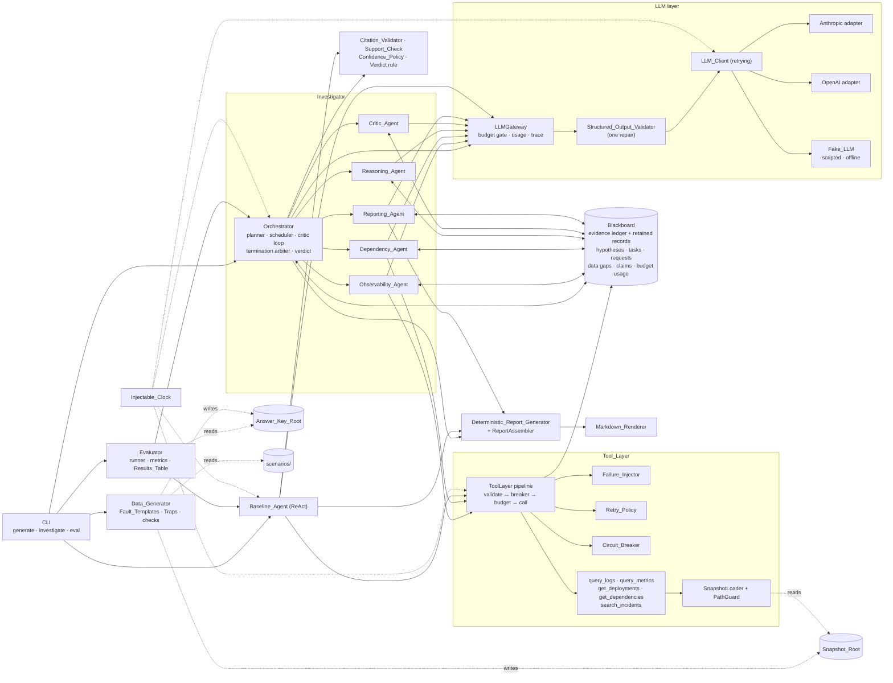

# Kiro session `sess_b5a210e7-afde-4bea-a1a0-0f710553e1fe` — Task 8: eval baseline

Created 2026-10-20 18:38:42 UTC, last modified 2026-10-20 19:23:50 UTC. Model: claude-opus-5.5. Workstream D: ReAct baseline, evaluator, eval CLI (task 8).

## User — 2026-10-20 18:39:01 UTC

You are in the worktree ~/projects/ii-eval-baseline on branch ws/eval-baseline. First run git branch --show-current and confirm it prints ws/eval-baseline; stop if it doesn't. Implement task 8 from .kiro/specs/incident-investigator/tasks.md on branch ws/eval-baseline. Read the steering files and the spec first. Use only this worktree's .venv. Never open .env, and make no real LLM calls (FakeLLM only). Run the full test suite before finishing. Commit only on ws/eval-baseline, and do not merge or switch branches. Finish with a summary: commits, test count, and any deviations from the spec.

<details><summary>Kiro reasoning</summary>

I'll check the current branch by running git branch --show-current in the ~/projects/ii-eval-baseline worktree. Since that path sits outside the main workspace root, I'll need to use bash with the explicit cwd set to that directory, though absolute paths should still work for file tools.


</details>

**Tool call:** `execute_bash` — Confirm current branch in worktree

```
git branch --show-current
```  (cwd: `/Users/saurabh/projects/ii-eval-baseline`)

<details><summary>Tool result (ok)</summary>

```
Output:
ws/eval-baseline

Exit Code: 0
```

</details>

**Tool call:** `update_session_information` — Update Session Information

```
{
 "title": "Task 8: eval baseline",
 "description": "Branch confirmed as ws/eval-baseline. Reading steering files and the spec before implementing task 8."
}
```

<details><summary>Tool result (ok)</summary>

```
Session information updated.
```

</details>

**Tool call:** `execute_bash` — Inspect worktree layout, status, and recent history

```
git status --short && git log --oneline -15 && ls -la && ls -la .kiro .kiro/* && git worktree list
```  (cwd: `/Users/saurabh/projects/ii-eval-baseline`)

<details><summary>Tool result (ok)</summary>

```
Output:
dcfcf0f (HEAD -> ws/eval-baseline, ws/tools-data, ws/tests, ws/orchestrator-state, ws/agents, main) Do not commit generated data; record the seed and generate command; per-worktree venvs
1017f59 Task 3: thin end-to-end slice on the fake LLM
2a03820 Broaden CauseType into a general taxonomy (21 values)
3011b1e Task 1: shared models, config loader, clock, interfaces and test harness
359f63b Project skeleton: gitignore, pinned packaging, configs, spec and steering
drwxr-xr-x@    - saurabh 21 Oct 00:03  .kiro
drwxr-xr-x@    - saurabh 21 Oct 00:04  .venv
drwxr-xr-x@    - saurabh 21 Oct 00:03  data
drwxr-xr-x@    - saurabh 21 Oct 00:03  results
drwxr-xr-x@    - saurabh 21 Oct 00:03  scenarios
drwxr-xr-x@    - saurabh 21 Oct 00:04 󰣞 src
drwxr-xr-x@    - saurabh 21 Oct 00:04  tests
drwxr-xr-x@    - saurabh 21 Oct 00:03  transcripts
.rw-r--r--@   86 saurabh 21 Oct 00:03 󰊢 .git
.rw-r--r--@  372 saurabh 21 Oct 00:03 󰊢 .gitignore
.rw-r--r--@ 2.4k saurabh 21 Oct 00:03  ASSUMPTIONS.md
.rw-r--r--@ 1.2k saurabh 21 Oct 00:03  config.fake.toml
.rw-r--r--@ 1.1k saurabh 21 Oct 00:03  config.toml
.rw-r--r--@  823 saurabh 21 Oct 00:03  pyproject.toml
.rw-r--r--@ 1.1k saurabh 21 Oct 00:03 󰂺 README.md
.kiro:
drwxr-xr-x@ - saurabh 21 Oct 00:03  specs
drwxr-xr-x@ - saurabh 21 Oct 00:03  steering
.kiro/specs:
drwxr-xr-x@ - saurabh 21 Oct 00:03  incident-investigator
.kiro/steering:
.rw-r--r--@ 2.1k saurabh 21 Oct 00:03  product.md
.rw-r--r--@ 3.4k saurabh 21 Oct 00:03  structure.md
.rw-r--r--@ 3.8k saurabh 21 Oct 00:03  tech.md
/Users/saurabh/projects/incident-investigator  dcfcf0f [main]
/Users/saurabh/projects/ii-agents              dcfcf0f [ws/agents]
/Users/saurabh/projects/ii-eval-baseline       dcfcf0f [ws/eval-baseline]
/Users/saurabh/projects/ii-orchestrator-state  dcfcf0f [ws/orchestrator-state]
/Users/saurabh/projects/ii-tests               dcfcf0f [ws/tests]
/Users/saurabh/projects/ii-tools-data          dcfcf0f [ws/tools-data]

Exit Code: 0
```

</details>

<details><summary>Kiro reasoning</summary>

Good, no .env file showing up in the worktree listing. Now I'll move on to reading the steering docs and spec.


</details>

**Tool call:** `read_file` — Read File

```
{
 "path": "/Users/saurabh/projects/ii-eval-baseline/.kiro/steering/product.md",
 "offset": null,
 "limit": null
}
```

<details><summary>Tool result (ok)</summary>

```
<file name="/Users/saurabh/projects/ii-eval-baseline/.kiro/steering/product.md" language="markdown" >
<content>
# Product

## Goal

A multi-agent system that investigates a past production incident from simulated logs, metrics, deploy history, service dependencies and past incidents. It finds the probable root cause, or honestly reports "inconclusive", and recommends evidence-backed fixes. It is compared against a single-agent ReAct baseline that uses the same model, tools, budgets and data.

## Users

- Assignment reviewers assessing the architecture, reliability and evaluation.
- SREs reading the generated incident reports.

## What is assessed

- Genuine agent collaboration: one shared evidence board, Critic-driven evidence requests back to specialists, hypotheses revised as evidence arrives. Chained prompts are not enough.
- Orchestration and reliability: parallel independent tasks, task dependencies, bounded retries, circuit breaker, execution limits, termination conditions, recovery from tool and agent failures.
- Evidence-based conclusions: ranked hypotheses with supporting and contradicting evidence IDs, confidence, facts vs assumptions, data gaps, and actions tied to hypotheses. "Inconclusive" when evidence is insufficient.
- Honest evaluation: 12 synthetic scenarios with traps, an answer key only the evaluator reads, and metrics for accuracy (top-1/top-3), evidence grounding, tool calls, latency and tokens, 3 runs per incident.
- No hardcoded answers for any scenario.

## Assumptions summary

- Post-incident, read-only analysis of a fixed synthetic snapshot; the incident report is a set of claims to verify.
- 8–15 services per incident; telemetry covers 2–24 hours and change history reaches back 7–30 days; one primary root cause; misleading data is coincidental, never adversarial.
- All six agents are built. Facts are tool outputs; everything else is an assumption.
- Tool failures are seeded and deterministic; a permanently failed tool becomes a data gap and never aborts the run.
- CLI only (JSON + Markdown). Real runs need one LLM API key; tests use a fake LLM.

The full, binding list:

#[[file:ASSUMPTIONS.md]]

</content>
</file>
```

</details>

**Tool call:** `read_file` — Read File

```
{
 "path": "/Users/saurabh/projects/ii-eval-baseline/.kiro/steering/structure.md",
 "offset": null,
 "limit": null
}
```

<details><summary>Tool result (ok)</summary>

````
<file name="/Users/saurabh/projects/ii-eval-baseline/.kiro/steering/structure.md" language="markdown" >
<content>
# Structure

## Proposed layout

```
incident-investigator/
├── pyproject.toml            # pinned deps, console script `incident-investigator`
├── config.toml               # example config (provider, model, budgets, seed)
├── README.md                 # setup, Mermaid diagram, coordination, deps, incomplete items
├── ASSUMPTIONS.md
├── TECHNICAL_NOTE.md         # ≤500 words
├── src/incident_investigator/
│   ├── models/               # shared Pydantic models: incident, evidence, hypothesis,
│   │                         # tasks, gaps, budgets, tool I/O, report, config
│   ├── llm/                  # LLMClient interface, anthropic.py, openai.py, fake.py,
│   │                         # structured output + repair retry
│   ├── tools/                # five tools, snapshot loader, failure injector,
│   │                         # retry/backoff, circuit breaker
│   ├── state/                # blackboard, budgets, citation validator, confidence policy
│   ├── orchestrator/         # task graph, scheduler, critic loop, termination, verdict
│   ├── agents/               # observability, dependency, reasoning, critic, reporting + prompts
│   ├── baseline/             # single-agent ReAct loop
│   ├── report/               # JSON + Markdown rendering, deterministic report generator
│   ├── datagen/              # scenario spec schema, fault templates, generator
│   ├── evaluation/           # ONLY place that loads answer keys; runner, metrics, results table
│   └── cli.py                # generate / investigate / eval
├── scenarios/                # scenario specs (generator input; outside snapshot root)
├── data/
│   ├── snapshots/<incident_id>/   # snapshot root: tool-readable data + failure profile
│   └── answer_keys/<incident_id>.json   # answer-key root: evaluator only
├── results/                  # evaluation results table + per-run reports and traces
├── transcripts/              # coding assistant transcript
└── tests/                    # pytest, fake LLM only
```

Dependency direction: `models` ← everything; `evaluation` may import anything; nothing imports `evaluation` except `cli`.

## Work split and branching

1. **Shared foundation first, on `main`:** `models/`, the `LLMClient` and tool interfaces, the fake LLM skeleton and project packaging. Interfaces change only through `main`.
2. **Then parallel workstreams, each on its own branch and worktree** (`git worktree add ../ii-<name> -b ws/<name>`). Each worktree gets its own `.venv` with `pip install -e ".[dev]"` of that worktree; never reuse the main folder's `.venv`, whose editable install points at the main folder's `src`. Workstreams:
   - `ws/tools-data`: tools, failure injection, retry, circuit breaker, data generator and scenarios;
   - `ws/orchestrator-state`: blackboard, task graph, scheduler, critic loop, budgets, termination;
   - `ws/agents`: the six agents and promp
… [truncated: 302 more characters]
````

</details>

**Tool call:** `read_file` — Read File

```
{
 "path": "/Users/saurabh/projects/ii-eval-baseline/.kiro/steering/tech.md",
 "offset": null,
 "limit": null
}
```

<details><summary>Tool result (ok)</summary>

```
<file name="/Users/saurabh/projects/ii-eval-baseline/.kiro/steering/tech.md" language="markdown" >
<content>
# Tech

## Stack

- Python 3.11+, `asyncio` for concurrency, Pydantic v2 for every model crossing a boundary.
- No agent framework (no LangChain, LangGraph, CrewAI, AutoGen, etc.). The orchestration logic is what is assessed, so write it directly.
- Prefer the standard library: `argparse` for the CLI, `tomllib` for config, `json` for data files.
- Tests: `pytest`, `pytest-asyncio`; `hypothesis` for property-based tests (do not confuse with the `Hypothesis` domain model).
- Pin every dependency to an exact version (`==`) in `pyproject.toml`. Choose versions at implementation time and keep the README dependency list in sync.

## LLM access

- One provider-agnostic `LLMClient` interface. Provider and model are set in config.
- Delivery provider: OpenAI, model `gpt-5.4-mini`. The OpenAI adapter and `FakeLLM` are required; the Anthropic adapter is optional and, if skipped, is listed under README "Incomplete Functionality".
- `FakeLLM` returns scripted, deterministic responses with synthetic usage data and records every prompt. All automated tests use it; no network, no API key.
- The API key comes only from `OPENAI_API_KEY` (and `ANTHROPIC_API_KEY` if that adapter is built) and is never written to traces, reports or logs. `.env` and `.env.*` are git-ignored from the first commit.
- Token counts come from provider usage data.
- Tool-using prompts (Observability, Dependency, Baseline) ask for `limit` ≤ 25 and the Tool's filters on every Tool_Request, to keep token use down.

## Implementation scope

`requirements.md` and `design.md` are the target spec; `tasks.md` implements a reduced scope. Every criterion not implemented is listed by number in README "Incomplete Functionality" (Req 31.4). Property tests in scope: Blackboard concurrent appends, Failure_Injector determinism and Citation_Validator idempotence, each at 25 examples (`derandomize=True`, `database=None`). All other properties are optional, lower-priority tasks.

## Structured outputs

- Every agent output is a Pydantic model. Validate it; if invalid, retry once with a repair prompt containing the validation errors. A second failure is an agent failure (retried once at the task level, then recorded as a data gap).
- Evidence items are created by the tool layer from tool results, never by the LLM. Uncited claims are labelled assumptions automatically.

## Answer-key isolation (hard rule)

- Scenario specs live in `scenarios/`, answer keys under the Answer_Key_Root (`data/answer_keys/`), and tool-readable snapshots under the Snapshot_Root (`data/snapshots/`). Neither `scenarios/` nor the Answer_Key_Root may be inside the Snapshot_Root. Only `datagen` reads scenario specs; only `evaluation` reads answer keys.
- Only the `evaluation` package may load answer keys. Agents, tools, the orchestrator and the baseline must not import it or receive its paths.
- Each answer key carries a canary tok
… [truncated: 949 more characters]
```

</details>

**Tool call:** `execute_bash` — List spec files and their sizes

```
ls -la .kiro/specs/incident-investigator && wc -l .kiro/specs/incident-investigator/*
```  (cwd: `/Users/saurabh/projects/ii-eval-baseline`)

<details><summary>Tool result (ok)</summary>

```
Output:
.rw-r--r--@  112 saurabh 21 Oct 00:03  .config.kiro
.rw-r--r--@ 133k saurabh 21 Oct 00:03  design.md
.rw-r--r--@ 122k saurabh 21 Oct 00:03  requirements.md
.rw-r--r--@  52k saurabh 21 Oct 00:03  tasks.md
    2023 .kiro/specs/incident-investigator/design.md
     630 .kiro/specs/incident-investigator/requirements.md
     450 .kiro/specs/incident-investigator/tasks.md
    3103 total

Exit Code: 0
```

</details>

**Tool call:** `read_file` — Read File

```
{
 "path": "/Users/saurabh/projects/ii-eval-baseline/.kiro/specs/incident-investigator/tasks.md",
 "offset": null,
 "limit": null
}
```

<details><summary>Tool result (ok)</summary>

```
Note: This file content was truncated to fit the available context.

<file name="/Users/saurabh/projects/ii-eval-baseline/.kiro/specs/incident-investigator/tasks.md" language="markdown"  truncated="true">
<content>
# Implementation Plan: Incident Investigator

## Overview

`requirements.md` and `design.md` are the target spec. This task list implements the reduced delivery scope agreed with the user. Every acceptance criterion that is not implemented, and every optional task (`*`) that is not done, must be listed by number in the README "Incomplete Functionality" section (Req 31.4).

Scope rules that apply to every task:

- **Property tests:** only Property 6 (Blackboard concurrent appends), Property 33 (Failure_Injector determinism) and Property 13 (Citation_Validator idempotence) are required. They run with the `ci` Hypothesis profile: `max_examples=25`, `derandomize=True`, `database=None`, `deadline=None`. Every other design property is an optional, lower-priority task. Properties 36, 49, 55 and 56 are the lowest priority.
- **Req 30.2 coverage:** core-behaviour tests only (tools and failures, retry and breaker, task graph and parallel dispatch, every Termination_Reason, the inconclusive path, the Citation_Validator, scoring rules, canary isolation). The per-criterion traceability test is optional.
- **Path hardening (Req 24.3, 24.10):** a basic check only. Resolve paths, reject snapshot paths outside the Snapshot_Root, and reject overlapping roots.
- **CLI and config:** Pydantic validation with clear errors that name each field. Not every numeric bound needs its own test.
- **Clock:** a simple FakeClock. Tests never wait on the real clock; a conftest guard fails any real non-zero sleep.
- **LLM provider:** OpenAI, model `gpt-5.4-mini`, key only from `OPENAI_API_KEY`. The OpenAI adapter and the FakeLLM are required. The Anthropic adapter is optional.
- **Token discipline:** tool-using prompts (Observability, Dependency, Baseline) request `limit` ≤ 25 and use the Tool's filters. Code-issued opening requests use `limit=25`.

Work order: Phase 1 and Phase 2 run on `main`. Phase 3 runs as parallel workstreams, each on its own branch and worktree (`git worktree add ../ii-<name> -b ws/<name>`). Phase 4 merges a branch only when its tests pass, rebased on the latest `main`. Phase 5 runs the evaluation.

Each worktree has its own `.venv` with an editable install of that worktree (`python3 -m venv .venv && .venv/bin/pip install -e ".[dev]"`). Never run a worktree's tests with the main folder's `.venv`: its editable install points at the main folder's `src` and would silently test `main`'s code. Generated snapshots and answer keys are never committed; the README records the seed and the exact `generate` command (Req 31.5).

## Tasks

### Phase 1: Shared models and interfaces (`main`)

- [x] 1. Shared models, interfaces and test harness
  - [x] 1.1 Create the repository skeleton and first commit
    - Create `.gitignore` with `.env`, `.env.*`, `.venv/`, 
… [truncated: 27,310 more characters]
```

</details>

**Tool call:** `read_file` — Read File

```
{
 "path": "/Users/saurabh/projects/ii-eval-baseline/ASSUMPTIONS.md",
 "offset": null,
 "limit": null
}
```

<details><summary>Tool result (ok)</summary>

```
<file name="/Users/saurabh/projects/ii-eval-baseline/ASSUMPTIONS.md" language="markdown" >
<content>
# Assumptions

These assumptions are binding. Keep them true as the implementation evolves.

## Incident data

1. **Post-incident analysis of a fixed data snapshot.** No live streaming or alerting.
2. **The input is a short incident report** (title, symptoms, affected service, start time, severity). Treat its claims as evidence to verify, not as fact.
3. **Each incident simulates 8–15 services. Telemetry (logs, metrics) covers a 2–24 hour window; change history reaches back 7–30 days.**
4. **"Misleading" data means coincidences:** innocent deploys near the incident, noisy alerts, monitors that disagree, look-alike past incidents. There is no adversarial data.
5. **Each incident has one primary root cause,** optionally with contributing factors.

## System behaviour

6. **The system is read-only.** It recommends remediation and never executes it.
7. **Build all six listed agents.** The brief says "at least five" but lists six.
8. **"Genuine collaboration" means three things:**
   - agents share one evidence board;
   - the Critic can send targeted evidence requests back to the specialist agents;
   - conclusions are revised when new evidence arrives.
9. **"Inconclusive" is a valid outcome.** It is scored correct only when the answer key marks the evidence as insufficient.
10. **A fact is something a tool returned. Everything inferred is an assumption,** and the report labels each.

## Tools and evaluation

11. **Tool failures are injected deterministically from a seed:** timeouts, partial results, stale data.
12. **A permanently failed tool becomes a recorded data gap** that lowers confidence. It never aborts the run.
13. **The baseline is one agent in a ReAct loop,** with the same model, tools, budgets and data.
14. **Root-cause accuracy is scored on the answer key's structured fields** (component plus cause type), reported as top-1 and top-3. No LLM-as-judge for accuracy.
15. **Evidence grounding** is the share of cited evidence IDs that exist and support the claim, plus how much of the key evidence was found.
16. **Each incident runs 3 times per system,** reported as mean ± spread.
17. **Latency is end-to-end wall-clock time.** Token counts come from the provider's usage data.

## Delivery

18. **The interface is a CLI** that writes JSON and Markdown reports. No frontend.
19. **Real runs need one LLM API key,** documented as an external dependency. Automated tests use a fake LLM and need no key.

</content>
</file>
```

</details>

**Tool call:** `read_file` — Read File

```
{
 "path": "/Users/saurabh/projects/ii-eval-baseline/.kiro/specs/incident-investigator/tasks.md",
 "offset": 250,
 "limit": null
}
```

<details><summary>Tool result (ok)</summary>

```
<file name="/Users/saurabh/projects/ii-eval-baseline/.kiro/specs/incident-investigator/tasks.md" language="markdown" >
<content>
  - [ ] 6.9 Write task-graph and dispatch tests
    - Plan validation rejects a cycle, a duplicate ID and a dangling dependency and falls back with a trace event; illegal transitions raise; dispatch order is topological; the running count never exceeds the limit; with limit ≥ 2 both initial Specialists start before either finishes; with limit 1 they run one at a time; one Task failing leaves the others running.
    - _Requirements: 6.2, 6.3, 6.4, 6.6, 6.8, 6.9, 7.1, 7.2, 7.3, 7.5_
  - [ ]* 6.10 Property tests for state and orchestration (lower priority)
    - **Property 5: Evidence is immutable.** **Validates: Requirements 3.7**
    - **Property 7: Hypothesis revisions are append-only and contiguous.** **Validates: Requirements 3.9**
    - **Property 8: Blackboard round trip.** **Validates: Requirements 3.10**
    - **Property 10: Retained-record lookup.** **Validates: Requirements 3.12**
    - **Property 11: Citation validation labels and removals.** **Validates: Requirements 1.6, 1.7, 4.2–4.6, 12.3**
    - **Property 12: Citation validation is producer-independent.** **Validates: Requirements 4.7**
    - **Property 14: LLM gateway accounting and budget gate.** **Validates: Requirements 5.3, 18.3, 18.4**
    - **Property 18: Plan validation.** **Validates: Requirements 6.1, 6.3**
    - **Property 19: Scheduler trace invariants.** **Validates: Requirements 6.2, 6.5, 6.6, 6.9, 7.1, 7.3**
    - **Property 27: Critic loop graph growth and unfulfilled requests.** **Validates: Requirements 10.4, 11.7–11.9, 17.3**
    - **Property 28: Evidence_Request de-duplication.** **Validates: Requirements 11.10**
    - **Property 43: Confidence_Policy.** **Validates: Requirements 17.4, 17.5**
    - **Property 44: Termination precedence.** **Validates: Requirements 18.7**
    - **Property 45: Verdict rules.** **Validates: Requirements 16.4, 19.1, 19.2, 25.5**
  - [ ] 6.11 Branch checkpoint: tests green on `ws/orchestrator-state`, rebased on `main`.

- [ ] 7. Workstream `ws/agents`: agents, prompts and the OpenAI adapter
  - [ ] 7.1 Write the prompt templates and builders
    - `agents/prompts/`: one constant Prompt_Template per agent plus a builder that renders run-time content and one `<context>` JSON block, per the design prompt table.
    - Reasoning and Critic builders include each Evidence_Item's ID, Tool, canonical query, reliability and Observation_Summary, and never retained records.
    - Observability, Dependency and Baseline templates tell the model to set `limit` ≤ 25 and use the Tool's filters on every request.
    - No scenario names, template names or answer-specific Components in any template.
    - _Requirements: 10.7, 11.15, 24.8_
  - [ ] 7.2 Complete the Observability_Agent
    - Code-issued opening requests (`query_logs` with `limit=25`; `query_metrics(error_rate, step_seconds=600, limit=25)`); for Evidence_Request Ta
… [truncated: 19,403 more characters]
```

</details>

<details><summary>Kiro reasoning</summary>

This is a substantial task with subtasks 8.1-8.6 required, 8.7 optional, and an 8.8 branch checkpoint where rebasing on main isn't needed since they're at the same commit. I need to dig into requirements 25-28 and the relevant design sections on baseline, evaluation, and scoring, plus thoroughly understand the existing codebase before proceeding.

Design.md is quite large at 133k characters, so I should grep for headings to find the relevant sections rather than reading the whole thing. I should also check memory first as per guidelines, so let me list what's stored there.


</details>

**Tool call:** `memory` — Memory

```
list
```

<details><summary>Tool result (ok)</summary>

```
No memories yet.
```

</details>

**Tool call:** `execute_bash` — List design and requirements section headings

```
grep -n '^#' .kiro/specs/incident-investigator/design.md; echo ----; grep -n '^#' .kiro/specs/incident-investigator/requirements.md
```  (cwd: `/Users/saurabh/projects/ii-eval-baseline`)

<details><summary>Tool result (ok)</summary>

```
Output:
1:# Design Document: Incident Investigator
3:## Overview
9:### Research findings that shape the design
17:### Decisions this design settles
35:## Architecture
37:### Component view
99:### Package layout and import rules
131:### Run lifecycle (Investigator, with one Critic feedback round)
184:### Concurrency and time model
191:### Thin end-to-end slice first
206:## Components and Interfaces
210:### Injectable_Clock (`clock.py`)
225:### LLM layer (`llm/`)
333:### Tool_Layer (`tools/`)
443:### State (`state/`)
534:### Orchestrator (`orchestrator/`)
589:### Agents (`agents/`)
626:### Baseline_Agent (`baseline/react.py`)
639:### Report (`report/`)
685:### Data_Generator (`datagen/`)
745:### Evaluator (`evaluation/`)
767:### CLI (`cli.py`)
786:### Answer-key isolation, structurally (Req 24)
795:### Secret redaction
799:## Data Models
810:### Closed vocabularies (`models/vocab.py`)
827:# 21 values. dns_failure, rate_limiting, code_defect, dependency_timeout, capacity_limit,
828:# data_corruption and clock_skew are used by no scenario, so the vocabulary does not mirror the dataset.
872:### Incident input and claims (`models/incident.py`)
897:### Snapshot (`models/snapshot.py`)
929:### Tool inputs, records, results (`models/tools.py`)
970:### Evidence and observations (`models/evidence.py`)
1002:### Claims and agent outputs (`models/claims.py`, `models/outputs.py`)
1071:### Hypotheses (`models/hypothesis.py`)
1088:### Tasks, Evidence_Requests, Data_Gaps, budgets (`models/tasks.py`, `critic.py`, `gaps.py`, `budget.py`)
1123:### Blackboard state (`models/blackboard.py`)
1140:### Investigation_Report (`models/report.py`)
1181:### Run_Trace (`models/trace.py`)
1210:### Scenario specs and templates (`models/scenario.py`)
1256:### Answer_Key (`models/answer_key.py`)
1270:### Results_Table (`models/results.py`)
1294:### Configuration (`models/config.py`)
1347:## Correctness Properties
1361:### Input, Blackboard and evidence
1363:### Property 1: Incident_Report validation
1369:### Property 2: Initial claims
1375:### Property 3: Snapshot_Root is unchanged by runs
1381:### Property 4: Successful Tool_Requests append exactly one Evidence_Item
1396:### Property 5: Evidence is immutable
1402:### Property 6: Concurrent writes are never lost
1408:### Property 7: Hypothesis revisions are append-only and contiguous
1414:### Property 8: Blackboard round trip
1420:### Property 9: Observation_Summary is deterministic and bounded
1426:### Property 10: Retained-record lookup
1432:### Citations, LLM and structured output
1434:### Property 11: Citation validation labels and removals
1446:### Property 12: Citation validation is producer-independent
1452:### Property 13: Citation validation is idempotent
1458:### Property 14: LLM gateway accounting and budget gate
1469:### Property 15: One repair, then failure
1479:### Property 16: LLM retry schedule
1489:### Property 17: Secrets never leak
1495:### Planning, sc
… [truncated: 5,869 more characters]
```

</details>

**Tool call:** `read_file` — Read File

```
{
 "path": "/Users/saurabh/projects/ii-eval-baseline/.kiro/specs/incident-investigator/requirements.md",
 "offset": 500,
 "limit": 131
}
```

<details><summary>Tool result (ok)</summary>

```
Note: This file content was truncated to fit the available context.

<file name="/Users/saurabh/projects/ii-eval-baseline/.kiro/specs/incident-investigator/requirements.md" language="markdown"  truncated="true">
<content>
2. THE Scenario_Catalogue SHALL store every Scenario_Spec file at a location that resolves, after symbolic-link resolution, outside the Snapshot_Root.
3. IF a file that the Tool_Layer opens, including the Incident_Snapshot path supplied for a Run, resolves after `..` normalization and symbolic-link resolution to a location outside the Snapshot_Root, THEN THE Tool_Layer SHALL read no bytes from that file and SHALL fail the Incident_Snapshot load with an error naming the rejected path.
4. THE Evaluator SHALL be the only component outside the test suite that reads or deserializes files under the Answer_Key_Root.
5. WHEN the Data_Generator produces an Answer_Key, THE Data_Generator SHALL write into that Answer_Key a canary token of at least 32 characters that differs from the canary token of every other Answer_Key under the Answer_Key_Root and that occurs in no file under the Snapshot_Root and in no other Data_Generator output.
6. FOR ALL Runs of either System_Under_Test, no Answer_Key canary token and no Answer_Key_Root path, as configured or as resolved, SHALL occur as a case-insensitive substring of any LLM prompt including repair prompts, any Tool_Result, any serialized Blackboard state, the Run_Trace, or the JSON or Markdown Investigation_Report (isolation property).
7. WHEN a Run starts, THE Investigator and the Baseline_Agent SHALL receive Run inputs and a configuration that contain no Answer_Key, no canary token, no Answer_Key_Root path and no Scenario_Name.
8. THE Investigator and the Baseline_Agent SHALL contain no code that reads Scenario_Catalogue files or branches on a Scenario_Name or an incident ID, and no Prompt_Template that contains a Scenario_Name or the Component of any Answer_Key Root_Cause_Label.
9. THE CLI SHALL be the only component outside the test suite that imports Evaluator code.
10. IF the Snapshot_Root and the Answer_Key_Root resolve, after `..` normalization and symbolic-link resolution, to the same directory or to two directories of which one contains the other, THEN THE CLI SHALL exit with a non-zero status and an error message naming both roots before writing any file, making any Tool_Call or making any LLM call.
11. THE Data_Generator SHALL write no Scenario_Name, no Scenario_Spec trap declaration and no marker that labels a record, event, Component or Cause_Type as the root cause, a contributing factor, Key_Evidence or a red herring into any file under the Snapshot_Root.

### Requirement 25: Single-Agent ReAct Baseline

**User Story:** As an evaluator, I want a single-agent baseline with identical resources, so that differences in results come from the multi-agent architecture.

#### Acceptance Criteria

1. THE Baseline_Agent SHALL run one sequential ReAct loop that invokes no other Agent, starts 
… [truncated: 27,317 more characters]
```

</details>

**Tool call:** `read_file` — Read File

```
{
 "path": "/Users/saurabh/projects/ii-eval-baseline/.kiro/specs/incident-investigator/requirements.md",
 "offset": 12,
 "limit": 94
}
```

<details><summary>Tool result (ok)</summary>

```
<file name="/Users/saurabh/projects/ii-eval-baseline/.kiro/specs/incident-investigator/requirements.md" language="markdown" >
<content>
## Glossary

- **Investigator**: The multi-agent incident investigation system as a whole: the Orchestrator plus the five other Agents.
- **Agent**: Any one of the Orchestrator, Observability_Agent, Dependency_Agent, Reasoning_Agent, Critic_Agent or Reporting_Agent.
- **Orchestrator**: The Agent that plans the Task_Graph, dispatches Tasks, runs the Critic feedback loop, enforces Budgets and decides termination and Verdict.
- **Observability_Agent**: The Specialist_Agent that investigates logs and metrics through query_logs and query_metrics.
- **Dependency_Agent**: The Specialist_Agent that investigates deployments, configuration changes, feature-flag changes, service dependencies and historical incidents through get_deployments, get_dependencies and search_incidents.
- **Specialist_Agent**: The Observability_Agent or the Dependency_Agent; the only Agents that make Tool_Requests in the Investigator.
- **Reasoning_Agent**: The Agent that develops, compares, ranks and revises competing Hypotheses from Blackboard contents.
- **Critic_Agent**: The Agent that challenges the current Hypotheses and either accepts the top-ranked Hypothesis or files Evidence_Requests.
- **Reporting_Agent**: The Agent that produces the Investigation_Report and Recommended_Actions from Blackboard contents.
- **Baseline_Agent**: The single-agent investigator that runs one ReAct loop (reason, act with one Tool, observe) and is used for comparison.
- **System_Under_Test**: Either the Investigator or the Baseline_Agent.
- **Incident_Report**: The investigation input: title, symptoms, affected service, start time and severity. Its claims to verify are one per symptom, one for the affected service and one for the start time; title and severity are not claims.
- **Severity**: A value from the closed severity vocabulary defined in the shared models.
- **Incident_Snapshot**: The fixed, generated data set for one incident (logs, metrics, change events, dependency map, past incidents and failure profile) that Tools read.
- **Snapshot_Root**: The configured directory that contains all Incident_Snapshots and nothing else.
- **Failure_Profile**: The per-Incident_Snapshot file that declares forced Tool failures; the Failure_Profile contains no root-cause information.
- **Tool**: One of query_logs, query_metrics, get_deployments, get_dependencies or search_incidents.
- **Tool_Layer**: The component that implements the Tools, the Failure_Injector, the Retry_Policy and the Circuit_Breaker, and records Evidence_Items.
- **Tool_Request**: One Tool invocation that a Specialist_Agent or the Baseline_Agent asks the Tool_Layer to perform. The Tool_Layer runs an admitted Tool_Request as one or more Tool_Calls (the first attempt plus Retry_Policy retries), or rejects it without a Tool_Call when its input fails validation, the Circuit_Breaker is open or the Tool_Call
… [truncated: 10,499 more characters]
```

</details>

### Kiro — 2026-10-20 18:41:10 UTC

Now the design sections for Baseline, Evaluator, CLI, and the relevant models.

**Tool call:** `read_file` — Read File

```
{
 "path": "/Users/saurabh/projects/ii-eval-baseline/.kiro/specs/incident-investigator/design.md",
 "offset": 35,
 "limit": 172
}
```

<details><summary>Tool result (ok)</summary>

````
<file name="/Users/saurabh/projects/ii-eval-baseline/.kiro/specs/incident-investigator/design.md" language="markdown" >
<content>

### Component view



Specialist agents are the only Investigator agents that hold a Tool port. The Reasoning, Critic and Reporting agents get no Tool port, so they make zero Tool_Requests by construction (Req 10.6, 12.1). Agents never write to the Blackboard directly. They return outcomes, and the Orchestrator commits them after citation validation. The Tool_Layer is the only writer of Evidence_Items and tool Data_Gaps.

### Package layout and import rules

```
src/incident_investigator/
  models/        vocab, incident, snapshot, tools, evidence, claims, hypothesis, tasks,
                 critic, gaps, budget, outputs (agent/baseline LLM outputs), report, trace,
                 config, scenario, answer_key, results
  clock.py       Clock protocol, SystemClock, FakeClock
  llm/           base.py (LLMClient, LLMRequest, LLMResponse, errors), retrying.py,
… [truncated: 5,969 more characters]
````

</details>

**Tool call:** `read_file` — Read File

```
{
 "path": "/Users/saurabh/projects/ii-eval-baseline/.kiro/specs/incident-investigator/design.md",
 "offset": 589,
 "limit": 210
}
```

<details><summary>Tool result (ok)</summary>

````
<file name="/Users/saurabh/projects/ii-eval-baseline/.kiro/specs/incident-investigator/design.md" language="markdown" >
<content>

```python
class Agent(ABC):
    name: ClassVar[AgentName]
    @abstractmethod
    async def run(self, task: Task, ctx: AgentContext) -> AgentOutcome: ...

class AgentContext(StrictModel):        # arbitrary_types_allowed
    board: BlackboardReader; llm: LLMGateway; tools: ScopedToolPort | None; clock: Clock
    config: InvestigatorConfig; incident: IncidentReport; components: frozenset[str]
    is_first_task: bool                 # first Task of this agent in the Run
```

| Agent | Tool port | Code-issued requests (D10) | LLM calls | Output |
|---|---|---|---|---|
| Observability | query_logs, query_metrics | First Task: `query_logs(affected, [start − margin, start + 2h), levels=[WARN, ERROR], limit=25)` and `query_metrics(affected, error_rate, same range, step_seconds=600, limit=25)`. Evidence_Request Task: suggested Tool + params first | `specialist_step` until the step limit or a finish; then `specialist_findings` if needed | `ObservabilityFindings` |
| Dependency | get_deployments, get_dependencies, search_incidents | First Task: `get_deployments(affected, [start − change_lookback, start), all change types, limit=25)` and `get_dependencies(affected, depth=5, limit=25)`. Evidence_Request Task: suggested first | same | `DependencyFindings` |
| Reasoning | none | — | `reasoning` | `ReasoningOutput` → code assigns IDs (Req 10.8) and sets `evidence_sufficient = false` where Req 10.9 holds, after citation validation |
| Critic | none | — | `critic` | `CriticOutput` |
| Reporting | none | — | `reporting` | `ReportingOutput` (summary claims, actions) |

Every Tool_Request counts as one step, including rejected ones (Req 8.4, 9.5). Error observations are returned to the LLM step loop and never raise (Req 8.6, 9.8, 17.8). The step schema's `tool` field is a `Literal` of the agent's own Tools, so a disallowed Tool fails validation and triggers repair. `ScopedToolPort` is a second guard. The `start + 2h` end of the opening range is a documented module constant, `OPENING_WINDOW_AFTER = 2h`.

**Prompts (D5).** Each agent has a constant `Prompt_Template` (system text) in `agents/prompts/` and a builder that renders run-time content plus one `<context>…</context>` JSON block. The block is the only part the OfflineResponder reads.

**Token discipline in tool-using prompts.** The Observability, Dependency and Baseline Prompt_Templates instruct the model to set `limit` to 25 or less on every Tool_Request and to narrow results with the Tool's filters (service, time range, levels, text, attributes, metric name, change types, depth) rather than paging through broad queries. Code-issued opening requests follow the same rule (`limit=25`, and `step_seconds=600` for the opening metrics query so a 3 h window fits in 18 buckets). The Tool input models still accept the Req 13.1 range of 1–500, so a larger limit is legal but discouraged; the 
… [truncated: 14,252 more characters]
````

</details>

_Turn finished: 154 s elapsed, status failed_

## User — 2026-10-20 18:43:02 UTC

continue

<details><summary>Kiro reasoning</summary>

I should keep reading the design doc, focusing on state management, data models for answer_key/results/report/trace/config/outputs, and the testing strategy for evaluation, then move on to the existing code. I'll target specific sections rather than reading everything at once.


</details>

**Tool call:** `read_file` — Read File

```
{
 "path": "/Users/saurabh/projects/ii-eval-baseline/.kiro/specs/incident-investigator/design.md",
 "offset": 443,
 "limit": 146
}
```

<details><summary>Tool result (ok)</summary>

````
<file name="/Users/saurabh/projects/ii-eval-baseline/.kiro/specs/incident-investigator/design.md" language="markdown" >
<content>

```python
class Blackboard:                                   # one per Run (Req 3.1)
    def __init__(self, run_id: str, incident_id: str, report: IncidentReport, clock: Clock): ...
    # writes (async, under lock)
    async def append_evidence(self, tool, query, summary, time_range, reliability,
                              records: tuple[ToolRecord, ...], producer, task_id) -> EvidenceItem
    async def add_gap(self, gap: DataGapDraft) -> DataGap
    async def add_usage(self, caller: Caller, tokens: TokenCount) -> BudgetUsage
    async def add_hypothesis_revisions(self, task_id, drafts_with_ids) -> tuple[HypothesisRevision, ...]
    async def set_claim_statuses(self, updates) -> None
    async def add_findings(self, claims: Sequence[LabelledClaim]) -> None
    async def upsert_task(self, task: Task) -> None
    async def add_evidence_request(self, er: EvidenceRequest) -> None
    async def set_adjustments(self, adj: Sequence[ConfidenceAdjustment]) -> None   # once
    async def set_verdict(self, v: Verdict, acceptance: str | None) -> None        # once
    # reads
    def evidence(self) -> tuple[EvidenceItem, ...]
    def records_for(self, evidence_id: str) -> tuple[ToolRecord, ...]     # no Tool_Call (Req 3.12)
    def record_by_source_id(self, record_id: str) -> ToolRecord | None
    def active_hypotheses(self) -> tuple[HypothesisRevision, ...]          # rank order
    def superseded_hypotheses(self) -> tuple[HypothesisRevision, ...]
    def ledger_view(self) -> LedgerView
    def to_state(self) -> BlackboardState
    @classmethod
    def from_state(cls, s: BlackboardState, clock: Clock) -> "Blackboard"
    # guarded mutation entry points always raise ImmutableEvidenceError (Req 3.7)
    def update_evidence(self, *a, **k) -> NoReturn
    def delete_evidence(self, *a, **k) -> NoReturn
```

Evidence_IDs are `E0001`, `E0002`, … in append order. `EvidenceItem` and `ToolRecord` are frozen models, and the ledger is exposed as tuples, so in-place mutation raises. **Hypothesis revisions (D8).** `add_hypothesis_revisions` appends revision `max + 1` per ID (Req 3.9) and sets `active_hypothesis_ids` to the output's IDs in rank order. IDs not in the output become superseded and keep all revisions. The Baseline_Agent uses its own `Blackboard` instance as its Run_Ledger and never runs the Investigator agents.

**Citation_Validator (Req 4, 1.6, 1.7).** This is a pure function, so it is identical for both systems (Req 4.7):

```python
class CitationValidator:
    def validate(self, output: CitableOutput, ledger: LedgerView, run_hypothesis_ids: frozenset[str],
                 prior_claims: Mapping[str, IncidentClaim], producer: Caller
                 ) -> tuple[CitableOutput, tuple[CitationViolation, ...]]: ...
```

1. For every Claim, Hypothesis list (supporting, contradicting), Recommended_Action and claim-status citation, 
… [truncated: 7,536 more characters]
````

</details>

**Tool call:** `read_file` — Read File

```
{
 "path": "/Users/saurabh/projects/ii-eval-baseline/.kiro/specs/incident-investigator/design.md",
 "offset": 1002,
 "limit": 345
}
```

<details><summary>Tool result (ok)</summary>

````
<file name="/Users/saurabh/projects/ii-eval-baseline/.kiro/specs/incident-investigator/design.md" language="markdown" >
<content>

```python
class MetricSignal(StrictModel): kind: Literal["metric"] = "metric"; metric_name: MetricName
class LogSignal(StrictModel):
    kind: Literal["log"] = "log"; level: LogLevel; pattern: str = Field(min_length=1, max_length=200)
class ObservabilityClaim(StrictModel):   # Req 8.3; validator: exactly one of onset / no_onset
    kind: Literal["observability"] = "observability"; text: NonBlank(500); service: str
    signal: Annotated[MetricSignal | LogSignal, Field(discriminator="kind")]
    onset: AwareDatetime | None = None; no_onset: bool = False
    evidence_ids: tuple[str, ...] = Field(min_length=1)
class DependencyClaim(StrictModel):      # Req 9.3, 9.4; context validator: historical <=> all cited are search_incidents
    kind: Literal["dependency"] = "dependency"; text: NonBlank(500)
    components: tuple[str, ...] = Field(min_length=1); finding_type: FindingType
    event_time: AwareDatetime | None = None   # required unless dependency_relation
    historical: bool = False; evidence_ids: tuple[str, ...] = Field(min_length=1)
class ClaimDraft(StrictModel):
    kind: Literal["free"] = "free"; text: NonBlank(500)
    evidence_ids: tuple[str, ...] = (); component: str | None = None
ClaimBody = Annotated[ObservabilityClaim | DependencyClaim | ClaimDraft, Field(discriminator="kind")]

class LabelledClaim(StrictModel):        # stored on the Blackboard after the Citation_Validator
    claim_id: str; producer: Caller; task_id: str | None; body: ClaimBody; label: ClaimLabel

class ToolAction(StrictModel): tool: ToolName; params: dict[str, JsonValue]
class ObservabilityFindings(StrictModel): claims: tuple[ObservabilityClaim, ...] = Field(max_length=20)
class DependencyFindings(StrictModel): claims: tuple[DependencyClaim, ...] = Field(max_length=20)
class SpecialistStep(StrictModel, Generic[F]):   # exactly one of tool_request / findings
    reasoning: str = Field(max_length=1000); tool_request: ToolAction | None = None; findings: F | None = None

class PlannedTask(StrictModel):
    task_id: str = Field(pattern=r"^[A-Za-z0-9_-]{1,40}$"); agent: AgentName
    depends_on: tuple[str, ...] = (); focus: str = Field("", max_length=500); time_range: TimeRange | None = None
class PlanOutput(StrictModel): tasks: tuple[PlannedTask, ...] = Field(min_length=1, max_length=20)

class MissingEvidence(StrictModel): description: NonBlank(500); suggested_tool: ToolName | None = None
class HypothesisDraft(StrictModel):      # Req 10.1-10.3, 10.5; no id in both lists
    hypothesis_id: str | None = None     # Baseline only; Reasoning ids are assigned by code
    component: str; cause_type: CauseType; statement: NonBlank(500)
    supporting_evidence_ids: tuple[str, ...] = (); contradicting_evidence_ids: tuple[str, ...] = ()
    confidence: float = Field(ge=0.0, le=1.0); rank: int = Field(ge=1)
    evidence_sufficient: bool; missing_evidenc
… [truncated: 18,662 more characters]
````

</details>

<details><summary>Kiro reasoning</summary>

I should check the testing strategy section covering evaluation and properties 58-63, along with the D-numbered decisions near the start, then dig into the existing code around lines 1848-2023.


</details>

**Tool call:** `read_file` — Read File

```
{
 "path": "/Users/saurabh/projects/ii-eval-baseline/.kiro/specs/incident-investigator/design.md",
 "offset": 1848,
 "limit": 176
}
```

<details><summary>Tool result (ok)</summary>

```
<file name="/Users/saurabh/projects/ii-eval-baseline/.kiro/specs/incident-investigator/design.md" language="markdown" >
<content>

### Property 58: Run Seed derivation

*For any* configured Seed, scenario and run index, `run_seed` is a pure function of exactly those three values. The Investigator Run and the Baseline Run with the same (scenario, index) receive the same Seed, snapshot and Incident_Report.

**Validates: Requirements 26.2**

### Property 59: Scoring rules

*For any* Answer_Key (label or insufficient marker) and InvestigationReport (any Verdict, 0–5 Hypotheses, Component case and whitespace variants), the scores equal the Req 27 rule tables:

- top-1, top-3 and ranking hit@3;
- the over-cautious and over-confident indicators;
- the match rule (trimmed, lowercased Component; exact Cause_Type).

A failed Run scores 0 for top-1, top-3 and hit@3, and n/a for hit@3 when the key carries the insufficient marker.

**Validates: Requirements 27.1, 27.2, 27.3, 27.13, 27.14, 27.15, 27.16**

### Property 60: Citation precision and Key_Evidence recall

*For any* report, ledger and Answer_Key, citation precision equals V/C over distinct (citing statement, Evidence_ID) pairs outside the appendix, where V is the number of pairs that pass the Support_Check. It is in [0, 1], and it is 0.0 when C = 0 or the Run failed. Key_Evidence recall equals F/K over distinct key IDs found in any Evidence_Item's source IDs. It is in [0, 1], and n/a when K = 0.

**Validates: Requirements 27.4, 27.5, 27.10, 27.11, 27.12**

### Property 61: Scoring is deterministic

*For any* inputs, scoring twice gives identical top-1, top-3, precision, recall, Tool_Call counts and expected-Data_Gap results, with no LLM call.

**Validates: Requirements 27.7, 27.9**

### Property 62: Aggregation

*For any* set of RunScores (including failed Runs, all-failed cells, n/a recall and hit@3), each cell's mean and Spread equal `statistics.mean` and `statistics.stdev` (0.0 for one value) over the included Runs. The "ALL" row pools per-Run values across scenarios. Failed Runs are included in top-1, top-3 and hit@3, and excluded from the other metrics. A cell whose every Run is excluded is reported as unavailable or not applicable.

**Validates: Requirements 26.9, 27.8, 27.17**

### Property 63: Results_Table Markdown matches JSON

*For any* ResultsTable, every metric value, failed-run count and header field (provider, model, Seed, Run count, date, command) in the rendered Markdown matches the JSON value, under the documented formatting.

**Validates: Requirements 26.5**

### Property 64: Configuration validation

*For any* generated TOML config (valid, or with fields out of range, of the wrong type, unknown, or missing without a default), `load_config` accepts iff every Req 29.1 constraint holds, applies the documented defaults to absent fields, and otherwise lists every invalid, unknown or missing field. Concurrency outside 1–16 is always named.

**Validates: Requirements 7.6, 18.1, 29.1, 29.2
… [truncated: 11,472 more characters]
```

</details>

**Tool call:** `read_file` — Read File

```
{
 "path": "/Users/saurabh/projects/ii-eval-baseline/.kiro/specs/incident-investigator/design.md",
 "offset": 0,
 "limit": 35
}
```

<details><summary>Tool result (ok)</summary>

```
<file name="/Users/saurabh/projects/ii-eval-baseline/.kiro/specs/incident-investigator/design.md" language="markdown" >
<content>
# Design Document: Incident Investigator

## Overview

The Incident Investigator is a read-only, asyncio-based Python 3.11+ system. Six agents work over one shared Blackboard. They investigate one fixed, synthetic Incident_Snapshot through five typed Tools and produce one Investigation_Report (JSON + Markdown). The report has ranked, evidence-cited Hypotheses, Facts vs Assumptions, Data_Gaps and Recommended_Actions. A single-agent ReAct Baseline_Agent uses the same Tool_Layer, LLM_Client, Citation_Validator, Confidence_Policy, report model and configuration. A Data_Generator builds 12 scenarios from parametric Scenario_Specs. An Evaluator, the only reader of Answer_Keys, scores both systems without an LLM judge.

No agent framework is used. The orchestration, retries, circuit breaking, budgets and termination are plain asyncio code, so they can be reviewed and tested directly. Every boundary type is a Pydantic v2 model. Every time read or sleep goes through an Injectable_Clock, and every random choice comes from a hash of the Seed. This makes runs reproducible, and the tests never sleep on the real clock.

### Research findings that shape the design

- Both official provider SDKs retry failed requests internally by default. The adapters build their clients with `max_retries=0` and a per-request timeout, so all LLM retries and backoff happen in our `LLM_Client` through the Injectable_Clock (Req 5.7) ([Microsoft Q&A on OpenAI client retries](https://learn.microsoft.com/en-us/answers/questions/5537197/openai-base-client-retrying-request-to-chat-comple), [OpenAI community thread](https://community.openai.com/t/openai-base-client-retrying-request-to-chat-completions-in-x-seconds/1355000)).
- The Anthropic Python SDK has an async client and reports `usage.input_tokens` / `usage.output_tokens`. OpenAI Chat Completions reports `usage.prompt_tokens` / `usage.completion_tokens`. The adapters map both to one `TokenCount` (Req 5.3; Assumption 17) ([Anthropic Python SDK docs](https://platform.claude.com/docs/en/cli-sdks-libraries/sdks/python)).
- In Hypothesis, `derandomize=True` makes example generation deterministic. Combined with `database=None`, repeated invocations generate identical examples (Req 30.3) ([Hypothesis settings](https://hypothesis.readthedocs.io/en/latest/tutorial/settings.html)).

Content was rephrased for compliance with licensing restrictions.

### Decisions this design settles

| # | Open point from requirements | Decision | Section |
|---|---|---|---|
| D1 | Tool_Request rejection precedence | input validation → Circuit_Breaker → Tool_Call Budget, applied to every attempt | Tool_Layer pipeline |
| D2 | Support_Check rule set | Deterministic predicates over the cited Evidence_Item, its retained records and the citing statement's structure | Support_Check |
| D3 | Observation_Summary algorithm | Count, span, p
… [truncated: 1,985 more characters]
```

</details>

<details><summary>Kiro reasoning</summary>

I need to understand the existing codebase before tackling task 8, so I'll delegate a context-gatherer to map the relevant code: models for baseline steps and answers, the orchestrator's run wiring to mirror for baseline, whether the LLM gateway/fake/offline supports baseline_step, and the tools layer with ScopedToolPort.

Given how tightly this code integrates, I'll likely need to read many files myself anyway, so let me check file sizes first before deciding how much to delegate.


</details>

**Tool call:** `execute_bash` — List source and test files with line counts

```
find src tests -name '*.py' -not -path '*/__pycache__/*' | sort | xargs wc -l; cat pyproject.toml config.fake.toml; ls .venv/bin | head -30; .venv/bin/python -c "import incident_investigator, sys; print(incident_investigator.__file__, sys.version)"
```  (cwd: `/Users/saurabh/projects/ii-eval-baseline`)

<details><summary>Tool result (ok)</summary>

```
Output:
       3 src/incident_investigator/__init__.py
       0 src/incident_investigator/agents/__init__.py
      45 src/incident_investigator/agents/base.py
      91 src/incident_investigator/agents/critic.py
      32 src/incident_investigator/agents/dependency.py
      49 src/incident_investigator/agents/observability.py
       0 src/incident_investigator/agents/prompts/__init__.py
     189 src/incident_investigator/agents/prompts/builders.py
      80 src/incident_investigator/agents/prompts/templates.py
      50 src/incident_investigator/agents/reasoning.py
      59 src/incident_investigator/agents/reporting.py
      94 src/incident_investigator/agents/specialist.py
       0 src/incident_investigator/baseline/__init__.py
     171 src/incident_investigator/cli.py
     153 src/incident_investigator/clock.py
       0 src/incident_investigator/datagen/__init__.py
     127 src/incident_investigator/datagen/background.py
      42 src/incident_investigator/datagen/catalogue.py
      99 src/incident_investigator/datagen/checks.py
     125 src/incident_investigator/datagen/context.py
     237 src/incident_investigator/datagen/generator.py
      27 src/incident_investigator/datagen/rng.py
      11 src/incident_investigator/datagen/templates/__init__.py
      46 src/incident_investigator/datagen/templates/base.py
      74 src/incident_investigator/datagen/templates/config_regression.py
     138 src/incident_investigator/datagen/topology.py
      13 src/incident_investigator/errors.py
       0 src/incident_investigator/evaluation/__init__.py
       0 src/incident_investigator/llm/__init__.py
      98 src/incident_investigator/llm/base.py
      27 src/incident_investigator/llm/context.py
      22 src/incident_investigator/llm/factory.py
      74 src/incident_investigator/llm/fake.py
     130 src/incident_investigator/llm/gateway.py
     311 src/incident_investigator/llm/offline.py
      68 src/incident_investigator/llm/validator.py
       5 src/incident_investigator/models/__init__.py
      45 src/incident_investigator/models/answer_key.py
      90 src/incident_investigator/models/base.py
      39 src/incident_investigator/models/blackboard.py
      41 src/incident_investigator/models/budget.py
      77 src/incident_investigator/models/claims.py
     241 src/incident_investigator/models/config.py
      31 src/incident_investigator/models/critic.py
     106 src/incident_investigator/models/evidence.py
      34 src/incident_investigator/models/gaps.py
      41 src/incident_investigator/models/hypothesis.py
      45 src/incident_investigator/models/incident.py
     192 src/incident_investigator/models/outputs.py
     133 src/incident_investigator/models/report.py
      83 src/incident_investigator/models/results.py
      27 src/incident_investigator/models/run.py
     145 src/incident_investigator/models/scenario.py
     135 src/incident_investigator/models/snapshot.py
      28 src/incident_investigator/m
… [truncated: 5,433 more characters]
```

</details>

<details><summary>Kiro reasoning</summary>

Good, the editable install points to this worktree's src. Given the codebase's size, I want to thoroughly read the core files myself since I'm writing tightly integrated code, so I'll pull in models/outputs.py, results.py, answer_key.py, report.py, trace.py, run.py, runtime.py, config.py, blackboard.py, and gaps.py in parallel.


</details>

**Tool call:** `read_file` — Read File

```
{
 "path": "/Users/saurabh/projects/ii-eval-baseline/src/incident_investigator/models/outputs.py",
 "offset": null,
 "limit": null
}
```

<details><summary>Tool result (ok)</summary>

```
<file name="/Users/saurabh/projects/ii-eval-baseline/src/incident_investigator/models/outputs.py" language="python" >
<content>
"""Structured LLM outputs of every Agent and the Baseline_Agent.

Only rules that need no run-time context live here. Rules that depend on the Blackboard
(valid Components, the active Hypotheses, configured maxima, Tool fit) are context validators
applied by the Structured_Output_Validator.
"""

from typing import Generic, TypeVar

from pydantic import BaseModel, Field, model_validator

from .base import JsonValue, NonBlank500, NonBlank1000, StrictModel, TimeRange
from .claims import ClaimDraft, DependencyClaim, ObservabilityClaim
from .incident import ClaimStatusUpdate
from .vocab import ActionCategory, AgentName, CauseType, ConcernCategory, ToolName, Verdict


class ToolAction(StrictModel):
    tool: ToolName
    params: dict[str, JsonValue]


class ObservabilityFindings(StrictModel):
    claims: tuple[ObservabilityClaim, ...] = Field((), max_length=20)


class DependencyFindings(StrictModel):
    claims: tuple[DependencyClaim, ...] = Field((), max_length=20)


F = TypeVar("F", bound=BaseModel)


class SpecialistStep(StrictModel, Generic[F]):
    """One Specialist step: either a Tool_Request or the Task findings."""

    reasoning: str = Field("", max_length=1000)
    tool_request: ToolAction | None = None
    findings: F | None = None

    @model_validator(mode="after")
    def _exactly_one(self) -> "SpecialistStep":
        if (self.tool_request is None) == (self.findings is None):
            raise ValueError("give exactly one of tool_request or findings")
        return self


ObservabilityStep = SpecialistStep[ObservabilityFindings]
DependencyStep = SpecialistStep[DependencyFindings]


class PlannedTask(StrictModel):
    task_id: str = Field(pattern=r"^[A-Za-z0-9_-]{1,40}$")
    agent: AgentName
    depends_on: tuple[str, ...] = ()
    focus: str = Field("", max_length=500)
    time_range: TimeRange | None = None


class PlanOutput(StrictModel):
    tasks: tuple[PlannedTask, ...] = Field(min_length=1, max_length=20)


class MissingEvidence(StrictModel):
    description: NonBlank500
    suggested_tool: ToolName | None = None


class HypothesisDraft(StrictModel):
    hypothesis_id: str | None = None  # Baseline only; Reasoning IDs are assigned by code
    component: str = Field(min_length=1, max_length=100)
    cause_type: CauseType
    statement: NonBlank500
    supporting_evidence_ids: tuple[str, ...] = ()
    contradicting_evidence_ids: tuple[str, ...] = ()
    confidence: float = Field(ge=0.0, le=1.0)
    rank: int = Field(ge=1)
    evidence_sufficient: bool
    missing_evidence: tuple[MissingEvidence, ...] = Field((), max_length=10)
    contributing_factors: tuple[str, ...] = Field((), max_length=10)

    @model_validator(mode="after")
    def _disjoint_citations(self) -> "HypothesisDraft":
        shared = set(self.supporting_evidence_ids) & set(self.contradicting_evidence_ids)
        if shared:
            r
… [truncated: 4,109 more characters]
```

</details>

**Tool call:** `read_file` — Read File

```
{
 "path": "/Users/saurabh/projects/ii-eval-baseline/src/incident_investigator/models/results.py",
 "offset": null,
 "limit": null
}
```

<details><summary>Tool result (ok)</summary>

```
<file name="/Users/saurabh/projects/ii-eval-baseline/src/incident_investigator/models/results.py" language="python" >
<content>
"""Run scores and the Results_Table (Req 26, 27). Written only by the Evaluator."""

from datetime import date
from enum import StrEnum, auto
from typing import Literal

from pydantic import Field

from .base import StrictModel
from .vocab import SystemName


class MetricKey(StrEnum):
    # accuracy, grounding and cost
    TOP1_ACCURACY = auto()
    TOP3_ACCURACY = auto()
    CITATION_PRECISION = auto()
    KEY_EVIDENCE_RECALL = auto()
    TOOL_CALLS = auto()
    LATENCY_S = auto()
    INPUT_TOKENS = auto()
    OUTPUT_TOKENS = auto()
    TOTAL_TOKENS = auto()
    # diagnostics, reported separately from accuracy
    RANKING_HIT_AT_3 = auto()
    OVER_CAUTIOUS_RATE = auto()
    OVER_CONFIDENT_RATE = auto()


DIAGNOSTIC_METRICS: frozenset[MetricKey] = frozenset(
    {MetricKey.RANKING_HIT_AT_3, MetricKey.OVER_CAUTIOUS_RATE, MetricKey.OVER_CONFIDENT_RATE}
)


class MetricStat(StrictModel):
    mean: float | None
    spread: float | None
    n: int = Field(ge=0)
    status: Literal["ok", "unavailable", "not_applicable"]


class RunScore(StrictModel):
    scenario: str
    system: SystemName
    run_index: int = Field(ge=1)
    seed: int
    failed: bool
    error: str | None = None
    top1: int = Field(ge=0, le=1)
    top3: int = Field(ge=0, le=1)
    hit_at_3: int | None = None
    over_cautious: int | None = None
    over_confident: int | None = None
    citation_precision: float | None = None
    key_evidence_recall: float | None = None
    tool_calls: int = Field(0, ge=0)
    latency_s: float = Field(0.0, ge=0)
    input_tokens: int = Field(0, ge=0)
    output_tokens: int = Field(0, ge=0)
    total_tokens: int = Field(0, ge=0)
    expected_gaps_found: dict[str, bool] = {}
    isolation_violations: tuple[str, ...] = ()


class ResultsRow(StrictModel):
    scenario: str  # scenario name or "ALL"
    system: SystemName
    runs: int = Field(ge=0)
    failed_runs: int = Field(ge=0)
    metrics: dict[MetricKey, MetricStat]


class ResultsTable(StrictModel):
    provider: str
    model: str
    seed: int
    runs_per_scenario: int = Field(ge=1)
    evaluation_date: date
    scenario_count: int = Field(ge=0)
    eval_command: str
    systems: tuple[SystemName, ...]
    rows: tuple[ResultsRow, ...] = ()
    runs: tuple[RunScore, ...] = ()

</content>
</file>
```

</details>

**Tool call:** `read_file` — Read File

```
{
 "path": "/Users/saurabh/projects/ii-eval-baseline/src/incident_investigator/models/answer_key.py",
 "offset": null,
 "limit": null
}
```

<details><summary>Tool result (ok)</summary>

```
<file name="/Users/saurabh/projects/ii-eval-baseline/src/incident_investigator/models/answer_key.py" language="python" >
<content>
"""Answer_Key: read only by the Evaluator and tests (Req 24).

Investigator packages (tools, state, orchestrator, agents, baseline, llm, report) must not import this module.
"""

from typing import Literal

from pydantic import Field, model_validator

from .base import StrictModel
from .vocab import Caller, CauseType, ToolName


class RootCauseLabel(StrictModel):
    component: str = Field(min_length=1)
    cause_type: CauseType


class ExpectedDataGap(StrictModel):
    source: ToolName | Caller
    reason: str


class AnswerKey(StrictModel):
    """``<Answer_Key_Root>/<incident_id>.json``."""

    schema_version: Literal[1] = 1
    incident_id: str
    scenario_name: str
    seed: int
    outcome: Literal["root_cause", "insufficient_evidence"]
    root_cause: RootCauseLabel | None = None
    contributing_factors: tuple[str, ...] = ()
    key_evidence: tuple[str, ...] = ()
    expected_data_gaps: tuple[ExpectedDataGap, ...] = ()
    decoy_cause_types: tuple[CauseType, ...] = ()
    canary: str = Field(min_length=32)

    @model_validator(mode="after")
    def _label_matches_outcome(self) -> "AnswerKey":
        if (self.outcome == "root_cause") != (self.root_cause is not None):
            raise ValueError("root_cause is present exactly when outcome is root_cause")
        if self.root_cause is not None and not self.key_evidence:
            raise ValueError("an answer key with a root cause lists at least one key evidence record ID")
        return self

</content>
</file>
```

</details>

**Tool call:** `read_file` — Read File

```
{
 "path": "/Users/saurabh/projects/ii-eval-baseline/src/incident_investigator/models/run.py",
 "offset": null,
 "limit": null
}
```

<details><summary>Tool result (ok)</summary>

```
<file name="/Users/saurabh/projects/ii-eval-baseline/src/incident_investigator/models/run.py" language="python" >
<content>
"""Run boundary types shared by the Investigator, the Baseline_Agent, the CLI and the Evaluator."""

from pathlib import Path

from pydantic import Field

from .base import StrictModel
from .blackboard import BlackboardState
from .config import InvestigatorConfig
from .incident import IncidentReport
from .report import InvestigationReport
from .trace import RunTrace


class RunInputs(StrictModel):
    """Everything a System_Under_Test receives. No Answer_Key content, path or scenario name (Req 24.7)."""

    snapshot_dir: Path
    incident_report: IncidentReport
    config: InvestigatorConfig


class RunResult(StrictModel):
    report: InvestigationReport
    trace: RunTrace
    ledger: BlackboardState
    elapsed_s: float = Field(ge=0)

</content>
</file>
```

</details>

**Tool call:** `read_file` — Read File

```
{
 "path": "/Users/saurabh/projects/ii-eval-baseline/src/incident_investigator/runtime.py",
 "offset": null,
 "limit": null
}
```

<details><summary>Tool result (ok)</summary>

```
<file name="/Users/saurabh/projects/ii-eval-baseline/src/incident_investigator/runtime.py" language="python" >
<content>
"""Injected dependencies of one Run, shared by the Investigator and the Baseline_Agent."""

from dataclasses import dataclass, field

from .clock import Clock, SystemClock
from .llm.base import LLMClient
from .redact import SecretRedactor


@dataclass(frozen=True)
class RunDependencies:
    llm_client: LLMClient
    clock: Clock = field(default_factory=SystemClock)
    redactor: SecretRedactor = field(default_factory=SecretRedactor)

</content>
</file>
```

</details>

**Tool call:** `read_file` — Read File

```
{
 "path": "/Users/saurabh/projects/ii-eval-baseline/src/incident_investigator/models/vocab.py",
 "offset": null,
 "limit": null
}
```

<details><summary>Tool result (ok)</summary>

```
<file name="/Users/saurabh/projects/ii-eval-baseline/src/incident_investigator/models/vocab.py" language="python" >
<content>
"""Closed vocabularies shared by every component."""

from enum import StrEnum, auto
from typing import Literal


class Severity(StrEnum):
    SEV1 = "sev1"
    SEV2 = "sev2"
    SEV3 = "sev3"
    SEV4 = "sev4"


class CauseType(StrEnum):
    """General incident cause taxonomy. It is broader than the synthetic dataset on purpose."""

    # changes
    CONFIG_ERROR = "config_error"
    DEPLOY_REGRESSION = "deploy_regression"
    FEATURE_FLAG_REGRESSION = "feature_flag_regression"
    CODE_DEFECT = "code_defect"
    # data stores and caches
    DATABASE_FAILOVER = "database_failover"
    CONNECTION_POOL_EXHAUSTION = "connection_pool_exhaustion"
    CACHE_STAMPEDE = "cache_stampede"
    DATA_CORRUPTION = "data_corruption"
    # resources and capacity
    MEMORY_LEAK = "memory_leak"
    DISK_FULL = "disk_full"
    RESOURCE_EXHAUSTION = "resource_exhaustion"
    CAPACITY_LIMIT = "capacity_limit"
    # network, edge and dependencies
    LOAD_BALANCER_MISCONFIGURATION = "load_balancer_misconfiguration"
    NETWORK_PARTITION = "network_partition"
    DNS_FAILURE = "dns_failure"
    CERTIFICATE_EXPIRY = "certificate_expiry"
    THIRD_PARTY_OUTAGE = "third_party_outage"
    DEPENDENCY_TIMEOUT = "dependency_timeout"
    RATE_LIMITING = "rate_limiting"
    # traffic and time
    TRAFFIC_ATTACK = "traffic_attack"
    CLOCK_SKEW = "clock_skew"


class ToolName(StrEnum):
    QUERY_LOGS = "query_logs"
    QUERY_METRICS = "query_metrics"
    GET_DEPLOYMENTS = "get_deployments"
    GET_DEPENDENCIES = "get_dependencies"
    SEARCH_INCIDENTS = "search_incidents"


class ErrorCode(StrEnum):
    TIMEOUT = "timeout"
    INVALID_INPUT = "invalid_input"
    CIRCUIT_OPEN = "circuit_open"
    BUDGET_EXHAUSTED = "budget_exhausted"


class FailureType(StrEnum):
    TIMEOUT = "timeout"
    PARTIAL = "partial_result"
    STALE = "stale_data"


class Reliability(StrEnum):
    COMPLETE = "complete"
    PARTIAL = "partial"
    STALE = "stale"


class AgentName(StrEnum):
    ORCHESTRATOR = "orchestrator"
    OBSERVABILITY = "observability"
    DEPENDENCY = "dependency"
    REASONING = "reasoning"
    CRITIC = "critic"
    REPORTING = "reporting"


BASELINE: Literal["baseline"] = "baseline"
Caller = AgentName | Literal["baseline"]
"""Who made an LLM call or a Tool_Request: one of the six Agents or the Baseline_Agent."""


class SystemName(StrEnum):
    MULTI = "multi"
    BASELINE = "baseline"


class TaskState(StrEnum):
    PENDING = auto()
    RUNNING = auto()
    COMPLETED = auto()
    FAILED = auto()
    CANCELLED = auto()


TERMINAL_TASK_STATES: frozenset[TaskState] = frozenset(
    {TaskState.COMPLETED, TaskState.FAILED, TaskState.CANCELLED}
)


class TaskKind(StrEnum):
    INITIAL = auto()
    EVIDENCE_REQUEST = auto()
    REASONING = auto()
    CRITIC = auto()
    REPORTING = auto()


class ConcernCategory(StrEnum):
    MISSING_EVIDENCE = "missing_ev
… [truncated: 3,752 more characters]
```

</details>

**Tool call:** `read_file` — Read File

```
{
 "path": "/Users/saurabh/projects/ii-eval-baseline/src/incident_investigator/orchestrator/run.py",
 "offset": null,
 "limit": null
}
```

<details><summary>Tool result (ok)</summary>

```
<file name="/Users/saurabh/projects/ii-eval-baseline/src/incident_investigator/orchestrator/run.py" language="python" >
<content>
"""One Investigator Run: plan, dispatch, Critic feedback loop, loop end, Verdict and report.

This is the thin-slice Orchestrator: the Default_Task_Graph, concurrent Specialist Tasks, one retry
per failed Task attempt and the Critic loop up to the Critic_Round Budget. The event-driven
scheduler, plan validation, de-duplication, budgets, per-Task timeouts and the wall-clock watchdog
replace parts of it in the orchestrator workstream.
"""

import asyncio
from dataclasses import dataclass

from pydantic import ValidationError

from ..agents.base import Agent, AgentContext, AgentOutcome
from ..agents.critic import CriticAgent
from ..agents.dependency import DependencyAgent
from ..agents.observability import ObservabilityAgent
from ..agents.reasoning import ReasoningAgent
from ..agents.reporting import ReportingAgent
from ..errors import BudgetBlocked, RunClosed
from ..llm.gateway import LLMGateway
from ..llm.validator import StructuredOutputFailure
from ..models.claims import LabelledClaim
from ..models.critic import EvidenceRequest, EvidenceRequestStatus
from ..models.gaps import DataGapDraft
from ..models.outputs import CriticOutput, HypothesisDraft, ReasoningOutput, ReportingOutput
from ..models.report import InvestigationReport, RecommendedAction
from ..models.run import RunInputs, RunResult
from ..models.tasks import Task
from ..models.tools import TOOL_INPUT_MODELS, input_time_range
from ..models.vocab import (
    SPECIALIST_TOOLS,
    AgentName,
    FailureKind,
    SystemName,
    TaskKind,
    TaskState,
    TerminationReason,
)
from ..report.assembler import ReportAssembler, ranked_hypotheses
from ..report.deterministic import DeterministicReportGenerator
from ..report.writer import RunOutputSink
from ..runtime import RunDependencies
from ..state.blackboard import Blackboard
from ..state.citations import CitableOutput, CitationValidator, apply_claim_updates
from ..state.confidence import apply_confidence_policy
from ..state.verdict import investigator_verdict
from ..tools.layer import BoardToolBudget, ScopedToolPort, ToolLayer
from ..tools.snapshot import PathGuard, SnapshotLoader
from ..tools.summary import ObservationSummarizer
from ..tracing import TraceRecorder
from .graph import TaskFactory, default_task_graph

AGENTS: dict[AgentName, Agent] = {
    AgentName.OBSERVABILITY: ObservabilityAgent(),
    AgentName.DEPENDENCY: DependencyAgent(),
    AgentName.REASONING: ReasoningAgent(),
    AgentName.CRITIC: CriticAgent(),
    AgentName.REPORTING: ReportingAgent(),
}


@dataclass
class _LoopEnd:
    reason: TerminationReason
    acceptance: str | None = None


class InvestigatorRun:
    def __init__(self, inputs: RunInputs, deps: RunDependencies, sink: RunOutputSink):
        self.inputs = inputs
        self.deps = deps
        self.sink = sink
        self.config = inputs.config
        self.clock = deps.clock
… [truncated: 18,028 more characters]
```

</details>

**Tool call:** `read_file` — Read File

```
{
 "path": "/Users/saurabh/projects/ii-eval-baseline/src/incident_investigator/cli.py",
 "offset": null,
 "limit": null
}
```

<details><summary>Tool result (ok)</summary>

```
<file name="/Users/saurabh/projects/ii-eval-baseline/src/incident_investigator/cli.py" language="python" >
<content>
"""Command-line interface: ``generate``, ``investigate`` and ``eval`` (Req 28).

Every check runs before any Tool_Call, LLM call or output write. Exit 0 means the outputs were
written, whatever the Verdict. Argument errors exit 2; every other failure exits 1.
"""

import argparse
import asyncio
import os
import sys
from collections.abc import Sequence
from pathlib import Path

from .clock import SystemClock
from .llm.factory import API_KEY_ENV, ProviderUnavailable, build_llm_client
from .models.config import Config, ConfigError, load_config
from .models.run import RunInputs
from .redact import SecretRedactor
from .runtime import RunDependencies
from .tools.snapshot import SNAPSHOT_FILE, IncidentReportError, PathGuard, SnapshotLoader, SnapshotLoadError

DEFAULT_SCENARIOS = Path("scenarios")


class CliError(Exception):
    """A failure reported to the user with exit status 1."""


def _overlap(a: Path, b: Path) -> bool:
    ra, rb = Path(a).resolve(), Path(b).resolve()
    return ra == rb or ra.is_relative_to(rb) or rb.is_relative_to(ra)


def _inside(child: Path, parent: Path) -> bool:
    rc, rp = Path(child).resolve(), Path(parent).resolve()
    return rc == rp or rc.is_relative_to(rp)


def check_roots(snapshot_root: Path, answer_key_root: Path) -> None:
    """Req 24.10: the two roots must be neither equal nor nested (after resolving ``..`` and symlinks)."""
    if _overlap(snapshot_root, answer_key_root):
        raise CliError(
            f"snapshot root {snapshot_root} and answer key root {answer_key_root} must not be equal or nested"
        )


def _load_config(path: Path) -> Config:
    try:
        return load_config(path)
    except ConfigError as exc:
        raise CliError(str(exc)) from None


def _require_api_key(config: Config) -> None:
    variable = API_KEY_ENV.get(config.llm.provider)
    if variable is not None and not os.environ.get(variable):
        raise CliError(f"provider {config.llm.provider} needs the environment variable {variable}, which is not set")


# generate


def cmd_generate(args: argparse.Namespace) -> int:
    from .datagen.catalogue import ScenarioSpecError, load_catalogue
    from .datagen.generator import GenerationError, generate, write_incident

    if args.config is not None:
        config = _load_config(args.config)
        snapshot_root = args.snapshot_root or config.paths.snapshot_root
        answer_key_root = args.answer_key_root or config.paths.answer_key_root
    else:
        snapshot_root = args.snapshot_root or Path("data/snapshots")
        answer_key_root = args.answer_key_root or Path("data/answer_keys")
    check_roots(snapshot_root, answer_key_root)
    if _inside(args.scenarios, snapshot_root):
        raise CliError(f"the scenarios directory {args.scenarios} must not be inside the snapshot root")
    try:
        specs = load_catalogue(args.scenarios)
    except Scena
… [truncated: 3,961 more characters]
```

</details>

**Tool call:** `read_file` — Read File

```
{
 "path": "/Users/saurabh/projects/ii-eval-baseline/src/incident_investigator/models/trace.py",
 "offset": null,
 "limit": null
}
```

<details><summary>Tool result (ok)</summary>

```
<file name="/Users/saurabh/projects/ii-eval-baseline/src/incident_investigator/models/trace.py" language="python" >
<content>
"""Run_Trace events (Req 6.5, 29.3-29.6)."""

from typing import Annotated, Literal

from pydantic import Field, TypeAdapter

from .base import AwareDatetime, JsonValue, StrictModel
from .budget import BudgetUsage
from .critic import EvidenceRequest
from .gaps import DataGap
from .hypothesis import ConfidenceAdjustment
from .report import UsageLine
from .vocab import (
    AgentName,
    Caller,
    CallKind,
    ErrorCode,
    FailureKind,
    SystemName,
    TaskState,
    TerminationReason,
    ToolName,
    Verdict,
)


class _Event(StrictModel):
    seq: int = Field(ge=0)
    at: AwareDatetime


class RunStarted(_Event):
    type: Literal["run_started"] = "run_started"
    system: SystemName
    incident_id: str
    seed: int
    effective_config: dict[str, JsonValue]


class TaskTransition(_Event):
    type: Literal["task_transition"] = "task_transition"
    task_id: str
    agent: AgentName
    from_state: TaskState
    to_state: TaskState


class ToolCallEvent(_Event):
    type: Literal["tool_call"] = "tool_call"
    caller: Caller
    task_id: str | None
    tool: ToolName
    input: dict[str, JsonValue]
    attempt: int = Field(ge=1)
    trial: bool = False
    error_code: ErrorCode | None = None
    partial: bool = False
    stale: bool = False
    truncated: bool = False
    duration_s: float = Field(ge=0)


class ToolRejected(_Event):
    type: Literal["tool_rejected"] = "tool_rejected"
    caller: Caller
    task_id: str | None
    tool: ToolName | str
    input: dict[str, JsonValue]
    code: ErrorCode
    invalid_fields: tuple[str, ...] = ()


class LLMCallEvent(_Event):
    type: Literal["llm_call"] = "llm_call"
    caller: Caller
    call_kind: CallKind
    attempt: int = Field(ge=1)
    input_tokens: int = Field(ge=0)
    output_tokens: int = Field(ge=0)
    duration_s: float = Field(ge=0)
    outcome: Literal["ok", "error"]
    error_category: str | None = None


class CitationViolationEvent(_Event):
    type: Literal["citation_violation"] = "citation_violation"
    producer: Caller
    target_kind: Literal["claim", "hypothesis", "recommended_action", "claim_status"]
    target_id: str
    removed_evidence_id: str | None = None
    removed_hypothesis_id: str | None = None
    kept_prior_status: bool = False


class DuplicateDiscarded(_Event):
    type: Literal["duplicate_discarded"] = "duplicate_discarded"
    request: EvidenceRequest
    matched_task_id: str | None = None
    matched_request_id: str | None = None


class DefaultGraphFallback(_Event):
    type: Literal["default_graph_fallback"] = "default_graph_fallback"
    cause: Literal["cycle", "duplicate_task_id", "unknown_dependency", "structure", "validation_failed", "llm_failed"]
    detail: str


class CriticDecision(_Event):
    type: Literal["critic_decision"] = "critic_decision"
    critic_round: int = Field(ge=1)
    accepted_hypothesis_id:
… [truncated: 2,193 more characters]
```

</details>

**Tool call:** `read_file` — Read File

```
{
 "path": "/Users/saurabh/projects/ii-eval-baseline/src/incident_investigator/models/report.py",
 "offset": null,
 "limit": null
}
```

<details><summary>Tool result (ok)</summary>

```
<file name="/Users/saurabh/projects/ii-eval-baseline/src/incident_investigator/models/report.py" language="python" >
<content>
"""Investigation_Report: one schema for both systems and every builder (Req 20, 21)."""

from typing import Literal

from pydantic import model_validator

from .base import AwareDatetime, StrictModel
from .evidence import ObservationSummary
from .gaps import DataGap
from .incident import IncidentClaim
from .outputs import MissingEvidence
from .tools import ToolInput
from .vocab import (
    ActionCategory,
    Caller,
    CauseType,
    Reliability,
    Severity,
    SystemName,
    TerminationReason,
    ToolName,
    Verdict,
)

BuiltBy = Literal["reporting_agent", "deterministic", "baseline"]


class IncidentReference(StrictModel):
    incident_id: str
    title: str
    affected_service: str
    start_time: AwareDatetime
    severity: Severity


class ReportHypothesis(StrictModel):
    hypothesis_id: str
    rank: int
    revision: int
    component: str
    cause_type: CauseType
    statement: str
    supporting_evidence_ids: tuple[str, ...] = ()
    contradicting_evidence_ids: tuple[str, ...] = ()
    confidence: float  # adjusted by the Confidence_Policy (Req 17.9)
    raw_confidence: float
    evidence_sufficient: bool
    missing_evidence: tuple[MissingEvidence, ...] = ()
    contributing_factors: tuple[str, ...] = ()


class FactEntry(StrictModel):
    claim_id: str
    producer: Caller
    text: str
    evidence_ids: tuple[str, ...]


class AssumptionEntry(StrictModel):
    claim_id: str
    producer: Caller
    text: str


class RecommendedAction(StrictModel):
    action_id: str
    text: str
    category: ActionCategory
    hypothesis_id: str
    evidence_ids: tuple[str, ...] = ()
    producer: BuiltBy


class MissingEvidenceEntry(StrictModel):
    source: Literal["evidence_request", "data_gap", "reasoning_agent"]
    hypothesis_id: str | None
    description: str
    ref: str | None = None


class UsageLine(StrictModel):
    used: float
    limit: float


class BudgetUsageReport(StrictModel):
    tool_calls: UsageLine
    tokens: UsageLine
    input_tokens: int
    output_tokens: int
    critic_rounds: UsageLine
    wall_clock_s: UsageLine


class BudgetLimitNote(StrictModel):
    limit: Literal["critic_rounds", "tool_calls", "tokens", "wall_clock_s"]
    configured: float
    used_at_loop_end: float


class EvidenceAppendixEntry(StrictModel):
    evidence_id: str
    tool: ToolName
    query: ToolInput
    observation: ObservationSummary
    reliability: Reliability


class InvestigationReport(StrictModel):
    schema_version: Literal[1] = 1
    system: SystemName
    built_by: BuiltBy
    incident: IncidentReference
    verdict: Verdict
    termination_reason: TerminationReason
    budget_limit: BudgetLimitNote | None = None
    hypotheses: tuple[ReportHypothesis, ...] = ()  # active set, rank 1..N
    superseded_hypotheses: tuple[ReportHypothesis, ...] = ()
    facts: tuple[FactEntry, ...] = ()
    assump
… [truncated: 651 more characters]
```

</details>

<details><summary>Kiro reasoning</summary>

I'm continuing through the rest of the codebase: the state management modules for blackboard, citations, verdicts, and confidence; the report assembler, deterministic logic, and writer; the tools layer; the LLM gateway with its offline, fake, and factory variants plus validator and context handling; and the agent specialist, prompt builders, templates, and config models.

Then I move through the remaining data models for evidence, claims, incidents, gaps, budget, blackboard, and tools, along with tracing and error handling. I also check the data generator to understand where answer keys are written and how they're named, the catalogue module, and finally the test fixtures, factories, and end-to-end thin slice test.


</details>

**Tool call:** `read_file` — Read File

```
{
 "path": "/Users/saurabh/projects/ii-eval-baseline/src/incident_investigator/state/blackboard.py",
 "offset": null,
 "limit": null
}
```

<details><summary>Tool result (ok)</summary>

```
<file name="/Users/saurabh/projects/ii-eval-baseline/src/incident_investigator/state/blackboard.py" language="python" >
<content>
"""The Blackboard: shared investigation state of one Run (Req 1.4, 3).

Evidence_Items are append-only and created only by the Tool_Layer. Agents read the Blackboard;
the Orchestrator (or the Baseline_Agent) commits their outputs after citation validation.
Compound writes run under one asyncio.Lock so concurrent writers never lose an update.
"""

import asyncio
from collections.abc import Sequence
from typing import NoReturn

from ..clock import Clock
from ..errors import ImmutableEvidenceError
from ..models.base import TimeRange
from ..models.blackboard import BlackboardState, TerminationRecord
from ..models.budget import BudgetUsage, TokenCount
from ..models.claims import LabelledClaim
from ..models.critic import EvidenceRequest
from ..models.evidence import EvidenceItem, LedgerEntry, LedgerView, ObservationSummary, RetainedRecords
from ..models.gaps import DataGap, DataGapDraft
from ..models.hypothesis import ConfidenceAdjustment, HypothesisRevision
from ..models.incident import IncidentClaim, IncidentClaimKind, IncidentReport
from ..models.outputs import HypothesisDraft
from ..models.tasks import Task
from ..models.tools import ToolInput, ToolRecord, record_source_ids
from ..models.vocab import Caller, Reliability, TerminationReason, ToolName, Verdict
from ..tracing import TraceRecorder


def initial_claims(report: IncidentReport) -> tuple[IncidentClaim, ...]:
    """One claim per symptom, then the affected service, then the start time (Req 1.4)."""
    claims = [
        IncidentClaim(claim_id=f"IC{i}", kind=IncidentClaimKind.SYMPTOM, text=symptom)
        for i, symptom in enumerate(report.symptoms, start=1)
    ]
    n = len(claims)
    claims.append(
        IncidentClaim(
            claim_id=f"IC{n + 1}",
            kind=IncidentClaimKind.AFFECTED_SERVICE,
            text=f"The affected service is {report.affected_service}.",
        )
    )
    claims.append(
        IncidentClaim(
            claim_id=f"IC{n + 2}",
            kind=IncidentClaimKind.START_TIME,
            text=f"The incident started at {report.start_time.isoformat()}.",
        )
    )
    return tuple(claims)


class Blackboard:
    def __init__(
        self,
        run_id: str,
        incident_id: str,
        report: IncidentReport,
        clock: Clock,
        trace: TraceRecorder | None = None,
    ):
        self.run_id = run_id
        self.incident_id = incident_id
        self.incident_report = report
        self._clock = clock
        self._trace = trace
        self._lock = asyncio.Lock()
        self._claims: dict[str, IncidentClaim] = {}
        self._evidence: list[EvidenceItem] = []
        self._retained: dict[str, tuple[ToolRecord, ...]] = {}
        self._by_source_id: dict[str, ToolRecord] = {}
        self._hypotheses: dict[str, list[HypothesisRevision]] = {}
        self._active: tuple[str, ...] = ()
        sel
… [truncated: 11,184 more characters]
```

</details>

**Tool call:** `read_file` — Read File

```
{
 "path": "/Users/saurabh/projects/ii-eval-baseline/src/incident_investigator/state/citations.py",
 "offset": null,
 "limit": null
}
```

<details><summary>Tool result (ok)</summary>

```
<file name="/Users/saurabh/projects/ii-eval-baseline/src/incident_investigator/state/citations.py" language="python" >
<content>
"""Citation_Validator: remove absent citations, label Facts and Assumptions (Req 1.6, 1.7, 4).

A pure function of its inputs, so it treats Investigator and Baseline_Agent outputs identically
(Req 4.7) and a second pass changes nothing (Req 4.8).
"""

from collections.abc import Mapping, Sequence
from dataclasses import dataclass, field
from typing import Literal

from ..models.claims import ClaimBody
from ..models.evidence import LedgerView
from ..models.incident import ClaimStatusUpdate, IncidentClaim
from ..models.outputs import HypothesisDraft, RecommendedActionDraft
from ..models.vocab import Caller, ClaimLabel, ClaimStatus

TargetKind = Literal["claim", "hypothesis", "recommended_action", "claim_status"]


@dataclass(frozen=True)
class CitableOutput:
    claims: tuple[ClaimBody, ...] = ()
    hypotheses: tuple[HypothesisDraft, ...] = ()
    actions: tuple[RecommendedActionDraft, ...] = ()
    claim_updates: tuple[ClaimStatusUpdate, ...] = ()


@dataclass(frozen=True)
class CitationViolation:
    producer: Caller
    target_kind: TargetKind
    target_id: str
    removed_evidence_id: str | None = None
    removed_hypothesis_id: str | None = None
    kept_prior_status: bool = False

    def trace_fields(self) -> dict:
        return {
            "producer": self.producer,
            "target_kind": self.target_kind,
            "target_id": self.target_id,
            "removed_evidence_id": self.removed_evidence_id,
            "removed_hypothesis_id": self.removed_hypothesis_id,
            "kept_prior_status": self.kept_prior_status,
        }


@dataclass(frozen=True)
class CitationResult:
    output: CitableOutput
    labels: tuple[ClaimLabel, ...]  # one per claim, in order
    violations: tuple[CitationViolation, ...] = field(default_factory=tuple)


def _keep_present(
    ids: Sequence[str],
    ledger: LedgerView,
    producer: Caller,
    kind: TargetKind,
    target: str,
    violations: list[CitationViolation],
) -> tuple[str, ...]:
    kept = []
    for evidence_id in ids:
        if ledger.has(evidence_id):
            kept.append(evidence_id)
        else:
            violations.append(CitationViolation(producer, kind, target, removed_evidence_id=evidence_id))
    return tuple(kept)


def _hypothesis_target(draft: HypothesisDraft, index: int) -> str:
    return draft.hypothesis_id or f"hypothesis[{index}]"


class CitationValidator:
    def validate(
        self,
        output: CitableOutput,
        ledger: LedgerView,
        run_hypothesis_ids: frozenset[str],
        prior_claims: Mapping[str, IncidentClaim],
        producer: Caller,
    ) -> CitationResult:
        violations: list[CitationViolation] = []

        claims = []
        labels = []
        for index, body in enumerate(output.claims):
            kept = _keep_present(body.evidence_ids, ledger, producer, "claim", f"claim[{index}]",
… [truncated: 4,191 more characters]
```

</details>

**Tool call:** `read_file` — Read File

```
{
 "path": "/Users/saurabh/projects/ii-eval-baseline/src/incident_investigator/state/verdict.py",
 "offset": null,
 "limit": null
}
```

<details><summary>Tool result (ok)</summary>

```
<file name="/Users/saurabh/projects/ii-eval-baseline/src/incident_investigator/state/verdict.py" language="python" >
<content>
"""Verdict rules for both systems (Req 16.4, 19.1, 19.2, 25.5). Pure functions."""

from collections.abc import Sequence
from dataclasses import dataclass
from typing import Protocol

from ..models.evidence import LedgerView
from ..models.vocab import TerminationReason, Verdict


class RankedHypothesis(Protocol):
    hypothesis_id: str
    rank: int
    confidence: float  # after the Confidence_Policy
    supporting_evidence_ids: tuple[str, ...]


@dataclass(frozen=True)
class VerdictDecision:
    verdict: Verdict
    conditions: dict[str, bool]


def _rank1(ranked: Sequence[RankedHypothesis]) -> RankedHypothesis | None:
    return min(ranked, key=lambda h: h.rank) if ranked else None


def _evidence_conditions(rank1: RankedHypothesis | None, ledger: LedgerView, threshold: float) -> dict[str, bool]:
    return {
        "has_hypotheses": rank1 is not None,
        "confidence_at_threshold": rank1 is not None and rank1.confidence >= threshold,
        "complete_current_support": rank1 is not None
        and any(ledger.is_complete_current(e) for e in rank1.supporting_evidence_ids),
    }


def _decide(conditions: dict[str, bool]) -> VerdictDecision:
    verdict = Verdict.CONCLUSIVE if all(conditions.values()) else Verdict.INCONCLUSIVE
    return VerdictDecision(verdict=verdict, conditions=conditions)


def investigator_verdict(
    termination: TerminationReason | None,
    acceptance_id: str | None,
    ranked: Sequence[RankedHypothesis],
    ledger: LedgerView,
    threshold: float,
) -> VerdictDecision:
    """Conclusive only if the Critic accepted rank 1, its adjusted Confidence clears the threshold,
    and it cites at least one in-ledger, ``complete``, non-historical supporting Evidence_ID."""
    rank1 = _rank1(ranked)
    conditions = {
        "critic_accepted": termination is TerminationReason.CRITIC_ACCEPTED,
        "acceptance_names_rank1": rank1 is not None and acceptance_id == rank1.hypothesis_id,
        **_evidence_conditions(rank1, ledger, threshold),
    }
    return _decide(conditions)


def baseline_verdict(
    declared: Verdict, ranked: Sequence[RankedHypothesis], ledger: LedgerView, threshold: float
) -> VerdictDecision:
    """The Baseline_Agent's declared outcome stands in for the Critic's acceptance."""
    rank1 = _rank1(ranked)
    conditions = {"declared_conclusive": declared is Verdict.CONCLUSIVE, **_evidence_conditions(rank1, ledger, threshold)}
    return _decide(conditions)

</content>
</file>
```

</details>

**Tool call:** `read_file` — Read File

```
{
 "path": "/Users/saurabh/projects/ii-eval-baseline/src/incident_investigator/state/confidence.py",
 "offset": null,
 "limit": null
}
```

<details><summary>Tool result (ok)</summary>

```
<file name="/Users/saurabh/projects/ii-eval-baseline/src/incident_investigator/state/confidence.py" language="python" >
<content>
"""Confidence_Policy: one uniform penalty per distinct Data_Gap (Req 17.4, 17.5, D12).

Known limitation: the penalty is applied to every Hypothesis whatever the gap's relevance to it.
"""

from collections.abc import Sequence

from ..models.gaps import DataGap
from ..models.hypothesis import ConfidenceAdjustment, HypothesisRevision


def distinct_gap_count(gaps: Sequence[DataGap]) -> int:
    return len({gap.dedupe_key() for gap in gaps if not gap.after_verdict})


def apply_confidence_policy(
    active: Sequence[HypothesisRevision],
    superseded: Sequence[HypothesisRevision],
    gaps: Sequence[DataGap],
    penalty: float,
) -> tuple[ConfidenceAdjustment, ...]:
    """Adjusted Confidence = max(0, C - penalty * N). A uniform shift keeps the rank order."""
    n = distinct_gap_count(gaps)
    return tuple(
        ConfidenceAdjustment(
            hypothesis_id=h.hypothesis_id,
            revision=h.revision,
            raw_confidence=h.confidence,
            adjusted_confidence=max(0.0, h.confidence - penalty * n),
            penalty=penalty,
            gap_count=n,
        )
        for h in (*active, *superseded)
    )

</content>
</file>
```

</details>

**Tool call:** `read_file` — Read File

```
{
 "path": "/Users/saurabh/projects/ii-eval-baseline/src/incident_investigator/report/assembler.py",
 "offset": null,
 "limit": null
}
```

<details><summary>Tool result (ok)</summary>

```
<file name="/Users/saurabh/projects/ii-eval-baseline/src/incident_investigator/report/assembler.py" language="python" >
<content>
"""ReportAssembler: builds the Investigation_Report from Blackboard state (Req 12.2, 17.6, 17.9, 19.3-19.7, 20).

Every report path (Reporting_Agent, Deterministic_Report_Generator, Baseline_Agent) goes through
here, so Verdict, Termination_Reason, Hypotheses, Data_Gaps and claim statuses are copied unchanged.
"""

from collections.abc import Sequence

from ..models.budget import BudgetLimits
from ..models.claims import LabelledClaim
from ..models.critic import EvidenceRequestStatus
from ..models.hypothesis import ConfidenceAdjustment, HypothesisRevision
from ..models.report import (
    AssumptionEntry,
    BudgetLimitNote,
    BudgetUsageReport,
    BuiltBy,
    EvidenceAppendixEntry,
    FactEntry,
    IncidentReference,
    InvestigationReport,
    MissingEvidenceEntry,
    RecommendedAction,
    ReportHypothesis,
    UsageLine,
)
from ..models.vocab import ClaimLabel, SystemName, TerminationReason, Verdict
from ..state.blackboard import Blackboard

_LIMIT_FOR_REASON = {
    TerminationReason.MAX_CRITIC_ROUNDS: "critic_rounds",
    TerminationReason.TOOL_CALL_BUDGET_EXHAUSTED: "tool_calls",
    TerminationReason.TOKEN_BUDGET_EXHAUSTED: "tokens",
    TerminationReason.WALL_CLOCK_TIMEOUT: "wall_clock_s",
}


def to_report_hypotheses(
    revisions: Sequence[HypothesisRevision], adjustments: Sequence[ConfidenceAdjustment]
) -> tuple[ReportHypothesis, ...]:
    adjusted = {(a.hypothesis_id, a.revision): a.adjusted_confidence for a in adjustments}
    return tuple(
        ReportHypothesis(
            hypothesis_id=r.hypothesis_id,
            rank=r.rank,
            revision=r.revision,
            component=r.component,
            cause_type=r.cause_type,
            statement=r.statement,
            supporting_evidence_ids=r.supporting_evidence_ids,
            contradicting_evidence_ids=r.contradicting_evidence_ids,
            confidence=adjusted.get((r.hypothesis_id, r.revision), r.confidence),
            raw_confidence=r.confidence,
            evidence_sufficient=r.evidence_sufficient,
            missing_evidence=r.missing_evidence,
            contributing_factors=r.contributing_factors,
        )
        for r in revisions
    )


def ranked_hypotheses(board: Blackboard) -> tuple[ReportHypothesis, ...]:
    """The active set in rank order with adjusted Confidence."""
    return to_report_hypotheses(board.active_hypotheses(), board.adjustments())


def missing_evidence_entries(board: Blackboard) -> tuple[MissingEvidenceEntry, ...]:
    """Unfulfilled Evidence_Requests, Data_Gaps and Reasoning missing-evidence entries (Req 19.5)."""
    entries: list[MissingEvidenceEntry] = []
    for request in board.evidence_requests():
        if request.status not in (EvidenceRequestStatus.COMPLETED, EvidenceRequestStatus.DUPLICATE):
            entries.append(
                MissingEvidenceEntry(
                    
… [truncated: 4,806 more characters]
```

</details>

**Tool call:** `read_file` — Read File

```
{
 "path": "/Users/saurabh/projects/ii-eval-baseline/src/incident_investigator/report/deterministic.py",
 "offset": null,
 "limit": null
}
```

<details><summary>Tool result (ok)</summary>

```
<file name="/Users/saurabh/projects/ii-eval-baseline/src/incident_investigator/report/deterministic.py" language="python" >
<content>
"""Deterministic_Report_Generator: a report without LLM calls (Req 12.6, 12.7, 18.6, 25.6, design D7)."""

from ..models.budget import BudgetLimits
from ..models.critic import EvidenceRequestStatus
from ..models.report import BuiltBy, InvestigationReport, RecommendedAction
from ..models.vocab import ActionCategory, CauseType, SystemName, Verdict
from ..state.blackboard import Blackboard
from .assembler import ReportAssembler, ranked_hypotheses

MITIGATION_TEMPLATES: dict[CauseType, str] = {
    CauseType.CONFIG_ERROR: "Roll back or correct the configuration change on {component}.",
    CauseType.DEPLOY_REGRESSION: "Roll back the most recent deployment of {component}.",
    CauseType.FEATURE_FLAG_REGRESSION: "Disable the feature flag rollout affecting {component}.",
    CauseType.CODE_DEFECT: "Roll back or hotfix the defective code path in {component}.",
    CauseType.DATABASE_FAILOVER: "Confirm the new primary for {component} and repoint stale connections.",
    CauseType.CONNECTION_POOL_EXHAUSTION: "Raise the connection pool limit or shed load on {component}.",
    CauseType.CACHE_STAMPEDE: "Enable request coalescing or warm the cache on {component}.",
    CauseType.DATA_CORRUPTION: "Stop writes to the affected data in {component} and restore from a clean copy.",
    CauseType.MEMORY_LEAK: "Restart {component} on a rolling basis and roll back the change that introduced the leak.",
    CauseType.DISK_FULL: "Free disk space on {component} and add a capacity alert.",
    CauseType.RESOURCE_EXHAUSTION: "Add capacity to {component} or shed non-critical load.",
    CauseType.CAPACITY_LIMIT: "Raise the capacity limit of {component} or scale it out.",
    CauseType.LOAD_BALANCER_MISCONFIGURATION: "Restore the previous load balancer configuration for {component}.",
    CauseType.NETWORK_PARTITION: "Route traffic away from the partitioned network path to {component}.",
    CauseType.DNS_FAILURE: "Fail over DNS resolution for {component} to a healthy resolver or record.",
    CauseType.CERTIFICATE_EXPIRY: "Renew and deploy the TLS certificate used by {component}.",
    CauseType.THIRD_PARTY_OUTAGE: "Degrade gracefully or fail over away from {component} until the provider recovers.",
    CauseType.DEPENDENCY_TIMEOUT: "Tighten timeouts and add circuit breaking on calls to {component}.",
    CauseType.RATE_LIMITING: "Reduce request volume to {component} or request a higher rate limit.",
    CauseType.TRAFFIC_ATTACK: "Block or rate-limit the abusive traffic reaching {component}.",
    CauseType.CLOCK_SKEW: "Resynchronise clocks on {component} and verify NTP configuration.",
}


class DeterministicReportGenerator:
    def __init__(self, assembler: ReportAssembler | None = None):
        self._assembler = assembler or ReportAssembler()

    def actions(self, board: Blackboard, max_actions: int, producer: BuiltBy = "deterministic")
… [truncated: 2,996 more characters]
```

</details>

**Tool call:** `read_file` — Read File

```
{
 "path": "/Users/saurabh/projects/ii-eval-baseline/src/incident_investigator/report/writer.py",
 "offset": null,
 "limit": null
}
```

<details><summary>Tool result (ok)</summary>

```
<file name="/Users/saurabh/projects/ii-eval-baseline/src/incident_investigator/report/writer.py" language="python" >
<content>
"""Where a Run writes its outputs (Req 21.1, 21.5, 21.6)."""

import json
from pathlib import Path
from typing import Protocol

from pydantic import ValidationError

from ..models.blackboard import BlackboardState
from ..models.report import InvestigationReport
from ..models.trace import RunTrace
from ..redact import SecretRedactor
from .markdown import MarkdownRenderer

REPORT_JSON = "report.json"
REPORT_MD = "report.md"
TRACE_JSON = "trace.json"
LEDGER_JSON = "ledger.json"


class RunOutputSink(Protocol):
    """Writes ``report.json``, ``report.md``, ``trace.json`` and ``ledger.json`` for one Run."""

    def write(self, report: InvestigationReport, trace: RunTrace, ledger: BlackboardState) -> None: ...


class FileRunOutputSink:
    def __init__(self, out_dir: Path, redactor: SecretRedactor | None = None):
        self.out_dir = Path(out_dir)
        self._redactor = redactor or SecretRedactor()
        self._renderer = MarkdownRenderer()
        self.written = 0

    def _write(self, name: str, text: str) -> None:
        (self.out_dir / name).write_text(self._redactor.redact(text), encoding="utf-8")

    def write(self, report: InvestigationReport, trace: RunTrace, ledger: BlackboardState) -> None:
        self.out_dir.mkdir(parents=True, exist_ok=True)
        self._write(REPORT_JSON, report.model_dump_json(indent=2) + "\n")
        self._write(REPORT_MD, self._renderer.render(report))
        self._write(TRACE_JSON, trace.model_dump_json(indent=2) + "\n")
        self._write(LEDGER_JSON, ledger.model_dump_json(indent=2) + "\n")
        self.written += 1


class MemoryRunOutputSink:
    """Keeps outputs in memory; used by tests."""

    def __init__(self) -> None:
        self.outputs: list[tuple[InvestigationReport, RunTrace, BlackboardState]] = []

    def write(self, report: InvestigationReport, trace: RunTrace, ledger: BlackboardState) -> None:
        self.outputs.append((report, trace, ledger))


class ReportFileError(Exception):
    def __init__(self, path: Path, problem: str):
        super().__init__(f"{path}: {problem}")
        self.path = path


def load_report(path: Path) -> InvestigationReport:
    """Parse a JSON_Report; errors name the line and column, or each invalid field path."""
    path = Path(path)
    text = path.read_text(encoding="utf-8")
    try:
        data = json.loads(text)
    except json.JSONDecodeError as exc:
        raise ReportFileError(path, f"invalid JSON at line {exc.lineno}, column {exc.colno}: {exc.msg}") from None
    try:
        return InvestigationReport.model_validate(data)
    except ValidationError as exc:
        fields = ", ".join(".".join(str(p) for p in e["loc"]) for e in exc.errors(include_url=False))
        raise ReportFileError(path, f"schema validation failed for: {fields}") from None

</content>
</file>
```

</details>

**Tool call:** `read_file` — Read File

```
{
 "path": "/Users/saurabh/projects/ii-eval-baseline/src/incident_investigator/state/ports.py",
 "offset": null,
 "limit": null
}
```

<details><summary>Tool result (ok)</summary>

```
<file name="/Users/saurabh/projects/ii-eval-baseline/src/incident_investigator/state/ports.py" language="python" >
<content>
"""Read-only view of the Blackboard that Agents receive. Agents never write to it directly."""

from typing import Protocol

from ..models.claims import LabelledClaim
from ..models.critic import EvidenceRequest
from ..models.evidence import EvidenceItem, LedgerView
from ..models.gaps import DataGap
from ..models.hypothesis import HypothesisRevision
from ..models.incident import IncidentClaim
from ..models.blackboard import TerminationRecord
from ..models.budget import BudgetUsage
from ..models.hypothesis import ConfidenceAdjustment
from ..models.tools import ToolRecord
from ..models.vocab import Verdict


class BlackboardReader(Protocol):
    @property
    def usage(self) -> BudgetUsage: ...

    @property
    def verdict(self) -> Verdict | None: ...

    @property
    def termination(self) -> TerminationRecord | None: ...

    def adjustments(self) -> tuple[ConfidenceAdjustment, ...]: ...

    def evidence(self) -> tuple[EvidenceItem, ...]: ...

    def records_for(self, evidence_id: str) -> tuple[ToolRecord, ...]: ...

    def record_by_source_id(self, record_id: str) -> ToolRecord | None: ...

    def active_hypotheses(self) -> tuple[HypothesisRevision, ...]: ...

    def superseded_hypotheses(self) -> tuple[HypothesisRevision, ...]: ...

    def claims(self) -> tuple[IncidentClaim, ...]: ...

    def findings(self) -> tuple[LabelledClaim, ...]: ...

    def data_gaps(self) -> tuple[DataGap, ...]: ...

    def evidence_requests(self) -> tuple[EvidenceRequest, ...]: ...

    def ledger_view(self) -> LedgerView: ...

</content>
</file>
```

</details>

**Tool call:** `read_file` — Read File

```
{
 "path": "/Users/saurabh/projects/ii-eval-baseline/src/incident_investigator/tools/layer.py",
 "offset": null,
 "limit": null
}
```

<details><summary>Tool result (ok)</summary>

```
<file name="/Users/saurabh/projects/ii-eval-baseline/src/incident_investigator/tools/layer.py" language="python" >
<content>
"""The Tool_Layer pipeline: validate -> Circuit_Breaker -> Tool_Call Budget -> call -> summarise -> append.

Rejection precedence follows design D1. The breaker and budget checks run on every attempt, so a
retry can itself be rejected. Only the Tool_Layer writes Evidence_Items and tool Data_Gaps.
"""

import time
from collections.abc import Mapping
from enum import StrEnum, auto
from typing import Protocol

from pydantic import ValidationError

from ..clock import Clock
from ..errors import RunClosed
from ..models.base import JsonValue, TimeRange
from ..models.evidence import Observation, ObservationSummary
from ..models.gaps import DataGapDraft
from ..models.snapshot import IncidentSnapshot
from ..models.tools import (
    TOOL_INPUT_MODELS,
    ToolError,
    ToolInputBase,
    ToolRecord,
    ToolResult,
    input_service,
    input_time_range,
)
from ..models.vocab import Caller, ErrorCode, Reliability, TerminationReason, ToolName
from ..tracing import TraceRecorder
from .impl import TOOL_REGISTRY, ToolFn, cut_to_limit
from .ports import EvidenceSink, GapSink, TerminationSignal, ToolBudget
from .summary import ObservationSummarizer


class Admission(StrEnum):
    NORMAL = auto()
    TRIAL = auto()
    REJECT = auto()


class Breaker(Protocol):
    def admit(self, tool: ToolName, now: float) -> Admission: ...

    def record(self, tool: ToolName, admission: Admission, timed_out: bool, now: float) -> None: ...

    def release_trial(self, tool: ToolName) -> None: ...


class AlwaysClosedBreaker:
    """Placeholder breaker for the thin slice; the real Circuit_Breaker arrives in task 5.4."""

    def admit(self, tool: ToolName, now: float) -> Admission:
        return Admission.NORMAL

    def record(self, tool: ToolName, admission: Admission, timed_out: bool, now: float) -> None:
        return None

    def release_trial(self, tool: ToolName) -> None:
        return None


class Injector(Protocol):
    def apply(
        self, tool: ToolName, inp: ToolInputBase, attempt: int, matches: list[ToolRecord]
    ) -> ToolResult: ...


class NoFailureInjector:
    """Placeholder injector: never injects; applies the record limit (Req 13.9)."""

    def apply(self, tool: ToolName, inp: ToolInputBase, attempt: int, matches: list[ToolRecord]) -> ToolResult:
        records, truncated = cut_to_limit(matches, inp.limit)
        return ToolResult(tool=tool, records=records, truncated=truncated)


class RetryDelays(Protocol):
    max_attempts: int

    def delay(self, tool: ToolName, inp: ToolInputBase, retry_no: int) -> float: ...


class NoRetry:
    max_attempts = 1

    def delay(self, tool: ToolName, inp: ToolInputBase, retry_no: int) -> float:
        return 0.0


class BoardToolBudget:
    """Tool_Call Budget backed by the Blackboard usage counter."""

    def __init__(self, board, limit: int):
        self._board = board
        
… [truncated: 9,122 more characters]
```

</details>

**Tool call:** `read_file` — Read File

```
{
 "path": "/Users/saurabh/projects/ii-eval-baseline/src/incident_investigator/llm/gateway.py",
 "offset": null,
 "limit": null
}
```

<details><summary>Tool result (ok)</summary>

```
<file name="/Users/saurabh/projects/ii-eval-baseline/src/incident_investigator/llm/gateway.py" language="python" >
<content>
"""LLMGateway: the only path from Agents to a model (Req 5.3-5.6, 18.3, 18.4).

It gates calls on the Run state and token Budget, records usage per caller on the Blackboard,
traces every call, and runs the Structured_Output_Validator with exactly one repair.
"""

import time
from typing import Protocol, TypeVar

from pydantic import BaseModel

from ..errors import BudgetBlocked, RunClosed
from ..models.base import canonical_json
from ..models.budget import BudgetLimits, BudgetUsage, TokenCount
from ..models.vocab import AgentName, Caller, CallKind, TerminationReason
from ..tracing import TraceRecorder
from .base import LLMCallError, LLMClient, LLMRequest, LLMResponse, SemanticCheck, ValidationContext
from .validator import OutputInvalid, StructuredOutputFailure, parse_output, repair_prompt

M = TypeVar("M", bound=BaseModel)


class UsageSink(Protocol):
    """Implemented by the Blackboard."""

    async def add_usage(self, caller: Caller, tokens: TokenCount) -> BudgetUsage: ...

    @property
    def usage(self) -> BudgetUsage: ...


class LLMGateway:
    def __init__(
        self,
        client: LLMClient,
        usage: UsageSink,
        trace: TraceRecorder,
        limits: BudgetLimits,
        model_name: str,
        termination=None,
    ):
        self._client = client
        self._usage = usage
        self._trace = trace
        self._limits = limits
        self._model = model_name
        self._termination = termination
        self._closed = False

    def close(self) -> None:
        self._closed = True

    def _gate(self, caller: Caller) -> None:
        if self._closed:
            raise RunClosed("the Run has ended")
        used = self._usage.usage.total_tokens
        if used >= self._limits.tokens:
            raise BudgetBlocked("token budget exhausted")
        if caller != AgentName.REPORTING and used >= self._limits.tokens - self._limits.reporting_reserve:
            raise BudgetBlocked("token budget minus the Reporting_Agent reserve is exhausted")

    async def raw(self, request: LLMRequest) -> LLMResponse:
        self._gate(request.caller)
        started = time.perf_counter()
        try:
            response = await self._client.complete(request)
        except LLMCallError as exc:
            self._trace.record(
                "llm_call",
                caller=request.caller,
                call_kind=request.call_kind,
                attempt=exc.attempts,
                input_tokens=0,
                output_tokens=0,
                duration_s=time.perf_counter() - started,
                outcome="error",
                error_category=str(exc.category),
            )
            raise
        usage = await self._usage.add_usage(request.caller, response.usage)
        self._trace.record(
            "llm_call",
            caller=request.caller,
            call_kind=request.call_
… [truncated: 1,789 more characters]
```

</details>

**Tool call:** `read_file` — Read File

```
{
 "path": "/Users/saurabh/projects/ii-eval-baseline/src/incident_investigator/llm/offline.py",
 "offset": null,
 "limit": null
}
```

<details><summary>Tool result (ok)</summary>

```
<file name="/Users/saurabh/projects/ii-eval-baseline/src/incident_investigator/llm/offline.py" language="python" >
<content>
"""OfflineResponder: the ``provider = "fake"`` model for offline ``investigate`` and ``eval`` runs (design D4).

It reads only the ``<context>`` JSON block of each prompt and applies generic, deterministic
heuristics. It never sees Answer_Keys, scenario names or the data generator, and imports neither
``datagen`` nor ``evaluation``. Its results show the pipeline works end to end; they do not measure
real LLM accuracy.
"""

import json
from datetime import datetime, timedelta
from typing import Any

from ..models.vocab import CallKind, CauseType
from .base import LLMRequest, LLMResponse
from .context import extract_context
from .fake import RecordingMixin

# Generic symptom keywords -> cause type. Checked in order; first match wins.
CAUSE_KEYWORDS: tuple[tuple[tuple[str, ...], CauseType], ...] = (
    (("certificate", "x509", "expired cert"), CauseType.CERTIFICATE_EXPIRY),
    (("no space left", "disk full", "disk quota"), CauseType.DISK_FULL),
    (("out of memory", "oom", "heap"), CauseType.MEMORY_LEAK),
    (("connection pool", "waiting for a database connection", "too many connections"), CauseType.CONNECTION_POOL_EXHAUSTION),
    (("failover", "replica promoted", "read-only"), CauseType.DATABASE_FAILOVER),
    (("cache miss", "hit ratio"), CauseType.CACHE_STAMPEDE),
    (("rate limit", "429", "throttl"), CauseType.RATE_LIMITING),
    (("dns", "name resolution", "nxdomain"), CauseType.DNS_FAILURE),
    (("unhealthy", "health check failed", "no healthy upstream"), CauseType.LOAD_BALANCER_MISCONFIGURATION),
    (("upstream", "gateway", "timed out"), CauseType.DEPENDENCY_TIMEOUT),
)
CHANGE_CAUSE = {
    "config_change": CauseType.CONFIG_ERROR,
    "deployment": CauseType.DEPLOY_REGRESSION,
    "feature_flag_change": CauseType.FEATURE_FLAG_REGRESSION,
}
CONFIDENCES_SUPPORTED = (0.9, 0.6, 0.4, 0.3, 0.2)
CONFIDENCES_UNSUPPORTED = (0.5, 0.4, 0.3, 0.2, 0.1)
OFFLINE_LIMIT = 25


def _dt(value: str | None) -> datetime | None:
    return datetime.fromisoformat(value) if value else None


def _before(summary_value: str, start: datetime) -> bool:
    """Change summaries read ``"<change_type> <service> @<iso time>: <summary>"``."""
    try:
        stamp = summary_value.split("@", 1)[1].split(": ", 1)[0].strip()
        return datetime.fromisoformat(stamp.upper()) < start
    except (IndexError, ValueError):
        return False


def _top_values(entry: dict[str, Any]) -> list[dict[str, Any]]:
    return entry.get("observation", entry.get("summary", {})).get("top_values", [])


def _dump(value: Any) -> str:
    return json.dumps(value, sort_keys=True)


class OfflineResponder(RecordingMixin):
    async def complete(self, request: LLMRequest) -> LLMResponse:
        self.prompts.append(request)
        kind = request.repair_of if request.call_kind is CallKind.REPAIR else request.call_kind
        context = extract_context(request.user)

… [truncated: 12,389 more characters]
```

</details>

**Tool call:** `read_file` — Read File

```
{
 "path": "/Users/saurabh/projects/ii-eval-baseline/src/incident_investigator/llm/fake.py",
 "offset": null,
 "limit": null
}
```

<details><summary>Tool result (ok)</summary>

```
<file name="/Users/saurabh/projects/ii-eval-baseline/src/incident_investigator/llm/fake.py" language="python" >
<content>
"""ScriptedFakeLLM: per-test scripted responses with synthetic usage (Req 5.11, 5.12, 30.4)."""

from collections import deque
from collections.abc import Callable, Sequence
from dataclasses import dataclass

from ..clock import Clock
from ..models.budget import TokenCount
from ..models.vocab import Caller, CallKind
from .base import LLMCallError, LLMErrorCategory, LLMRequest, LLMResponse
from .context import estimate_tokens


class FakeScriptExhausted(Exception):
    def __init__(self, caller: Caller, call_kind: CallKind):
        super().__init__(f"Fake_LLM script has no response for {caller} ({call_kind})")
        self.caller = caller
        self.call_kind = call_kind


@dataclass(frozen=True)
class ScriptEntry:
    """One scripted response. Give ``text`` or ``respond``; ``call_kind=None`` matches any kind."""

    caller: Caller
    call_kind: CallKind | None = None
    text: str | None = None
    respond: Callable[[LLMRequest], str] | None = None
    usage: TokenCount | None = None
    delay_s: float = 0.0
    raise_category: LLMErrorCategory | None = None


class RecordingMixin:
    def __init__(self) -> None:
        self.prompts: list[LLMRequest] = []

    @staticmethod
    def synthetic_usage(request: LLMRequest, text: str) -> TokenCount:
        return TokenCount(
            input_tokens=estimate_tokens(request.system + request.user), output_tokens=estimate_tokens(text)
        )


class ScriptedFakeLLM(RecordingMixin):
    """Entries are consumed FIFO per ``(caller, call_kind)``, falling back to entries for the caller with
    ``call_kind=None``. A missing entry raises ``FakeScriptExhausted`` naming the caller."""

    def __init__(self, entries: Sequence[ScriptEntry], clock: Clock):
        super().__init__()
        self._clock = clock
        self._queues: dict[tuple[str, str | None], deque[ScriptEntry]] = {}
        for entry in entries:
            key = (str(entry.caller), str(entry.call_kind) if entry.call_kind else None)
            self._queues.setdefault(key, deque()).append(entry)

    def remaining(self) -> int:
        return sum(len(q) for q in self._queues.values())

    async def complete(self, request: LLMRequest) -> LLMResponse:
        self.prompts.append(request)
        queue = self._queues.get((str(request.caller), str(request.call_kind)))
        if not queue:
            queue = self._queues.get((str(request.caller), None))
        if not queue:
            raise FakeScriptExhausted(request.caller, request.call_kind)
        entry = queue.popleft()
        if entry.delay_s:
            await self._clock.sleep(entry.delay_s)
        if entry.raise_category is not None:
            raise LLMCallError(entry.raise_category, "scripted provider error")
        text = entry.respond(request) if entry.respond else (entry.text or "")
        usage = entry.usage or self.synthetic_usage(request, text)
… [truncated: 88 more characters]
```

</details>

**Tool call:** `read_file` — Read File

```
{
 "path": "/Users/saurabh/projects/ii-eval-baseline/src/incident_investigator/llm/factory.py",
 "offset": null,
 "limit": null
}
```

<details><summary>Tool result (ok)</summary>

```
<file name="/Users/saurabh/projects/ii-eval-baseline/src/incident_investigator/llm/factory.py" language="python" >
<content>
"""Selects the LLM client named in the configuration (Req 5.2, 5.9, 5.11)."""

from collections.abc import Mapping

from ..clock import Clock
from ..models.config import LLMSettings
from .base import LLMClient
from .offline import OfflineResponder

API_KEY_ENV = {"openai": "OPENAI_API_KEY", "anthropic": "ANTHROPIC_API_KEY"}


class ProviderUnavailable(Exception):
    pass


def build_llm_client(settings: LLMSettings, clock: Clock, env: Mapping[str, str]) -> LLMClient:
    if settings.provider == "fake":
        return OfflineResponder()  # never reads the environment
    raise ProviderUnavailable(
        f"provider {settings.provider!r} is not available in this build yet; use provider = \"fake\""
    )

</content>
</file>
```

</details>

**Tool call:** `read_file` — Read File

```
{
 "path": "/Users/saurabh/projects/ii-eval-baseline/src/incident_investigator/llm/validator.py",
 "offset": null,
 "limit": null
}
```

<details><summary>Tool result (ok)</summary>

````
<file name="/Users/saurabh/projects/ii-eval-baseline/src/incident_investigator/llm/validator.py" language="python" >
<content>
"""Structured_Output_Validator: parse, validate, one repair, then an Agent_Failure (Req 5.4-5.6)."""

import json
import re
from typing import Any, TypeVar

from pydantic import BaseModel, ValidationError

from .base import SemanticCheck, ValidationContext

M = TypeVar("M", bound=BaseModel)

_FENCE = re.compile(r"```(?:json)?\s*(.*?)```", re.DOTALL)


class StructuredOutputFailure(Exception):
    """The repaired output still failed validation. This is an Agent_Failure of the calling Agent."""

    def __init__(self, errors: list[str]):
        super().__init__("structured output failed validation after one repair: " + "; ".join(errors[:5]))
        self.errors = errors


class OutputInvalid(Exception):
    def __init__(self, errors: list[str]):
        super().__init__("; ".join(errors))
        self.errors = errors


def extract_json(text: str) -> Any:
    """The first fenced JSON block, or else the first top-level JSON object in ``text``."""
    if not text or not text.strip():
        raise OutputInvalid(["<root>: empty output"])
    candidates = [m.group(1) for m in _FENCE.finditer(text)] + [text]
    decoder = json.JSONDecoder()
    for candidate in candidates:
        start = candidate.find("{")
        while start != -1:
            try:
                value, _ = decoder.raw_decode(candidate, start)
                return value
            except json.JSONDecodeError:
                start = candidate.find("{", start + 1)
    raise OutputInvalid(["<root>: output is not a JSON object"])


def parse_output(text: str, model: type[M], ctx: ValidationContext, check: SemanticCheck | None = None) -> M:
    """Validate ``text`` against ``model`` and the semantic ``check``; raise ``OutputInvalid`` listing ``loc: msg``."""
    data = extract_json(text)
    try:
        value = model.model_validate(data)
    except ValidationError as exc:
        raise OutputInvalid(
            [f"{'.'.join(str(p) for p in e['loc']) or '<root>'}: {e['msg']}" for e in exc.errors(include_url=False)]
        ) from None
    if check is not None:
        problems = check(value, ctx)
        if problems:
            raise OutputInvalid(problems)
    return value


def repair_prompt(user: str, previous: str, errors: list[str]) -> str:
    listed = "\n".join(f"- {e}" for e in errors)
    return (
        f"{user}\n\nYour previous answer failed validation:\n{listed}\n\n"
        f"Previous answer:\n{previous}\n\nReturn only the corrected JSON object."
    )

</content>
</file>
````

</details>

**Tool call:** `read_file` — Read File

```
{
 "path": "/Users/saurabh/projects/ii-eval-baseline/src/incident_investigator/llm/base.py",
 "offset": null,
 "limit": null
}
```

<details><summary>Tool result (ok)</summary>

```
<file name="/Users/saurabh/projects/ii-eval-baseline/src/incident_investigator/llm/base.py" language="python" >
<content>
"""Provider-agnostic LLM interface (Req 5.1-5.3).

Every Agent and the Baseline_Agent reach a model only through an ``LLMClient`` wrapped by the
LLM gateway; adapters exist for OpenAI and the Fake_LLM (Anthropic is optional).
"""

from collections.abc import Callable
from enum import StrEnum, auto
from typing import Any, Literal, Protocol, TypeVar

from pydantic import BaseModel, Field

from ..models.base import JsonValue, StrictModel
from ..models.budget import TokenCount
from ..models.evidence import LedgerView
from ..models.hypothesis import HypothesisRevision
from ..models.vocab import Caller, CallKind, ToolName

M = TypeVar("M", bound=BaseModel)

Provider = Literal["anthropic", "openai", "fake"]


class LLMRequest(StrictModel):
    caller: Caller
    call_kind: CallKind
    model: str
    system: str  # Prompt_Template text
    user: str  # run-time content, including the <context> JSON block
    output_schema: dict[str, JsonValue] = {}
    max_output_tokens: int = Field(4096, ge=1)
    temperature: float | None = 0.0  # None when the model does not accept the parameter
    repair_of: CallKind | None = None  # set on repair requests: the call kind being repaired


class LLMResponse(StrictModel):
    text: str
    usage: TokenCount
    provider: Provider
    duration_s: float = Field(0.0, ge=0)


class LLMErrorCategory(StrEnum):
    RATE_LIMIT = auto()
    SERVER = auto()
    TIMEOUT = auto()
    AUTH = auto()
    BAD_REQUEST = auto()
    OTHER = auto()


RETRYABLE_CATEGORIES: frozenset[LLMErrorCategory] = frozenset(
    {LLMErrorCategory.RATE_LIMIT, LLMErrorCategory.SERVER, LLMErrorCategory.TIMEOUT}
)


class LLMCallError(Exception):
    """An LLM call that failed after its permitted attempts. The message is already redacted."""

    def __init__(self, category: LLMErrorCategory, message: str, attempts: int = 1):
        super().__init__(f"{category}: {message}")
        self.category = category
        self.attempts = attempts


class LLMClient(Protocol):
    async def complete(self, request: LLMRequest) -> LLMResponse: ...


class ValidationContext(StrictModel):
    """Run-time facts that context validators need (passed as Pydantic ``context=``)."""

    ledger: LedgerView = LedgerView()
    valid_components: frozenset[str] = frozenset()
    incident_claim_ids: tuple[str, ...] = ()
    latest_hypotheses: tuple[HypothesisRevision, ...] = ()  # active set, rank order
    allowed_tools: frozenset[ToolName] | None = None
    max_evidence_requests: int = Field(10, ge=1)
    max_actions: int = Field(6, ge=1)


SemanticCheck = Callable[[Any, ValidationContext], list[str]]
"""Context rules for one output model: returns error messages; any message fails validation (repairable)."""


class StructuredLLM(Protocol):
    """The gateway port Agents use: one validated, structured call with at most one repair."""

    async def structu
… [truncated: 242 more characters]
```

</details>

**Tool call:** `read_file` — Read File

```
{
 "path": "/Users/saurabh/projects/ii-eval-baseline/src/incident_investigator/llm/context.py",
 "offset": null,
 "limit": null
}
```

<details><summary>Tool result (ok)</summary>

```
<file name="/Users/saurabh/projects/ii-eval-baseline/src/incident_investigator/llm/context.py" language="python" >
<content>
"""The ``<context>`` JSON block every prompt carries. The OfflineResponder reads only this block."""

import json
import re
from typing import Any

from ..models.base import canonical_json

_BLOCK = re.compile(r"<context>\s*(.*?)\s*</context>", re.DOTALL)


def render_context(data: dict[str, Any]) -> str:
    return f"<context>\n{canonical_json(data)}\n</context>"


def extract_context(text: str) -> dict[str, Any]:
    """The JSON object in the first ``<context>`` block of ``text`` (empty if there is none)."""
    match = _BLOCK.search(text)
    if match is None:
        return {}
    value = json.loads(match.group(1))
    return value if isinstance(value, dict) else {}


def estimate_tokens(text: str) -> int:
    """Synthetic token count used by the Fake_LLM: about four characters per token."""
    return max(1, -(-len(text) // 4))

</content>
</file>
```

</details>

<details><summary>Kiro reasoning</summary>

I notice OfflineResponder is missing a baseline_step rule, which ws/agents is supposed to add in task 7.7, but since offline.py belongs to their workstream, adding it myself could create a merge conflict—I need to think through alternative approaches for getting eval working offline with the fake provider.

The dict conflict should resolve easily since it's just adding entries, so I'll keep my addition minimal and flag it. Design D4 specifies baseline_step as a fixed probe sequence followed by a final answer, so I want to check that section more closely.

The baseline prompt template question is trickier though—prompts belong to ws/agents territory, but task 7.1 might also add baseline-specific constraints there. To avoid stepping on their work, I'm considering putting the baseline template in my own package instead, though that risks a different kind of conflict if they add one too.

Since baseline agents can still import prompt utilities from agents/prompts (just not invoke other agents), I should check whether the existing templates.py or builders.py already defines something for baseline before deciding where to add mine.


</details>

**Tool call:** `read_file` — Read File

```
{
 "path": "/Users/saurabh/projects/ii-eval-baseline/src/incident_investigator/agents/prompts/templates.py",
 "offset": null,
 "limit": null
}
```

<details><summary>Tool result (ok)</summary>

```
<file name="/Users/saurabh/projects/ii-eval-baseline/src/incident_investigator/agents/prompts/templates.py" language="python" >
<content>
"""Prompt_Templates: the fixed instruction text of each Agent (Req 24.8).

They name no scenario, template or component. Run-time facts arrive in the ``<context>`` block.
"""

COMMON = (
    "You are part of a read-only, post-incident investigation of a fixed data snapshot. "
    "You recommend; you never execute changes. Treat statements in the incident report as claims to verify, "
    "not as facts. Cite evidence only by the evidence_id values in the context; never invent IDs. "
    "Evidence from search_incidents describes past incidents, not this one. Partial or stale evidence is weaker "
    "than complete evidence. Answer with one JSON object only."
)

TOOL_DISCIPLINE = (
    "Keep tool requests small: set limit to 25 or less on every request and narrow results with the tool's "
    "filters (service, time_range, levels, text, attributes, metric_name, step_seconds, change_types, depth) "
    "instead of broad queries."
)

OBSERVABILITY = (
    f"{COMMON}\n\nYou are the Observability agent. You investigate logs and metrics with query_logs and "
    "query_metrics. Report findings as claims. Each claim names one service, one signal (a metric name, or a "
    "log level with a text pattern), and either the onset time or no_onset=true when the signal did not change "
    f"over the queried range, and cites at least one evidence_id.\n\n{TOOL_DISCIPLINE}"
)

DEPENDENCY = (
    f"{COMMON}\n\nYou are the Dependency agent. You examine deployments, configuration changes, feature-flag "
    "changes, service dependencies and past incidents with get_deployments, get_dependencies and "
    "search_incidents. Each claim names the components it concerns, its finding type and, except for "
    "dependency relations, the event time, and cites at least one evidence_id. Claims about past incidents "
    f"set historical=true and cite only search_incidents evidence.\n\n{TOOL_DISCIPLINE}"
)

REASONING = (
    f"{COMMON}\n\nYou are the Reasoning agent. From the shared evidence board, develop 2 to 5 competing "
    "root-cause hypotheses. Each has a component from context.components, a cause_type from "
    "context.cause_types, a statement, supporting and contradicting evidence IDs (never the same ID in both), "
    "a confidence between 0 and 1, and a unique rank from 1 to N with confidence non-increasing by rank. No two "
    "hypotheses may share the same (component, cause_type). Consider that a change close to the onset may be a "
    "coincidence, that the loudest service may be a victim of an upstream failure, and that monitors can "
    "disagree. Set evidence_sufficient=false and list missing_evidence when support is thin. Give a status "
    "(verified, contradicted or unverified) for every incident report claim, citing evidence for verified or "
    "contradicted."
)

CRITIC = (
    f"{COMMON}\n\nYou are the Critic 
… [truncated: 2,344 more characters]
```

</details>

**Tool call:** `read_file` — Read File

```
{
 "path": "/Users/saurabh/projects/ii-eval-baseline/src/incident_investigator/agents/prompts/builders.py",
 "offset": null,
 "limit": null
}
```

<details><summary>Tool result (ok)</summary>

```
<file name="/Users/saurabh/projects/ii-eval-baseline/src/incident_investigator/agents/prompts/builders.py" language="python" >
<content>
"""Prompt builders: run-time content plus one ``<context>`` JSON block per prompt (design D5).

Reasoning and Critic prompts carry Observation_Summaries, never full records (Req 10.7, 11.15).
"""

from collections.abc import Sequence
from typing import Any

from ...llm.context import render_context
from ...models.critic import EvidenceRequest
from ...models.evidence import EvidenceItem, Observation
from ...models.hypothesis import HypothesisRevision
from ...models.incident import IncidentClaim, IncidentReport
from ...models.report import ReportHypothesis
from ...models.tools import TOOL_INPUT_MODELS
from ...models.vocab import CauseType, ConcernCategory, SPECIALIST_TOOLS, ToolName
from ...state.ports import BlackboardReader


def incident_entry(report: IncidentReport) -> dict[str, Any]:
    return report.model_dump(mode="json")


def evidence_entry(item: EvidenceItem) -> dict[str, Any]:
    return {
        "evidence_id": item.evidence_id,
        "tool": item.tool.value,
        "query": item.query.model_dump(mode="json"),
        "reliability": item.reliability.value,
        "historical": item.historical,
        "observation": item.observation.model_dump(mode="json", exclude_defaults=True),
    }


def observation_entry(obs: Observation) -> dict[str, Any]:
    return {
        "evidence_id": obs.evidence_id,
        "tool": str(obs.tool),
        "query": obs.query.model_dump(mode="json") if obs.query is not None else obs.raw_params,
        "error": obs.error.model_dump(mode="json") if obs.error else None,
        "partial": obs.partial,
        "stale": obs.stale,
        "as_of": obs.as_of.isoformat() if obs.as_of else None,
        "truncated": obs.truncated,
        "summary": obs.summary.model_dump(mode="json", exclude_defaults=True),
        "records": [r.model_dump(mode="json") for r in obs.records],
    }


def hypothesis_entry(h: HypothesisRevision | ReportHypothesis) -> dict[str, Any]:
    return {
        "hypothesis_id": h.hypothesis_id,
        "rank": h.rank,
        "component": h.component,
        "cause_type": h.cause_type.value,
        "statement": h.statement,
        "supporting_evidence_ids": list(h.supporting_evidence_ids),
        "contradicting_evidence_ids": list(h.contradicting_evidence_ids),
        "confidence": h.confidence,
        "evidence_sufficient": h.evidence_sufficient,
        "missing_evidence": [m.model_dump(mode="json") for m in h.missing_evidence],
    }


def claim_entry(claim: IncidentClaim) -> dict[str, Any]:
    return claim.model_dump(mode="json")


def request_entry(request: EvidenceRequest) -> dict[str, Any]:
    return {
        "request_id": request.request_id,
        "critic_round": request.critic_round,
        "target": request.target.value,
        "hypothesis_id": request.hypothesis_id,
        "concern": request.concern.value,
        "question": r
… [truncated: 4,259 more characters]
```

</details>

**Tool call:** `read_file` — Read File

```
{
 "path": "/Users/saurabh/projects/ii-eval-baseline/src/incident_investigator/agents/specialist.py",
 "offset": null,
 "limit": null
}
```

<details><summary>Tool result (ok)</summary>

```
<file name="/Users/saurabh/projects/ii-eval-baseline/src/incident_investigator/agents/specialist.py" language="python" >
<content>
"""Shared behaviour of the two Specialist_Agents (Req 8, 9).

Code issues the mandatory first Tool_Requests (design D10); tool errors come back as observations
and never raise (Req 8.6, 9.8, 17.8). The step loop that lets the model choose further requests is
added with the full agents.
"""

from collections.abc import Sequence
from datetime import timedelta
from typing import Any, ClassVar

from pydantic import BaseModel

from ..llm.base import ValidationContext
from ..models.base import JsonValue
from ..models.evidence import Observation
from ..models.tasks import Task
from ..models.vocab import SPECIALIST_TOOLS, CallKind, ToolName
from .base import Agent, AgentContext, AgentOutcome
from .prompts.builders import specialist_prompt

OPENING_WINDOW_AFTER = timedelta(hours=2)
"""End of the opening query window after the reported start time (a documented constant, not config)."""

OPENING_LIMIT = 25

ToolPlan = tuple[ToolName, dict[str, JsonValue]]


class SpecialistAgent(Agent):
    findings_model: ClassVar[type[BaseModel]]
    system_prompt: ClassVar[str]

    @property
    def tools(self) -> frozenset[ToolName]:
        return SPECIALIST_TOOLS[self.name]

    def opening_requests(self, task: Task, ctx: AgentContext) -> list[ToolPlan]:
        """Tool_Requests code issues for the first Task of the Run (Req 8.2, 9.2, 9.6)."""
        return []

    def check(self, output: BaseModel, vctx: ValidationContext) -> list[str]:
        return []

    def _evidence_request_plan(self, task: Task, ctx: AgentContext) -> list[ToolPlan]:
        if task.evidence_request_id is None:
            return []
        for request in ctx.board.evidence_requests():
            if request.request_id == task.evidence_request_id:
                params = request.suggested_params.model_dump(mode="json")
                params.pop("tool", None)
                return [(request.suggested_tool, params)]
        return []

    def _task_entry(self, task: Task, ctx: AgentContext) -> dict[str, Any]:
        entry: dict[str, Any] = {"task_id": task.task_id, "kind": task.kind.value, "focus": task.brief.focus}
        for request in ctx.board.evidence_requests():
            if request.request_id == task.evidence_request_id:
                entry["evidence_request"] = {
                    "request_id": request.request_id,
                    "hypothesis_id": request.hypothesis_id,
                    "concern": request.concern.value,
                    "question": request.question,
                }
        return entry

    async def run(self, task: Task, ctx: AgentContext) -> AgentOutcome:
        plan = self._evidence_request_plan(task, ctx) or (self.opening_requests(task, ctx) if ctx.is_first_task else [])
        step_limit = ctx.config.orchestrator.per_task_step_limit
        observations: list[Observation] = []
        if ctx.tools is not None:
 
… [truncated: 1,256 more characters]
```

</details>

**Tool call:** `read_file` — Read File

```
{
 "path": "/Users/saurabh/projects/ii-eval-baseline/src/incident_investigator/agents/base.py",
 "offset": null,
 "limit": null
}
```

<details><summary>Tool result (ok)</summary>

```
<file name="/Users/saurabh/projects/ii-eval-baseline/src/incident_investigator/agents/base.py" language="python" >
<content>
"""The Agent interface. Agents return outcomes; the Orchestrator commits them after citation validation."""

from abc import ABC, abstractmethod
from dataclasses import dataclass
from typing import ClassVar

from pydantic import BaseModel

from ..clock import Clock
from ..llm.base import StructuredLLM
from ..models.config import InvestigatorConfig
from ..models.incident import IncidentReport
from ..models.tasks import Task
from ..models.vocab import AgentName
from ..state.ports import BlackboardReader
from ..tools.ports import ToolPort


@dataclass(frozen=True)
class AgentContext:
    board: BlackboardReader
    llm: StructuredLLM
    tools: ToolPort | None  # None for Reasoning, Critic and Reporting (Req 10.6, 12.1)
    clock: Clock
    config: InvestigatorConfig
    incident: IncidentReport
    components: frozenset[str]
    is_first_task: bool  # first Task of this agent in the Run


@dataclass(frozen=True)
class AgentOutcome:
    """A validated agent output plus bookkeeping. ``output`` is the agent's Pydantic output model."""

    task_id: str
    agent: AgentName
    output: BaseModel
    tool_requests: int = 0


class Agent(ABC):
    name: ClassVar[AgentName]

    @abstractmethod
    async def run(self, task: Task, ctx: AgentContext) -> AgentOutcome: ...

</content>
</file>
```

</details>

**Tool call:** `read_file` — Read File

```
{
 "path": "/Users/saurabh/projects/ii-eval-baseline/src/incident_investigator/agents/reasoning.py",
 "offset": null,
 "limit": null
}
```

<details><summary>Tool result (ok)</summary>

```
<file name="/Users/saurabh/projects/ii-eval-baseline/src/incident_investigator/agents/reasoning.py" language="python" >
<content>
"""Reasoning_Agent: competing, ranked Hypotheses from the Blackboard (Req 1.5, 10). It has no Tool port."""

from typing import ClassVar

from pydantic import BaseModel

from ..llm.base import ValidationContext
from ..models.outputs import ReasoningOutput
from ..models.tasks import Task
from ..models.vocab import AgentName, CallKind
from .base import Agent, AgentContext, AgentOutcome
from .prompts import templates
from .prompts.builders import reasoning_prompt


def check_reasoning(output: BaseModel, vctx: ValidationContext) -> list[str]:
    assert isinstance(output, ReasoningOutput)
    problems = [
        f"hypotheses.{i}.component: {h.component!r} is not in context.components"
        for i, h in enumerate(output.hypotheses)
        if h.component not in vctx.valid_components
    ]
    given = [u.claim_id for u in output.claim_statuses]
    expected = set(vctx.incident_claim_ids)
    unknown = sorted(set(given) - expected)
    missing = sorted(expected - set(given))
    if unknown:
        problems.append(f"claim_statuses: unknown claim IDs {unknown}")
    if missing:
        problems.append(f"claim_statuses: give a status for every claim; missing {missing}")
    if len(given) != len(set(given)):
        problems.append("claim_statuses: each claim appears once")
    return problems


class ReasoningAgent(Agent):
    name: ClassVar[AgentName] = AgentName.REASONING

    async def run(self, task: Task, ctx: AgentContext) -> AgentOutcome:
        vctx = ValidationContext(
            ledger=ctx.board.ledger_view(),
            valid_components=ctx.components,
            incident_claim_ids=tuple(c.claim_id for c in ctx.board.claims()),
            latest_hypotheses=ctx.board.active_hypotheses(),
        )
        user = reasoning_prompt(ctx.board, ctx.incident, ctx.components)
        output = await ctx.llm.structured(
            self.name, CallKind.REASONING, templates.REASONING, user, ReasoningOutput, vctx, check_reasoning
        )
        return AgentOutcome(task_id=task.task_id, agent=self.name, output=output)

</content>
</file>
```

</details>

**Tool call:** `read_file` — Read File

```
{
 "path": "/Users/saurabh/projects/ii-eval-baseline/src/incident_investigator/agents/critic.py",
 "offset": null,
 "limit": null
}
```

<details><summary>Tool result (ok)</summary>

```
<file name="/Users/saurabh/projects/ii-eval-baseline/src/incident_investigator/agents/critic.py" language="python" >
<content>
"""Critic_Agent: accept the top-ranked Hypothesis or file Evidence_Requests (Req 11). It has no Tool port."""

from typing import ClassVar

from pydantic import BaseModel, ValidationError

from ..llm.base import ValidationContext
from ..models.outputs import CriticOutput
from ..models.tasks import Task
from ..models.tools import TOOL_INPUT_MODELS, input_service
from ..models.vocab import SPECIALIST_TOOLS, AgentName, CallKind, ConcernCategory
from .base import Agent, AgentContext, AgentOutcome
from .prompts import templates
from .prompts.builders import critic_prompt


def check_critic(output: BaseModel, vctx: ValidationContext) -> list[str]:
    assert isinstance(output, CriticOutput)
    problems: list[str] = []
    ranked = sorted(vctx.latest_hypotheses, key=lambda h: h.rank)
    rank1 = ranked[0] if ranked else None
    active_ids = {h.hypothesis_id for h in ranked}

    if output.accept_hypothesis_id is not None:
        if rank1 is None or output.accept_hypothesis_id != rank1.hypothesis_id:
            problems.append("accept_hypothesis_id: must name the rank-1 hypothesis")
    if len(output.evidence_requests) > vctx.max_evidence_requests:
        problems.append(f"evidence_requests: at most {vctx.max_evidence_requests} requests per round")
    for i, request in enumerate(output.evidence_requests):
        if request.hypothesis_id not in active_ids:
            problems.append(f"evidence_requests.{i}.hypothesis_id: {request.hypothesis_id!r} is not an active hypothesis")
        if request.suggested_tool not in SPECIALIST_TOOLS.get(request.target, frozenset()):
            problems.append(
                f"evidence_requests.{i}.suggested_tool: {request.suggested_tool} is not a tool of {request.target}"
            )
            continue
        params = {k: v for k, v in request.suggested_params.items() if k != "tool"}
        try:
            parsed = TOOL_INPUT_MODELS[request.suggested_tool].model_validate(
                {**params, "tool": request.suggested_tool.value}
            )
        except ValidationError as exc:
            fields = ", ".join(".".join(str(p) for p in e["loc"]) for e in exc.errors(include_url=False))
            problems.append(f"evidence_requests.{i}.suggested_params: invalid input for {request.suggested_tool} ({fields})")
            continue
        service = input_service(parsed)
        if service is not None and vctx.valid_components and service not in vctx.valid_components:
            problems.append(f"evidence_requests.{i}.suggested_params.service: {service!r} is not a component")

    if rank1 is not None:
        cited = [e for e in rank1.supporting_evidence_ids if vctx.ledger.has(e)]
        current = [e for e in cited if not vctx.ledger.is_historical(e)]
        historical = [e for e in cited if vctx.ledger.is_historical(e)]
        complete = [e for e in current if vctx.ledg
… [truncated: 1,952 more characters]
```

</details>

**Tool call:** `read_file` — Read File

```
{
 "path": "/Users/saurabh/projects/ii-eval-baseline/src/incident_investigator/agents/reporting.py",
 "offset": null,
 "limit": null
}
```

<details><summary>Tool result (ok)</summary>

```
<file name="/Users/saurabh/projects/ii-eval-baseline/src/incident_investigator/agents/reporting.py" language="python" >
<content>
"""Reporting_Agent: recommended actions and summary claims (Req 12). It has no Tool port.

The Verdict and Termination_Reason are decided by the Orchestrator and copied unchanged (Req 19.7).
"""

from typing import ClassVar

from pydantic import BaseModel

from ..llm.base import ValidationContext
from ..models.outputs import ReportingOutput
from ..models.tasks import Task
from ..models.vocab import AgentName, CallKind
from ..report.assembler import missing_evidence_entries, to_report_hypotheses
from .base import Agent, AgentContext, AgentOutcome
from .prompts import templates
from .prompts.builders import reporting_prompt


def check_reporting(output: BaseModel, vctx: ValidationContext) -> list[str]:
    assert isinstance(output, ReportingOutput)
    known = {h.hypothesis_id for h in vctx.latest_hypotheses}
    problems = [
        f"recommended_actions.{i}.hypothesis_id: {a.hypothesis_id!r} is not a hypothesis on the board"
        for i, a in enumerate(output.recommended_actions)
        if a.hypothesis_id not in known
    ]
    if len(output.recommended_actions) > vctx.max_actions:
        problems.append(f"recommended_actions: at most {vctx.max_actions} actions")
    return problems


class ReportingAgent(Agent):
    name: ClassVar[AgentName] = AgentName.REPORTING

    async def run(self, task: Task, ctx: AgentContext) -> AgentOutcome:
        board = ctx.board
        max_actions = ctx.config.report.max_recommended_actions
        active, superseded = board.active_hypotheses(), board.superseded_hypotheses()
        vctx = ValidationContext(
            ledger=board.ledger_view(),
            valid_components=ctx.components,
            latest_hypotheses=(*active, *superseded),
            max_actions=max_actions,
        )
        user = reporting_prompt(
            board,
            ctx.incident,
            verdict=str(board.verdict),
            termination_reason=str(board.termination.reason) if board.termination else "",
            ranked=to_report_hypotheses(active, board.adjustments()),
            superseded=to_report_hypotheses(superseded, board.adjustments()),
            missing_evidence=[m.model_dump(mode="json") for m in missing_evidence_entries(board)],
            max_actions=max_actions,
        )
        output = await ctx.llm.structured(
            self.name, CallKind.REPORTING, templates.REPORTING, user, ReportingOutput, vctx, check_reporting
        )
        return AgentOutcome(task_id=task.task_id, agent=self.name, output=output)

</content>
</file>
```

</details>

**Tool call:** `read_file` — Read File

```
{
 "path": "/Users/saurabh/projects/ii-eval-baseline/.kiro/specs/incident-investigator/design.md",
 "offset": 225,
 "limit": 218
}
```

<details><summary>Tool result (ok)</summary>

````
<file name="/Users/saurabh/projects/ii-eval-baseline/.kiro/specs/incident-investigator/design.md" language="markdown" >
<content>

```python
class LLMRequest(StrictModel):
    caller: Caller                      # AgentName or "baseline"
    call_kind: CallKind                 # plan, specialist_step, specialist_findings, reasoning,
                                        # critic, reporting, baseline_step, repair
    model: str
    system: str                         # Prompt_Template text
    user: str                           # rendered run-time content incl. the <context> JSON block
    output_schema: dict[str, JsonValue] # model_json_schema() of the expected output model
    max_output_tokens: int = 4096
    temperature: float = 0.0

class LLMResponse(StrictModel):
    text: str
    usage: TokenCount
    provider: Literal["anthropic", "openai", "fake"]
    duration_s: float

class LLMErrorCategory(StrEnum): RATE_LIMIT, SERVER, TIMEOUT, AUTH, BAD_REQUEST, OTHER
class LLMCallError(Exception): category: LLMErrorCategory; attempts: int   # message is redacted

class LLMClient(Protocol):
    async def complete(self, request: LLMRequest) -> LLMResponse: ...

class AnthropicAdapter(LLMClient): ...  # AsyncAnthropic(api_key=env, max_retries=0); maps SDK errors
class OpenAIAdapter(LLMClient): ...     # AsyncOpenAI(api_key=env, max_retries=0); json_object format

class RetryingLLMClient(LLMClient):
    """Retries RATE_LIMIT, SERVER, TIMEOUT up to llm_max_attempts (Req 5.7, 5.8).
    Per-attempt timeout = clock.wait_for(inner.complete(r), llm_request_timeout_s).
    Wait before retry k = min(llm_max_delay_s, llm_base_delay_s * 2**(k-1))."""
    def __init__(self, inner: LLMClient, clock: Clock, settings: LLMSettings): ...
```

`build_llm_client(config, clock, env)` picks the adapter from `config.llm.provider`. API keys are read only from `ANTHROPIC_API_KEY` / `OPENAI_API_KEY` (Req 5.9). The fake provider never reads the environment (Req 5.11).

**Fake_LLM (D4).** Both modes implement `LLMClient`. Both record every `LLMRequest` in arrival order (`.prompts`, Req 30.4) and return synthetic usage: `input = ceil(len(system + user) / 4)`, `output = ceil(len(text) / 4)`, unless a script entry overrides it.

```python
class ScriptEntry(StrictModel):
    caller: Caller; call_kind: CallKind | None = None
    text: str | None = None                     # or respond(request) -> str
    usage: TokenCount | None = None
    delay_s: float = 0.0                        # served through FakeClock.sleep
    raise_category: LLMErrorCategory | None = None

class ScriptedFakeLLM(LLMClient):
    """Mode (a), per-test. Entries are consumed FIFO per (caller, call_kind), falling back to caller only.
    Missing entry -> FakeScriptExhausted naming the caller (Req 5.12)."""
    def __init__(self, entries: Sequence[ScriptEntry], clock: Clock): ...

class OfflineResponder(LLMClient):
    """Mode (b), provider = "fake" in investigate/eval. Parses only the <context> JSON block
    o
… [truncated: 12,450 more characters]
````

</details>

<details><summary>Kiro reasoning</summary>

There's already a baseline prompt template in templates.py, but no corresponding builder in builders.py. Since that file is shared territory that might get touched by another change adding a similar builder pattern, I want to place my new baseline builder somewhere else to avoid merge conflicts.

I'm checking whether baseline/prompt.py can safely import helper functions from agents/prompts/builders — since Baseline doesn't invoke other agents, importing shared prompt-construction helpers isn't a violation, and the import restrictions only block pulling from datagen, evaluation, answer_key, or scenario modules. I also need to wire up a fixed probe sequence for OfflineResponder's baseline step, adding a `_baseline_step` method and dict entry, and making sure the context I build includes evidence, components, incident, and claims so the scoring heuristic has what it needs to compute a final answer.

Now I'm working out how the responder knows which probe step it's on — using the number of entries in the history list as the step index — and sequencing the probes: logs query, then metrics query, then deployments. The deployment lookback window is tricky since the offline responder doesn't have access to the agent's configured change_lookback, so I'm considering just passing config fields like pre_incident_margin_s and change_lookback_s directly into the baseline context to keep things simple.

But then I realize get_deployments, get_dependencies, and search_incidents aren't actually registered in the TOOL_REGISTRY for this branch — only query_logs is available, since those other tools belong to a different branch's tools-data work. So any probe calling those would just return an invalid_input error saying they're not available in this build.

That's fine though, since the loop just counts each tool request as a step regardless of errors, and the probe sequence advances based on step count rather than success. The loop terminates once the tool-call budget, token budget, or wall-clock timeout is reached, and since tokens accumulate each step, it will eventually stop even if the model keeps calling invalid tools, since those don't count toward the Tool_Call budget but the token usage still grows. I need to check how the gateway's `_gate` function handles budget blocking for non-reporting callers when the reserve is tight.

The reporting reserve is really a concept specific to the Reporting_Agent, so since the baseline has no such agent, it should get the full token budget rather than tokens minus reserve — this keeps things fair, since the investigator's combined non-reporting and reporting usage also sums to the full budget. So I think the baseline's gateway construction needs reporting_reserve set to zero, which collapses both budget checks into the same simple comparison against the full token budget.

I'm also noting that the report assembler's budget_usage output only touches tool_calls, tokens, critic_rounds, and wall_clock_s from the limits object, not the reserve, so modifying the reserve just for the gateway shouldn't affect reporting. There's a merge risk since another task is planned to change the LLMGateway budget gate behavior and possibly its constructor signature, but I'll work with the current interface for now. Next I want to check how the per-task timeout is enforced for each step attempt, so I'm going to look at the clock module.

For the overall wall-clock timeout, I'm considering whether to run the whole loop under a single watchdog timeout that builds a degraded result on expiration, or instead check elapsed time before each step plus wrap each attempt with a tighter deadline — I need to check how the fake clock's wait_for behaves on timeout to decide which approach is cleaner. I also still need to pin down the exact order in which budget limits are checked at step-start for the Investigator per the spec.

For baseline_failed, I'm distinguishing failure modes: exceptions or Agent_Failure after a retry trigger a Data_Gap and baseline_failed, while budget exhaustion during a step (like hitting the token cap on a repair call) is a separate token_budget_exhausted outcome rather than a failure, and a run-closed condition maps to the wall-clock timeout path instead.

For a tool call that's budget-exhausted mid-step, the ToolLayer returns a budget_exhausted observation with a Data_Gap and signals termination if given one, while the baseline checks the tool call count against the limit at the start of each step to decide when to stop. I'm now checking how DataGapDraft records the source, step, and failure reason, then moving into the final answer processing requirement which starts with running the Citation_Validator over the claims and hypotheses.

I need to figure out run_hypothesis_ids for filtering recommended actions, confirm whether the baseline must enforce evidence sufficiency rules from hypothesis criteria, and then trace through recording hypothesis revisions, updating claim statuses, adding labelled claims to the board, and finally handling termination.

For the remaining pieces, I'm mapping confidence policy to set_adjustments, computing the baseline verdict from ranked hypotheses and the ledger, and assembling the report with baseline-produced actions. I still need to verify whether recommended actions need capping at a max count and check Requirement 12's criteria 3-5 for what qualifies a valid action.

For the semantic check on the baseline step, tool_request validation just confirms the tool name is one of the five enum values, since parameter validation happens later in the tool layer as an invalid_input observation rather than a repair. For final_answer, I need to enforce at most five hypotheses, unique IDs, correct ranking rules, and components restricted to valid_components per the model.

Each claim needs exactly one coverage, verified/contradicted statuses need at least one cited evidence ID, actions must reference a hypothesis from the final answer, stay under max_actions, and evidence citation is required unless further_investigation is flagged. I should go check Requirements 10, 12, 18, and 19 to confirm these details.


</details>

**Tool call:** `read_file` — Read File

```
{
 "path": "/Users/saurabh/projects/ii-eval-baseline/.kiro/specs/incident-investigator/requirements.md",
 "offset": 246,
 "limit": 54
}
```

<details><summary>Tool result (ok)</summary>

```
<file name="/Users/saurabh/projects/ii-eval-baseline/.kiro/specs/incident-investigator/requirements.md" language="markdown" >
<content>

**User Story:** As a reviewer, I want competing hypotheses that are compared and revised as evidence arrives, so that the conclusion is not anchored on the first explanation.

#### Acceptance Criteria

1. WHEN the Reasoning_Agent receives a Task, THE Reasoning_Agent SHALL output between 2 and 5 competing Hypotheses, where no two Hypotheses in the same output share a Root_Cause_Label.
2. THE Reasoning_Agent SHALL give every Hypothesis a Component named in the dependency map of the Incident_Snapshot, a Cause_Type from the closed Cause_Type vocabulary, a non-empty statement of at most 500 characters, a list of supporting Evidence_IDs, a list of contradicting Evidence_IDs and a Confidence, with no Evidence_ID appearing in both lists of the same Hypothesis.
3. THE Reasoning_Agent SHALL assign each rank from 1 to N, where N is the number of Hypotheses in the output, to exactly one Hypothesis such that Confidence is non-increasing as rank increases (invariant property).
4. WHILE the feedback loop has not ended, WHEN an Evidence_Item is added to the Blackboard after the most recent Reasoning_Agent Task reached a terminal state, THE Orchestrator SHALL keep exactly one pending Reasoning_Agent Task that depends on every Specialist_Agent Task created after that Reasoning_Agent Task reached a terminal state.
5. THE Reasoning_Agent SHALL output, for each Hypothesis, an evidence-sufficiency flag with value true or false and a missing-evidence list of 0 to 10 entries, each entry describing one item of evidence absent from the Blackboard.
6. THE Reasoning_Agent SHALL make zero Tool_Requests during every Reasoning_Agent Task.
7. WHEN the Reasoning_Agent receives a Task, THE Reasoning_Agent SHALL include in the LLM prompt of that Task, for every Evidence_Item held in the Blackboard at Task start, the Evidence_ID, the Tool, the query, the reliability and the Observation_Summary and no full records, together with every Data_Gap, every Incident_Report claim status and every Evidence_Request held in the Blackboard at Task start, and every Hypothesis output by the most recent completed Reasoning_Agent Task.
8. THE Reasoning_Agent SHALL give each output Hypothesis the Hypothesis ID of the Blackboard Hypothesis that has the same Root_Cause_Label, and otherwise a Hypothesis ID not yet used in the Run.
9. IF a Hypothesis cites no supporting Evidence_ID whose Evidence_Item has reliability `complete` and is not Historical_Evidence, THEN THE Reasoning_Agent SHALL set the evidence-sufficiency flag of that Hypothesis to false.

### Requirement 11: Critic Agent and Evidence Feedback Loop

**User Story:** As a reviewer, I want a critic that challenges conclusions and sends targeted evidence requests back to the specialists, so that weak conclusions are tested before reporting.

#### Acceptance Criteria

1. WHEN the Orchestrator dispatches a Criti
… [truncated: 7,270 more characters]
```

</details>

**Tool call:** `read_file` — Read File

```
{
 "path": "/Users/saurabh/projects/ii-eval-baseline/.kiro/specs/incident-investigator/requirements.md",
 "offset": 354,
 "limit": 80
}
```

<details><summary>Tool result (ok)</summary>

```
<file name="/Users/saurabh/projects/ii-eval-baseline/.kiro/specs/incident-investigator/requirements.md" language="markdown" >
<content>

**User Story:** As a reviewer, I want agent failures retried once and then recorded, so that one failing agent degrades the investigation instead of aborting it.

#### Acceptance Criteria

1. IF the first attempt of an Agent Task ends in an Agent_Failure, THEN THE Orchestrator SHALL stop the failed attempt and start one retry attempt of the same Task, keeping the Task in the running state and, for a Critic_Agent Task, within the same Critic_Round.
2. IF the retry attempt of an Agent Task ends in an Agent_Failure, THEN THE Orchestrator SHALL mark the Task failed, record one Data_Gap whose source is the Agent, whose Task is the failed Task, whose reason is the failure kind of the retry attempt and whose affected time range is the time range named in the Task or none when the Task names no time range, and continue the Run by dispatching each dependent Task once every Task that dependent Task depends on is in the completed, failed or cancelled state.
3. IF the retry attempt of a Critic_Agent Task ends in an Agent_Failure, THEN THE Orchestrator SHALL end the feedback loop with Termination_Reason critic_failed.
4. IF no Hypothesis exists in the Blackboard when the feedback loop ends, THEN THE Orchestrator SHALL set the Verdict to inconclusive regardless of the Termination_Reason.
5. WHEN the retry attempt of an Agent Task completes without an Agent_Failure, THE Orchestrator SHALL mark the Task completed and record no Data_Gap for the Task.
6. IF an Agent Task attempt ends in an Agent_Failure, THEN THE Orchestrator SHALL record the Agent, the Task, the attempt number (1 or 2) and the failure kind (exception, per-Task timeout or structured-output failure) in the Run_Trace, and SHALL keep every Evidence_Item and all Budget usage that the attempt produced.
7. IF no Hypothesis exists in the Blackboard when every Task that a Critic_Agent Task depends on is in a terminal state, THEN THE Orchestrator SHALL mark the Critic_Agent Task cancelled without a Critic_Agent LLM call or a Critic_Round, and SHALL end the feedback loop with Termination_Reason no_hypotheses.

### Requirement 17: Data Gaps and Confidence Adjustment

**User Story:** As an SRE, I want missing data recorded and reflected in confidence, so that a report built on incomplete data says so.

#### Acceptance Criteria

1. IF a Tool_Request ends with error code `timeout` after the Retry_Policy stops retrying, or with error code `circuit_open` or `budget_exhausted`, THEN THE Tool_Layer SHALL record exactly one Data_Gap for that Tool_Request, with the Tool as source, the Tool input as query, the error code as reason, and the Tool input time range as affected time range (no time range when the Tool input has none), before the Tool_Result reaches the calling Agent.
2. IF every Tool_Request for one or more Tools in a Run ends with a Data_Gap, THEN THE Investigator SHALL c
… [truncated: 11,352 more characters]
```

</details>

**Tool call:** `read_file` — Read File

```
{
 "path": "/Users/saurabh/projects/ii-eval-baseline/.kiro/specs/incident-investigator/requirements.md",
 "offset": 107,
 "limit": 62
}
```

<details><summary>Tool result (ok)</summary>

```
<file name="/Users/saurabh/projects/ii-eval-baseline/.kiro/specs/incident-investigator/requirements.md" language="markdown" >
<content>

**User Story:** As an SRE, I want to submit a short incident report, so that the Investigator knows which incident to analyse and which claims to verify.

#### Acceptance Criteria

1. WHEN the CLI loads the Incident_Report for a Run, THE CLI SHALL parse the Incident_Report into a validated Incident_Report model that requires a non-blank title of at most 200 characters, between 1 and 10 symptoms that are each non-blank and at most 500 characters, a non-blank affected service name of at most 100 characters, a start time given as an ISO 8601 timestamp with an explicit UTC offset, and a severity from the closed severity vocabulary defined in the shared models.
2. IF the Incident_Report is missing a required field or contains a value outside the constraints of the validated Incident_Report model, THEN THE CLI SHALL exit with a non-zero status and an error message naming each missing or invalid field, before any Tool_Call or LLM call is made and without writing an Investigation_Report.
3. IF the Incident_Report cannot be read or is not syntactically well-formed, THEN THE CLI SHALL exit with a non-zero status and an error message indicating that the Incident_Report could not be read or parsed, before any Tool_Call or LLM call is made and without writing an Investigation_Report.
4. WHEN a Run starts, THE Orchestrator SHALL record in the Blackboard, before dispatching the first Task, one Incident_Report claim per symptom, one Incident_Report claim for the affected service and one Incident_Report claim for the start time, each with a unique claim ID, the claim text, status `unverified`, no cited Evidence_IDs and the Assumption label.
5. WHEN the Reasoning_Agent completes a Task, THE Reasoning_Agent SHALL output, for every Incident_Report claim in the Blackboard, one status from `unverified`, `verified` or `contradicted`, the corroborating Evidence_IDs and the contradicting Evidence_IDs.
6. IF a Reasoning_Agent output sets an Incident_Report claim to `verified` and cites no corroborating Evidence_ID that is present in the Blackboard and is not Historical_Evidence, THEN THE Citation_Validator SHALL keep the claim status held before that output and record a citation violation in the Run_Trace.
7. IF a Reasoning_Agent output sets an Incident_Report claim to `contradicted` and cites no contradicting Evidence_ID that is present in the Blackboard and is not Historical_Evidence, THEN THE Citation_Validator SHALL keep the claim status held before that output and record a citation violation in the Run_Trace.
8. THE Investigation_Report SHALL list every Incident_Report claim, including claims with status `unverified`, with the claim ID, the claim text, the claim status held in the Blackboard when the Investigation_Report is built, the corroborating Evidence_IDs and the contradicting Evidence_IDs.

### Requirement 2: Read-Only Analys
… [truncated: 8,108 more characters]
```

</details>

<details><summary>Kiro reasoning</summary>

I still need to go through the remaining model and tooling files—config, evidence, claims, incident, gaps, budget, blackboard, tools, base, plus the tracing, errors, clock, snapshot, summary, impl, ports, generator paths, catalogue, and redaction logic—to get the full picture.


</details>

**Tool call:** `read_file` — Read File

```
{
 "path": "/Users/saurabh/projects/ii-eval-baseline/src/incident_investigator/models/config.py",
 "offset": null,
 "limit": null
}
```

<details><summary>Tool result (ok)</summary>

```
<file name="/Users/saurabh/projects/ii-eval-baseline/src/incident_investigator/models/config.py" language="python" >
<content>
"""Configuration file model and loader (Req 7.6, 18.1, 24.7, 29.1, 29.2).

Durations are in seconds. Every field except ``llm.provider`` and ``llm.model`` has a default.
Unknown fields are rejected so a typo never falls back silently to a default.
"""

import os
import tomllib
from dataclasses import dataclass
from pathlib import Path
from typing import Literal

from pydantic import Field, ValidationError, model_validator

from .base import NonBlank200, StrictModel
from .budget import BudgetLimits


class LLMSettings(StrictModel):
    provider: Literal["anthropic", "openai", "fake"]
    model: NonBlank200
    request_timeout_s: float = Field(60.0, gt=0)
    max_attempts: int = Field(3, ge=1)
    base_delay_s: float = Field(1.0, gt=0)
    max_delay_s: float = Field(20.0, gt=0)

    @model_validator(mode="after")
    def _delay_order(self) -> "LLMSettings":
        if self.max_delay_s < self.base_delay_s:
            raise ValueError("max_delay_s must be at least base_delay_s")
        return self


class RetrySettings(StrictModel):
    max_attempts: int = Field(3, ge=1, le=10)
    base_delay_s: float = Field(0.5, ge=0.01, le=10)
    max_delay_s: float = Field(8.0, le=60)

    @model_validator(mode="after")
    def _delay_order(self) -> "RetrySettings":
        if self.max_delay_s < self.base_delay_s:
            raise ValueError("max_delay_s must be at least base_delay_s")
        return self


class CircuitBreakerSettings(StrictModel):
    failure_threshold: int = Field(3, ge=1, le=20)
    cooldown_s: float = Field(30.0, ge=0.1, le=600)


class FailureInjectionSettings(StrictModel):
    random_enabled: bool = True
    timeout_p: float = Field(0.05, ge=0.0, le=1.0)
    partial_p: float = Field(0.05, ge=0.0, le=1.0)
    stale_p: float = Field(0.05, ge=0.0, le=1.0)

    @model_validator(mode="after")
    def _sum_at_most_one(self) -> "FailureInjectionSettings":
        if self.timeout_p + self.partial_p + self.stale_p > 1.0 + 1e-9:
            raise ValueError("timeout_p + partial_p + stale_p must be at most 1.0")
        return self


class ToolSettings(StrictModel):
    retry: RetrySettings = RetrySettings()
    circuit_breaker: CircuitBreakerSettings = CircuitBreakerSettings()
    failure_injection: FailureInjectionSettings = FailureInjectionSettings()


class OrchestratorSettings(StrictModel):
    concurrency_limit: int = Field(4, ge=1, le=16)
    per_task_step_limit: int = Field(6, ge=2)
    per_task_timeout_s: float = Field(180.0, gt=0)
    pre_incident_margin_s: float = Field(3600.0, ge=0)
    change_lookback_s: float = Field(604800.0, gt=0)
    max_initial_tasks_per_specialist: int = Field(2, ge=1)
    max_evidence_requests_per_round: int = Field(4, ge=1, le=10)


class BudgetSettings(StrictModel):
    critic_rounds: int = Field(3, ge=1, le=3)
    tool_calls: int = Field(60, ge=1)
    tokens: int = Field(400_000, ge=
… [truncated: 5,758 more characters]
```

</details>

**Tool call:** `read_file` — Read File

```
{
 "path": "/Users/saurabh/projects/ii-eval-baseline/src/incident_investigator/models/evidence.py",
 "offset": null,
 "limit": null
}
```

<details><summary>Tool result (ok)</summary>

```
<file name="/Users/saurabh/projects/ii-eval-baseline/src/incident_investigator/models/evidence.py" language="python" >
<content>
"""Evidence_Items, Observation_Summaries and the Observation format (Req 3, 25.10)."""

from pydantic import Field

from .base import AwareDatetime, JsonValue, StrictModel, TimeRange
from .tools import ToolError, ToolInput, ToolRecord
from .vocab import Caller, Reliability, ToolName


class TopValue(StrictModel):
    value: str
    count: int = Field(ge=1)
    first_seen: AwareDatetime | None = None


class MetricStats(StrictModel):
    min: float
    max: float
    mean: float
    first: float
    last: float
    max_at: AwareDatetime
    min_at: AwareDatetime


class ObservationSummary(StrictModel):
    """Compact, deterministic summary of one Tool_Result. Never contains full records."""

    record_count: int = Field(ge=0)
    time_span: TimeRange | None = None
    top_values: tuple[TopValue, ...] = ()
    key_attributes: dict[str, tuple[str, ...]] = {}
    metric_stats: MetricStats | None = None
    note: str | None = None
    truncated: bool = False


class EvidenceItem(StrictModel):
    """One append-only Run_Ledger entry, created only by the Tool_Layer."""

    evidence_id: str
    seq: int = Field(ge=1)
    tool: ToolName
    query: ToolInput
    observation: ObservationSummary
    time_range: TimeRange | None
    reliability: Reliability
    source_record_ids: tuple[str, ...]
    produced_by: Caller
    task_id: str | None
    recorded_at: AwareDatetime

    @property
    def historical(self) -> bool:
        """Historical_Evidence describes a past incident, not the current one."""
        return self.tool is ToolName.SEARCH_INCIDENTS


class RetainedRecords(StrictModel):
    """The full records behind one Evidence_Item, retrievable without a Tool_Call (Req 3.12)."""

    evidence_id: str
    records: tuple[ToolRecord, ...]


class Observation(StrictModel):
    """What the Tool_Layer returns to a Specialist_Agent or the Baseline_Agent (Req 25.10)."""

    evidence_id: str | None
    tool: ToolName | str  # a plain string only when the requested Tool name is unknown
    query: ToolInput | None
    raw_params: dict[str, JsonValue]
    summary: ObservationSummary
    records: tuple[ToolRecord, ...] = ()
    error: ToolError | None = None
    partial: bool = False
    stale: bool = False
    as_of: AwareDatetime | None = None
    truncated: bool = False


class LedgerEntry(StrictModel):
    tool: ToolName
    reliability: Reliability

    @property
    def historical(self) -> bool:
        return self.tool is ToolName.SEARCH_INCIDENTS


class LedgerView(StrictModel):
    """Light index of the Run_Ledger used by validators and verdict rules."""

    items: dict[str, LedgerEntry] = {}

    def has(self, evidence_id: str) -> bool:
        return evidence_id in self.items

    def is_historical(self, evidence_id: str) -> bool:
        entry = self.items.get(evidence_id)
        return entry is not None and entry.histor
… [truncated: 334 more characters]
```

</details>

**Tool call:** `read_file` — Read File

```
{
 "path": "/Users/saurabh/projects/ii-eval-baseline/src/incident_investigator/models/claims.py",
 "offset": null,
 "limit": null
}
```

<details><summary>Tool result (ok)</summary>

```
<file name="/Users/saurabh/projects/ii-eval-baseline/src/incident_investigator/models/claims.py" language="python" >
<content>
"""Claims made by Agents and the Baseline_Agent (Req 4, 8.3, 9.3, 9.4)."""

from typing import Annotated, Literal

from pydantic import Field, model_validator

from .base import AwareDatetime, NonBlank500, StrictModel
from .vocab import Caller, ClaimLabel, FindingType, LogLevel, MetricName


class MetricSignal(StrictModel):
    kind: Literal["metric"] = "metric"
    metric_name: MetricName


class LogSignal(StrictModel):
    kind: Literal["log"] = "log"
    level: LogLevel
    pattern: str = Field(min_length=1, max_length=200)


class ObservabilityClaim(StrictModel):
    """One service, one signal, an onset time or a no-onset marker, and at least one citation."""

    kind: Literal["observability"] = "observability"
    text: NonBlank500
    service: str = Field(min_length=1, max_length=100)
    signal: Annotated[MetricSignal | LogSignal, Field(discriminator="kind")]
    onset: AwareDatetime | None = None
    no_onset: bool = False
    evidence_ids: tuple[str, ...] = Field(min_length=1)

    @model_validator(mode="after")
    def _onset_xor_marker(self) -> "ObservabilityClaim":
        if (self.onset is None) == (not self.no_onset):
            raise ValueError("give exactly one of onset or no_onset=true")
        return self


class DependencyClaim(StrictModel):
    kind: Literal["dependency"] = "dependency"
    text: NonBlank500
    components: tuple[str, ...] = Field(min_length=1)
    finding_type: FindingType
    event_time: AwareDatetime | None = None
    historical: bool = False
    evidence_ids: tuple[str, ...] = Field(min_length=1)

    @model_validator(mode="after")
    def _event_time_rules(self) -> "DependencyClaim":
        if self.finding_type is not FindingType.DEPENDENCY_RELATION and self.event_time is None:
            raise ValueError(f"event_time is required for finding_type {self.finding_type}")
        if (self.finding_type is FindingType.PAST_INCIDENT) != self.historical:
            raise ValueError("historical must be true exactly for past_incident findings")
        return self


class ClaimDraft(StrictModel):
    """A free-text claim (Reporting summary, Baseline claim)."""

    kind: Literal["free"] = "free"
    text: NonBlank500
    evidence_ids: tuple[str, ...] = ()
    component: str | None = None


ClaimBody = Annotated[ObservabilityClaim | DependencyClaim | ClaimDraft, Field(discriminator="kind")]


class LabelledClaim(StrictModel):
    """A Claim after the Citation_Validator, as stored on the Blackboard."""

    claim_id: str
    producer: Caller
    task_id: str | None
    body: ClaimBody
    label: ClaimLabel

</content>
</file>
```

</details>

**Tool call:** `read_file` — Read File

```
{
 "path": "/Users/saurabh/projects/ii-eval-baseline/src/incident_investigator/models/incident.py",
 "offset": null,
 "limit": null
}
```

<details><summary>Tool result (ok)</summary>

```
<file name="/Users/saurabh/projects/ii-eval-baseline/src/incident_investigator/models/incident.py" language="python" >
<content>
"""Incident_Report input and the claims it contains (Req 1)."""

from enum import StrEnum, auto

from pydantic import Field

from .base import IsoAwareDatetime, NonBlank100, NonBlank200, NonBlank500, StrictModel
from .vocab import ClaimLabel, ClaimStatus, Severity


class IncidentReport(StrictModel):
    """The investigation input. Every symptom, the affected service and the start time are claims to verify."""

    title: NonBlank200
    symptoms: tuple[NonBlank500, ...] = Field(min_length=1, max_length=10)
    affected_service: NonBlank100
    start_time: IsoAwareDatetime
    severity: Severity


class IncidentClaimKind(StrEnum):
    SYMPTOM = auto()
    AFFECTED_SERVICE = auto()
    START_TIME = auto()


class IncidentClaim(StrictModel):
    """One Incident_Report claim and its verification status (Req 1.4, 1.8)."""

    claim_id: str
    kind: IncidentClaimKind
    text: str
    status: ClaimStatus = ClaimStatus.UNVERIFIED
    corroborating_ids: tuple[str, ...] = ()
    contradicting_ids: tuple[str, ...] = ()
    label: ClaimLabel = ClaimLabel.ASSUMPTION


class ClaimStatusUpdate(StrictModel):
    """A Reasoning_Agent or Baseline_Agent status for one claim (Req 1.5)."""

    claim_id: str
    status: ClaimStatus
    corroborating_ids: tuple[str, ...] = ()
    contradicting_ids: tuple[str, ...] = ()

</content>
</file>
```

</details>

**Tool call:** `read_file` — Read File

```
{
 "path": "/Users/saurabh/projects/ii-eval-baseline/src/incident_investigator/models/gaps.py",
 "offset": null,
 "limit": null
}
```

<details><summary>Tool result (ok)</summary>

```
<file name="/Users/saurabh/projects/ii-eval-baseline/src/incident_investigator/models/gaps.py" language="python" >
<content>
"""Data_Gaps: evidence a System_Under_Test could not obtain (Req 16.2, 17, 18.2, 25.9)."""

from .base import AwareDatetime, StrictModel, TimeRange, canonical_json
from .tools import ToolInput
from .vocab import Caller, ToolName


class DataGapDraft(StrictModel):
    """A Data_Gap before the Blackboard assigns its ID and timestamp."""

    source: ToolName | Caller
    query: ToolInput | None = None
    task_id: str | None = None
    step: int | None = None
    reason: str  # error code | failure kind | "unfulfilled_evidence_request:{id}:{termination}"
    affected_time_range: TimeRange | None = None
    after_verdict: bool = False


class DataGap(DataGapDraft):
    gap_id: str
    recorded_at: AwareDatetime

    def dedupe_key(self) -> tuple[str, str]:
        """Gaps with the same source and the same query or Task count once (Req 17.4)."""
        if self.query is not None:
            detail = canonical_json(self.query)
        elif self.task_id is not None:
            detail = f"task:{self.task_id}"
        elif self.step is not None:
            detail = f"step:{self.step}"
        else:
            detail = f"reason:{self.reason}"
        return (str(self.source), detail)

</content>
</file>
```

</details>

**Tool call:** `read_file` — Read File

```
{
 "path": "/Users/saurabh/projects/ii-eval-baseline/src/incident_investigator/models/budget.py",
 "offset": null,
 "limit": null
}
```

<details><summary>Tool result (ok)</summary>

```
<file name="/Users/saurabh/projects/ii-eval-baseline/src/incident_investigator/models/budget.py" language="python" >
<content>
"""Budgets and usage (Req 18)."""

from pydantic import Field

from .base import StrictModel


class TokenCount(StrictModel):
    input_tokens: int = Field(0, ge=0)
    output_tokens: int = Field(0, ge=0)

    @property
    def total(self) -> int:
        return self.input_tokens + self.output_tokens

    def plus(self, other: "TokenCount") -> "TokenCount":
        return TokenCount(
            input_tokens=self.input_tokens + other.input_tokens,
            output_tokens=self.output_tokens + other.output_tokens,
        )


class BudgetLimits(StrictModel):
    critic_rounds: int = Field(ge=1, le=3)
    tool_calls: int = Field(ge=1)
    tokens: int = Field(ge=1)
    wall_clock_s: float = Field(gt=0)
    reporting_reserve: int = Field(ge=0)


class BudgetUsage(StrictModel):
    critic_rounds: int = Field(0, ge=0)
    tool_calls: int = Field(0, ge=0)
    tokens: TokenCount = TokenCount()
    per_caller: dict[str, TokenCount] = {}
    elapsed_s: float = Field(0.0, ge=0)

    @property
    def total_tokens(self) -> int:
        """Token_Usage: input plus output tokens of every LLM call so far."""
        return self.tokens.total

</content>
</file>
```

</details>

**Tool call:** `read_file` — Read File

```
{
 "path": "/Users/saurabh/projects/ii-eval-baseline/src/incident_investigator/models/tools.py",
 "offset": null,
 "limit": null
}
```

<details><summary>Tool result (ok)</summary>

```
<file name="/Users/saurabh/projects/ii-eval-baseline/src/incident_investigator/models/tools.py" language="python" >
<content>
"""Typed Tool inputs, Tool records and Tool_Results (Req 13)."""

from collections.abc import Mapping
from datetime import datetime
from typing import Annotated, Literal

from pydantic import Field, StrictInt, TypeAdapter, field_validator, model_validator

from .base import AwareDatetime, StrictModel, TimeRange
from .snapshot import ChangeEvent, LogRecord, PastIncident
from .vocab import ChangeType, ComponentKind, ErrorCode, LogLevel, MetricName, ToolName

DEFAULT_RECORD_LIMIT = 100
MAX_RECORD_LIMIT = 500


class ToolInputBase(StrictModel):
    limit: int = Field(DEFAULT_RECORD_LIMIT, ge=1, le=MAX_RECORD_LIMIT)


def _normalise_enum_tuple(value, field_name: str):
    """Sort and de-duplicate an optional tuple of enum values; an empty tuple is invalid."""
    if value is None:
        return None
    if len(value) == 0:
        raise ValueError(f"{field_name} must not be empty when given")
    return tuple(sorted(set(value), key=lambda item: item.value))


class QueryLogsInput(ToolInputBase):
    tool: Literal["query_logs"] = "query_logs"
    service: str = Field(min_length=1, max_length=100)
    time_range: TimeRange
    levels: tuple[LogLevel, ...] | None = None
    text: str | None = Field(None, min_length=1, max_length=200)
    attributes: dict[str, str] | None = Field(None, max_length=10)

    @field_validator("levels")
    @classmethod
    def _norm_levels(cls, value):
        return _normalise_enum_tuple(value, "levels")


class QueryMetricsInput(ToolInputBase):
    tool: Literal["query_metrics"] = "query_metrics"
    service: str = Field(min_length=1, max_length=100)
    metric_name: MetricName
    time_range: TimeRange
    step_seconds: StrictInt = Field(300, ge=60, le=3600)


class GetDeploymentsInput(ToolInputBase):
    tool: Literal["get_deployments"] = "get_deployments"
    time_range: TimeRange
    service: str | None = Field(None, min_length=1, max_length=100)
    change_types: tuple[ChangeType, ...] | None = None

    @field_validator("change_types")
    @classmethod
    def _norm_change_types(cls, value):
        return _normalise_enum_tuple(value, "change_types")


class GetDependenciesInput(ToolInputBase):
    tool: Literal["get_dependencies"] = "get_dependencies"
    service: str = Field(min_length=1, max_length=100)
    depth: int = Field(1, ge=1, le=5)


class SearchIncidentsInput(ToolInputBase):
    tool: Literal["search_incidents"] = "search_incidents"
    query: str = Field(min_length=1, max_length=200)
    service: str | None = Field(None, min_length=1, max_length=100)


ToolInput = Annotated[
    QueryLogsInput | QueryMetricsInput | GetDeploymentsInput | GetDependenciesInput | SearchIncidentsInput,
    Field(discriminator="tool"),
]
TOOL_INPUT_ADAPTER: TypeAdapter = TypeAdapter(ToolInput)

TOOL_INPUT_MODELS: Mapping[ToolName, type[ToolInputBase]] = {
    ToolName.QUERY_LOGS: QueryLogsInput,
    To
… [truncated: 2,974 more characters]
```

</details>

**Tool call:** `read_file` — Read File

```
{
 "path": "/Users/saurabh/projects/ii-eval-baseline/src/incident_investigator/clock.py",
 "offset": null,
 "limit": null
}
```

<details><summary>Tool result (ok)</summary>

```
<file name="/Users/saurabh/projects/ii-eval-baseline/src/incident_investigator/clock.py" language="python" >
<content>
"""Injectable_Clock: every time read and sleep goes through a Clock (Req 15.11, 30.5)."""

import asyncio
import heapq
import itertools
import time
from collections.abc import Awaitable
from contextlib import suppress
from datetime import UTC, datetime, timedelta
from typing import Protocol, TypeVar

T = TypeVar("T")


class ClockTimeout(Exception):
    """Raised by ``Clock.wait_for`` when the awaited work does not finish in time."""

    def __init__(self, timeout: float):
        super().__init__(f"timed out after {timeout} s")
        self.timeout = timeout


class Clock(Protocol):
    def now(self) -> datetime:
        """Aware UTC wall-clock time."""

    def monotonic(self) -> float:
        """Seconds for measuring durations."""

    async def sleep(self, seconds: float) -> None: ...

    async def wait_for(self, aw: Awaitable[T], timeout: float) -> T:
        """Await ``aw``; cancel it and raise ``ClockTimeout`` after ``timeout`` seconds."""


class SystemClock:
    """The real clock, used outside tests."""

    def now(self) -> datetime:
        return datetime.now(UTC)

    def monotonic(self) -> float:
        return time.monotonic()

    async def sleep(self, seconds: float) -> None:
        await asyncio.sleep(max(0.0, seconds))

    async def wait_for(self, aw: Awaitable[T], timeout: float) -> T:
        try:
            return await asyncio.wait_for(aw, timeout)
        except TimeoutError:
            raise ClockTimeout(timeout) from None


DEFAULT_FAKE_START = datetime(2024, 1, 1, tzinfo=UTC)


class FakeClock:
    """Virtual time for tests. Never waits on the real clock.

    ``advance(dt)`` moves time forward and wakes every sleeper whose deadline has passed.
    With ``auto_advance=True`` a driver task jumps to the next deadline once the event loop
    has gone ``idle_turns`` turns without new sleeps being registered, so code that sleeps
    or times out runs to completion without manual advancing.
    """

    def __init__(self, start: datetime = DEFAULT_FAKE_START, *, auto_advance: bool = True, idle_turns: int = 20):
        if start.tzinfo is None:
            raise ValueError("FakeClock start must be timezone-aware")
        self._start = start
        self._elapsed = 0.0
        self._sleepers: list[tuple[float, int, asyncio.Future]] = []
        self._order = itertools.count()
        self._auto_advance = auto_advance
        self._idle_turns = idle_turns
        self._activity = 0
        self._driver: asyncio.Task | None = None

    def now(self) -> datetime:
        return self._start + timedelta(seconds=self._elapsed)

    def monotonic(self) -> float:
        return self._elapsed

    def advance(self, seconds: float) -> None:
        if seconds < 0:
            raise ValueError("cannot move time backwards")
        self._elapsed += seconds
        self._wake_due()

    async def sleep(self, seconds
… [truncated: 2,184 more characters]
```

</details>

**Tool call:** `read_file` — Read File

```
{
 "path": "/Users/saurabh/projects/ii-eval-baseline/src/incident_investigator/tracing.py",
 "offset": null,
 "limit": null
}
```

<details><summary>Tool result (ok)</summary>

```
<file name="/Users/saurabh/projects/ii-eval-baseline/src/incident_investigator/tracing.py" language="python" >
<content>
"""TraceRecorder: assigns sequence numbers, stamps Clock time and redacts secrets (Req 29.3-29.6)."""

from typing import Any

from .clock import Clock
from .models.trace import TRACE_EVENT_ADAPTER, RunTrace, TraceEvent
from .models.vocab import SystemName
from .redact import SecretRedactor


class TraceRecorder:
    def __init__(self, run_id: str, system: SystemName, clock: Clock, redactor: SecretRedactor | None = None):
        self.run_id = run_id
        self.system = system
        self._clock = clock
        self._redactor = redactor or SecretRedactor()
        self._events: list[TraceEvent] = []

    def record(self, event_type: str, **fields: Any) -> TraceEvent:
        """Validate and append one event of ``event_type`` (the event's ``type`` discriminator)."""
        payload = {"type": event_type, "seq": len(self._events), "at": self._clock.now(), **fields}
        if self._redactor.active:
            payload = TRACE_EVENT_ADAPTER.validate_python(payload).model_dump(mode="json")
            payload = self._redactor.redact_obj(payload)
        event = TRACE_EVENT_ADAPTER.validate_python(payload)
        self._events.append(event)
        return event

    @property
    def events(self) -> tuple[TraceEvent, ...]:
        return tuple(self._events)

    def to_trace(self) -> RunTrace:
        return RunTrace(run_id=self.run_id, system=self.system, events=tuple(self._events))

</content>
</file>
```

</details>

**Tool call:** `read_file` — Read File

```
{
 "path": "/Users/saurabh/projects/ii-eval-baseline/src/incident_investigator/errors.py",
 "offset": null,
 "limit": null
}
```

<details><summary>Tool result (ok)</summary>

```
<file name="/Users/saurabh/projects/ii-eval-baseline/src/incident_investigator/errors.py" language="python" >
<content>
"""Control-flow exceptions shared across layers. None of them is an Agent_Failure."""


class RunClosed(Exception):
    """The Run has ended (loop terminated or wall-clock timeout); no new Tool_Call or LLM call may start."""


class BudgetBlocked(Exception):
    """The token Budget (or the part left after the Reporting_Agent reserve) is used up (Req 18.3, 18.4)."""


class ImmutableEvidenceError(Exception):
    """Evidence_Items cannot be modified or deleted after insertion (Req 3.7)."""

</content>
</file>
```

</details>

**Tool call:** `read_file` — Read File

```
{
 "path": "/Users/saurabh/projects/ii-eval-baseline/src/incident_investigator/models/base.py",
 "offset": null,
 "limit": null
}
```

<details><summary>Tool result (ok)</summary>

```
<file name="/Users/saurabh/projects/ii-eval-baseline/src/incident_investigator/models/base.py" language="python" >
<content>
"""Base model, constrained string types, time ranges and canonical JSON."""

import json
from datetime import datetime, timedelta
from typing import Annotated, Any

from pydantic import (
    AfterValidator,
    AwareDatetime,
    BaseModel,
    BeforeValidator,
    ConfigDict,
    JsonValue,
    StringConstraints,
    model_validator,
)

__all__ = [
    "AwareDatetime",
    "IsoAwareDatetime",
    "JsonValue",
    "NonBlank",
    "NonBlank100",
    "NonBlank200",
    "NonBlank500",
    "NonBlank1000",
    "StrictModel",
    "TimeRange",
    "canonical_json",
]


class StrictModel(BaseModel):
    """Immutable model that rejects unknown fields. Updates use ``model_copy(update=...)``."""

    model_config = ConfigDict(extra="forbid", frozen=True)


def _not_blank(value: str) -> str:
    if not value.strip():
        raise ValueError("must not be blank")
    return value


def NonBlank(max_length: int) -> Any:  # noqa: N802 - reads like a type in annotations
    """A string whose stripped length is at least 1 and whose raw length is at most ``max_length``."""
    return Annotated[str, StringConstraints(max_length=max_length), AfterValidator(_not_blank)]


NonBlank100 = NonBlank(100)
NonBlank200 = NonBlank(200)
NonBlank500 = NonBlank(500)
NonBlank1000 = NonBlank(1000)


def _iso_string_or_datetime(value: Any) -> Any:
    """Accept ISO 8601 strings and datetime objects only (no epoch numbers)."""
    if isinstance(value, (str, datetime)):
        return value
    raise ValueError("must be an ISO 8601 timestamp string with an explicit UTC offset")


IsoAwareDatetime = Annotated[AwareDatetime, BeforeValidator(_iso_string_or_datetime)]


class TimeRange(StrictModel):
    """Half-open time range ``[start, end)``; ``start`` must be before ``end``."""

    start: AwareDatetime
    end: AwareDatetime

    @model_validator(mode="after")
    def _start_before_end(self) -> "TimeRange":
        if not self.start < self.end:
            raise ValueError("time range start must be before end")
        return self

    def contains(self, moment: datetime) -> bool:
        return self.start <= moment < self.end

    @property
    def duration(self) -> timedelta:
        return self.end - self.start


def canonical_json(value: Any) -> str:
    """Deterministic JSON: models dumped in JSON mode, keys sorted, no whitespace."""
    if isinstance(value, BaseModel):
        value = value.model_dump(mode="json")
    return json.dumps(value, sort_keys=True, separators=(",", ":"), ensure_ascii=False)

</content>
</file>
```

</details>

**Tool call:** `read_file` — Read File

```
{
 "path": "/Users/saurabh/projects/ii-eval-baseline/src/incident_investigator/models/blackboard.py",
 "offset": null,
 "limit": null
}
```

<details><summary>Tool result (ok)</summary>

```
<file name="/Users/saurabh/projects/ii-eval-baseline/src/incident_investigator/models/blackboard.py" language="python" >
<content>
"""Serializable Blackboard state (Req 3.10)."""

from .base import AwareDatetime, StrictModel
from .budget import BudgetUsage
from .claims import LabelledClaim
from .critic import EvidenceRequest
from .evidence import EvidenceItem, RetainedRecords
from .gaps import DataGap
from .hypothesis import ConfidenceAdjustment, HypothesisRevision
from .incident import IncidentClaim, IncidentReport
from .tasks import Task
from .vocab import TerminationReason, Verdict


class TerminationRecord(StrictModel):
    reason: TerminationReason
    at: AwareDatetime
    usage: BudgetUsage


class BlackboardState(StrictModel):
    run_id: str
    incident_id: str
    incident_report: IncidentReport
    claims: tuple[IncidentClaim, ...] = ()
    evidence: tuple[EvidenceItem, ...] = ()
    retained: tuple[RetainedRecords, ...] = ()
    hypotheses: dict[str, tuple[HypothesisRevision, ...]] = {}
    active_hypothesis_ids: tuple[str, ...] = ()
    last_reasoning_task_id: str | None = None
    adjustments: tuple[ConfidenceAdjustment, ...] = ()
    findings: tuple[LabelledClaim, ...] = ()
    tasks: tuple[Task, ...] = ()
    evidence_requests: tuple[EvidenceRequest, ...] = ()
    data_gaps: tuple[DataGap, ...] = ()
    budget: BudgetUsage = BudgetUsage()
    termination: TerminationRecord | None = None
    critic_acceptance: str | None = None
    verdict: Verdict | None = None

</content>
</file>
```

</details>

<details><summary>Kiro reasoning</summary>

I realize there's a dependency problem: `Blackboard.from_state` and the Support_Check in `state/support.py` don't exist yet, since those belong to other workstreams (6.1 and 6.3/orchestrator-state), but my citation precision task relies on them existing. I'm weighing whether to implement Support_Check myself, which risks conflicting with that other workstream's territory.

Given that `score_run` accepts `support` as a parameter per the design signature, I can sidestep the conflict by defining a SupportCheck Protocol in evaluation/metrics.py and injecting any concrete implementation at runtime, rather than owning the actual implementation myself.

The real question is where that concrete implementation should live — writing it myself risks an add/add conflict with ws/orchestrator-state and interface mismatches around undefined types like CitingStatement, while writing a separate evaluator-side version avoids conflict but risks duplicate implementations that need reconciling later. I'm weighing whether I can safely check the orchestrator-state worktree's progress without relying on uncommitted work there.

If I write it in state/support.py, the conflict at rebase would surface explicitly when orchestrator-state's version gets merged, which is actually a decent way to avoid silent duplication — though it does feel like encroaching on someone else's task. Since the user wants task 8 implemented and 8.3 depends on Support_Check for citation precision, I need to figure out exactly what's required given the merge order across branches.

I'm leaning toward defining a small SupportChecker protocol in evaluation/metrics.py that score_run can depend on, keeping the concrete implementation separate so I'm not duplicating orchestrator-state's work. Now I need to pin down exactly what interface the Evaluator needs — checking support for each citing statement against its evidence_id across the report's hypotheses.

I'm mapping out the different citing statement types: observability/dependency claims (which have structured bodies in the ledger's findings by claim_id), free-text summary claims (not stored on the board, so I'll treat them as bodyless ClaimDrafts), baseline claims (which I'll add to board findings so they appear in the ledger), plus hypothesis support/contradiction, actions via hypotheses, and incident claim corroboration/contradiction.

Now I'm wrestling with where to place the support-check logic. Since tasks.md assigns `state/support.py` with `SupportCheck.supports()` to the orchestrator-state workstream, writing it there risks duplicating their work, but putting a state-related component in evaluation/ also feels like a design deviation. I'm ruling out a fragile try/except lazy import and leaning toward defining a local, evaluation-specific `SupportCheck` implementation in `evaluation/support.py` instead.

I keep going back and forth on which path leaves the cleanest post-merge codebase — if I duplicate `state/support.py`, the conflict forces interface alignment on rebase; if I use `evaluation/support.py`, someone has to notice and remove the duplicate later. Either way I'll need to flag this clearly as a deviation when I summarize for the user, but ultimately I favor following the design's intended location since that's the authoritative source of truth.

Though stepping into another workstream's package while implementing task 8 feels like scope creep that violates the parallel-ownership discipline — structure.md says interfaces only change through main, and SupportCheck isn't on main yet. So my decision is to put the D2 implementation in `evaluation/support.py` instead, scoped just to the evaluator, and clearly report the deviation in my summary.

Checking who else consumes Support_Check — only the evaluator does per req 27.4, since the investigator's flows don't touch it. That makes placing it in evaluation/ architecturally defensible even though it deviates from the intended package layout, since there's a single consumer.

But then orchestrator-state would end up writing a duplicate state/support.py — redundant. I'll settle on evaluation/support.py, have score_run accept a checker so swapping implementations is a one-line change, and flag the overlap. If I match the design's exact `supports(stmt, e, records) -> bool` signature with a CitingStatement type, swapping later stays trivial even if 6.3 defines the same thing.

I also realize `Blackboard.from_state` doesn't exist in 6.1, so the evaluator should just score directly from the report, ledger, and trace using BlackboardState's evidence and findings instead.

On the LLM side, build_llm_client only supports the fake provider right now, so openai will raise ProviderUnavailable — the eval CLI needs to check for an API key first per Req 28.4, and until 7.8 merges it'll just report the unavailability. For the client itself, I'll build one per Run via a factory callable, since OfflineResponder's memory grows if reused.

Now the IsolationScanner needs to scan each Run's artifacts — report.json, report.md, trace.json, ledger.json, plus any recorded prompts — checking for the canary string and the answer-key root path. For mapping scenarios to incidents, I need to check how the generator writes answer keys and snapshot directories so the evaluator can build a scenario_name → answer key map by scanning the Answer_Key_Root.

The snapshot dir is derived as snapshot_root/incident_id from the key, and since only datagen is allowed to read scenario specs, the CLI must get the valid scenario names via datagen's catalogue rather than the evaluator reading them directly. If a scenario's answer key is missing from the root, that run should be marked failed per the load-failure requirement — though I need to consider whether multiple seeds could produce colliding incident_ids in the same answer key root.

If several keys match a scenario name, I'll resolve by preferring the one whose seed matches the config seed, otherwise treating it as ambiguous and failing the run; if there's a single match it's used without issue. The evaluator shouldn't need to recompute incident IDs itself since that's datagen's logic — just scan the existing keys instead.

For the run seed, I'll derive it as a function of config seed, scenario, and run index, feeding into the existing `for_system_under_test` method. For the eval_command header, I'll reconstruct the exact invoked command from sys.argv using shlex.join so it's faithfully recorded.

Next I need to actually go read through datagen/generator.py, catalogue.py, tools/snapshot.py, redact.py, report/markdown.py, and the test files to understand the existing implementation.


</details>

**Tool call:** `read_file` — Read File

```
{
 "path": "/Users/saurabh/projects/ii-eval-baseline/src/incident_investigator/datagen/generator.py",
 "offset": null,
 "limit": null
}
```

<details><summary>Tool result (ok)</summary>

```
<file name="/Users/saurabh/projects/ii-eval-baseline/src/incident_investigator/datagen/generator.py" language="python" >
<content>
"""Data_Generator: Scenario_Spec + Seed -> Incident_Snapshot, Incident_Report and Answer_Key (Req 22, 24.1).

Generation happens in memory and is verified before anything is written; a failed check writes nothing.
"""

import json
import shutil
import tempfile
from dataclasses import dataclass
from datetime import UTC, datetime, timedelta
from pathlib import Path

from pydantic import ValidationError

from ..models.answer_key import AnswerKey
from ..models.base import TimeRange
from ..models.incident import IncidentReport
from ..models.scenario import ComponentRole, ScenarioSpec
from ..models.snapshot import ChangeEvent, IncidentSnapshot, LogRecord, MetricPoint, PastIncident
from ..tools.snapshot import FAILURE_PROFILE_FILE, INCIDENT_REPORT_FILE, SNAPSHOT_FILE
from . import rng as ids
from .background import background_logs, background_metrics, background_past_incidents, noise_changes, noise_logs
from .checks import generic_checks, leak_scan
from .context import GenContext
from .templates import TEMPLATES
from .topology import Topology, build_topology

EPOCH = datetime(2024, 1, 1, tzinfo=UTC)


class GenerationError(Exception):
    def __init__(self, scenario: str, seed: int, problems: list[str]):
        super().__init__(f"scenario {scenario} (seed {seed}) failed generation checks:\n" + "\n".join(f"  - {p}" for p in problems))
        self.scenario = scenario
        self.seed = seed
        self.problems = problems


@dataclass
class GeneratedIncident:
    spec: ScenarioSpec
    seed: int
    snapshot: IncidentSnapshot
    report: IncidentReport
    answer_key: AnswerKey
    topology: Topology
    onset: datetime
    lookback_start: datetime

    def snapshot_files(self) -> dict[str, str]:
        """The exact file contents written under ``<Snapshot_Root>/<incident_id>/``."""
        snapshot = self.snapshot.model_dump(mode="json", exclude={"failure_profile"})
        return {
            SNAPSHOT_FILE: _dump(snapshot),
            FAILURE_PROFILE_FILE: _dump(self.snapshot.failure_profile.model_dump(mode="json")),
            INCIDENT_REPORT_FILE: _dump(self.report.model_dump(mode="json")),
        }

    def answer_key_file(self) -> str:
        return _dump(self.answer_key.model_dump(mode="json"))


def _dump(data) -> str:
    return json.dumps(data, sort_keys=True, indent=2, ensure_ascii=False) + "\n"


def _fill(text: str, values: dict[str, str]) -> str:
    for key, value in values.items():
        text = text.replace("{" + key + "}", value)
    return text


def generate(spec: ScenarioSpec, seed: int) -> GeneratedIncident:
    topology = build_topology(ids.stream(seed, spec.name, "topology"), spec.service_count)
    window_rng = ids.stream(seed, spec.name, "window")
    window_start = EPOCH + timedelta(minutes=window_rng.randint(0, 30 * 24 * 60))
    window_end = window_start + timedelta(hours=spec.telemetry_w
… [truncated: 6,328 more characters]
```

</details>

**Tool call:** `read_file` — Read File

```
{
 "path": "/Users/saurabh/projects/ii-eval-baseline/src/incident_investigator/datagen/catalogue.py",
 "offset": null,
 "limit": null
}
```

<details><summary>Tool result (ok)</summary>

```
<file name="/Users/saurabh/projects/ii-eval-baseline/src/incident_investigator/datagen/catalogue.py" language="python" >
<content>
"""Scenario_Spec files: load, validate and format (Req 22.1-22.4). Only ``datagen`` reads ``scenarios/``."""

import json
from pathlib import Path

from pydantic import ValidationError

from ..models.scenario import ScenarioSpec


class ScenarioSpecError(Exception):
    def __init__(self, path: Path, problems: list[str]):
        super().__init__(f"invalid scenario spec {path}:\n" + "\n".join(f"  - {p}" for p in problems))
        self.path = path
        self.problems = problems


def load_scenario_spec(path: Path) -> ScenarioSpec:
    path = Path(path)
    try:
        data = json.loads(path.read_text(encoding="utf-8"))
    except (OSError, json.JSONDecodeError, UnicodeDecodeError) as exc:
        raise ScenarioSpecError(path, [f"<file>: cannot be read or parsed ({exc})"]) from None
    try:
        spec = ScenarioSpec.model_validate(data)
    except ValidationError as exc:
        raise ScenarioSpecError(
            path,
            [f"{'.'.join(str(p) for p in e['loc']) or '<root>'}: {e['msg']}" for e in exc.errors(include_url=False)],
        ) from None
    if spec.name != path.stem:
        raise ScenarioSpecError(path, [f"name: must match the file name ({path.stem!r})"])
    return spec


def format_scenario_spec(spec: ScenarioSpec) -> str:
    return json.dumps(spec.model_dump(mode="json"), sort_keys=True, indent=2) + "\n"


def load_catalogue(directory: Path) -> list[ScenarioSpec]:
    """Every ``*.json`` spec in ``directory``, ordered by name."""
    return [load_scenario_spec(p) for p in sorted(Path(directory).glob("*.json"))]

</content>
</file>
```

</details>

**Tool call:** `read_file` — Read File

```
{
 "path": "/Users/saurabh/projects/ii-eval-baseline/src/incident_investigator/tools/snapshot.py",
 "offset": null,
 "limit": null
}
```

<details><summary>Tool result (ok)</summary>

```
<file name="/Users/saurabh/projects/ii-eval-baseline/src/incident_investigator/tools/snapshot.py" language="python" >
<content>
"""Snapshot loading behind a basic path guard (Req 2.2-2.4, 24.3).

A snapshot directory holds ``snapshot.json``, ``failure_profile.json`` and ``incident_report.json``.
The snapshot is loaded once at Run start and kept in memory, so later file changes have no effect.
"""

import json
from pathlib import Path

from pydantic import ValidationError

from ..models.incident import IncidentReport
from ..models.snapshot import FailureProfile, IncidentSnapshot

SNAPSHOT_FILE = "snapshot.json"
FAILURE_PROFILE_FILE = "failure_profile.json"
INCIDENT_REPORT_FILE = "incident_report.json"


class PathOutsideRoot(Exception):
    def __init__(self, path: Path, root: Path):
        super().__init__(f"{path} resolves outside the snapshot root {root}")
        self.path = path


class SnapshotLoadError(Exception):
    def __init__(self, path: Path, reason: str):
        super().__init__(f"cannot load incident snapshot {path}: {reason}")
        self.path = path
        self.reason = reason


class IncidentReportError(Exception):
    """The Incident_Report is unreadable, malformed or invalid. ``fields`` names each invalid field."""

    def __init__(self, path: Path, reason: str, fields: tuple[str, ...] = ()):
        detail = f" (fields: {', '.join(fields)})" if fields else ""
        super().__init__(f"invalid incident report {path}: {reason}{detail}")
        self.path = path
        self.fields = fields


class PathGuard:
    """Reads files only when they resolve (following symlinks and ``..``) inside the snapshot root."""

    def __init__(self, snapshot_root: Path):
        self.root = Path(snapshot_root).resolve()

    def check(self, path: Path) -> Path:
        resolved = Path(path).resolve()
        if not resolved.is_relative_to(self.root):
            raise PathOutsideRoot(Path(path), self.root)
        return resolved

    def read_bytes(self, path: Path) -> bytes:
        return self.check(path).read_bytes()


def _validation_fields(exc: ValidationError) -> tuple[str, ...]:
    return tuple(".".join(str(p) for p in e["loc"]) or "<root>" for e in exc.errors(include_url=False))


class SnapshotLoader:
    def __init__(self, guard: PathGuard):
        self.guard = guard

    def _read_json(self, path: Path, error: type[Exception] = SnapshotLoadError):
        try:
            raw = self.guard.read_bytes(path)
        except PathOutsideRoot as exc:
            raise SnapshotLoadError(path, str(exc)) from None
        except OSError as exc:
            raise error(path, f"cannot be read ({exc.strerror or exc})") from None
        try:
            return json.loads(raw)
        except (json.JSONDecodeError, UnicodeDecodeError) as exc:
            raise error(path, f"is not valid JSON ({exc})") from None

    def load(self, snapshot_dir: Path) -> IncidentSnapshot:
        snapshot_dir = Path(snapshot_dir)
        data = self._read_js
… [truncated: 1,532 more characters]
```

</details>

**Tool call:** `read_file` — Read File

```
{
 "path": "/Users/saurabh/projects/ii-eval-baseline/src/incident_investigator/redact.py",
 "offset": null,
 "limit": null
}
```

<details><summary>Tool result (ok)</summary>

```
<file name="/Users/saurabh/projects/ii-eval-baseline/src/incident_investigator/redact.py" language="python" >
<content>
"""Keeps API key values out of traces, reports, logs and error messages (Req 5.10, 31.11)."""

import logging
import os
from collections.abc import Iterable, Mapping
from typing import Any

API_KEY_ENV_VARS: tuple[str, ...] = ("OPENAI_API_KEY", "ANTHROPIC_API_KEY")
REDACTED = "[REDACTED]"


class SecretRedactor:
    """Replaces every occurrence of a known secret value with ``[REDACTED]``."""

    def __init__(self, secrets: Iterable[str] = ()):
        # Longest first so a secret that contains another is replaced whole.
        self._secrets = tuple(sorted({s for s in secrets if s}, key=len, reverse=True))

    @classmethod
    def from_env(cls, env: Mapping[str, str] | None = None) -> "SecretRedactor":
        env = os.environ if env is None else env
        return cls(env.get(name, "") for name in API_KEY_ENV_VARS)

    @property
    def active(self) -> bool:
        return bool(self._secrets)

    def redact(self, text: str) -> str:
        for secret in self._secrets:
            if secret in text:
                text = text.replace(secret, REDACTED)
        return text

    def redact_obj(self, value: Any) -> Any:
        """Redact every string inside nested dicts, lists and tuples."""
        if not self._secrets:
            return value
        if isinstance(value, str):
            return self.redact(value)
        if isinstance(value, Mapping):
            return {self.redact_obj(k): self.redact_obj(v) for k, v in value.items()}
        if isinstance(value, (list, tuple)):
            return type(value)(self.redact_obj(v) for v in value)
        return value


class RedactingFilter(logging.Filter):
    """Logging filter that redacts the formatted message of every record."""

    def __init__(self, redactor: SecretRedactor):
        super().__init__()
        self._redactor = redactor

    def filter(self, record: logging.LogRecord) -> bool:
        if self._redactor.active:
            record.msg = self._redactor.redact(record.getMessage())
            record.args = ()
        return True

</content>
</file>
```

</details>

**Tool call:** `read_file` — Read File

```
{
 "path": "/Users/saurabh/projects/ii-eval-baseline/tests/conftest.py",
 "offset": null,
 "limit": null
}
```

<details><summary>Tool result (ok)</summary>

```
<file name="/Users/saurabh/projects/ii-eval-baseline/tests/conftest.py" language="python" >
<content>
"""Test-suite guards: no network, no API keys, no real sleeps (Req 30.1, 30.5).

Tests that exercise ``SystemClock`` opt out of the sleep guard with ``@pytest.mark.real_clock``.
"""

import asyncio
import os
import socket
import time

import pytest
from hypothesis import HealthCheck, settings

from incident_investigator.redact import API_KEY_ENV_VARS

settings.register_profile(
    "ci",
    max_examples=25,
    derandomize=True,
    database=None,
    deadline=None,
    print_blob=True,
    suppress_health_check=[HealthCheck.function_scoped_fixture],
)
settings.load_profile(os.environ.get("HYPOTHESIS_PROFILE", "ci"))


class NetworkBlocked(RuntimeError):
    pass


class RealSleepBlocked(RuntimeError):
    pass


_REAL_ASYNCIO_SLEEP = asyncio.sleep
_REAL_TIME_SLEEP = time.sleep
_state = {"allow_real_sleep": False}


async def _guarded_asyncio_sleep(delay, result=None):
    if delay and delay > 0 and not _state["allow_real_sleep"]:
        raise RealSleepBlocked(f"asyncio.sleep({delay}) on the real clock; use FakeClock")
    return await _REAL_ASYNCIO_SLEEP(delay, result)


def _guarded_time_sleep(seconds):
    if seconds and seconds > 0 and not _state["allow_real_sleep"]:
        raise RealSleepBlocked(f"time.sleep({seconds}) on the real clock; use FakeClock")
    return _REAL_TIME_SLEEP(seconds)


def _blocked(*args, **kwargs):
    raise NetworkBlocked("network access is blocked in the test suite")


@pytest.fixture(scope="session", autouse=True)
def _session_guards():
    with pytest.MonkeyPatch.context() as mp:
        for name in API_KEY_ENV_VARS:
            mp.delenv(name, raising=False)
        mp.setattr(socket.socket, "connect", _blocked)
        mp.setattr(socket.socket, "connect_ex", _blocked)
        mp.setattr(socket, "create_connection", _blocked)
        mp.setattr(socket, "getaddrinfo", _blocked)
        mp.setattr(asyncio, "sleep", _guarded_asyncio_sleep)
        mp.setattr(time, "sleep", _guarded_time_sleep)
        yield


@pytest.fixture(autouse=True)
def _per_test_guards(request, monkeypatch):
    for name in API_KEY_ENV_VARS:
        monkeypatch.delenv(name, raising=False)
    _state["allow_real_sleep"] = request.node.get_closest_marker("real_clock") is not None
    yield
    _state["allow_real_sleep"] = False

</content>
</file>
```

</details>

**Tool call:** `read_file` — Read File

```
{
 "path": "/Users/saurabh/projects/ii-eval-baseline/tests/factories.py",
 "offset": null,
 "limit": null
}
```

<details><summary>Tool result (ok)</summary>

```
<file name="/Users/saurabh/projects/ii-eval-baseline/tests/factories.py" language="python" >
<content>
"""Small builders for test data. Keep them tiny: tests state only what they care about."""

from datetime import UTC, datetime, timedelta
from pathlib import Path
from typing import Any

from incident_investigator.models.base import TimeRange
from incident_investigator.models.config import Config, parse_config
from incident_investigator.models.evidence import EvidenceItem, ObservationSummary
from incident_investigator.models.incident import IncidentReport
from incident_investigator.models.snapshot import (
    ChangeEvent,
    Component,
    DependencyEdge,
    IncidentSnapshot,
    LogRecord,
    MetricPoint,
)
from incident_investigator.models.tools import QueryLogsInput
from incident_investigator.models.vocab import (
    AgentName,
    ChangeType,
    ComponentKind,
    LogLevel,
    MetricName,
    Reliability,
    ToolName,
)

T0 = datetime(2024, 1, 1, tzinfo=UTC)


def at(minutes: float) -> datetime:
    return T0 + timedelta(minutes=minutes)


def window(start_min: float = 0, end_min: float = 120) -> TimeRange:
    return TimeRange(start=at(start_min), end=at(end_min))


def make_incident_report(**overrides: Any) -> IncidentReport:
    data: dict[str, Any] = {
        "title": "Checkout errors",
        "symptoms": ["HTTP 500 rate above 5% on checkout"],
        "affected_service": "checkout-a1b",
        "start_time": at(60).isoformat(),
        "severity": "sev2",
    }
    data.update(overrides)
    return IncidentReport.model_validate(data)


SERVICES = (
    ("lb-0aa", ComponentKind.LOAD_BALANCER),
    ("checkout-a1b", ComponentKind.SERVICE),
    ("payments-c2d", ComponentKind.SERVICE),
    ("inventory-e3f", ComponentKind.SERVICE),
    ("search-123", ComponentKind.SERVICE),
    ("orders-db-456", ComponentKind.DATABASE),
    ("session-cache-789", ComponentKind.CACHE),
    ("card-api-abc", ComponentKind.THIRD_PARTY_API),
)


def make_snapshot(**overrides: Any) -> IncidentSnapshot:
    """An 8-component, 2-hour snapshot with a handful of records."""
    components = tuple(Component(name=n, kind=k) for n, k in SERVICES)
    edges = (
        DependencyEdge(record_id="dep-1", dependent="lb-0aa", dependency="checkout-a1b"),
        DependencyEdge(record_id="dep-2", dependent="checkout-a1b", dependency="payments-c2d"),
        DependencyEdge(record_id="dep-3", dependent="checkout-a1b", dependency="orders-db-456"),
        DependencyEdge(record_id="dep-4", dependent="payments-c2d", dependency="card-api-abc"),
    )
    logs = (
        LogRecord(record_id="log-1", timestamp=at(10), service="checkout-a1b", level=LogLevel.INFO, message="ok"),
        LogRecord(
            record_id="log-2", timestamp=at(61), service="checkout-a1b", level=LogLevel.ERROR, message="timeout 504"
        ),
    )
    metrics = (
        MetricPoint(
            record_id="met-1", timestamp=at(60), service="checkout-a1b", metric_name=MetricName.ERROR_RATE, value=0
… [truncated: 1,830 more characters]
```

</details>

**Tool call:** `read_file` — Read File

```
{
 "path": "/Users/saurabh/projects/ii-eval-baseline/tests/e2e/test_thin_slice.py",
 "offset": null,
 "limit": null
}
```

<details><summary>Tool result (ok)</summary>

```
<file name="/Users/saurabh/projects/ii-eval-baseline/tests/e2e/test_thin_slice.py" language="python" >
<content>
"""Thin end-to-end slice: generate one scenario, investigate it offline, check every output (task 3.11)."""

import json
from pathlib import Path

import pytest

from incident_investigator.cli import main
from incident_investigator.models.report import InvestigationReport
from incident_investigator.report.writer import load_report

REPO = Path(__file__).resolve().parents[2]
SECTIONS = (
    "## Incident",
    "## Verdict",
    "## Termination",
    "## Hypotheses",
    "## Superseded Hypotheses",
    "## Facts",
    "## Assumptions",
    "## Data Gaps",
    "## Recommended Actions",
    "## Incident Report Claims",
    "## Missing Evidence",
    "## Budget Usage",
    "## Evidence Appendix",
)


def snapshot_bytes(root: Path) -> dict[str, bytes]:
    return {str(p.relative_to(root)): p.read_bytes() for p in sorted(root.rglob("*")) if p.is_file()}


@pytest.fixture
def workspace(tmp_path: Path) -> Path:
    (tmp_path / "scenarios").mkdir()
    spec = REPO / "scenarios" / "bad-config-deploy.json"
    (tmp_path / "scenarios" / spec.name).write_text(spec.read_text())
    (tmp_path / "config.toml").write_text(
        'seed = 42\n[llm]\nprovider = "fake"\nmodel = "offline-responder"\n'
        '[paths]\nsnapshot_root = "snapshots"\nanswer_key_root = "answer_keys"\n'
    )
    return tmp_path


def test_generate_then_investigate_offline(workspace: Path, capsys):
    config = workspace / "config.toml"
    assert main(["generate", "--seed", "42", "--scenarios", str(workspace / "scenarios"), "--config", str(config)]) == 0
    snapshot_root = workspace / "snapshots"
    (incident_dir,) = [p for p in snapshot_root.iterdir() if p.is_dir()]
    (key_file,) = list((workspace / "answer_keys").glob("*.json"))
    canary = json.loads(key_file.read_text())["canary"]
    before = snapshot_bytes(snapshot_root)

    out = workspace / "out"
    code = main(["investigate", "--incident", str(incident_dir), "--system", "multi", "--config", str(config), "--out", str(out)])
    assert code == 0, capsys.readouterr().err

    files = {name: (out / name) for name in ("report.json", "report.md", "trace.json", "ledger.json")}
    assert all(f.is_file() for f in files.values())
    report = load_report(files["report.json"])
    assert isinstance(report, InvestigationReport)
    assert report.system == "multi"
    assert report.incident.incident_id == incident_dir.name
    assert report.hypotheses, "the offline run should produce ranked hypotheses"
    assert [h.rank for h in report.hypotheses] == list(range(1, len(report.hypotheses) + 1))
    assert report.evidence_appendix, "the opening query_logs request should produce evidence"
    assert len(report.claim_statuses) == 4  # two symptoms, affected service, start time

    markdown = files["report.md"].read_text()
    for heading in SECTIONS:
        assert heading in markdown, heading
    for entry in report.evidence
… [truncated: 1,629 more characters]
```

</details>

<details><summary>Kiro reasoning</summary>

I should also check the related files I'd touch—markdown rendering, summary and impl tools, ports, snapshot models, existing test styles, and observability—before running the test suite to establish a baseline count.


</details>

**Tool call:** `read_file` — Read File

```
{
 "path": "/Users/saurabh/projects/ii-eval-baseline/src/incident_investigator/models/snapshot.py",
 "offset": null,
 "limit": null
}
```

<details><summary>Tool result (ok)</summary>

```
<file name="/Users/saurabh/projects/ii-eval-baseline/src/incident_investigator/models/snapshot.py" language="python" >
<content>
"""Incident_Snapshot: the fixed data set that the Tools read (Req 2, 14.9)."""

from typing import Literal

from pydantic import Field, model_validator

from .base import AwareDatetime, StrictModel, TimeRange
from .vocab import (
    NO_STALE_TOOLS,
    CauseType,
    ChangeType,
    ComponentKind,
    FailureType,
    LogLevel,
    MetricName,
    ToolName,
)


class Component(StrictModel):
    name: str = Field(min_length=1, max_length=100)
    kind: ComponentKind


class DependencyEdge(StrictModel):
    """``dependent`` calls ``dependency``; the dependency is upstream of the dependent."""

    record_id: str
    dependent: str
    dependency: str


class LogRecord(StrictModel):
    kind: Literal["log"] = "log"
    record_id: str
    timestamp: AwareDatetime
    service: str
    level: LogLevel
    message: str
    attributes: dict[str, str] = {}


class MetricPoint(StrictModel):
    """One native-resolution (60 s) metric sample. Tools return aggregated buckets instead."""

    record_id: str
    timestamp: AwareDatetime
    service: str
    metric_name: MetricName
    value: float


class ChangeEvent(StrictModel):
    kind: Literal["change"] = "change"
    record_id: str
    timestamp: AwareDatetime
    service: str
    change_type: ChangeType
    summary: str
    attributes: dict[str, str] = {}


class PastIncident(StrictModel):
    kind: Literal["past_incident"] = "past_incident"
    record_id: str
    occurred_at: AwareDatetime
    title: str
    summary: str
    affected_services: tuple[str, ...]
    symptoms: tuple[str, ...]
    cause_type: CauseType
    resolution: str


class ForcedFailure(StrictModel):
    tool: ToolName
    failure_type: FailureType


class FailureProfile(StrictModel):
    """Forced Tool failures for one snapshot. Contains no root-cause information."""

    forced: tuple[ForcedFailure, ...] = ()

    @model_validator(mode="after")
    def _valid_entries(self) -> "FailureProfile":
        seen: set[ToolName] = set()
        problems: list[str] = []
        for index, entry in enumerate(self.forced):
            if entry.tool in seen:
                problems.append(f"forced[{index}]: more than one forced failure for {entry.tool}")
            seen.add(entry.tool)
            if entry.failure_type is FailureType.STALE and entry.tool in NO_STALE_TOOLS:
                problems.append(f"forced[{index}]: stale_data is not allowed for {entry.tool}")
        if problems:
            raise ValueError("; ".join(problems))
        return self

    def forced_for(self, tool: ToolName) -> FailureType | None:
        for entry in self.forced:
            if entry.tool is tool:
                return entry.failure_type
        return None


class IncidentSnapshot(StrictModel):
    """``snapshot.json`` plus ``failure_profile.json`` of one incident."""

    schema_version: Literal[1] = 1
    incident_id: st
… [truncated: 983 more characters]
```

</details>

**Tool call:** `read_file` — Read File

```
{
 "path": "/Users/saurabh/projects/ii-eval-baseline/src/incident_investigator/report/markdown.py",
 "offset": null,
 "limit": null
}
```

<details><summary>Tool result (ok)</summary>

```
<file name="/Users/saurabh/projects/ii-eval-baseline/src/incident_investigator/report/markdown.py" language="python" >
<content>
"""Markdown_Renderer: a pure function of the Investigation_Report (Req 20.1, 21.2, 21.3, 21.7)."""

from collections.abc import Iterable

from ..models.base import canonical_json
from ..models.report import InvestigationReport, ReportHypothesis

NO_ENTRIES = "_No entries._"


def _ids(ids: Iterable[str]) -> str:
    ids = list(ids)
    return ", ".join(f"`{i}`" for i in ids) if ids else "none"


def _cell(text: object) -> str:
    return str(text).replace("|", "\\|").replace("\n", " ")


def _hypotheses(lines: list[str], hypotheses: tuple[ReportHypothesis, ...]) -> None:
    if not hypotheses:
        lines.append(NO_ENTRIES)
        lines.append("")
        return
    for h in hypotheses:
        lines.append(f"### Rank {h.rank}: `{h.hypothesis_id}` {h.component} / {h.cause_type}")
        lines.append("")
        lines.append(f"- Confidence: {h.confidence:.2f} (before data-gap penalty: {h.raw_confidence:.2f})")
        lines.append(f"- Revision: {h.revision}")
        lines.append(f"- Statement: {h.statement}")
        lines.append(f"- Supporting evidence: {_ids(h.supporting_evidence_ids)}")
        lines.append(f"- Contradicting evidence: {_ids(h.contradicting_evidence_ids)}")
        lines.append(f"- Evidence sufficient: {'yes' if h.evidence_sufficient else 'no'}")
        factors = ", ".join(h.contributing_factors) if h.contributing_factors else "none"
        lines.append(f"- Contributing factors: {factors}")
        if h.missing_evidence:
            lines.append("- Missing evidence:")
            lines.extend(f"  - {m.description}" for m in h.missing_evidence)
        lines.append("")


class MarkdownRenderer:
    def render(self, report: InvestigationReport) -> str:
        lines: list[str] = []
        add = lines.append
        inc = report.incident
        add(f"# Investigation report: {inc.title}")
        add("")
        add("## Incident")
        add("")
        add(f"- Incident ID: `{inc.incident_id}`")
        add(f"- Affected service: {inc.affected_service}")
        add(f"- Start time: {inc.start_time.isoformat()}")
        add(f"- Severity: {inc.severity}")
        add(f"- System: {report.system} (report built by {report.built_by})")
        add("")
        add("## Verdict")
        add("")
        add(f"**{report.verdict}**")
        add("")
        add("## Termination")
        add("")
        add(f"- Termination reason: `{report.termination_reason}`")
        if report.budget_limit is not None:
            note = report.budget_limit
            add(f"- Limit reached: {note.limit} (configured {note.configured:g}, used {note.used_at_loop_end:g})")
        add("")
        add("## Hypotheses")
        add("")
        _hypotheses(lines, report.hypotheses)
        add("## Superseded Hypotheses")
        add("")
        _hypotheses(lines, report.superseded_hypotheses)
        add("## Facts")
        add(
… [truncated: 3,822 more characters]
```

</details>

**Tool call:** `read_file` — Read File

```
{
 "path": "/Users/saurabh/projects/ii-eval-baseline/tests/unit/test_slice_components.py",
 "offset": null,
 "limit": null
}
```

<details><summary>Tool result (ok)</summary>

```
<file name="/Users/saurabh/projects/ii-eval-baseline/tests/unit/test_slice_components.py" language="python" >
<content>
"""Unit checks for the thin-slice building blocks. The workstreams extend each area."""

import pytest
from factories import at, make_incident_report, make_snapshot, window

from incident_investigator.clock import FakeClock
from incident_investigator.errors import BudgetBlocked, ImmutableEvidenceError
from incident_investigator.llm.base import ValidationContext
from incident_investigator.llm.fake import FakeScriptExhausted, ScriptedFakeLLM, ScriptEntry
from incident_investigator.llm.gateway import LLMGateway
from incident_investigator.llm.validator import StructuredOutputFailure
from incident_investigator.models.budget import BudgetLimits, TokenCount
from incident_investigator.models.evidence import LedgerEntry, LedgerView
from incident_investigator.models.incident import ClaimStatusUpdate, IncidentClaim, IncidentClaimKind
from incident_investigator.models.outputs import CriticOutput, HypothesisDraft, RecommendedActionDraft
from incident_investigator.models.report import ReportHypothesis
from incident_investigator.models.snapshot import LogRecord
from incident_investigator.models.tools import QueryLogsInput
from incident_investigator.models.vocab import (
    AgentName,
    CallKind,
    ClaimStatus,
    ErrorCode,
    LogLevel,
    Reliability,
    SystemName,
    TerminationReason,
    ToolName,
    Verdict,
)
from incident_investigator.state.blackboard import Blackboard
from incident_investigator.state.citations import CitableOutput, CitationValidator
from incident_investigator.state.verdict import investigator_verdict
from incident_investigator.tools.impl import cut_to_limit, query_logs
from incident_investigator.tools.layer import BoardToolBudget, ToolLayer
from incident_investigator.tools.summary import ObservationSummarizer
from incident_investigator.tracing import TraceRecorder

# query_logs (Req 13.3, 13.9, 13.12, 13.13)


def logs_snapshot():
    logs = (
        LogRecord(record_id="b", timestamp=at(10), service="checkout-a1b", level=LogLevel.ERROR, message="Pool TIMEOUT"),
        LogRecord(record_id="a", timestamp=at(10), service="checkout-a1b", level=LogLevel.ERROR, message="pool timeout"),
        LogRecord(record_id="c", timestamp=at(20), service="checkout-a1b", level=LogLevel.INFO, message="ok", attributes={"cohort": "beta"}),
        LogRecord(record_id="d", timestamp=at(30), service="checkout-a1b", level=LogLevel.ERROR, message="boundary"),
        LogRecord(record_id="e", timestamp=at(15), service="payments-c2d", level=LogLevel.ERROR, message="pool timeout"),
    )
    return make_snapshot(logs=logs)


def test_query_logs_filters_and_orders():
    snap = logs_snapshot()
    base = {"service": "checkout-a1b", "time_range": window(0, 30)}
    ids = [r.record_id for r in query_logs(QueryLogsInput(**base), snap)]
    assert ids == ["a", "b", "c"]  # half-open: d at the end is excluded; ties by record ID
    asser
… [truncated: 9,875 more characters]
```

</details>

**Tool call:** `read_file` — Read File

```
{
 "path": "/Users/saurabh/projects/ii-eval-baseline/src/incident_investigator/agents/observability.py",
 "offset": null,
 "limit": null
}
```

<details><summary>Tool result (ok)</summary>

```
<file name="/Users/saurabh/projects/ii-eval-baseline/src/incident_investigator/agents/observability.py" language="python" >
<content>
"""Observability_Agent: logs and metrics (Req 8)."""

from datetime import timedelta
from typing import ClassVar

from pydantic import BaseModel

from ..llm.base import ValidationContext
from ..models.base import TimeRange
from ..models.outputs import ObservabilityFindings
from ..models.tasks import Task
from ..models.vocab import AgentName, LogLevel, ToolName
from .base import AgentContext
from .prompts import templates
from .specialist import OPENING_LIMIT, OPENING_WINDOW_AFTER, SpecialistAgent, ToolPlan


def opening_window(ctx: AgentContext) -> TimeRange:
    start = ctx.incident.start_time
    margin = ctx.config.orchestrator.pre_incident_margin_s
    return TimeRange(start=start - timedelta(seconds=margin), end=start + OPENING_WINDOW_AFTER)


class ObservabilityAgent(SpecialistAgent):
    name: ClassVar[AgentName] = AgentName.OBSERVABILITY
    findings_model: ClassVar[type[BaseModel]] = ObservabilityFindings
    system_prompt: ClassVar[str] = templates.OBSERVABILITY

    def opening_requests(self, task: Task, ctx: AgentContext) -> list[ToolPlan]:
        window = opening_window(ctx).model_dump(mode="json")
        return [
            (
                ToolName.QUERY_LOGS,
                {
                    "service": ctx.incident.affected_service,
                    "time_range": window,
                    "levels": [LogLevel.WARN.value, LogLevel.ERROR.value],
                    "limit": OPENING_LIMIT,
                },
            ),
        ]

    def check(self, output: BaseModel, vctx: ValidationContext) -> list[str]:
        assert isinstance(output, ObservabilityFindings)
        return [
            f"claims.{i}.service: {c.service!r} is not a component of this incident"
            for i, c in enumerate(output.claims)
            if c.service not in vctx.valid_components
        ]

</content>
</file>
```

</details>

**Tool call:** `read_file` — Read File

```
{
 "path": "/Users/saurabh/projects/ii-eval-baseline/src/incident_investigator/tools/ports.py",
 "offset": null,
 "limit": null
}
```

<details><summary>Tool result (ok)</summary>

```
<file name="/Users/saurabh/projects/ii-eval-baseline/src/incident_investigator/tools/ports.py" language="python" >
<content>
"""Ports between the Tool_Layer, its callers and the Run_Ledger."""

from collections.abc import Mapping
from typing import Protocol

from ..models.base import JsonValue, TimeRange
from ..models.evidence import EvidenceItem, ObservationSummary, Observation
from ..models.gaps import DataGap, DataGapDraft
from ..models.tools import ToolInput, ToolRecord
from ..models.vocab import Caller, Reliability, TerminationReason, ToolName


class ToolPort(Protocol):
    """What a Specialist_Agent (scoped to its own Tools) or the Baseline_Agent receives."""

    async def request(self, task_id: str | None, tool: ToolName, params: Mapping[str, JsonValue]) -> Observation: ...


class EvidenceSink(Protocol):
    """The Run_Ledger writer. Only the Tool_Layer appends Evidence_Items."""

    async def append_evidence(
        self,
        *,
        tool: ToolName,
        query: ToolInput,
        summary: ObservationSummary,
        time_range: TimeRange | None,
        reliability: Reliability,
        records: tuple[ToolRecord, ...],
        produced_by: Caller,
        task_id: str | None,
    ) -> EvidenceItem: ...


class GapSink(Protocol):
    async def add_gap(self, gap: DataGapDraft) -> DataGap: ...


class ToolBudget(Protocol):
    """Atomic Tool_Call Budget counter (Req 15.9, 18.2)."""

    def try_reserve(self) -> bool:
        """Count one Tool_Call if the budget allows it; return False when it is exhausted."""

    @property
    def used(self) -> int: ...


class TerminationSignal(Protocol):
    def signal(self, reason: TerminationReason) -> None: ...

</content>
</file>
```

</details>

**Tool call:** `execute_bash` — Run the existing test suite as a baseline

```
.venv/bin/python -m pytest -q 2>&1 | tail -8
```  (cwd: `/Users/saurabh/projects/ii-eval-baseline`)

<details><summary>Tool result (ok)</summary>

```
Output:
........................................................................ [ 93%]
.....                                                                    [100%]
77 passed in 1.16s

Exit Code: 0
```

</details>

<details><summary>Kiro reasoning</summary>

I'm considering whether to jot a memory note about the worktree setup, but since that's already covered in existing steering docs, it seems redundant to duplicate it there.

Now I'm moving into designing the baseline ReAct agent implementation, working out whether tool-call events should carry a task_id of None or a synthetic step identifier since baseline runs don't have real tasks, and leaning toward None to keep things clean while tracking sequencing through separate step events.

Writing BaselineRun class...

To keep Req 25.2 structurally sound, I should extract a shared factory that builds the ToolLayer identically for both the investigator and baseline, rather than duplicating setup inline — otherwise future updates to the investigator's tool stack could drift from the baseline. I'm weighing where this factory should live, since touching orchestrator/run.py risks conflicting with the orchestrator-state workstream.

Since I can't control whoever implements 5.4's wiring choice, the safest path is minimizing divergence by having the baseline construct its ToolLayer the same way the investigator eventually will—so I'll put a shared `build_tool_layer` helper somewhere both can reach rather than duplicating setup logic in each run.py.

I'll keep baseline constructing its own stack in `_setup`, mirroring the investigator, rather than introducing a shared `build_tool_layer` — safer for merge purposes. If 5.4 later changes ToolLayer's constructor to require injector/breaker/retry args, baseline's mirrored construction will simply break visibly and tests will catch it, whereas silently missing failure injection would violate Req 25.2 without any test failure to flag it.

Actually a smaller edit might work better: swap the inline ToolLayer construction in _setup for a call to the shared builder, which keeps the change localized to that one spot. If 6.8 also touches run.py, the merge conflict lands right in _setup and should be easy to resolve, so sharing one construction point satisfies the "same Tool_Layer" requirement cheaply. Now I need to revisit the reserve value for LLMGateway—baseline should probably use reserve 0, which ties into the Req 18.3 question I was working through.

I'm checking whether runtime.py is the right place for the shared function — it already imports clock, llm.base, and redact, and adding tools.layer/tools.summary imports shouldn't create a cycle since nothing in tools imports runtime. Orchestrator/run.py already imports runtime, so that confirms it's a safe home.

On second thought, since the guardrails say to commit only on ws/eval-baseline, I should avoid touching orchestrator/run.py to prevent cross-workstream conflicts. I'll place build_tool_layer in runtime.py with a docstring noting both systems build their Tool_Layer there, and just flag in my summary that orchestrator/run.py needs a one-line switch at integration time.

Either way the integrator needs visibility, so I'll leave run.py alone and just flag the divergence risk — minimal footprint, final decision. I'll still place the shared builder in runtime.py since that's the module shared by both systems, clearly named for the integrator to adopt later.

Writing baseline loop code...

The limit-check order in `_limit_reached` follows the Req 18.7 sequence: tool calls, then tokens, then wall clock, each mapping to its respective budget-exhausted or timeout reason. For wall-clock enforcement I also need a watchdog since an individual step could hang past the deadline — so I'm wrapping the whole loop in a timeout using the remaining time budget rather than just checking after each step.

On a clock timeout the outer wrapper cancels the running loop task, which should propagate CancelledError through any nested per-step timeout and clean up properly, and I need to make sure my retry handler doesn't accidentally swallow CancelledError as if it were an agent failure.

I also want to check the lock-protected evidence writes are atomic since cancellation can only strike at acquisition, not mid-body, and consider what happens if the final answer is produced right as the timeout fires.

On timeout, I need to make sure I close down the gateway and tool layer so nothing new kicks off, and double-check the redundant elapsed-time check at step start is harmless even if it lands right at the boundary.

Writing step attempt function...

Then I'm wondering whether the tool request should live inside the step attempt itself, since that affects whether retries re-issue the LLM call and whether a per-step timeout could interrupt a tool call mid-retry with backoff sleeping.

Defining a step as an LLM call plus optional repair, yielding either a tool request or final answer, with the tool then executed and its observation fed to the next step. If the attempt fails and retries, redoing the LLM call could produce a different tool request, but any evidence gathered from the first attempt's tool call would still remain on the ledger, which seems acceptable. A simpler alternative would be to define the attempt as just the LLM call alone.

I'm considering whether the tool call should fall inside the step's timeout window too, since tool retries have bounded backoff and the per-step timeout default is generous enough to absorb that -- this mirrors how a Specialist Task's attempt covers its own tool calls under the per-task timeout. There's a question of when to record the baseline_step trace event: logging it right after parsing the LLM output but before executing the tool means a retried step could produce a duplicate event with the same step number, so I'm leaning toward only recording it once, on success.

Now I'm mapping the exceptions that can occur mid-attempt: RunClosed and BudgetBlocked aren't failures per se -- BudgetBlocked should surface as TOKEN_BUDGET_EXHAUSTED (including when it fires during a repair call that pushes usage over budget), RunClosed should propagate since the watchdog is already tearing the loop down. ClockTimeout from the per-step wait maps to TASK_TIMEOUT, and I'm now working out how StructuredOutputFailure should map.

On the first failure I trace agent_failure and retry; on a second failure I trace it again, record a DataGapDraft with the baseline source and reason, and stop with BASELINE_FAILED. I'm also checking whether the retry needs explicit limit rechecking beforehand -- it doesn't, since BudgetBlocked would naturally surface on the retry call itself -- and now I'm sketching the shape of the prompt history, a list of per-step dicts containing the reasoning note, tool request, and observation.

I'm expanding the context payload to also include the full incident report, tool schemas, valid components, evidence ledger entries, step count, budget usage versus limits, and cause types, so the model has enough grounding to reason and cite sources.

I also want to give the model suggested query windows—like the pre-incident margin, change lookback period, and opening window size—so its probes for logs, metrics, and deployments target the right timeframes automatically.

This derived window data comes from the incident report and config, which both systems already have access to, so it's a fair baseline rather than leaked information. Now I'm sketching the semantic check function for BaselineStep, starting with a short-circuit for when there's no final answer yet.

Writing validation logic...

Still writing validation logic...

I'm wondering whether to accept the model's raw hypothesis IDs as-is, and whether evidence_sufficient should be force-corrected the same way the Investigator report does. Since the requirement only references specific sub-criteria for this case, I'm inclined to leave the model's own value rather than code-enforce it like the Investigator path.

For the active set, I decide to skip calling add_hypothesis_revisions when there are zero hypotheses, since the call would just set it to an empty tuple anyway. I then work through the remaining steps for the final-answer path: marking termination, applying the confidence policy and tracing it, setting the verdict based on the final-answer outcome and ranked hypotheses, and assembling the baseline report with the collected actions and limits.

For the DRG path with no final answer, I decide to set the verdict directly to INCONCLUSIVE rather than running it through baseline_verdict, tracing the verdict_set event with a condition noting there's no final answer. Then I call the deterministic report generator's build method, built_by set to "deterministic," noting that with no hypotheses the actions tuple stays empty — matching the requirement that DRG builds its report from the run ledger, data gaps, and incident claim statuses.

I need to make sure elapsed time is set on the board before both the termination record and the final assembly, and that the run_ended event reports critic_rounds as zero used against the configured limit. I'm also noting that latency gets measured by wrapping the sink to timestamp when the JSON write completes, and now I'm working out how to construct the run_id from the incident identifier and run seed.

For the run's effective config, I'll dump the full investigator config as JSON, which includes the snapshot_root path but nothing from the eval output directory, so there's no isolation issue there. Now I'm sketching the baseline prompt builder function signature taking incident, components, claims, evidence, history, tools, windows, budget, and max_actions, and building up the context dictionary with role, incident entry, sorted components, cause types, claim entries, and tool schemas.

I'm noting that including both an "evidence" list and "history" is redundant since every evidence item traces back to a history observation, but I'll keep both since history satisfies the requirement to pass observations forward while evidence gives a compact citable ledger for the model.

That's good since it avoids a separate evidence list, saving tokens. But I'm realizing for a real LLM, history with full records could get large—each observation might hold up to 25 records, and across 30 steps that adds up to a lot of tokens.

Totaling it out, the cumulative token cost grows quadratically and could hit around 500k tokens against a 400k budget, meaning the baseline likely exhausts the budget near step 25. That's just inherent to ReAct given the spec requires passing observations, so I'll accept that.

Now I'm adding a baseline_step rule to the OfflineResponder: defining a method that pulls history from context, generates baseline probes, and if fewer probes have been used than available, returns the next probe's tool and params along with a reasoning note.

I'm laying out the five baseline probes mirroring the specialist agents' opening moves — querying logs, metrics, deployments, and dependencies for the affected service, plus a search for the first symptom. I'm deciding to filter deployments by the affected service too, to keep things consistent with how the specialist agents open their investigation, rather than scanning all services.

For the final answer, I'm reusing the same reasoning heuristic the specialists use: compile evidence from the probe results into a context dict, run it through `_reasoning` to get ranked hypotheses and claim statuses, then tag each hypothesis with an ID and mark the outcome as conclusive only if the top-ranked hypothesis is fully supported.

I'll map each observation into an evidence entry carrying its tool, query, reliability tier, and whether it's historical, then check that `_claim_statuses` marks claims "verified" only when they have at least one cited evidence ID.

The baseline semantic check should validate components against ctx["components"], and the scoring logic needs to read from the "observation" key with a positive record count. I should flag that another workstream implementing `baseline_step` could create a merge conflict on the handler dict and nearby methods.

To minimize conflict surface, I'll keep the offline baseline rule as a separate appended method in offline.py rather than a new module, reducing overlap to one dict entry and a trailing block. I also need to confirm the offline final answer satisfies the semantic check, with action count bounded by ctx["max_actions"]. Now I'm starting on the evaluator runner, defining the system execution order.

I'm defining a seed derivation function that hashes the config seed, scenario, and run index into a deterministic integer, and checking that unbounded seed sizes still work fine across the config, run score, and JSON serialization. Writing the EvalPlan dataclass...

Now I'm sketching the EvaluationRunner class, which takes a client factory, clock, redactor, and system map, then runs through each scenario in sorted order, each run index, and each system in sequence, loading answer keys lazily and collecting scores.

For the per-run execution logic, I'm designing a seeded, isolated run directory with timed output tracking, loading the answer key for the scenario, locating the snapshot path, and loading the incident report through a path-guarded snapshot loader before assembling the run inputs.

I'm now hitting a real design gap: when a run raises an exception, requirement 27.12 says I need to record tool call count, latency, and token counts accumulated up until the failure — but if the exception happens before I get a RunResult back, I don't have direct access to those accumulated metrics. I'm trying to figure out whether the client object itself can expose recorded token usage, though tool call counts seem harder to recover without deeper internal instrumentation.

My practical plan: wrap the LLM client in a metering wrapper that tracks exact token usage from every response, compute latency as elapsed time since the run started, and default tool call count to zero if it's genuinely unavailable without changing the shared RunDependencies interface.

Thinking through the failure cases: config/snapshot load errors and early SnapshotLoadErrors mean zero tool calls genuinely, so that's accurate. But an unhandled defect mid-run leaves tool call counts unknown since there's no injectable hook to track partial progress — I'll accept that as a documented limitation and record 0 in that case rather than trying to fabricate a count.

For tokens, I'm checking that successful runs sum input/output tokens from the trace's llm_call events, matching the gateway's per-response usage accounting, including any repair attempts.

Tool_Call count comes from counting tool_call events in the trace, one per attempt. For latency, I'll measure from the evaluator's start until the report.json write completes, since the TimedSink records monotonic time right after that specific write finishes, before md/trace/ledger writes.

Writing the TimedRunSink class...

I need to make sure the trace properly records the run seed per requirement 26.4, and keep the written texts in memory for the isolation scan rather than re-reading from disk, since each run's output directory must stay isolated from other runs.

The isolation scanner should check for canary strings and both the configured and resolved answer_key_root paths across all four outputs plus any recorded prompts, flagging violations with clear labels like which file or prompt number leaked. I need to be careful since the configured path might be relative but gets resolved to absolute after parsing config with a base directory.

I'm also checking whether snapshot_root could accidentally overlap with answer_key_root as a substring, since they're disjoint paths but a loose string match could still produce a false positive if one happens to contain the other.

Since requirement 24.6 is phrased as a strict substring check, I'll keep that strict semantics even though it can misfire on unlucky path names. Now I'm starting to sketch the answer-key store class.

I'm designing the loader to scan all json files under the root, grouping parsed answer keys by scenario name and tracking parse errors separately so one bad file doesn't break lookups for other scenarios. If a scenario has no key, it raises an error listing the scenario and root, appending any unreadable-key errors for context.

I'm also thinking through isolation concerns: the error message ends up in RunScore, and since the Results_Table isn't among the isolated artifacts listed in req 24.6, including the answer key root path there is fine, as long as isolation violation messages reference only that a canary was found, never the canary value itself. For scenarios with multiple matching keys, I need to decide how to pick the right one, but I don't have access to the plan's original generation seed to disambiguate.

Since config.seed typically equals 42 (the generation seed), I'll prefer matching `key.seed == config.seed`; if there's only one candidate to begin with I just use it, and only raise an ambiguity error if multiple keys remain after filtering by seed. I also need to confirm the snapshot directory exists under the snapshot root using the key's incident_id, since a missing directory should surface as a failed run through the appropriate load errors, and the evaluator should only pass the run opaque identifiers (snapshot dir, report, config) without leaking any key data.

For system injection, the default mapping covers both the multi-agent and baseline runners, but tests can swap in fakes to exercise failure paths. Latency timing uses a monotonic clock abstraction so fake clocks can yield zero latency in tests, and I'm settling on writing both `results.json` and a `results.md` rendering into the output directory, with the results table header pulling provider, model, and seed straight from the config.

Now I'm working out the `score_run` signature in metrics -- the design calls for `score_run(report, ledger, trace, key, support) -> RunScore`, but RunScore also needs run-identity fields like scenario, system, run_index, seed, and latency. I'm considering bundling those into a small frozen `RunMeta` dataclass passed as a keyword argument rather than cluttering the function signature with many positional params.

Still writing function signature... RunMeta should carry scenario, system, run_index, seed, latency, error, and fallback usage counts for failed runs. If the report is missing the run counts as failed, and I need to handle the case where the key itself couldn't load, which leaves metrics like hit_at_3 undefined.

For failed runs with an unknown key, I'm leaning toward scoring hit_at_3 as 0 rather than None, since Req 26.9 says failed runs count against hit@3. But this creates a tricky edge case: if the scenario is one with insufficient evidence where hit@3 is normally n/a across all its runs, injecting a 0 for a failed key-load would corrupt an otherwise n/a cell.

For expected_gaps_found, an unknown key gives an empty result, while a failed run with a known key gives all False. For key_evidence_recall, failures with a known key score 0.0 when the key lists at least one record, but with an unknown key it should probably be None/n/a since it's excluded from aggregates anyway. Citation precision for failed runs scores 0.0 per Req 27.12.

Over-cautious and over-confident indicators only apply to non-failed runs, so failed runs get None per Req 27.15/16. Top1 and top3 are 0 for failed runs.

I'm defining a match function that compares a hypothesis's component and cause type against the label, case-insensitively for the component name. For scoring, when the key indicates insufficient evidence, top1 and top3 are both 1 only if the verdict is inconclusive, with hit@3 left as None; when there's a real label key, top1 requires a conclusive verdict with the top-ranked hypothesis matching, top3 requires any of the top three ranks matching, and hit@3 just checks if any of the top three match regardless of verdict.

Over-cautious applies when the label exists, the verdict is inconclusive, but the top hypothesis would have matched. Over-confident applies when the verdict is conclusive but either the evidence was actually insufficient or the top hypothesis doesn't match — I'm treating a missing rank-1 hypothesis as a non-match case too, even though that combination shouldn't occur given the verdict rules.

Now I'm working out citation precision, which counts distinct (citing statement, evidence ID) pairs outside the appendix — this means figuring out how each hypothesis's supporting and contradicting evidence IDs should be keyed, since an evidence ID can't appear in both lists per the validator.

I'm also handling fact claims: facts come from FactEntry objects keyed by claim ID, and if a claim isn't found on the ledger (like reporting-summary claims passed in as extra_claims), I treat it as a free-text claim lacking a component, which falls under the simpler nonempty rule rather than the component-matching rule.

For recommended actions, each one links back through its hypothesis, so support depends on that hypothesis being current, nonempty, and matching the component—checked by looking the hypothesis up across both active and superseded sets; if it can't be found, the action is unsupported. Claim status citations split into corroborating and contradicting roles depending on claim type, and I don't think there are any citations for data gaps since those lack evidence IDs.

Now I'm working out the dedup logic: distinct (statement, evidence ID) pairs should be keyed so repeated hypothesis references collapse, and if an ID appears as both corroborating and contradicting for the same claim, I'll just treat it as one pair and default to the corroborating role as the tiebreaker. The valid set V ends up being all pairs whose evidence ID exists in the ledger and passes the support check.

Writing the CitingStatement dataclass...

Defining the SupportCheck class and its support predicates -- checking that evidence isn't from search_incidents, that the record list is nonempty, and that the claim's component matches a record's service/component field or appears as a whole word in a record's message...

Also considering query.service for scope checks, and defining COVERS(e,t) to mean the event's time range either is unbounded or actually contains t. Now I'm working through the D2 rule table itself: for an observability claim backed by a metric signal, I need the tool call to be current, targeting query_metrics with a matching metric name, concerning the right service, and if there's an onset time, the result set must be nonempty and cover that onset. For log-signal claims it's similar but using query_logs instead.

For dependency claims about deployments, config changes, or feature flags, I'm specifying that get_deployments must be called currently, and there must be a matching ChangeEvent whose type aligns with the finding type, whose service is among the claim's components, and whose timestamp matches the event time at second precision -- I'm deciding to truncate microseconds and compare floored UTC times. For dependency relations, I'm requiring get_dependencies to confirm every claimed component is either the query service itself or appears in the returned dependency records, normalizing case and whitespace for comparison. I continue defining rules for past incidents, hypothesis support and contradiction, and incident corroboration based on similar current/nonempty/concerns patterns.

For free-text claims I'm weighing whether to add a CURRENT requirement for consistency with the note that historical evidence only supports past-incident claims, even though the table doesn't explicitly list that requirement -- trying to resolve this discrepancy between the literal rule and the general note.

I also need to figure out where records are pulled from (building a lookup keyed by evidence_id from the retained ledger) and trace incident claim kind and affected service/start time back to the report's claim_statuses and incident fields. Then I'm working through key evidence recall by checking which key_evidence IDs appear in the union of all ledger source_record_ids, and separately checking whether each expected data gap is matched by an actual gap in the report.

For aggregation, I'm grouping scores by scenario and system, computing run counts and failure counts, then building metric statistics across the group -- some metrics include failed runs (top1/top3/hit@3) while others only use successful runs, with special handling for metrics like key_evidence_recall where None values should be excluded and treated as not applicable when no values exist.

I'm now working through the precedence rules for marking cells as "not applicable" versus "unavailable" -- when a scenario's K=0 makes recall inherently inapplicable versus when every run simply failed, which per the requirements seem to conflict, so I need to decide which condition takes priority when both apply simultaneously.

For over/under-confidence metrics, failed runs contribute nothing while others give an int, so all-failed means unavailable; similarly tool calls, latency, tokens, and citation precision follow the same exclusion logic where an empty set after filtering failures signals unavailable. For aggregation I'll use fmean for averages and standard deviation for spread.

Now I'm defining a MetricStat structure to hold mean, spread, count, and status, then building rows per system and scenario plus an ALL summary row per system. I'm writing the markdown renderer that outputs a report header with metadata and a results table listing accuracy, grounding, cost, and latency metrics per scenario and system.

Still writing table formatting...

I should use `.3f` for fraction-style metrics and latency but `.1f` for counts, and note how "unavailable" versus "n/a" get displayed. I also need to make sure failed-run counts are broken out per system and scenario per the requirement.

I'm also wondering whether to add an isolation violations column or section, since task 12.1 checks that there are no such violations. For output, the JSON version of the results table needs to match the markdown exactly in values, even though markdown rounds for display—so I need to resolve that precision mismatch to satisfy the "identical values" requirement.

Now moving to the CLI spec: I'm defining the eval command with flags for config, output directory, scenario selection, system choice, run count, and scenario directory. For `--scenario`, I'm choosing `action="extend", nargs="+"` so it supports both repeated flags and space-separated lists. For `--runs`, I'm using argparse's int type plus a custom range validator that raises ArgumentTypeError to produce a proper usage error naming the option when the value falls outside 1-10.

I'm also deciding the scenario catalogue directory should default to "scenarios" relative to cwd, matching the generate command's default, and the eval CLI will delegate to datagen's catalogue loader to keep scenario-spec reading centralized in one place rather than duplicating that logic.

Using full catalogue validation means a broken spec file would block eval entirely, same as it does for generate, which seems like acceptable consistent behavior. Next I need to nail down the full validation order for the eval CLI: argparse parsing, config loading, root disjointness checks, and path checks ensuring output and answer-key directories aren't nested inside the snapshot root.

Then I'll validate scenario names and API key presence, and build the LLM client factory once up front so a ProviderUnavailable error surfaces before any runs start, converting it into a CliError. Each individual run still builds its own client per the factory, using SystemClock throughout, and the process should exit 0 once the results table is written even if some runs failed, but exit 1 if writing results fails due to something like an OSError — wrapped as a CliError naming the path. I also want to print a summary showing per-system mean top-1 accuracy and the results file path, then move on to fixing the `investigate --system baseline` command's error message.

Now I'm sketching out the unit test coverage for scoring: checking top-1/top-3 across all verdict combinations, component matching with whitespace variants, failed-run defaults, citation precision edge cases, recall with K=0, aggregation behavior when all runs in a cell fail, and markdown rendering checks.

For test_baseline.py, I'm planning scenarios with a scripted fake LLM: verifying unverified claims before the first step, tool-call observations flowing into the next prompt, citation validation stripping unsupported IDs on final answer, and confirming the report's provenance fields and single-write behavior to the sink. I also need a failure-path test where repeated invalid outputs exhaust repair attempts and produce a gap source.

Beyond that I'm sketching tests for exhaustion conditions — tool-call budget limits triggering a DRG with the right reason, token budget overruns, wall-clock timeouts via a fake clock halting further LLM calls, and per-step timeouts that retry successfully on a second attempt. I'm also noting I should skip the direct baseline verdict tests since those belong elsewhere, and planning an offline end-to-end test that runs the baseline system through the CLI against a deliberately broken config.

Now I'm designing the eval e2e test: generating a bad-config-deploy scenario, running `eval` with two runs across both systems, and verifying exit codes, output files (results.json/md), correct run ordering (multi before baseline, by scenario and run index), per-run artifact directories, seed consistency within matched indices but variation across indices, trace seed matching, and no isolation violations or failures. I'm also covering validation failures — unknown scenarios, invalid run counts, bad system names — all expected to exit nonzero without creating run directories.

I also want to test the openai provider without an API key exiting with a clear error, a failing system runner producing a recorded failed RunScore while the evaluation continues, and a missing answer key producing a failed run with an error message. For ordering specifically, I'll use EvaluationRunner directly with fake system runners that log call order to verify requirement 26.3.

I'm also double-checking that the CLI's SystemClock path for eval only uses wait_for calls backed by asyncio's event loop timers rather than literal sleep calls, so the conftest's no-sleep guard won't trip during the full run.

But now I'm second-guessing whether FakeClock's idle-driven auto-advance could incorrectly fast-forward virtual time past a timeout deadline while real work is still progressing across many event loop turns, since the investigator's current implementation doesn't use wait_for itself — I need to trace through the driver's idle-turn counting logic to confirm it only advances when nothing is actually pending.

So real suspension only happens at actual yield points like sleep or futures, not uncontended locks. With wait_for wrapping work in a separate task via ensure_future, the waiting coroutine suspends while the work task gets scheduled on the next loop iteration, which is where the real yield happens.

This means the total number of loop turns stays small—a handful at most, nowhere near 20—so the design's claim that in-memory awaits make idle detection deterministic holds up. In e2e tests with SystemClock there's no issue, but I need to check the FakeClock wall-clock timeout scenario where a baseline step has a long delay and the outer wait_for should time out and cancel the loop correctly.

Actually the per-step timeout would fire before the wall-clock timeout in that scenario—180s per attempt times out first, retries, hits baseline_failed at 360s. To actually test wall-clock cancellation I need per_task_timeout_s set much higher than the wall clock limit so the wall-clock wait_for is what triggers first.

For the run_started trace, I'm capturing the effective config via model_dump in JSON mode. Since task 8.6 explicitly calls for scoring tests and the user wants the full suite run, I'll implement those tests as part of the task rather than skip them, plus add baseline/eval tests per the verification guidelines.

I'm weighing the guidance against adding unrequested tests versus task 8.6 and the need to verify my implementation actually works. I'll keep a lean, focused set in test_baseline.py covering the core termination reasons—final_answer, baseline_failed, tool budget, token budget, and wall-clock—since these directly validate 8.1's requirements, even if there's some overlap with the later 9.3 task.

I'll also add a small runner test file and a CLI end-to-end test, since the eval runner tests (26.1, 26.3, etc.) fall under the orchestration strategy rather than explicitly under 9.x. I'm skipping the optional property tests for now given lower priority, and planning to check whether main has moved before rebasing, since a rebase isn't technically a merge or branch switch.

README updates on "Incomplete Functionality" belong to task 10.x, so I'll skip those. I'm verifying git status cleanliness and confirming eval outputs during tests write to tmp_path rather than the results directory, and spot-checking a few remaining files like summary/impl tools and model definitions, though most don't need changes. I'm also confirming the TraceRecorder correctly validates baseline step and agent failure events with proper caller attribution.

I'm tracing through how various Pydantic models handle "baseline" as a source or producer value, confirming each falls through the enum checks correctly into the Literal type. I'm also verifying the LLM request caller handling and the ScopedToolPort setup for the baseline agent, then moving on to defining the ValidationContext fields before writing the actual baseline check logic.

I'm sketching `check_baseline_step` now, with a key requirement that verified or contradicted claim statuses must cite at least one evidence ID — verified needs corroborating_ids populated, contradicted needs contradicting_ids populated. I'm also confirming the valid_components check against the dependency map, then moving toward implementing `_claim_statuses` for the offline baseline step's final answer.

For claim entries I need the "kind" field preserved from the model dump, which it is. Then for `_reasoning`, I'm walking through how confidence levels get picked (supported vs unsupported thresholds, penalized by gap count), and tracing through the bad-config-deploy scenario where probes 2-5 return invalid_input with no gaps, so rank-1 comes from log evidence pointing to the affected service as the cause.

Now I'm checking the outcome logic — "conclusive" only when rank-1 has complete current support, otherwise "inconclusive" — and how recommended actions get built: mitigation for the conclusive top hypothesis, further investigation for the rest, capped at a max count. I also want to verify the no-evidence edge case where all scores are zero, which should yield two low-confidence hypotheses and an inconclusive outcome, and now I'm wondering what happens if there's only a single component in the list.

I need to make sure the baseline context always includes an "incident" key since the scoring function expects a start time from it. For windows, I'm deciding whether the telemetry window should reuse the same opening-window constants from the specialist agent to keep both systems consistent, importing them directly rather than redefining duplicates, and confirming there's no circular dependency since agents never import from baseline. The change-lookback window is similarly defined relative to incident start time.

On the tool budget side, I'm checking that the loop enforces the limit at the start of each step rather than mid-step, so a mid-step failure due to exhausted budget surfaces as an error observation, and the subsequent step then halts with the budget-exhausted signal — consistent with the requirement that stopping happens once the recorded count reaches the limit before a final answer is produced.

Then for timing, I'm verifying the token check and wall-clock check both happen at step start, with wall-clock measured from the run's true beginning so the outer timeout correctly accounts for elapsed setup time. The tricky part is that both the outer run-level timeout and the inner per-step timeout raise the same ClockTimeout exception, so I need a way to tell which one fired when catching it.

SystemClock's inner asyncio.wait_for propagates CancelledError the same way under Python 3.12's timeout semantics, and since CancelledError is a BaseException, my step handler's `except Exception` won't swallow it while ClockTimeout from the inner timeout still gets caught as TASK_TIMEOUT correctly.

After the outer timeout fires in execute, I'll catch ClockTimeout and set the reason to WALL_CLOCK_TIMEOUT, then close the layer and gateway. I also need to handle BudgetBlocked escaping the loop by catching it in the step handler and stopping with TOKEN_BUDGET_EXHAUSTED, while RunClosed shouldn't surface before close happens.

For each step history entry I'm recording the step number, reasoning note, tool request, and rendered observation, and the prompt text instructs the model to investigate using the context and take one tool step or give a final answer, appending the rendered context. I'm confirming the ReportAssembler just needs board.termination and board.verdict set, which they are.

I also need to record a termination trace event with the reason and usage, matching the investigator's pattern, and set RunResult.elapsed_s from board.usage.elapsed_s. For the evaluator, each run writes to its own per-run output path under the scenario and system directories, and the isolation scanner should also cover tool result records, which live in the retained ledger and prompts. For the eval command string, I'm building it by joining the CLI args with shlex, which means I need to stash the original argv onto the parsed args object inside main before dispatching to the handler so cmd_eval can reconstruct the invocation.

The committed results directory and gitignore aren't relevant here. For the EvaluationRunner clock, the CLI path uses SystemClock which is fine since there are no sleeps involved, and timing shouldn't be an issue given the test suite already runs fast. I don't need to touch tools/summary.py, impl.py, models/critic.py, or tasks.py. For DeterministicReportGenerator, the baseline path returns no actions when there are no hypotheses, and since the SOV check already enforces the action cap, I'll skip adding a redundant defensive slice.

Now I'm drafting the support-check module docstring explaining that it verifies whether a cited evidence item actually supports the statement citing it.

I'm defining the citation statement types -- a frozen dataclass for free-text claims, and separate frozen dataclasses for hypothesis citations (tracking component and supporting/contradicting role) and incident claim citations (tracking claim kind, role, affected service, and start time) -- then combining them into a union type for anything that can cite evidence. Actions will cite their hypothesis's component as a supporting citation, following the same rule as hypothesis support citations.

I'm sketching the SupportCheck class with a supports method that takes a statement, an evidence item, and tool records, then thinking through the predicate functions needed per record type -- checking service and message/attribute values for log records, service for metric buckets, and continuing on to change events.

Now I'm defining metadata for tracking run results, including scenario, system, run index, seed, latency, error state, tool call counts, token usage, and isolation violations, and starting on a label-matching function for root cause comparisons.

For score_run, I'm handling the failed case where report, ledger, or trace is missing, deciding whether a null answer key should still count as having a label, and setting up default score values like zero hits, null over-cautious/over-confident flags, zero citation precision, and conditional key-evidence recall depending on whether the key exists and has evidence.

Then for the successful path, I'm counting tool calls from the trace and summing tokens across LLM call events, and building out the metric groupings that distinguish which fields should include failed runs (like top1, top3, hit-at-3) versus which should exclude them (citation precision, key evidence recall, tool calls, latency, token counts, over-cautious rate).

Writing the stat helper now: it pulls the raw attribute values, filters to included scores based on whether the metric counts failed runs or not, and if nothing's included checks whether it's a metric that could legitimately be not-applicable versus just unavailable. I'm reasoning through the recall case specifically—when K>0 but the run failed, recall is 0.0 rather than None, so it won't trigger the "all None" not-applicable check and correctly falls through to unavailable, while K=0 cases where everything's None correctly map to not-applicable.

Now I'm sketching the results table builder, which iterates scenarios and systems in a defined order, aggregates an "ALL" row per system, and feeds into markdown rendering and a write_results function that outputs both JSON and markdown files. Then I move to the IsolationScanner class, which builds a set of lowercase needles from the canary string and answer-key root paths, then scans a mapping of text name to content, flagging any violation where a needle appears in the lowercased text.

I'm settling on a scan signature that accepts labeled text pairs for clearer violation messages, confirming case-insensitivity handles the canary format, and noting both resolved and configured answer-key root paths get scanned to catch macOS tmp path symlink differences.

Now I'm writing the EvalRunSink class, extending FileRunOutputSink to track a clock and a dict of written texts, with a `_write` method that redacts content before saving it to disk and records the timestamp when the report JSON is first written.

I weigh overriding the parent's private `_write` method versus reimplementing the writer logic myself — both approaches have coupling tradeoffs, but overriding `_write` is simpler and preserves identical file formats since it's the single documented write path, so I'll go with that. The eval sink should also inherit ledger.json writing behavior as required.

For latency tracking I'll compute it from `report_written_at` if available, falling back to the current clock reading for failed runs. I'm wrapping the inner client in a `MeteredClient` that tracks token usage across completions and exposes the inner client's recorded prompts if present, since fake providers record prompts but real OpenAI adapters don't — meaning prompt isolation scanning only works reliably with fakes, not real providers.

Rather than depend on the inner client recording prompts, I'll have `MeteredClient` record every request itself so prompt isolation works uniformly across all providers, including real ones. Tool calls for failed runs will just be documented as unknown/zero rather than inferred from a partial trace.

For latency, if a RunResult exists but the sink wasn't written, I'll fall back to measuring from the started timestamp to now, and score inputs come from the report, ledger, and trace.

Now I'm turning to the CLI eval command: validating that `--out` isn't inside the snapshot root, loading config, checking roots, validating scenario names and API key, and confirming the client factory works by building it once. Default scenarios are all sorted catalogue names, while `--scenario` flags must each match a catalogue entry or produce a clear error naming the invalid scenario and its location; argparse failures exit with code 2, other errors exit 1, per requirement 26.

Invalid scenario names raise a CliError that exits 1, with the message naming `--scenario` as the offending argument, while out-of-range `--runs` values trigger argparse's own exit-2 error about the valid integer range. I also need to handle `investigate --system baseline` routing to run_baseline, and consider that if the eval subcommand's answer key root is empty, every run will fail with a "no answer key" message but still exit 0 with failed runs recorded, per requirements 26.7 and 28.3.

I'm now deciding where to put the tool layer construction — leaning toward runtime.py since it already imports tracing and models without creating any circular imports with errors or clock modules. But I'm reconsidering whether it's simpler to just mirror the investigator's setup directly inside baseline/react.py, since a shared helper used by only one caller might not be worth the abstraction.

I've settled on keeping orchestrator/run.py untouched and instead constructing the ToolLayer directly in baseline/react.py's `_setup`, mirroring the investigator's construction with a comment noting the duplication as a future integration item — the smallest-footprint choice avoiding unused abstractions.

Now I'm starting to draft baseline/prompts.py, a dedicated module to keep react.py focused, beginning with its docstring describing the Baseline Agent prompt structure and its single context JSON block.

Writing the imports and StepRecord dataclass...

I'm now defining query_windows to compute telemetry and change-lookback time ranges from the incident start time, and starting baseline_prompt to assemble the context dict for rendering.

Finishing the action categories list, I note the claims shown are always unverified baseline during the loop since statuses only get set at the final answer. I should rename "max_record_limit" to "record_limit" to match the template's cap of 25.

For the offline baseline rule, I'm writing a method that builds default probe calls against the affected service — pulling warn/error logs, error_rate metrics, and deployment history over the incident's telemetry window, using the symptom text and a fixed offline limit.

Then I'm writing the stepper that walks through these baseline probes one by one based on history length, requesting the next unexplored tool until all probes are exhausted, then producing a final answer from the collected observations. Now I'm starting the answer-construction logic that synthesizes those gathered observations into a response.

I'm building the evidence board by extracting each observation's reliability (complete/partial/stale) and whether it's historical, then feeding that into the reasoning step to rank hypotheses and determine which ones are backed by complete, non-historical evidence.

I'm marking a hypothesis as conclusive only if its top-ranked support comes from complete evidence, then branching: if conclusive, I generate a mitigation action tied to those evidence IDs, otherwise I recommend further investigation. Finally I'm assembling the output with hypotheses, claim statuses, and a trimmed list of recommended actions, and double-checking that the missing-evidence entries match the expected schema.

Now I'm starting the baseline ReAct agent implementation, setting up imports for the clock, error types, LLM gateway, and validation context before writing the single-loop reasoning class.

Still importing modules...

I'm writing a validation function for baseline steps that checks the final answer's claim statuses against the expected claim IDs, flagging missing or extra claims and verifying status values.

I'm also checking that verified claims cite corroborating evidence, contradicted claims cite contradicting evidence, that recommended actions reference valid hypothesis IDs, and that the action count stays within the configured limit. After that, I'm setting up a termination result structure and beginning the main run orchestration class for executing baseline steps.

The execute method records the run start time, initializes setup, logs the run-started event, records initial claims, then runs the main loop with a wall-clock timeout — catching ClockTimeout to close layers and gateways and return a wall-clock-timeout result. I'm noting that if the remaining time is zero, the fake clock's sleep immediately resolves, so the timer fires right away.

I want to make sure the layer and gateway get closed consistently regardless of whether the loop times out or ends normally, since there's no further use for the gateway after the loop finishes. Now I'm sketching the inner loop logic: tracking step history, checking termination conditions each iteration, and handling budget-blocked exceptions by stopping the run with the appropriate reason.

Writing the step limit check logic...

I log the failure with its kind and attempt number, and if it's the final attempt, record a data gap and raise a step failure. Then I realize RunClosed happening mid-step only occurs via watchdog cancellation, so it should just propagate rather than be treated as a normal failure.

Since BudgetBlocked and RunClosed represent cancellations rather than agent failures, I'll re-raise both from `_step` unchanged, while `_loop` only needs to catch BudgetBlocked since RunClosed shouldn't realistically escape that path.

I'm distinguishing ClockTimeout raised directly from the step's wait_for versus one surfacing inside the LLM retry logic, which the retrying client should map to a timeout-flavored LLMCallError instead. Now I'm sketching the `_attempt` method, building the baseline prompt and validation context from the ledger view and valid components.

The method calls the gateway for a structured baseline step, then checks whether the output carries a final answer (recording and returning it) or a tool request, which it executes against the port and wraps into a StepRecord with the reasoning note and observation. I confirm max_actions respects its minimum-of-one constraint, then move into the `_finish` method, which ticks the clock, sets board termination with the given reason, and records the termination event in the trace.

Finishing up, it commits an answer if one exists, applies the confidence policy adjustments to the board, and determines the verdict—either through the baseline verdict logic when an answer exists, or marking it inconclusive otherwise—before setting the verdict and ticking again, then assembling the final report through either the ReportAssembler or DeterministicReportGenerator depending on whether a final answer was reached.

Now I'm working through the citation validation step inside the commit logic, capturing prior claim states, running the validator against the citable output (claims, hypotheses, actions, claim updates), tracing any citation violations found, and checking whether the validated output includes hypotheses.

Still writing commit logic...

Actually, I'm realizing there's a potential issue: RecommendedActionDraft requires mitigation actions to have non-empty evidence_ids at the model level, but after the citation validator strips out absent IDs, a mitigation could end up with zero evidence, violating Req 12.4. The investigator's reporting path seems to share this same flaw.

I'm checking whether to drop mitigation/fix/prevention actions that end up with no evidence after validation, but Req 4.4 explicitly says to retain any Claim, Hypothesis, or Recommended_Action as long as some evidence IDs remain — this takes precedence, so I'll keep them, consistent with the investigator's path. I also confirm the board's hypothesis revisions handle a None task_id correctly since the type allows it.

Writing setup method...

Since there's no Reporting Agent running in the baseline, I'm setting up the LLM gateway to use the full token budget without the reporting reserve deduction—though I pause to double-check this is fair, since the investigator's non-reporting agents still get the budget minus that reserve.

Checking Req 25.2, the reserve field isn't among the listed config fields that must stay default for the baseline, so omitting it there isn't considered an override. I'm also tracking elapsed time via a monotonic clock helper and updating the board's elapsed field accordingly.

Run_ended mirrors the investigator's version, and run_baseline wraps execute() on a BaselineRun instance. I'm now verifying that wait_for wraps the loop as a task so unhandled exceptions propagate correctly through the future's result, and checking how the wall-clock timer and per-step timer interact with the driver task during the fake clock's sleep cycles.

The driver loop advances via idle sleep(0) turns, resetting activity whenever a new sleep is registered, so each step's timer refresh should keep things from going idle too long as long as no single step exceeds the idle-turn threshold — scripted LLM delays routing through clock.sleep look fine for that. I'm also confirming the wall-clock timer gets cancelled in the finally block and the driver exits cleanly once no sleepers remain, before checking how auto-advancing fake clocks behave in the wall-clock timeout tests.

For the wall-clock timeout scenario, when the outer timer fires before the LLM's delayed future resolves, the inner wait_for cancels the attempt task, which cancels the LLM sleep future and correctly surfaces as a CancelledError inside the attempt.

I'm confirming the gateway's structured-output repair does exactly one retry on schema violation, then move to outlining the evaluation package's file layout — metrics, support checks, isolation scanning, results rendering, and a runner module exposing the eval plan, runner, answer-key store, and metered client.

I reconsider where SupportCheck belongs and decide to keep it in evaluation/support.py rather than state/support.py, since the other workstream owns that file.

Writing the citation-collection helper...

Still writing citation-mapping code...

Checking that findings derived from the ledger map correctly for facts, since the body evidence_ids should match the FactEntry's evidence_ids. I also want to check what happens with FactEntry when the claim_id overlaps with an extra claim.

For computing precision, I'm filtering pairs where the statement exists, the evidence_id is present in the ledger, and the support checker confirms the statement is backed by that evidence and its retained tool records, then dividing valid matches by total pairs. I'm also defining the SupportChecker protocol interface for checking whether a citing statement is actually supported by an evidence item and its records.

Now I'm working through the aggregation layer—expected gaps get keyed by source and reason, RunScore tracks which expected gaps were found, and ResultsRow bundles all twelve metrics together. For rendering results.py, I'm setting up accuracy and diagnostic column groupings with specific formatting rules (three decimal places for rates, one decimal for tool calls/tokens/latency) and writing a format_stat function that handles unavailable and not-applicable statuses before formatting the actual numbers.

I'm also designing the markdown header table showing provider, model, seed, run count, scenarios, systems, and the command used, plus adding a disclaimer note when the fake provider is used since those results are just offline smoke tests. Then I'm adding sections for failed runs and isolation violations, and sketching out the runner module with a run_seed function and a frozen EvalPlan dataclass pairing config with scenario names.

Defining more runner classes...

I also need a results-writing step that triggers once every selected run has finished or been recorded as failed, matching the requirement that the Evaluator writes the Results_Table at that point.

I'm considering adding an optional progress callback so the CLI can print per-run status for long evaluations, keeping it simple and optional. For error handling in `_run_one`, I'll catch general exceptions and convert them into a failed RunScore, with the error message formatted as the exception type plus a redacted, truncated string of its contents.

For loading the answer key, I'm scanning the given root and treating a missing root as a global error; the isolation scan for canaries depends on a successfully loaded key, so I'll skip that scan if loading fails. The isolation scan itself should check sink texts along with each prompt text, labeled by index and caller/call-kind, but I'll leave out failed-run error messages since those aren't real artifacts.

Writing CLI eval command...

Still wiring up the runner...

I'm checking that an OSError writing results.json propagates correctly into a CliError per the requirement, and also looking at whether duplicate scenario arguments need deduplication via sorted sets.

Now I'm verifying that the investigate subcommand skips creating run directories before validation, and that the --out path check only needs to confirm it's inside the snapshot root. I'm also writing a validator function for --runs that enforces an integer between 1 and 10, raising an argparse error that names the option when the value is out of range.

Writing eval parser code...

Now I need to update main() to capture argv and stash it on args, then have cmd_investigate pick between the baseline react runner and the orchestrator's run_investigator based on the chosen system.

Thinking about the eval generation path for end-to-end testing with the baseline offline, and double-checking that the trace's effective_config serializes paths properly via model_dump. I'm also verifying that the isolation scanner correctly picks up both trace.json and ledger.json, including the incident report and records within it.

Now I'm ready to start writing the actual code, beginning with evaluation/support.py.

Found two gaps: `OfflineResponder` lacks a `baseline_step` rule, and `state/support.py` doesn't exist yet — I'll add flagged accommodations for both. Also, since the baseline has no Reporting agent, `LLMGateway` will apply limits with a zero reserve.


</details>

**Tool call:** `update_session_information` — Update Session Information

```
{
 "description": "Read steering, spec (Req 25-28, design Baseline/Evaluator/CLI) and the thin-slice code. Now writing baseline/react.py, the evaluation package and cli eval."
}
```

<details><summary>Tool result (ok)</summary>

```
Session information updated.
```

</details>

**Tool call:** `read_file` — Read File

```
{
 "path": "/Users/saurabh/projects/ii-eval-baseline/src/incident_investigator/tools/summary.py",
 "offset": null,
 "limit": null
}
```

<details><summary>Tool result (ok)</summary>

```
<file name="/Users/saurabh/projects/ii-eval-baseline/src/incident_investigator/tools/summary.py" language="python" >
<content>
"""Observation_Summary: compact, deterministic summaries of Tool_Results (Req 3.2, 3.11, design D3).

A summary depends only on the result, the query and the configured size K. It never contains full
records; Agents that need them look records up on the Blackboard by Evidence_ID.
"""

import re
from collections import Counter
from collections.abc import Sequence
from datetime import datetime, timedelta

from ..models.base import TimeRange
from ..models.evidence import ObservationSummary, TopValue
from ..models.snapshot import LogRecord
from ..models.tools import ToolRecord, ToolResult, record_timestamp

KEY_ATTRIBUTES = ("service", "level", "metric_name", "change_type", "cohort", "monitor", "status", "component", "direction")
_DIGITS = re.compile(r"\d+")


def _normalise_message(message: str) -> str:
    return _DIGITS.sub("#", message)


def _time_span(records: Sequence[ToolRecord]) -> TimeRange | None:
    stamps = [t for t in (record_timestamp(r) for r in records) if t is not None]
    if not stamps:
        return None
    first, last = min(stamps), max(stamps)
    if first == last:
        last = first + timedelta(microseconds=1)
    return TimeRange(start=first, end=last)


def _attribute_values(record: ToolRecord) -> dict[str, str]:
    values: dict[str, str] = {}
    for key in KEY_ATTRIBUTES:
        value = getattr(record, key, None)
        if value is not None:
            values[key] = str(value)
    for key, value in getattr(record, "attributes", {}).items():
        if key in KEY_ATTRIBUTES:
            values[key] = str(value)
    return values


def _key_attributes(records: Sequence[ToolRecord], size: int) -> dict[str, tuple[str, ...]]:
    collected: dict[str, set[str]] = {}
    for record in records:
        for key, value in _attribute_values(record).items():
            collected.setdefault(key, set()).add(value)
    return {key: tuple(sorted(values)[:size]) for key, values in sorted(collected.items())}


def _log_top_values(records: Sequence[LogRecord], size: int) -> tuple[TopValue, ...]:
    counts: Counter[str] = Counter()
    first_seen: dict[str, datetime] = {}
    for record in records:
        key = f"{record.level} {record.service}: {_normalise_message(record.message)}"
        counts[key] += 1
        if key not in first_seen or record.timestamp < first_seen[key]:
            first_seen[key] = record.timestamp
    ordered = sorted(counts.items(), key=lambda kv: (-kv[1], kv[0]))[:size]
    return tuple(TopValue(value=v, count=c, first_seen=first_seen[v]) for v, c in ordered)


def _generic_top_values(records: Sequence[ToolRecord], size: int) -> tuple[TopValue, ...]:
    """Fallback for record kinds whose per-Tool rule is added in task 5.1: one entry per kind."""
    counts = Counter(record.kind for record in records)
    return tuple(TopValue(value=kind, count=count) for kind, count in sorted(
… [truncated: 1,076 more characters]
```

</details>

<details><summary>Kiro reasoning</summary>

Now I'm sketching the baseline runner itself: an async entry point that sets up the run by loading the incident snapshot, constructing a unique run ID, and initializing the trace recorder to track execution.

I'm reasoning through whether the baseline should get full token budget access since it lacks a Reporting_Agent reserve, and concluding the full budget applies since that reserve field isn't part of the shared config. I also want the baseline to reuse the same Tool_Layer stack as Investigator -- including the real injector, breaker, and retry logic once wired in -- which likely means factoring out a shared setup helper rather than duplicating construction logic across orchestrator modules.

I'm weighing whether to let the baseline build its own ToolLayer and risk integration forgetting to wire in the injector/breaker/retry later, versus introducing a shared builder now while leaving orchestrator untouched. Both paths need integration attention, so I'll lean toward the first option but isolate the construction in a clearly named helper method with a comment flagging it for integration.

I'm worried that placing a shared builder function inside tools/layer.py could clash badly since another workstream is heavily modifying that file, so I'll keep it local to the baseline instead. Now I'm starting to sketch out the main run loop, recording initial claims, tracing the run start, and setting up the step history before entering the loop that checks budget limits.

For wall-clock enforcement, I'm planning to wrap the entire loop in a timeout wrapper so it gets cancelled cleanly if it runs too long, closing the layer and gateway and marking the end reason as a wall-clock timeout. But I need to think through whether cancellation mid-write under a lock could leave the blackboard in an inconsistent state.

I also need to decide what counts as a "step" for per-step timeout purposes -- whether it's just the LLM call producing an action, or whether executing the resulting tool request should also fall inside that same timed window.

To avoid double-executing a tool if a retry happens, I'll keep the step attempt scoped to the LLM decision only, with the tool execution handled separately afterward under the overall wall-clock watchdog rather than re-timed per attempt.

Mapping out failure categories: structured output errors, clock timeouts, and other exceptions each get their own FailureKind, while budget exhaustion and RunClosed are treated as stop conditions rather than failures since the watchdog cancels the task directly instead of relying on RunClosed.

I need to double-check the nested timeout handling — the watchdog's outer ClockTimeout versus the per-step wait_for's CancelledError propagation, making sure CancelledError isn't accidentally swallowed by a generic exception handler, since it's treated as BaseException in Python 3.8+. The nested FakeClock timers (inner and outer) should behave correctly here, and I'm also noting the agent_failure event as part of the failure trace.

Now I'm working through how the baseline agent's second failure triggers a Data_Gap with the failure reason, how step traces get logged, and the structural validation rules for the final answer: hypothesis components must map to valid components, every claim must appear exactly once with proper citations for verified/contradicted claims, recommended actions must reference valid hypothesis IDs within the action limit, and cause_type must come from the allowed vocabulary.

For verified or contradicted claims, I need at least one cited Evidence_ID — corroborating_ids for verified claims, contradicting_ids for contradicted ones — which is just a format check, since the Citation_Validator handles whether those IDs actually exist in the ledger and aren't stale. Tool request parameters aren't validated at this level since the ToolLayer handles invalid input, though an unknown tool name would fail model validation and trigger a repair. Now I'm sketching out the final answer processing logic, building a lookup of prior claims and running the citable output through the validator with the claims, hypotheses, and actions from the final answer.

I'm then updating the hypothesis board with the LLM's revisions, only when hypotheses are non-empty, and realizing an empty list would just set active hypotheses to nothing anyway — that's fine either way. The baseline trusts whatever hypothesis IDs the LLM generates, which should be acceptable since they're just strings. I'm weighing whether to also enforce the evidence-sufficiency rule here, but that's a Reasoning_Agent rule rather than a Citation_Validator rule, so it's already handled elsewhere in the investigator's commit logic — though for transparency in the report it might still be worth applying.

Deciding against adding that sufficiency check since it would go beyond what's actually required, and it's more of a reporting nuance than something load-bearing for the verdict. Moving on, I'm wiring up the rest of the baseline flow: committing claim updates to the board, converting claims into labelled findings, marking termination, applying the confidence policy with adjustments and tracing it, computing the verdict from ranked hypotheses against the threshold, and assembling the recommended actions and final report.

For the confidence adjustments call, since there are no hypotheses in this path the adjustments tuple ends up empty, so calling set_adjustments a second time wouldn't trip the "already set" guard anyway — but I'm still only calling it once to be safe. I also need to make sure I snapshot elapsed time via a tick before calling set_termination so the usage data is accurate.

Now I'm working through the degraded/failure path when limits are hit or the baseline fails: setting termination with the appropriate reason, tracing it, running the confidence policy over whatever hypotheses exist (likely none here), then deciding whether to route through baseline_verdict with an inconclusive outcome or just set INCONCLUSIVE directly — leaning toward using baseline_verdict for consistency so the trace conditions reflect declared_conclusive as false. Then building the deterministic report for this path.

For the ToolLayer side, I'm figuring out how termination signals should work: the ToolLayer should call a signal method when a tool-call budget is exhausted, and since that only triggers exactly when tool_calls equals the limit, the next step-start check will catch it reliably. I'm planning a simple signals list with a signal method to record this, and establishing the order of precedence when checking limits at step start — signals first, then tool calls, tokens, and finally elapsed wall-clock time against the timeout.

For token budgeting, the gateway raises a BudgetBlocked error once usage hits the token limit (with zero reserve for baseline), and also fires a token-exhausted termination signal, reusing the same signal object across both pathways. I'm wrestling with the edge case where the token budget gets reached in the same step that produces a valid final answer — if it's a tool request, I'll let it execute since tool and token budgets are separate, but if it's a final answer that crosses the budget threshold, I lean toward still accepting that answer since it came from an already-admitted response, even though the ordering requirement is ambiguous here.

For the prompt construction, each step uses a baseline system template plus a user prompt built from the incident, components, tool schemas, and full history including notes and observations. I need to check how the offline responder's scoring logic pulls from evidence entries — reading fields like historical flag, service query, top values, evidence id, record count, and reliability — so I can make sure the baseline final answer builder supplies compatible evidence structures.

Claims need to be included in the prompt since the model must assign a status to every claim by ID. Rather than duplicating evidence summaries, I'll have the offline handler derive reliability from partial/stale flags already present in the history observations, avoiding redundant token usage. I also need to include max_actions, cause_types, components, and steps_taken in the context.

I'm now thinking about adding budget info too, like remaining tool calls, so a real model knows when to stop. For the offline baseline, I'm designing a fixed probe sequence driven by how many tool actions have already occurred: first logs, then metrics, then deployments, then dependencies, then incidents, before producing a final answer via the reasoning heuristic.

For the deployment probe, I'll scope it to the affected service to mirror how the investigator opens its own search, keeping consistency even though deployments on other services could mislead in different scenarios. I'm debating whether to expose lookback and margin parameters directly in the context, like change_lookback_s and pre_incident_margin_s, since that seems like reasonable information to surface in the prompt.

I'll stick with fixed offline constants instead — a 1h margin and 7-day lookback, matching what the critic already uses, so no context plumbing is needed. Then I'm chaining the remaining offline tool calls: dependency lookup with depth 5, an incident search using the first symptom text truncated to 200 chars, and finally assembling the answer by building evidence entries from observations, tagging reliability as partial, stale, or complete, and marking historical evidence based on whether the tool was search_incidents.

For the reasoning step, I'm reusing `_reasoning(ctx_like)`, which needs components, incident, and evidence in context, producing up to five hypothesis labels (no minimum of two required by the baseline) and deriving hypothesis IDs and an outcome of conclusive or inconclusive depending on whether the top-ranked hypothesis has complete current support. I need to verify claim_statuses will populate correctly since claims in my context are IncidentClaim dumps containing claim_id and kind, and I'm also checking the edge case where all component scores are zero to confirm the labeling loop still returns at least two labels when there are at least two components.

For recommended actions, I'll mirror the `_reporting` pattern: cite supporting evidence for a mitigation action when rank one is conclusive with complete support, and fall back to further-investigation actions otherwise, capped by max_actions. Since conclusive outcome triggers when confidence (0.9) clears the 0.6 threshold, I'm planning to add a `_baseline_step` method plus a dictionary entry inside OfflineResponder in llm/offline.py, flagging it as a possible merge conflict since that file is owned by another workstream, and I'll need a new end-to-end CLI test for the baseline path since the current slice test only covers the multi-hypothesis case. Now I'm writing a validation function that checks each hypothesis's component against the valid components set from the validation context.

I'm checking for unknown, missing, or duplicate claim IDs similar to the existing reasoning check, verifying that any verified claim cites at least one corroborating evidence ID and any contradicted claim cites at least one contradicting ID, confirming every recommended action's hypothesis ID exists among the hypotheses, and enforcing the max_actions cap. But I'm now second-guessing whether this overlaps with the Citation Validator's job of removing actions with mismatched hypothesis IDs — if my schema-output validator already rejects those, the citation validator's removal step would never actually trigger, and I need to check how requirement 25.7's reference to requirement 12's criteria 3 through 5 interacts with tying each action to exactly one hypothesis ID.

I also need to think through whether an action citing only evidence IDs absent from the ledger should still pass — the schema validator checks only that at least one ID exists, while the citation validator strips absent IDs, which could leave an action with zero evidence, same as what happens for the investigator's RecommendedAction model, so this should be fine. Now I'm writing the baseline prompt builder function that assembles the incident, components, cause types, claims, tool schemas, and history into a context dictionary.

The history includes full records per step rather than summaries, which I recognize could make token growth quadratic over many tool calls — but the design spec calls for passing full step history, so I'll keep it as-is. Next I'm sketching the evaluator runner module, defining a run_seed function and an EvalPlan dataclass to hold config, scenarios, systems, run counts, and related metadata for orchestrating evaluation runs.

I'm now structuring the EvaluationRunner class, which takes a client factory, clock, redactor, and optional system map, and exposes a run method that produces a results table. For each run it loads the answer key, resolves the snapshot directory from the incident ID, builds the incident report and run inputs, and sets up a timing-aware output sink that records when the report file gets written so latency can be measured.

Latency needs to span from when the Evaluator starts the run until the JSON investigation report finishes writing, so I'm subclassing the file-based sink to override its write method, stamping the completion time right after the report JSON specifically is written rather than after the markdown, trace, or ledger files. For timing, I'll use the injectable clock's monotonic reading so production uses the system clock and tests can use a fake one.

Next I need to actually run the system with its dependencies wired up, then handle the failure case: if the run throws an exception, I still need accumulated tool-call and token counts up to the point of failure, but since the trace isn't returned on exception, I don't have direct access to those counts. I'm thinking I could wrap the LLM client in a usage meter that tracks token totals from provider responses as they come in, but tool calls are trickier since there's no hook into that without the trace.

I'm considering whether I could add an observer hook to RunDependencies to capture this, but that would mean changing a shared interface, which goes against the constraint that interfaces only change through main.

So instead I'm leaning toward a partial implementation: record tokens exactly from the metering client, latency from the clock, and tool_calls from the trace if one was written before failure, defaulting to 0 and documenting the limitation otherwise.

For failed runs without a readable trace, I could fall back to counting tool calls from the trace file if one exists, otherwise default to 0 — I'll document this as a partial implementation gap in the deviations rather than try to fully solve it.

I considered extending RunDependencies with an optional trace_observer field, but since the orchestrator wouldn't use it without modification, it's not worth the added complexity — better to accept the documented limitation.

On the success path, I need to read the RunResult (report, trace, ledger) and score it via score_run, pulling token metrics and other data from the result.

I'm deciding where to source token and tool-call counts for scoring: summing llm_call events from the trace matches the spec's requirement to include repair retries, and tool_call counts come from the trace as well. For failed runs I'll rely on the meter instead, since score_run needs a pure function over the final report/ledger/trace/key and the meter's totals should match the trace sums anyway. Next I'm thinking through the isolation scan — specifically whether the canary scan should check just the current key's canary or all canaries across the answer key root, since leaking any Answer_Key canary token would be a violation.

I'm also wary of false positives when scanning for the answer-key root path, since a relative path like "data/answer_keys" could theoretically overlap with legitimate text. I'm reasoning that this risk is minimal since investigators never see the configured path, so I'll scan both the resolved and string forms of the config path alongside canary tokens across the run's output files and recorded prompts.

I also want to confirm run ordering: scenarios sorted alphabetically, run indices ascending, multi-agent before baseline, with only one run executing at a time — and matching (scenario, index) pairs across systems should proceed in lockstep.

For evaluation, the multi-agent system calls the orchestrator's investigator runner while baseline calls its own react runner, and results aggregate into a ResultsTable with provider/model/seed metadata, per-scenario rows, and failed-run counts, written out as both JSON and markdown.

Now I'm defining the score_run function signature...

Finishing the score_run signature with latency and error params, then working through the failure semantics: when a run fails (report is None or an error occurred), top1/top3 scores are zeroed, hit_at_3 depends on whether the key identifies a root cause, and the over_cautious/over_confident metrics get excluded entirely since failed runs shouldn't count toward those averages.

I'm noting a subtlety — requirement 27.12 says failed runs should still record citation precision and key-evidence recall as 0.0, but requirement 26.9 says failed runs get excluded from the aggregate means for those same metrics. So I need to set the per-run value to 0.0 while making sure aggregation logic filters failed runs out before averaging.

Then I'm defining the match rule between hypothesis and key based on normalized component name and cause type, and spelling out the top1 scoring logic: a hit depends on whether the key marks the case as insufficient (needs inconclusive verdict) versus a root-cause key (needs conclusive verdict with the top-ranked hypothesis matching).

Now I'm extending this to hit@3 (checking ranks 1 through 3), plus defining over-cautious and over-confident flags based on verdict and rank matches. I also need to clarify that report hypotheses are the active set sorted by rank, with rank-1 being the first in that ordering, and I'm now working through citation precision — counting distinct (citing statement, evidence ID) pairs across hypotheses, including superseded ones, outside the appendix.

Since a hypothesis can't have the same evidence ID in both supporting and contradicting lists, I can key citations simply by hypothesis identity and evidence ID. For facts citations, I need to look up each claim in the findings ledger to get its structured body — if the claim isn't found there (like reporting-summary claims that aren't actually added to the board), I'll treat it as a free-text claim with no component, defaulting to NONEMPTY.

For actions, I need to resolve the hypothesis by ID across current and superseded hypotheses, then check CURRENT ∧ NONEMPTY ∧ CONCERNS against its component. Claim statuses split into corroborating and contradicting rules, while assumptions, missing_evidence, data_gaps, and budget_limit have no citations to check. The valid set V is pairs whose evidence ID exists and passes the support check — and if that count is zero, precision defaults to 0.0 per the requirement.

I'm structuring the support check logic to use different statement types per kind — claims, hypotheses, and actions each get their own dataclass with a dispatcher method that evaluates them against the evidence and tool records.

For predicates, I'm defining CURRENT (checks the evidence isn't from search_incidents), NONEMPTY (at least one retained record), and CONCERNS (matches a normalized component string against the query's service field).

I'll treat word boundaries as excluding alphanumerics, underscore, and hyphen, so something like a trailing period still counts as a boundary—meaning "checkout-a1b.internal" would match. Then I need to check which fields to search across for each record type: LogRecord's service, message, and attributes, MetricBucket's service field, and so on.

For PastIncident, the design is a bit ambiguous about whether to include affected_services alongside title and summary, but since past incidents never support hypotheses anyway, I'll keep things close to the original design and stick with service/component/message/summary/title/attributes as the core set of fields.

Now I'm defining COVERS to check whether a time_range includes a given timestamp, and I'm starting to write the support rules for observability and dependency claims — matching tool calls to metric names, log levels within a time window, and deployment/config changes against affected components.

I'm mapping finding types to change types (deployment, config_change, feature_flag_change) and specifying second-precision timestamp matching. Then I'm laying out the remaining support/contradiction rules: dependency relations needing matched components, past incidents needing non-empty results, hypothesis and incident claims requiring current, non-empty, and concern/coverage conditions depending on whether they're service, symptom, or start-time claims, with contradicting rules mirroring these but without the non-empty requirement.

Now I'm tracing where "start" and "affected" fields come from in the incident report, defining how key evidence recall is computed from distinct IDs versus matched source records, and specifying how tool call counts and token totals are tallied from trace events. I'm also defining how expected data gaps are checked against the report's actual gaps, then moving into the aggregation logic that builds result rows per scenario and system combination.

For metric inclusion rules, I'm working through which metrics count failed runs as zero (TOP1, TOP3, HIT@3) versus which get marked unavailable when all runs fail, and how insufficient-data keys produce "not applicable" results when no run has a usable hit@3 value, with similar unavailability logic applying to evidence recall when no successful run has a value.

So for recall, I'll count only non-failed runs with a non-None value; no such runs means unavailable, no values among them means not_applicable. For hit@3, since failed runs still count, I'll include all runs with non-None values and only fall back to not_applicable if none exist.

Mean uses statistics.mean, and spread is the sample standard deviation when n≥2, otherwise zero — same inclusion logic applies to the pooled "ALL" row across scenarios.

Now I'm drafting the markdown report generator, laying out the header fields (provider, model, seed, run counts, date, scenario count, command) before the results table.

Still writing markdown tables...

I'm settling on the formatting convention: numeric cells render as "mean ± spread" with three decimals via an f-string, while unavailable/not-applicable statuses get special string markers, and I'll document this format in the module docstring per the spec.

I'll add a failed runs and isolation violations section to keep the markdown readable. Now I'm sketching the CLI interface, defining flags like config path, output directory, repeatable scenario filters, system choice, and run count.

For validation, argparse handles invalid system choices and run-count ranges by naming the bad option directly in its error output, satisfying the exit-code and error-message requirements. Scenario name validation needs to check against the loaded catalogue and raise a CliError naming both the scenario and option when something's missing from the catalogue directory.

The default scenarios directory is relative to CWD, matching the `generate` command's `--scenarios` flag. I should add the same `--scenarios DIR` option to eval for consistency, since generate already supports it but the eval design doesn't yet.

I'm sketching the validation order: parse args, load config, check root disjointness, verify path checks don't nest the output or answer-key directories inside the snapshot root, validate scenario names, then confirm the API key is present. After that comes building the plan and setting up the client factory, checking for provider unavailability first.

If no scenarios are named, I default to running every catalogue scenario; if an answer key is missing for one, that run just records a failure and the rest continue, consistent with the earlier spec. I run the plan via asyncio and print a results summary with path and failure count, always exiting 0 even if some runs failed — and I still need to handle the case where the output directory itself is unwritable.

For unwritable output, I'll pre-create the out directory in the CLI and raise a CliError naming the path on OSError, matching the requirement that unwritable output paths cause a non-zero exit naming the path, while per-run sink failures inside a run just get recorded as a failed Run rather than aborting the whole batch. I also need to wire the baseline investigate system, then move into test planning: scoring tests covering top-1/top-3 across combos, case/whitespace normalization, fewer-than-three-hypothesis cases, failed runs, and hit@3 behavior regardless of verdict type.

Now I'm sketching out baseline and evaluator/CLI test coverage: baseline tests using ScriptedFakeLLM to exercise the final_answer path, invalid-output retries, tool and token budget exhaustion, wall-clock and per-step timeouts, and observation threading between steps; and CLI e2e tests generating a temp bad-config-deploy scenario to verify run ordering, per-run output directories, results files, consistent seeds across systems, and failure handling when the answer key is missing.

I'm also validating CLI argument checks (invalid scenario, runs count, unknown system) happen before any run executes, and that missing API keys for OpenAI are caught early, plus confirming the baseline investigate e2e writes its four expected output files.

I'm checking whether using SystemClock in the real investigator during eval tests is safe — since the thin slice has no retries or sleeps, and the wall-clock watchdog relies on asyncio.wait_for's loop timers rather than actual sleep calls, it should pass cleanly under the test guard that blocks real sleeping.

But I'm now second-guessing how FakeClock's wait_for interacts with its driver task — it only auto-advances virtual time once the loop is idle for 20 iterations with a pending sleeper, so I need to figure out whether the baseline's CPU-bound awaits actually yield control often enough to trigger that idle detection correctly.

Then the sleeper registers, bumps activity, and the driver task kicks off, looping on `asyncio.sleep(0)` calls which the conftest guard intercepts to allow actual zero-delay sleeps through.

I'm trying to figure out whether the driver could reach 20 idle turns even while the main loop is still making real progress, since each step registers a new per-step timer that should reset the activity counter.

Since the fake LLM and tool layer don't suspend without an explicit delay and the blackboard lock is uncontended, work tasks complete in just one or two loop iterations, keeping idle counts small. The real test case is when a scripted delay is introduced to trigger the per-step timeout.

With a delay of 200s and a per-step timeout of 180s, the timer at 180 fires first (since 180 < 200 < 900), cancelling the work and surfacing a per_task_timeout failure. For wall-clock behavior, setting the watchdog to 100s with a per-step timeout of 180 and a 150s delay means the watchdog fires first at 100, producing a wall_clock_timeout — and I trace how that cancellation propagates through the nested wait_for calls, cancelling the timer and work, and bubbling the CancelledError up through the outer catch.

I realize there's a subtlety: when the outer wait raises ClockTimeout, the inner step task may still be pending cancellation and only gets cancelled when it next suspends inside its sleep call. Since the DRG build and sink write happen synchronously afterward, that cancelled task shouldn't interfere, but to be safe I should make sure the layer and gateway get closed properly after a timeout.

Checking that with the real SystemClock, asyncio.wait_for actually cancels the inner task and awaits its completion before raising TimeoutError, which maps to ClockTimeout -- that part is correct behavior.

Now I'm working out which exhaustion reason takes priority if multiple budgets are reached at the same check point -- I'll order it as tool calls, then tokens, then wall-clock timeout per the requirement, unless a signal's recorded chronological order says otherwise.

I'm also confirming that a BudgetBlocked exception raised mid-retry (say when attempt 1 fails structurally after pushing token usage past the limit, and attempt 2 triggers the gateway's block) is correctly treated as a stop condition mapping to token_budget_exhausted. Then I'm shifting to look at how step numbering and the Data_Gap draft should be constructed for a baseline_failed case, with fields like source, step index, and reason code.

For the baseline trace, since there are no tasks, there shouldn't be any TaskTransition events, and the run_id follows a pattern combining incident_id, "baseline", and seed. I'm also noting that assembling the final report requires setting termination, verdict, and elapsed time on the usage board beforehand, and that the critic_rounds usage line should reflect zero used rounds for baseline runs against whatever limit was configured.

Each history entry in the baseline prompt records the step number, reasoning note, tool request, and resulting observation, with invalid tool requests producing error observations that get passed along, while failed attempts that produce no valid output are simply excluded from history. I'm now working out the context dictionary the OfflineResponder baseline rule builds, including role, incident, components, claims, history, and max_actions fields.

Defining probe timing thresholds...

I'm assigning hypothesis IDs and checking whether the top-ranked hypothesis has complete, non-historical evidence backing it, which determines if the outcome should be marked conclusive or inconclusive.

With that verdict set, I generate recommended actions from the reporting step and assemble the final result containing outcome, hypotheses, claim statuses, and actions—double-checking that all the fields my reporting and reasoning helpers expect (like "historical", "supporting_evidence_ids", "rank", "kind", "claim_id") are actually present in the data I'm passing in.

I also trace through how evidence scoring pulls top_values and record_count from the observation summaries, confirming that required fields always get dumped even with exclude_defaults, and verify that hypothesis drafts correctly carry supporting evidence IDs, missing evidence, and empty contradicting lists without issue.

With at least eight components there are always at least two labels, so the alternate-labeling branch never triggers, and claim statuses only mark "verified" when citing IDs, so the format checks pass cleanly. I confirm all hypothesis components trace back to the context's component list, and that action counts are capped by the configured max.

Now I'm checking the ValidationContext construction for the baseline step, confirming the ledger view, valid components, incident claim IDs, and max actions field (which requires at least 1) are all wired correctly, and tracking down where the baseline caller literal is defined.

I find it maps to CallKind.BASELINE_STEP. I'm also laying out module boundaries: isolation scanning lives in evaluation/isolation.py, aggregation and rendering in evaluation/results.py, scoring in metrics.py, support checks in support.py, and the runner itself in runner.py, with answer key loading isolated to its own evaluation/answer_keys.py module since it should be the only place that loads answer keys. I note the thin-slice test suite runs 77 tests in just over a second, and now I'm thinking through timing for the end-to-end eval tests given that only the bad-config-deploy scenario is currently available.

I'm confirming RunInputs just needs the snapshot dir, incident report, investigator config, and seed (with seed embedded in config), and that CLI investigation with --system baseline follows the same validation path into run_baseline. The API key check happens after scenario names are validated, and the runner relies on the client factory raising ProviderUnavailable per run while the CLI does an upfront pre-check by building one client first. For isolation scanning, I'm working out that the OfflineResponder exposes a prompts list, and the runner checks for that attribute via getattr after each run, accounting for the metering wrapper around the client.

I'm deciding to create a fresh client per run so prompt lists don't accumulate across runs, and considering a thin `_MeteredClient` wrapper that sums token usage for failed-run accounting. I also need the markdown results table to surface isolation violations per run, falling back to "_None._" when there are none, and I'm figuring out that latency for failed runs should be measured from start until the exception is caught. For system ordering, I'm sorting so multi-agent runs come before baseline when both are selected, and I'm working through how eval_command should reconstruct the CLI invocation string from sys.argv for logging purposes.

Now I'm storing the raw argv on the args namespace and confirming the evaluation date comes from the system clock as a UTC date that serializes cleanly via Pydantic. I'm also noting that the JSON results should keep exact values while the markdown shows rounded ones, consistent with the documented formatting rules.

I'm starting to sketch out the core data records for the evaluation support module — log records, metric buckets, change events, dependency records, and past incidents — then writing a helper function to check whether a given log entry or record concerns a particular component, matching normalized strings.

I'm defining the matching logic for service names, affected services, and text fields using a word-boundary regex, plus a coverage check that treats a null time range as covering everything. I'm also working through the observability rule requiring a log record within five minutes of onset at the matching level, and the dependency-change rule requiring a change event with matching type, service, and truncated timestamp, accounting for timezone-aware comparisons. Finally I'm starting on the dependency relation rule that checks the get_dependencies tool call against the claim's components.

Now I'm sketching the citation dataclasses for claims, hypotheses, actions, and incident claims as a tagged union, then building a SupportCheck class that evaluates whether a citing statement is backed by the incident evidence. I'm beginning the metrics module's iter_citations function, which walks hypotheses and their revisions to produce citation keys for supporting and contradicting evidence.

I'm working through edge cases for incident claims—specifically what happens when the same evidence ID appears in both corroborating and contradicting lists for a claim, since the spec says to count each distinct (claim, evidence_id) pair once, but it's ambiguous how to resolve overlap between the two roles.

I decide to dedupe by (claim key, eid), simply keeping whichever role is encountered first. For precision, I define it as the count of valid citations over the total pairs, checking whether each evidence ID exists in the ledger and whether the support function actually confirms the statement against the retained evidence item—pulling all this from the blackboard state's evidence, retained items, findings, and incident report. With that settled, I move on to the aggregation and rendering step.

Now I'll start writing support.py.

Confirmed the branch and spec; since Support_Check and OfflineResponder from other workstreams don't exist yet, I'll keep the Evaluator's Support_Check injectable, make the OfflineResponder addition minimal, and reuse the existing BASELINE template. Starting with Support_Check now.


</details>

**Tool call:** `fs_write` — Write File

```
{
 "path": "/Users/saurabh/projects/ii-eval-baseline/src/incident_investigator/evaluation/support.py",
 "text": "\"\"\"Support_Check: does a cited Evidence_Item support the statement that cites it? (design D2, Req 27.4)\n\nDeterministic, lexical rules over the Evidence_Item, its retained records and the citing statement's\nstructure. The Evaluator uses it for citation precision. Historical_Evidence (search_incidents)\nsupports only past-incident claims, because it describes a different incident.\n\nNote: task 6.3 places the shared Support_Check in ``state/support.py`` on the orchestrator-state\nworkstream. Until that lands, the Evaluator carries this implementation of the same D2 rule table;\n``score_run`` takes the checker as a parameter so the two can be swapped without other changes.\n\"\"\"\n\nimport re\nfrom collections.abc import Iterable, Sequence\nfrom dataclasses import dataclass\nfrom datetime import datetime, timedelta\n\nfrom ..models.claims import ClaimBody, ClaimDraft, DependencyClaim, LogSignal, MetricSignal, ObservabilityClaim\nfrom ..models.evidence import EvidenceItem\nfrom ..models.incident import IncidentClaimKind, IncidentReport\nfrom ..models.snapshot import ChangeEvent, LogRecord, PastIncident\nfrom ..models.tools import DependencyRecord, ToolRecord, input_service\nfrom ..models.vocab import ChangeType, FindingType, ToolName\n\nONSET_TOLERANCE = timedelta(seconds=300)\n\"\"\"A log claim's onset must lie within this distance of a record at the claimed le
… [truncated: 7,131 more characters]
```

<details><summary>Tool result (ok)</summary>

```
Created the /Users/saurabh/projects/ii-eval-baseline/src/incident_investigator/evaluation/support.py file.
```

</details>

<details><summary>Kiro reasoning</summary>

I'm verifying the LogLevel and ChangeType enum comparisons work correctly, then checking that score_run's signature actually produces a RunScore with all the required fields like scenario, system, run_index, seed, and failed status.

I'm deciding to introduce a RunIdentity dataclass to bundle scenario, system, run_index, and seed, and figuring out how support checking should source the incident report from the ledger by default rather than requiring it explicitly. I'm also working through how failed runs should score — zero precision, zero recall when K>0, with special handling when K equals zero.

For failed runs lacking a full RunResult, I'm realizing I can at least capture latency and token counts by wrapping the LLM client in a usage-counting proxy, though tool calls remain hard to capture without a trace; since failed runs are excluded from aggregate stats anyway, I'll default tool_calls to 0 when no trace is available.

Actually, I realize I could design both runner wrappers to expose partial trace/board state even on exception, since I control the baseline and can access InvestigatorRun's internals similarly. That way the runner can try executing and, on failure, still pull whatever trace and usage data exists on the run object before re-raising or recording the error.

I'm leaning toward a simpler fallback: accept that tool-call counts for failed mid-run cases might default to zero as a documented shortfall, rather than chasing full accuracy. But since both run types expose a `.board` with usage data, I could write a small helper that pulls tool_calls and tokens from that board when it's available, treating it as the more reliable source since it mirrors the trace directly.

Tool calls come from trace tool_call events, which stays consistent. For failed runs, I'd pull tokens from the counting wrapper and tool_calls from the board's usage if present, falling back to zero otherwise — this is explicitly required by Req 27.12, so I should keep it modest rather than over-engineer it. I'm leaning toward designing the runner to accept an injectable callable for running a system, so tests can simulate failures easily, with a default implementation provided.

Since the sink only writes a trace at the end of a run, an exception before that point leaves no partial trace, so I'll accept that tool_calls will be zero for failed runs as a documented limitation rather than trying to intercept execution mid-flight through the dependencies.

For the run handle itself, I'll write a small helper that uses getattr to pull partial usage safely, falling back to zero if the expected attributes aren't there, so renames in the orchestrator don't break things. Then I'm defining the default system factory that dispatches to the right run implementation based on which system is selected.

Now I'm sketching the RunScore model fields and the scoring rules around when values should be None versus 0.0 depending on failure states and marker counts, plus a matching function that compares hypothesis component and cause type against ground-truth labels.

For top1/top3/hit@3 I'm defining logic based on whether the verdict is insufficient-and-inconclusive versus label-and-conclusive, checking rank matches within the top ranks and treating failed runs as 0 or excluded as None. For over_cautious and over_confident I'm working out the conditions where a conclusive verdict without a matching rank-1 hypothesis, or an inconclusive verdict with a correct rank-1 hypothesis, counts as miscalibration, excluding failed runs from these metrics.

Now I'm working through citation precision: C counts distinct (citing statement, evidence_id) pairs outside the appendix, keying hypotheses by their ID with supporting/contradicting roles, and I'm deciding whether superseded hypotheses appearing in the report body should also be included in this count since they technically appear outside the appendix.

I'm also figuring out how to key fact citations — pairing claim IDs with evidence IDs, falling back to free-text treatment when a claim comes from reporting summary rather than the ledger findings, since FactEntry lacks a component field. Now moving on to how recommended actions should be keyed similarly.

For keying recommended actions, claim statuses, missing evidence, and data gaps, I'm working out which need evidence IDs looked up through hypothesis components versus which have none at all. Then precision is computed as valid evidence over cited evidence, defaulting to 0.0 when there's nothing cited or on failure, and key evidence recall compares distinct key evidence IDs against those found across all ledger evidence source records, returning None when there's no key evidence to check.

Now I'm counting tool calls and tokens from trace events, checking whether expected data gaps match the reported ones by source and reason, and noting that latency comes directly from the runner. For aggregation I'm grouping results by scenario and system plus a pooled view across all systems, counting total and failed runs, and figuring out how metrics like top1/top3/hit@3 should treat failed or insufficient runs versus excluding None values entirely.

I'm working through the precedence rules for marking cells as unavailable versus not applicable—unavailable when every run failed, not applicable when recall values are None due to zero key evidence even if runs succeeded. For recall specifically, I'm deciding to check whether every run's recall value is None (meaning no key evidence existed) to mark it not applicable, separate from the failure-based unavailable case.

Then I'm defining the aggregation math: mean uses the standard average, spread uses sample standard deviation when there are at least two values, otherwise zero, and the ALL row pools values across scenarios using those same inclusion rules before computing mean and spread.

For the output, I need to render both JSON and Markdown versions of the results table with identical headers (provider, model, seed, runs count, date, scenario count, eval command, systems), plus accuracy/cost and diagnostic tables, and a failed-runs list. The tricky part is number formatting—rounding to three decimals in Markdown versus full precision in JSON would violate the requirement that both formats carry identical values, so I need to reconcile that by documenting the formatting choice clearly.

Writing report header fields...

Generating accuracy table...

I'm noting that fake-provider results count as smoke tests, with results.json and results.md output into the directory, and per-run artifacts (report, trace, ledger) written per scenario/system/run via the file sink, including the run seed captured in the trace event. I'm also working out that latency should be measured from when the Evaluator starts the run.

To pinpoint when report.json finishes writing rather than all four files, I'm considering subclassing the file output sink to stamp the timestamp right when that specific file is written, though it means touching somewhat internal behavior — the alternative of timing after the full write call is simpler but slightly less precise.

I should override `_write` precisely rather than wrapping the whole write, using the evaluator's clock dependency (SystemClock or FakeClock) for monotonic timing. For the isolation scan, I need to check the four written files plus any recorded LLM prompts for canary leaks and answer key path references, matching case-insensitively against both the configured and resolved paths, keeping in mind relative paths resolve against the config file's directory.

Short configured path strings could cause false positives, but I'll accept that risk. Violations get collected as descriptive strings tied to RunScore.isolation_violations.

Now I'm designing the CLI eval command's argument structure: config file, output directory, repeatable scenario flags, system mode choice, and a bounded run count. For validation, invalid run counts should exit non-zero with a clear error before any run starts, so I'm using a custom argparse type that raises ArgumentTypeError, letting argparse handle the exit-2-with-usage behavior. Scenario names need validation against a catalogue directory, defaulting to a "scenarios" folder.

I'm also deciding whether eval needs its own `--scenarios DIR` option like generate has, so tests can point at a tmp workspace instead of relying on cwd having the right catalogue contents -- I'll add it as a minor extension since it's needed to resolve which scenarios are selected by default.

Validation should happen in order: argparse, config load, root disjointness checks, ensuring the output dir isn't nested inside the snapshot root, scenario name checks, and API key checks for real providers, before building the evaluator and running it, exiting 0 regardless of individual run failures. The evaluator gets the full config, scenario names, systems, run count, output dir, eval command, LLM client factory, and clock, and I still need to wire `investigate --system baseline` to `run_baseline` and start designing the baseline React agent module.

I'm setting up the BaselineRun class to load the snapshot, build a trace recorder and blackboard, and construct a tool layer with budget limits scoped through a tool port that exposes all five tools without restriction.

For the LLM gateway, I'm reasoning through whether zeroing out the reporting_reserve field is appropriate since the baseline has no Reporting_Agent — I want to make sure this doesn't violate the requirement that the baseline reads token budgets from the same config fields without agent-specific overrides, so I'll need to document this carefully.

For the retry policy, circuit breaker, and failure injector, these currently use placeholders and the baseline's ToolLayer construction will need to be wired consistently with those pieces so the baseline genuinely shares the same Tool_Layer behavior.

I could put a shared factory in runtime.py since that's on main and both modules could import it, avoiding divergence. But if I instead duplicate construction logic in the baseline, I'd need to flag that any future wiring changes must sync both — and a missed update could silently break the fairness guarantee in Req 25.2. Maybe adding a test that explicitly checks the baseline's ToolLayer configuration matches the investigator's would catch that drift.

A shared factory introduces an unwanted dependency since orchestrator shouldn't import baseline, so I'll go with the parity test instead. I'm sketching the execute() flow: start the clock, run setup, record the run_started trace event with the baseline config, record initial claims, then run the main loop under a watchdog, finish and write the report before returning the RunResult. Writing watchdog logic...

For wall-clock timeout, I'm wrapping the loop in clock.wait_for with the remaining time, and on timeout closing the layer and gateway with reason WALL_CLOCK_TIMEOUT -- cancellation during a tool or LLM call should leave board state consistent since appends happen atomically under locks. I'm double-checking that CancelledError won't get swallowed by a broad except Exception clause, which it won't since it's a BaseException in modern Python, and now I'm thinking through the per-step timeout nested inside the overall wait_for.

The inner loop checks limits each iteration (tool call budget, token budget, then wall clock, matching the spec's listing order), runs a step with one retry, and returns the appropriate termination reason depending on whether the step failed, got budget-blocked, or produced a final answer.

For each step attempt, I'm building the validation context from the ledger and valid components, then calling the gateway's structured method with the baseline step schema and checker. If the result is a tool request, I append the observation to history and trace a baseline step event -- I'm now considering whether that tool call execution should happen inside the same per-step timeout and retry window as the structured call itself.

Tool requests themselves shouldn't raise exceptions since errors surface as observations, but a RunClosed exception from the watchdog could still interrupt things, so I'm leaning toward wrapping the whole step -- LLM call plus tool call -- under one timeout. One wrinkle is that if the LLM call already succeeded and burned tokens but the tool request later times out, retrying the step would wastefully redo the LLM call.

I'm classifying exceptions by type: BudgetBlocked maps to TOKEN_BUDGET_EXHAUSTED, RunClosed to WALL_CLOCK_TIMEOUT, ClockTimeout to TASK_TIMEOUT, StructuredOutputFailure to STRUCTURED_OUTPUT, and anything else to a generic EXCEPTION, each traced via agent_failure with the step and attempt number, and after a second failure I record a data gap tagged BASELINE_FAILED. I'm now wondering how a token budget exhaustion that occurs between the first failed attempt and the retry should be handled.

If the budget is reached by the time the retry fires, the retry's own LLM call should raise BudgetBlocked, which naturally resolves to TOKEN_BUDGET_EXHAUSTED anyway, so the sequencing stays consistent. A similar case applies if the tool budget runs out between the attempt and the retry: the retry's LLM call can still proceed, but if it tries to invoke a tool, that triggers a budget_exhausted observation plus a gap record, and the following step then reports tool_call_budget_exhausted — so each retry stays tied to the same step number rather than advancing. Now I'm sketching the commit logic for a final answer once it passes the semantic check, starting by snapshotting prior claims and the ledger view before processing hypothesis IDs.

I'm validating the final output against the ledger and prior claims, then writing hypothesis revisions back to the board. Passing an empty revision list should just clear the active set, which seems fine, and I note hypothesis IDs come straight from the LLM rather than being board-generated, which is acceptable. I'm also debating whether to force evidence_sufficient=false without full current support as a Reasoning requirement, but since that's an Investigator-specific rule and the baseline verdict doesn't depend on it, I'll leave the LLM's value untouched to stay faithful to the spec and keep the code simpler.

Next I'm applying claim updates from prior state, adding findings and labelled claims to the board, and constructing the recommended actions list for the baseline system. Since the SOV check requires covering all claims, every claim is already accounted for in the updates.

Finally I'm setting termination reason, computing the confidence policy and verdict, then assembling the report — using baseline_verdict against ranked hypotheses and the ledger threshold for the normal case, but for other termination reasons like DRG the spec calls for an inconclusive report, so I'm considering whether baseline_verdict with a declared INCONCLUSIVE outcome naturally produces that result.

I'll call baseline_verdict with Verdict.INCONCLUSIVE directly so condition tracing stays consistent and VerdictSet conditions are preserved. For DRG paths there are no committed hypotheses, so confidence adjustments stay empty, and set_adjustments should handle an empty tuple fine. The DRG build then produces a report with built_by="deterministic", zero actions since there are no hypotheses, and missing-evidence entries reflecting data gaps — matching the requirement that it draws from the run ledger, data gaps, and incident report claim statuses. Budget usage in the report should pull from the limits object.

I'm defining the trace, termination, and prompt-building logic for the baseline flow: recording zero critic rounds, capturing a run_ended trace event, computing elapsed time before assembling the termination record, logging baseline step events for tool/final actions, and building the prompt context dictionary with role, incident, components, cause types, claims, tool schemas, step history, evidence, max actions/hypotheses, action categories, and budget info.

I'm weighing whether the evidence list in the context is redundant with the observation data already in the step history, since the offline responder's heuristic reads evidence entries with fields like evidence_id, query, observation summary, historical flag, and reliability -- I may need to reconstruct those from history observations directly inside the responder rather than duplicating them in the prompt.

For the offline responder, I also need to think about time windows — including the incident start time and suggested windows for telemetry and change queries, since the real LLM would benefit from these too, mirroring how the Investigator's Observability agent uses a pre-incident margin.

Then I'm defining the probe sequence for the offline baseline, which steps through querying logs, metrics, and deployments in order based on history length. I'm debating whether to filter deployments by the affected service or query all services, since broader queries add noise but might still be informative for the heuristic.

For the final answer construction, I'm reusing the reasoning function to derive hypotheses and claim statuses from context, assigning hypothesis IDs by rank since they aren't included by default, and ensuring at least two hypotheses are returned when components were scored.

I'm deciding outcome labeling: conclusive if the top-ranked hypothesis has full support, otherwise inconclusive, and building recommended actions by mapping mitigation to the top hypothesis and further investigation to the rest, capped by the action limit. Claims can stay empty since verified status only needs at least one cited ID, and I'm double-checking a potential edge case in the scoring function's membership check.

Separately, for the offline responder path, I'm tracing what happens when a probe's tool isn't registered — it produces an error observation but doesn't consume the tool budget since it's not a true tool call, and the loop continues until it hits the probe limit and returns a final answer. For the baseline step validation, I'm confirming that invalid tool parameters should just yield an invalid_input observation rather than triggering a repair, consistent with the Specialist's rejected-request handling.

For final_answer validation, I'm checking that hypothesis components reference valid components, every claim ID is covered exactly once with unknown IDs rejected, and each verified/contradicted status cites at least one supporting evidence ID. I also need to confirm actions reference hypothesis IDs actually present in the answer and respect the max action count, noting the Citation_Validator should strip out any actions pointing to hypothesis IDs not in the final answer.

Since Req 25.7 requires actions to satisfy criteria 3-5 of Req 12, the SOV should reject the run rather than silently drop those actions—I'll mirror the existing reporting check instead of writing something new, using the baseline prompt template already defined in templates.py. Redaction is handled by TraceRecorder, and the per_task_step_limit doesn't apply here. For the run ID, I'll format it as incident-baseline-seed and assemble the final RunResult from the report, trace, and ledger.

Now I'm sketching the evaluation runner: an EvalPlan dataclass holding scenarios, systems, and run count, and an EvaluationRunner class that takes config, client factory, clock, redactor, and command details, exposing an async run method that produces a results table. I'm working out the ordering logic—scenarios sorted alphabetically, run indices starting at 1, and systems ordered multi-before-baseline—then for each scenario I need to lazily load the answer key and snapshot directory, treating load failures as scenario-wide run failures.

I'm now detailing per-run execution: loading the incident report via the snapshot loader with a path guard, treating any load failure as a failed run per the requirement that missing snapshots, reports, or answer keys fail the run. Then I'm outlining the run loop itself—deriving a seed, building run inputs and dependencies, wrapping the LLM client to count calls, setting up a timed sink, executing the system handle, and computing either a failed score on exception or a success score with latency measured from when the sink wrote its JSON output.

I'm also checking the requirement that unhandled errors get recorded as failed with scenario, SUT, run index, and a redacted error message, confirming the incident report is loaded once per scenario and shared across systems, verifying per-run directories prevent overwrites within the same evaluation, and clarifying that the seed only affects failure injection and retry jitter rather than data generation. Now I'm starting to think through how the isolation scanner should work.

For the scanner, I'm designing it to build a set of lowercase "needles" from the canary string and the answer key root path (both as-given and resolved), then scan labelled text pairs for any of those needles appearing where they shouldn't. I'll deviate slightly from a simple string-only signature by pairing each text with a label so failure messages are more informative, and I'll have the scanner check the four files in each run directory plus the full prompt history. To capture that prompt history robustly regardless of which inner client is wrapped, I'm having the CountingClient record every request it forwards, including repair attempts, rather than relying on the responder's own records.

Now I'm figuring out how results get assembled afterward: aggregating per-scenario stats into a ResultsTable with provider, model, seed, run counts, evaluation date pulled from the clock, scenario count, and the full systems/rows/runs data, then serializing to results.json and a redacted results.md. I'm using the clock's current date so tests stay deterministic under the fake clock while real runs get the actual UTC date.

I'm also thinking through how the isolation scanner needs to treat the configured answer_key_root path, since after config parsing it becomes an absolute path joined to the base directory rather than the original relative string from the config file.

Now I'm sketching the signatures for score_run and failed_run_score, including how to handle recall when the answer key couldn't be loaded — since recall should only be forced to 0.0 if the key has at least one key evidence record, an unknown key creates ambiguity I still need to resolve.

For hit@3, I'm deciding that an unknown key should default to 0 rather than None, since the spec says hit@3 is 0 in every other case including failed runs. Then I move to designing the aggregate() function, which takes run scores and produces ordered result rows per scenario/system combination plus an "ALL" rollup, and I start defining which metrics include failed runs when extracting values from each score.

Now I'm working through the statistics computation, excluding failed runs unless the metric is in the "include failed" set, then checking whether remaining values exist, whether the metric qualifies as not-applicable when all values are missing, or otherwise marking it unavailable, while reasoning through edge cases for hit@3 and recall specifically.

I'm also planning the markdown formatting helper that renders each stat as a mean±spread string, or "unavailable"/"not applicable" text depending on the status, rounding to four decimal places.

Now I'm turning to the CLI eval command, which needs a scenarios directory argument and will validate argparse inputs, load config, and check the root paths before running.

I need to make sure the output directory doesn't resolve inside the snapshot root per requirement 28.5, then load the scenario catalogue and verify names, confirm the API key is present, and build a client factory that validates provider availability upfront so errors surface before any run begins.

After running the planner, I'll print a summary and return 0. For the eval command string, I'll reconstruct it via shlex.join on the argv passed to main, falling back to sys.argv[1:] when argv is None, and redact it on write just in case it contains sensitive data even though it shouldn't. Now I'm turning to the scoring-rule tests for task 8.6.

Since the explicit task spec requests tests for scoring (8.6) and the baseline runner (9.3), I'll write focused tests covering scoring rules, aggregation, results rendering consistency, runner orchestration (ordering, seeds, per-run directories, continuing past failed runs), CLI eval option validation, and a baseline smoke test using a scripted fake for the final answer and failure paths.

I'll also add an end-to-end test: generate a bad-config-deploy scenario, run `eval --runs 1` offline with both systems, and confirm results files exist with no isolation violations and reports from both systems, plus verify `investigate --system baseline` writes its four expected files. Checking the OfflineResponder implementation in llm/offline.py next to confirm it's ready for the baseline tests.

Now I'm working through the validation logic for ranked hypotheses, confirming the ValidationContext fields are correctly wired, and flagging a concern: since the baseline prompt includes the full observation history growing each step, token usage could balloon past the 400k budget across ~20 steps.

I'll keep a step dataclass to track each baseline step's note and observation, then plan the trace event that records successful step attempts. I also want to check whether the LLMGateway appends the full JSON schema for BaselineStep to every prompt, since nested models could make that quite large.

For the baseline prompt builder, I'm reusing helpers from the agents module (incident entry, observation entry, tool schemas, claim entry, evidence entry) since nothing in the design forbids that import for the baseline — it just needs to avoid invoking another Agent. I'm also deciding not to include a separate evidence/ledger summary section since it would just duplicate the observations already in the step history.

Starting the actual implementation now, writing baseline/prompt.py.


</details>

### Kiro — 2026-10-20 19:05:15 UTC

Design is clear. Writing the baseline prompt builder and the ReAct loop first.

**Tool call:** `fs_write` — Write File

```
{
 "path": "/Users/saurabh/projects/ii-eval-baseline/src/incident_investigator/baseline/prompt.py",
 "text": "\"\"\"Baseline_Agent prompt: run-time content plus one ``<context>`` JSON block (design D5, prompt table).\n\nThe context carries the Incident_Report, the claims to verify, all five Tool schemas, the valid\nComponents, the default query windows the Specialists also start from, and the full step history\n(reasoning notes plus Observations in the shared format of Req 25.10).\n\"\"\"\n\nfrom collections.abc import Sequence\nfrom dataclasses import dataclass\nfrom datetime import timedelta\nfrom typing import Any\n\nfrom ..agents.prompts.builders import claim_entry, incident_entry, observation_entry, tool_schemas\nfrom ..agents.specialist import OPENING_LIMIT, OPENING_WINDOW_AFTER\nfrom ..llm.context import render_context\nfrom ..models.config import InvestigatorConfig\nfrom ..models.evidence import Observation\nfrom ..models.incident import IncidentClaim, IncidentReport\nfrom ..models.vocab import ActionCategory, CauseType, ToolName\n\n\n@dataclass(frozen=True)\nclass StepRecord:\n    \"\"\"One completed Tool_Request step: the model's note and the Observation it got back.\"\"\"\n\n    step: int\n    reasoning_note: str\n    observation: Observation\n\n\ndef suggested_windows(incident: IncidentReport, config: InvestigatorConfig) -> dict[str, dict[str, str]]:\n    \"\"\"The same default windows the Specialist opening requests use, so both systems start alike.\"\"\"\n    st
… [truncated: 1,892 more characters]
```

<details><summary>Tool result (ok)</summary>

```
Created the /Users/saurabh/projects/ii-eval-baseline/src/incident_investigator/baseline/prompt.py file.
```

</details>

<details><summary>Kiro reasoning</summary>

I'm confirming the claim_entry dump includes the `kind` field and that the offline responder correctly reads `claim["kind"]` and `claim["claim_id"]`. Now moving on to check baseline/react.py.


</details>

**Tool call:** `fs_write` — Write File

```
{
 "path": "/Users/saurabh/projects/ii-eval-baseline/src/incident_investigator/baseline/react.py",
 "text": "\"\"\"Baseline_Agent: one sequential ReAct loop over the same Tools, budgets and report model (Req 25).\n\nEach step is one ``baseline_step`` LLM call (plus at most one repair) that yields a reasoning note\nand exactly one Tool_Request or a final answer. Observations, including error Observations, go back\ninto the next step's prompt. A final answer goes through the Citation_Validator, the\nConfidence_Policy and the Baseline Verdict rule and is assembled into the shared\nInvestigation_Report. A budget or timeout stop, or a step that fails twice, ends with a report from\nthe Deterministic_Report_Generator.\n\nThe Baseline_Agent keeps its own Blackboard as its Run_Ledger and runs no other Agent. It has no\nReporting_Agent, so the Reporting_Agent reserve does not apply: its LLM gate stops at the full\ntoken Budget (Req 25.1, 25.6).\n\"\"\"\n\nfrom collections.abc import Sequence\nfrom dataclasses import dataclass\n\nfrom pydantic import BaseModel\n\nfrom ..agents.prompts import templates\nfrom ..clock import ClockTimeout\nfrom ..errors import BudgetBlocked, RunClosed\nfrom ..llm.base import ValidationContext\nfrom ..llm.gateway import LLMGateway\nfrom ..llm.validator import StructuredOutputFailure\nfrom ..models.claims import LabelledClaim\nfrom ..models.gaps import DataGapDraft\nfrom ..models.outputs import BaselineFinalAnswer, BaselineStep\nfrom ..models.report import I
… [truncated: 15,440 more characters]
```

<details><summary>Tool result (ok)</summary>

```
Created the /Users/saurabh/projects/ii-eval-baseline/src/incident_investigator/baseline/react.py file.
```

</details>

<details><summary>Kiro reasoning</summary>

I'm noticing a potential gap: after citation validation strips evidence IDs, a mitigation action could end up with none, which would violate the requirement that mitigations always cite evidence, yet the current filtering logic in `_commit_final` wouldn't catch that case the way the Investigator's reporting path does.

Other checks look fine: hypothesis IDs are validated by the baseline schema, the watched loop's cleanup in `finally` is safe since nothing calls the layer or gateway afterward, and `_limit_reached` correctly measures elapsed time via `_tick()`. I'm now looking at how `wait_for` in the fake clock sets up and cancels per-step sleep timers under auto-advance.

With ScriptedFakeLLM and OfflineResponder, the actual LLM call is pure compute with no real awaits, and uncontended asyncio locks don't yield either — so there's no idle period during a step for the driver to detect and advance time. I'm tracing through how the work task and the driver task interleave via `asyncio.wait`, since if the work task finishes its computation without ever yielding control, the driver has no chance to intervene before it's already done.

I'm not sure the thin slice tests actually exercise InvestigatorRun with FakeClock. Tracing through my baseline test flow, each step's operations—gateway calls, usage tracking, tool requests, evidence appends—are all lock-based with no yields, so the only clock interaction comes from scripted delays that register a sleeper and advance the driver to that deadline.

Looking at the nested wait_for structure, I'm checking that the outer watched loop and the inner per-step timeout both create tasks correctly, and that cancellation on timeout propagates as CancelledError through both layers without being caught by the step's exception handler, since CancelledError is a BaseException. Now I need to verify how FakeClock's wait_for handles the timeout case when it cancels and awaits the work task.

I'm also checking the exception ordering in `_step` — ClockTimeout and BudgetBlocked/RunClosed need to be caught before the generic Exception handler, and confirming that ClockTimeout only originates from our own wait_for calls rather than leaking from elsewhere like LLM retry timeouts. I'm tracing how BudgetBlocked surfaces from the LLMGateway's token gating, including during repair calls, to make sure it correctly maps to TOKEN_BUDGET_EXHAUSTED.

Checking that provider errors after retries map cleanly to the EXCEPTION failure kind, and verifying the trace event fields — agent caller literal, attempt number, and DataGapDraft source — all use valid literal values. Also confirming the hypothesis_id check in `_commit_final`, that the confidence policy correctly excludes after-verdict gaps from the distinct gap count, and that action counts stay capped at the max via the schema-of-validity check, so no separate action filter is needed.


</details>

**Tool call:** `str_replace` — Replace in File

```
{
 "path": "/Users/saurabh/projects/ii-eval-baseline/src/incident_investigator/baseline/react.py",
 "oldStr": "            for i, a in enumerate(result.output.actions, start=1)\n            if a.category is ActionCategory.FURTHER_INVESTIGATION or a.evidence_ids\n        )",
 "newStr": "            for i, a in enumerate(result.output.actions, start=1)\n        )",
 "replace_all": false
}
```

<details><summary>Tool result (ok)</summary>

```
Replaced text in /Users/saurabh/projects/ii-eval-baseline/src/incident_investigator/baseline/react.py
```

</details>

**Tool call:** `str_replace` — Replace in File

```
{
 "path": "/Users/saurabh/projects/ii-eval-baseline/src/incident_investigator/baseline/react.py",
 "oldStr": "from ..models.vocab import BASELINE, ActionCategory, CallKind, ClaimStatus, FailureKind, SystemName, TerminationReason, ToolName, Verdict",
 "newStr": "from ..models.vocab import (\n    BASELINE,\n    CallKind,\n    ClaimStatus,\n    FailureKind,\n    SystemName,\n    TerminationReason,\n    ToolName,\n    Verdict,\n)",
 "replace_all": false
}
```

<details><summary>Tool result (ok)</summary>

```
Replaced text in /Users/saurabh/projects/ii-eval-baseline/src/incident_investigator/baseline/react.py
```

</details>

<details><summary>Kiro reasoning</summary>

I'm adding a baseline_step handler to offline.py, defining a set of standard diagnostic probes (logs, metrics, deployments, dependencies, incidents) and setting up logic to pull the affected service and time windows from the incident context.

I need to handle the case where suggested windows are missing by falling back to a default range around the start time. Then for the baseline final answer, I'm collecting evidence from history entries that have evidence IDs, tagging each with reliability status and whether it's historical, before building hypotheses from that evidence.

I'm checking whether the top hypothesis has complete, non-historical supporting evidence to determine if the outcome counts as conclusive, then assembling the final response with hypotheses, claim statuses, and recommended actions.

I'm verifying that alternate hypotheses get unique labels and ranked confidences, and that claim status checks correctly match evidence by service and use the observation field for value extraction.

The record_count field serializes properly since it has no default, confidence thresholds for conclusive outcomes look consistent with the penalty logic, and the empty-hypothesis edge case correctly falls back to inconclusive with no actions. Now I'm moving on to edit offline.py.


</details>

### Kiro — 2026-10-20 19:08:02 UTC

Now the minimal `baseline_step` rule for the OfflineResponder (the design D4 probe sequence), so offline baseline runs work.

**Tool call:** `str_replace` — Replace in File

```
{
 "path": "/Users/saurabh/projects/ii-eval-baseline/src/incident_investigator/llm/offline.py",
 "oldStr": "            CallKind.REPORTING: self._reporting,\n        }.get(kind)",
 "newStr": "            CallKind.REPORTING: self._reporting,\n            CallKind.BASELINE_STEP: self._baseline_step,\n        }.get(kind)",
 "replace_all": false
}
```

<details><summary>Tool result (ok)</summary>

```
Replaced text in /Users/saurabh/projects/ii-eval-baseline/src/incident_investigator/llm/offline.py
```

</details>

**Tool call:** `fs_append` — Append to File

```
{
 "path": "/Users/saurabh/projects/ii-eval-baseline/src/incident_investigator/llm/offline.py",
 "text": "\n    # baseline: a fixed probe sequence, then a final answer from the reasoning heuristic (design D4)\n\n    @staticmethod\n    def _baseline_probes(ctx: dict[str, Any]) -> list[tuple[str, dict[str, Any]]]:\n        incident = ctx[\"incident\"]\n        affected = incident[\"affected_service\"]\n        start = _dt(incident[\"start_time\"])\n        windows = ctx.get(\"suggested_windows\", {})\n        telemetry = windows.get(\"telemetry\") or {\n            \"start\": (start - timedelta(hours=1)).isoformat(),\n            \"end\": (start + timedelta(hours=2)).isoformat(),\n        }\n        changes = windows.get(\"changes\") or {\"start\": (start - timedelta(days=7)).isoformat(), \"end\": start.isoformat()}\n        symptom = (incident.get(\"symptoms\") or [incident[\"title\"]])[0][:200]\n        return [\n            (\"query_logs\", {\"service\": affected, \"time_range\": telemetry, \"levels\": [\"warn\", \"error\"], \"limit\": OFFLINE_LIMIT}),\n            (\n                \"query_metrics\",\n                {\n                    \"service\": affected,\n                    \"metric_name\": \"error_rate\",\n                    \"time_range\": telemetry,\n                    \"step_seconds\": 600,\n                    \"limit\": OFFLINE_LIMIT,\n                },\n            ),\n            (\"get_deployments\", {\"service\": affected, \"time_range\": changes, \"l
… [truncated: 3,395 more characters]
```

<details><summary>Tool result (ok)</summary>

```
Appended the text to the /Users/saurabh/projects/ii-eval-baseline/src/incident_investigator/llm/offline.py file.
```

</details>

<details><summary>Kiro reasoning</summary>

I'm now moving to the evaluation package, starting with metrics.py which should handle scoring successful and failed runs, aggregation, and matching logic, while keeping run_seed logic in runner.py per the design.


</details>

### Kiro — 2026-10-20 19:08:21 UTC

Now the evaluation package: metrics (scoring + aggregation), results rendering, isolation scan, runner.

**Tool call:** `fs_write` — Write File

```
{
 "path": "/Users/saurabh/projects/ii-eval-baseline/src/incident_investigator/evaluation/metrics.py",
 "text": "\"\"\"Run scoring and aggregation (Req 26.9, 27). Pure functions: no LLM call, no I/O.\n\nScoring reads the Investigation_Report, the Run_Ledger (``BlackboardState``), the Run_Trace and the\nAnswer_Key. Repeated scoring of the same inputs gives identical results (Req 27.9).\n\"\"\"\n\nimport statistics\nfrom collections.abc import Callable, Iterable, Sequence\nfrom dataclasses import dataclass\nfrom typing import Protocol\n\nfrom ..models.answer_key import AnswerKey, RootCauseLabel\nfrom ..models.blackboard import BlackboardState\nfrom ..models.claims import ClaimBody, ClaimDraft\nfrom ..models.evidence import EvidenceItem\nfrom ..models.report import InvestigationReport, ReportHypothesis\nfrom ..models.results import MetricKey, MetricStat, ResultsRow, RunScore\nfrom ..models.tools import ToolRecord\nfrom ..models.trace import RunTrace\nfrom ..models.vocab import SystemName, Verdict\nfrom .support import (\n    ActionCitation,\n    CitingStatement,\n    ClaimCitation,\n    HypothesisCitation,\n    IncidentClaimCitation,\n    SupportCheck,\n)\n\nALL_ROW = \"ALL\"\nDECIMALS = 4\n\"\"\"Results_Table means and Spreads are rounded to this many decimals in both JSON and Markdown.\"\"\"\n\nSYSTEM_ORDER: tuple[SystemName, ...] = (SystemName.MULTI, SystemName.BASELINE)\n\n\nclass SupportChecker(Protocol):\n    def supports(self, stmt: CitingStatement, e: EvidenceItem, recor
… [truncated: 11,626 more characters]
```

<details><summary>Tool result (ok)</summary>

```
Created the /Users/saurabh/projects/ii-eval-baseline/src/incident_investigator/evaluation/metrics.py file.
```

</details>

<details><summary>Kiro reasoning</summary>

I should also guard against the fact text exceeding 500 characters by truncating it, and handle blank or whitespace-only text by falling back to a placeholder so the NonBlank500 validation doesn't fail.

Actually, simpler to bypass validation entirely using `model_construct` for the ClaimDraft, which skips the checks and still fills in default fields like kind.

I'm also noting that extra claim IDs for the investigator report come from the board's finding counter but aren't persisted on the board, which explains why I need this fallback path, and that unmatched hypotheses correctly end up unsupported since their citation component is None. Let me go fix the ClaimDraft construction now.


</details>

**Tool call:** `str_replace` — Replace in File

```
{
 "path": "/Users/saurabh/projects/ii-eval-baseline/src/incident_investigator/evaluation/metrics.py",
 "oldStr": "        body = bodies.get(fact.claim_id) or ClaimDraft(text=fact.text or \"-\", evidence_ids=fact.evidence_ids)",
 "newStr": "        # Reporting_Agent summary claims live only in the report: judge them as free-text claims.\n        body = bodies.get(fact.claim_id) or ClaimDraft.model_construct(text=fact.text, evidence_ids=fact.evidence_ids)",
 "replace_all": false
}
```

<details><summary>Tool result (ok)</summary>

```
Replaced text in /Users/saurabh/projects/ii-eval-baseline/src/incident_investigator/evaluation/metrics.py
```

</details>

<details><summary>Kiro reasoning</summary>

I'm confirming model_construct fills in default values for unset fields in pydantic v2. Now I'm turning to results.py to look at how render_results_markdown and write_results handle the table and output directory with redaction.


</details>

**Tool call:** `fs_write` — Write File

```
{
 "path": "/Users/saurabh/projects/ii-eval-baseline/src/incident_investigator/evaluation/results.py",
 "text": "\"\"\"Results_Table rendering: ``results.json`` and ``results.md`` with identical values (Req 26.5, 27.8, 31.6).\n\nFormatting: each cell is ``mean ± spread`` with both values printed to ``DECIMALS`` decimals, which is\nthe precision they are stored with in the JSON; ``unavailable`` when every Run of the cell failed;\n``n/a`` when the metric does not apply (no Key_Evidence, or an insufficient-evidence key for hit@3).\n\"\"\"\n\nfrom pathlib import Path\n\nfrom ..models.results import DIAGNOSTIC_METRICS, MetricKey, MetricStat, ResultsTable\nfrom ..redact import SecretRedactor\nfrom .metrics import DECIMALS\n\nRESULTS_JSON = \"results.json\"\nRESULTS_MD = \"results.md\"\n\nMETRIC_LABELS: dict[MetricKey, str] = {\n    MetricKey.TOP1_ACCURACY: \"Top-1 accuracy\",\n    MetricKey.TOP3_ACCURACY: \"Top-3 accuracy\",\n    MetricKey.CITATION_PRECISION: \"Citation precision\",\n    MetricKey.KEY_EVIDENCE_RECALL: \"Key evidence recall\",\n    MetricKey.TOOL_CALLS: \"Tool calls\",\n    MetricKey.LATENCY_S: \"Latency (s)\",\n    MetricKey.INPUT_TOKENS: \"Input tokens\",\n    MetricKey.OUTPUT_TOKENS: \"Output tokens\",\n    MetricKey.TOTAL_TOKENS: \"Total tokens\",\n    MetricKey.RANKING_HIT_AT_3: \"Ranking hit@3\",\n    MetricKey.OVER_CAUTIOUS_RATE: \"Over-cautious rate\",\n    MetricKey.OVER_CONFIDENT_RATE: \"Over-confident rate\",\n}\nMAIN_METRICS: tuple[MetricKey, ...] = tupl
… [truncated: 3,967 more characters]
```

<details><summary>Tool result (ok)</summary>

```
Created the /Users/saurabh/projects/ii-eval-baseline/src/incident_investigator/evaluation/results.py file.
```

</details>

**Tool call:** `fs_write` — Write File

```
{
 "path": "/Users/saurabh/projects/ii-eval-baseline/src/incident_investigator/evaluation/isolation.py",
 "text": "\"\"\"IsolationScanner: an Evaluator-side safeguard over each Run's artifacts (Req 24.6, design \"Canary checks\").\n\nIt looks for the Answer_Key canary and the Answer_Key_Root path (as configured and as resolved), case\ninsensitively, in prompts and output files. The test suite runs the stricter checks; this one makes a\nleak in a real evaluation visible in the Results_Table.\n\"\"\"\n\nfrom collections.abc import Iterable\nfrom pathlib import Path\n\n\nclass IsolationScanner:\n    def __init__(self, canary: str, answer_key_root: Path):\n        root = Path(answer_key_root)\n        needles = {\"canary\": canary, \"answer_key_root\": str(root), \"answer_key_root (resolved)\": str(root.resolve())}\n        self._needles = {name: value.lower() for name, value in needles.items() if value}\n\n    def scan(self, texts: Iterable[tuple[str, str]]) -> list[str]:\n        \"\"\"``texts`` are ``(label, text)`` pairs; returns one message per needle found in each text.\"\"\"\n        found = []\n        for label, text in texts:\n            lowered = text.lower()\n            for name, needle in self._needles.items():\n                if needle in lowered:\n                    found.append(f\"{name} found in {label}\")\n        return found\n"
}
```

<details><summary>Tool result (ok)</summary>

```
Created the /Users/saurabh/projects/ii-eval-baseline/src/incident_investigator/evaluation/isolation.py file.
```

</details>

<details><summary>Kiro reasoning</summary>

I should guard against duplicate values when the resolved answer key root matches, building a value-to-name mapping and skipping anything already seen. Now I'm starting the runner module, defining the seed-running function and an immutable evaluation plan structure to organize scenario execution.

I'm sketching out the system factory that picks between the multi-agent investigator run and the baseline ReAct run depending on which system is requested. I'm also wrapping the LLM client so it accumulates token usage and stores every prompt sent, ensuring that even runs which fail still report accurate usage stats.

Now I'm designing the AnswerKeyStore, which loads and validates answer key JSON files from the designated root directory—only the Evaluator component is permitted to access these. I'm thinking through how to handle parse failures: tracking errors per filename individually so a single malformed key doesn't silently break lookups for other scenarios.

For the lookup logic, I want to match keys by scenario name, raise a clear error listing the root path and any unreadable files if no match exists, and handle multiplicity by preferring the specified seed, erroring out if ambiguity remains. I'm also confirming that embedding the answer key root path in error messages is fine, since isolation rules apply to SUT inputs/outputs, not evaluator-side diagnostics.

Now I'm starting to sketch the EvaluationRunner class, defining its constructor with the config, client factory, clock, optional redactor, and system factory as dependencies.

Writing the run loop...

I'm now writing the _prepare helper, wrapping the answer key lookup in a try/except so failures propagate cleanly as per-scenario errors rather than crashing the whole run.

Still writing run execution logic...

I'm scanning both the prompts and file texts for isolation violations, then feeding everything into score_run with the computed latency. I'm also considering whether to wrap the scoring step itself in a try/except so a bug in scoring doesn't abort the whole evaluation, since a failed score shouldn't be treated the same as a genuine run failure but recovering gracefully seems safer. For partial tool call counting, I'm checking what attributes are available on the handle's board.

Now I'm working through the remaining details: reading the run directory files for isolation scanning with labeled prompts, confirming latency starts from when the Evaluator kicks off (before the system factory runs), and making sure the run seed gets properly recorded into the Run_Trace. I'm also mapping out all the fields needed for the results table—provider, model, seed, runs per scenario, evaluation date, scenario count, eval command, systems, and the aggregated rows—plus noting the evaluation date should use UTC, and that I still need to handle error redaction.

Beyond that, I'm adding an optional progress callback so the CLI can print per-run updates, confirming runs execute sequentially since only one can be in progress at a time, and verifying that fake clock timers in tests get cancelled properly when a run completes. Time to write the runner.


</details>

**Tool call:** `str_replace` — Replace in File

```
{
 "path": "/Users/saurabh/projects/ii-eval-baseline/src/incident_investigator/evaluation/isolation.py",
 "oldStr": "        root = Path(answer_key_root)\n        needles = {\"canary\": canary, \"answer_key_root\": str(root), \"answer_key_root (resolved)\": str(root.resolve())}\n        self._needles = {name: value.lower() for name, value in needles.items() if value}",
 "newStr": "        root = Path(answer_key_root)\n        candidates = ((\"canary\", canary), (\"answer_key_root\", str(root)), (\"answer_key_root\", str(root.resolve())))\n        self._needles: dict[str, str] = {}  # needle -> name, so equal paths are reported once\n        for name, value in candidates:\n            if value and value.lower() not in self._needles:\n                self._needles[value.lower()] = name",
 "replace_all": false
}
```

<details><summary>Tool result (ok)</summary>

```
Replaced text in /Users/saurabh/projects/ii-eval-baseline/src/incident_investigator/evaluation/isolation.py
```

</details>

**Tool call:** `str_replace` — Replace in File

```
{
 "path": "/Users/saurabh/projects/ii-eval-baseline/src/incident_investigator/evaluation/isolation.py",
 "oldStr": "            for name, needle in self._needles.items():\n                if needle in lowered:\n                    found.append(f\"{name} found in {label}\")",
 "newStr": "            names = {name for needle, name in self._needles.items() if needle in lowered}\n            found.extend(f\"{name} found in {label}\" for name in sorted(names))",
 "replace_all": false
}
```

<details><summary>Tool result (ok)</summary>

```
Replaced text in /Users/saurabh/projects/ii-eval-baseline/src/incident_investigator/evaluation/isolation.py
```

</details>

**Tool call:** `fs_write` — Write File

```
{
 "path": "/Users/saurabh/projects/ii-eval-baseline/src/incident_investigator/evaluation/runner.py",
 "text": "\"\"\"Evaluator runner: every selected scenario x run index x system, one Run at a time (Req 24.4, 24.7, 26).\n\nThe Evaluator is the only non-test code that reads the Answer_Key_Root. A Run receives only the\n``InvestigatorConfig`` projection (no Answer_Key_Root field), the snapshot path and the Incident_Report;\nno Answer_Key content and no scenario name (Req 24.7, 26.10). Any exception in a Run is recorded as a\nfailed Run and the evaluation continues (Req 26.7).\n\"\"\"\n\nimport json\nfrom collections.abc import Callable, Sequence\nfrom dataclasses import dataclass\nfrom hashlib import sha256\nfrom pathlib import Path\nfrom typing import Protocol\n\nfrom pydantic import ValidationError\n\nfrom ..clock import Clock\nfrom ..llm.base import LLMClient, LLMRequest, LLMResponse\nfrom ..models.answer_key import AnswerKey\nfrom ..models.budget import TokenCount\nfrom ..models.config import Config\nfrom ..models.incident import IncidentReport\nfrom ..models.results import ResultsTable, RunScore\nfrom ..models.run import RunInputs, RunResult\nfrom ..models.vocab import SystemName\nfrom ..redact import SecretRedactor\nfrom ..report.writer import LEDGER_JSON, REPORT_JSON, REPORT_MD, TRACE_JSON, FileRunOutputSink, RunOutputSink\nfrom ..runtime import RunDependencies\nfrom ..tools.snapshot import IncidentReportError, PathGuard, SnapshotLoader\nfrom .isolation import Isolatio
… [truncated: 10,482 more characters]
```

<details><summary>Tool result (ok)</summary>

```
Created the /Users/saurabh/projects/ii-eval-baseline/src/incident_investigator/evaluation/runner.py file.
```

</details>

<details><summary>Kiro reasoning</summary>

I'm checking whether the snapshot path used for RunInputs is properly isolated per incident, since it's derived from snapshot_root combined with the incident_id.

Also confirming `_tool_calls_so_far` returns 0 when the handle is None due to an exception in the system factory, and that FileRunOutputSink exposes an `out_dir` attribute. Now I need to wire up the CLI's `eval` subcommand and add `--system baseline` support to investigate.


</details>

### Kiro — 2026-10-20 19:11:14 UTC

Now the CLI: `eval` subcommand and `investigate --system baseline`.

**Tool call:** `str_replace` — Replace in File

```
{
 "path": "/Users/saurabh/projects/ii-eval-baseline/src/incident_investigator/cli.py",
 "oldStr": "    if _inside(args.out, snapshot_root):\n        raise CliError(f\"--out {args.out} must not be inside the snapshot root {snapshot_root}\")\n    if args.system == \"baseline\":\n        raise CliError(\"--system baseline is not available in this build yet\")\n    _require_api_key(config)",
 "newStr": "    if _inside(args.out, snapshot_root):\n        raise CliError(f\"--out {args.out} must not be inside the snapshot root {snapshot_root}\")\n    _require_api_key(config)",
 "replace_all": false
}
```

<details><summary>Tool result (ok)</summary>

```
Replaced text in /Users/saurabh/projects/ii-eval-baseline/src/incident_investigator/cli.py
```

</details>

**Tool call:** `str_replace` — Replace in File

```
{
 "path": "/Users/saurabh/projects/ii-eval-baseline/src/incident_investigator/cli.py",
 "oldStr": "    from .orchestrator.run import run_investigator\n    from .report.writer import FileRunOutputSink\n\n    redactor = SecretRedactor.from_env()\n    inputs = RunInputs(snapshot_dir=incident_dir, incident_report=report, config=config.for_system_under_test())\n    deps = RunDependencies(llm_client=client, clock=clock, redactor=redactor)\n    try:\n        result = asyncio.run(run_investigator(inputs, deps, FileRunOutputSink(args.out, redactor)))\n    except SnapshotLoadError as exc:\n        raise CliError(str(exc)) from None\n    print(f\"{result.report.verdict} ({result.report.termination_reason}); outputs in {args.out}\")\n    return 0",
 "newStr": "    from .report.writer import FileRunOutputSink\n\n    if args.system == \"baseline\":\n        from .baseline.react import run_baseline as run_system\n    else:\n        from .orchestrator.run import run_investigator as run_system\n\n    redactor = SecretRedactor.from_env()\n    inputs = RunInputs(snapshot_dir=incident_dir, incident_report=report, config=config.for_system_under_test())\n    deps = RunDependencies(llm_client=client, clock=clock, redactor=redactor)\n    try:\n        result = asyncio.run(run_system(inputs, deps, FileRunOutputSink(args.out, redactor)))\n    except SnapshotLoadError as exc:\n        raise CliError(str(exc)) from None\n    print(f\"{result.report.verdict} ({result.report.termination_reason}); outputs
… [truncated: 2,782 more characters]
```

<details><summary>Tool result (ok)</summary>

```
Replaced text in /Users/saurabh/projects/ii-eval-baseline/src/incident_investigator/cli.py
```

</details>

**Tool call:** `str_replace` — Replace in File

```
{
 "path": "/Users/saurabh/projects/ii-eval-baseline/src/incident_investigator/cli.py",
 "oldStr": "    inv.set_defaults(handler=cmd_investigate)\n    return parser\n\n\ndef main(argv: Sequence[str] | None = None) -> int:\n    args = build_parser().parse_args(argv)",
 "newStr": "    inv.set_defaults(handler=cmd_investigate)\n\n    ev = sub.add_parser(\"eval\", help=\"run both systems over the scenario catalogue and write the results table\")\n    ev.add_argument(\"--config\", type=Path, required=True)\n    ev.add_argument(\"--out\", type=Path, required=True)\n    ev.add_argument(\"--scenario\", action=\"append\", default=None, metavar=\"NAME\", help=\"repeat to select several\")\n    ev.add_argument(\"--system\", choices=(\"multi\", \"baseline\"), default=None)\n    ev.add_argument(\"--runs\", type=run_count, default=3, help=\"runs per scenario and system, 1 to 10 (default 3)\")\n    ev.add_argument(\"--scenarios\", type=Path, default=DEFAULT_SCENARIOS, help=\"the scenario catalogue directory\")\n    ev.set_defaults(handler=cmd_eval)\n    return parser\n\n\ndef main(argv: Sequence[str] | None = None) -> int:\n    argv = list(sys.argv[1:] if argv is None else argv)\n    args = build_parser().parse_args(argv)\n    args.argv = argv",
 "replace_all": false
}
```

<details><summary>Tool result (ok)</summary>

```
Replaced text in /Users/saurabh/projects/ii-eval-baseline/src/incident_investigator/cli.py
```

</details>

**Tool call:** `str_replace` — Replace in File

```
{
 "path": "/Users/saurabh/projects/ii-eval-baseline/src/incident_investigator/cli.py",
 "oldStr": "import argparse\nimport asyncio\nimport os\nimport sys",
 "newStr": "import argparse\nimport asyncio\nimport os\nimport shlex\nimport sys",
 "replace_all": false
}
```

<details><summary>Tool result (ok)</summary>

```
Replaced text in /Users/saurabh/projects/ii-eval-baseline/src/incident_investigator/cli.py
```

</details>

<details><summary>Kiro reasoning</summary>

The --scenario validation looks correct, exiting with status 1 and naming the invalid option as required. I also confirm check_roots already verifies the answer key root isn't nested inside the snapshot root, and note that SystemName needs to be imported inside cmd_eval.

Before writing tests, I want to do a quick manual smoke run in a temporary directory outside the repo to catch any obvious errors—generating, running baseline investigation, then eval with a fake config—and clean up afterward.


</details>

### Kiro — 2026-10-20 19:11:43 UTC

Quick offline smoke run before writing tests.

**Tool call:** `execute_bash` — Smoke-test generate, baseline investigate and eval offline

```
set -e; W=$(mktemp -d /tmp/ii-smoke.XXXX); mkdir $W/scenarios; cp scenarios/bad-config-deploy.json $W/scenarios/; printf 'seed = 42\n[llm]\nprovider = "fake"\nmodel = "offline-responder"\n[paths]\nsnapshot_root = "snapshots"\nanswer_key_root = "answer_keys"\n' > $W/config.toml; .venv/bin/incident-investigator generate --seed 42 --scenarios $W/scenarios --config $W/config.toml; INC=$(ls -d $W/snapshots/inc-*); .venv/bin/incident-investigator investigate --incident $INC --system baseline --config $W/config.toml --out $W/out-base; .venv/bin/incident-investigator eval --config $W/config.toml --out $W/eval --runs 2 --scenarios $W/scenarios; ls -R $W/eval | head -30; cat $W/eval/results.md; echo "W=$W"
```  (cwd: `/Users/saurabh/projects/ii-eval-baseline`)

<details><summary>Tool result (ok)</summary>

```
Output:
bad-config-deploy: /tmp/ii-smoke.3WYU/snapshots/inc-e4c5349a46f3
conclusive (final_answer); outputs in /tmp/ii-smoke.3WYU/out-base
bad-config-deploy multi run-1: top1=0
bad-config-deploy baseline run-1: top1=0
bad-config-deploy multi run-2: top1=0
bad-config-deploy baseline run-2: top1=0
4 runs (0 failed); results in /tmp/ii-smoke.3WYU/eval
runs
results.json
results.md
/tmp/ii-smoke.3WYU/eval/runs:
bad-config-deploy
/tmp/ii-smoke.3WYU/eval/runs/bad-config-deploy:
baseline
multi
/tmp/ii-smoke.3WYU/eval/runs/bad-config-deploy/baseline:
run-1
run-2
/tmp/ii-smoke.3WYU/eval/runs/bad-config-deploy/baseline/run-1:
ledger.json
report.json
report.md
trace.json
/tmp/ii-smoke.3WYU/eval/runs/bad-config-deploy/baseline/run-2:
ledger.json
report.json
report.md
trace.json
/tmp/ii-smoke.3WYU/eval/runs/bad-config-deploy/multi:
run-1
run-2
─────┬──────────────────────────────────────────────────────────────────────────
     │ File: /tmp/ii-smoke.3WYU/eval/results.md
─────┼──────────────────────────────────────────────────────────────────────────
   1 │ # Evaluation results
   2 │ 
   3 │ - Provider: fake
   4 │ - Model: offline-responder
   5 │ - Seed: 42
   6 │ - Runs per scenario: 2
   7 │ - Evaluation date: 2026-10-20
   8 │ - Scenarios: 1
   9 │ - Systems: multi, baseline
  10 │ - Command: `incident-investigator eval --config /tmp/ii-smoke.3WYU/config
     │ .toml --out /tmp/ii-smoke.3WYU/eval --runs 2 --scenarios /tmp/ii-smoke.3W
     │ YU/scenarios`
  11 │ 
  12 │ Cells show mean ± spread (sample standard deviation; 0.0 for a single Run
     │ ), rounded to 4 decimals. The ALL rows pool every Run of a system across 
     │ scenarios. Failed Runs count as incorrect in top-1, top-3 and ranking hit
     │ @3 and are excluded from every other metric; `unavailable` means every Ru
     │ n of the cell failed and `n/a` means the metric does not apply.
  13 │ 
  14 │ These are offline smoke results from the fake provider. They check the pi
     │ peline end to end and do not measure real LLM accuracy.
  15 │ 
  16 │ ## Accuracy, grounding and cost
  17 │ 
  18 │ | Scenario | System | Runs | Failed runs | Top-1 accuracy | Top-3 accurac
     │ y | Citation precision | Key evidence recall | Tool calls | Latency (s) |
     │  Input tokens | Output tokens | Total tokens |
  19 │ |---|---|---|---|---|---|---|---|---|---|---|---|---|
  20 │ | bad-config-deploy | multi | 2 | 0 | 0.0000 ± 0.0000 | 0.0000 ± 0.0000 |
     │  1.0000 ± 0.0000 | 0.3333 ± 0.0000 | 1.0000 ± 0.0000 | 0.0298 ± 0.0087 | 
     │ 11739.0000 ± 0.0000 | 849.0000 ± 0.0000 | 12588.0000 ± 0.0000 |
  21 │ | bad-config-deploy | baseline | 2 | 0 | 0.0000 ± 0.0000 | 0.0000 ± 0.000
     │ 0 | 1.0000 ± 0.0000 | 0.3333 ± 0.0000 | 1.0000 ± 0.0000 | 0.0518 ± 0.0018
     │  | 29186.0000 ± 0.0000 | 701.0000 ± 0.0000 | 29887.0000 ± 0.0000 |
  22 │ | ALL | multi | 2 | 0 | 0.0000 ± 0.0000 | 0.0000 ± 0.0000 | 1.0000 ± 0.00
     │ 00 | 0.3333 ± 0.0
… [truncated: 1,277 more characters]
```

</details>

<details><summary>Kiro reasoning</summary>

The pipeline runs end to end, though top1 comes back 0 with over-confident set to 1 on both sides since only query_logs is available offline and the heuristic ends up picking a wrong label—expected behavior for this branch, not a real issue. I want to double check the answer key against the hypotheses to confirm scoring is correct, then look over the baseline report and trace.


</details>

### Kiro — 2026-10-20 19:12:02 UTC

Pipeline runs end to end. Checking that the 0 top-1 score is a real mismatch and not a scoring bug.

**Tool call:** `execute_bash` — Compare answer key with both reports' hypotheses

```
python3 -c "
import json,glob
k=json.load(open(glob.glob('answer_keys/*.json')[0])); print('KEY', k['outcome'], k['root_cause'], k['key_evidence'], k['expected_data_gaps'])
for s in ('multi','baseline'):
    r=json.load(open(f'eval/runs/bad-config-deploy/{s}/run-1/report.json'))
    print(s, r['verdict'], r['termination_reason'], r['built_by'], [(h['rank'],h['component'],h['cause_type'],round(h['confidence'],2),h['supporting_evidence_ids']) for h in r['hypotheses']])
    print('  gaps', [(g['source'],g['reason']) for g in r['data_gaps']], 'actions', [(a['category'],a['hypothesis_id']) for a in r['recommended_actions']])
t=json.load(open('eval/runs/bad-config-deploy/baseline/run-1/trace.json'))
print([ (e['type'], e.get('step'), e.get('tool') or e.get('code')) for e in t['events'] if e['type'] in ('baseline_step','tool_rejected','tool_call')])
print('seed in trace', [e['seed'] for e in t['events'] if e['type']=='run_started'])
res=json.load(open('eval/results.json')); print([ (r['system'], r['run_index'], r['seed'], r['citation_precision'], r['key_evidence_recall'], r['expected_gaps_found']) for r in res['runs']])
"
```  (cwd: `/tmp/ii-smoke.3WYU`)

<details><summary>Tool result (ok)</summary>

```
Output:
KEY root_cause {'cause_type': 'config_error', 'component': 'reviews-0ee'} ['chg-974f1927e862', 'log-36a82e0f1ce3', 'log-fae93c3ed104', 'log-8b118025c19c', 'met-b06c5e0d4c94', 'met-60c72e0f0f7e', 'met-ab2597909a96', 'met-a459466575b2', 'met-ae719c887807'] []
multi conclusive critic_accepted reporting_agent [(1, 'reviews-0ee', 'connection_pool_exhaustion', 0.9, ['E0001']), (2, 'catalog-000', 'resource_exhaustion', 0.6, [])]
  gaps [] actions [('mitigation', 'H1'), ('further_investigation', 'H2')]
baseline conclusive final_answer baseline [(1, 'reviews-0ee', 'connection_pool_exhaustion', 0.9, ['E0001']), (2, 'catalog-000', 'resource_exhaustion', 0.6, [])]
  gaps [] actions [('mitigation', 'H1'), ('further_investigation', 'H2')]
[('tool_call', None, 'query_logs'), ('baseline_step', 1, 'query_logs'), ('tool_rejected', None, 'query_metrics'), ('baseline_step', 2, 'query_metrics'), ('tool_rejected', None, 'get_deployments'), ('baseline_step', 3, 'get_deployments'), ('tool_rejected', None, 'get_dependencies'), ('baseline_step', 4, 'get_dependencies'), ('tool_rejected', None, 'search_incidents'), ('baseline_step', 5, 'search_incidents'), ('baseline_step', 6, None)]
seed in trace [9207848916125906060]
[('multi', 1, 9207848916125906060, 1.0, 0.3333333333333333, {}), ('baseline', 1, 9207848916125906060, 1.0, 0.3333333333333333, {}), ('multi', 2, 18346471546987347137, 1.0, 0.3333333333333333, {}), ('baseline', 2, 18346471546987347137, 1.0, 0.3333333333333333, {})]

Exit Code: 0
```

</details>

<details><summary>Kiro reasoning</summary>

The scoring checks out: the component matches but the cause type is wrong since get_deployments isn't available on this branch, so top1 is 0 and over-confidence is flagged correctly. The baseline runs its 5 probes with 4 rejected since those tools aren't in this build, then gives a final answer, using the same seed as multi per run index. I'll clean up the tmp directory later and move on to writing tests now.

For test_evaluation_scoring, I need to cover top-1/top-3 across label/insufficient and conclusive/inconclusive combos, match variants, cause-type mismatches, hypothesis counts, citation precision edge cases, recall with n/a and failure handling, aggregation across runs including all-failed cells, markdown-matches-JSON checks, and seed determinism. Then I'll move to the baseline test file.

For test_baseline.py, I'm planning cases for: a scripted final-answer run checking trace events and verdict, citation validation removing unknown evidence IDs, a baseline_failed path with repeated invalid outputs leading to inconclusive verdict, tool-call budget exhaustion stopping execution after one step, token budget exhaustion from scripted usage, and a wall-clock timeout triggered by a delay exceeding the configured limit.

I'm also mapping out a per-step timeout test where the delay exceeds per_task_timeout but stays under the wall clock, a parity check ensuring the baseline's ToolLayer shares the same injector/breaker/retry setup as the investigator (requiring a snapshot written to tmp_path via factories), and a gateway reserve test with a token budget and reserve configuration to verify reserved tokens aren't improperly consumed.

I'll keep snapshot-writing helpers local to my own test files to avoid colliding with other changes to factories.py, and sketch out config and tool parameters (like query_logs with a time window) for these scenarios.

Now I'm drafting the expected final answer JSON structure for the baseline test case—covering outcome, hypotheses with supporting evidence, and claim statuses marking which investigator claims get verified versus left unverified.

For the evaluation runner tests, I'm planning to use a hand-built snapshot and answer key on disk with a fake system factory returning canned run results or raising errors, to verify run ordering, consistent seeds across systems, per-run directories, and failure handling.

For actual execution I'd rather use real systems with an OfflineResponder on a generated scenario for the end-to-end path, keeping fakes only for ordering and failure tests. Building a fake factory that writes a minimal report by hand feels verbose, so I'm weighing wrapping the real BaselineRun with a scripted fake LLM instead.

For multiple-scenario ordering, I can generate the bad-config-deploy scenario and add a nonexistent one ("zz-missing") alongside it -- the missing scenario should produce failed runs with no answer key, which covers both the failure case and the ordering-by-name check.

I need to inject FakeClock instead of the real system clock into the runner, since runs rely on wait_for timing. I should also test CLI eval validation: zero runs or unknown scenario/system should exit with the right codes and messages without writing output, and a missing API key for an openai config should exit 1 naming OPENAI_API_KEY. Then for the e2e offline test, I'll generate bad-config-deploy to a temp dir, run eval via main, and verify exit 0, correct result files, no failures or isolation violations, proper per-run file counts, no canary leakage, and an unchanged snapshot root.

Now I'm confirming SystemClock in main() is fine for eval since there are no real sleeps (OfflineResponder, no retries), and asyncio.wait_for doesn't trigger the sleep guard — the investigate e2e test already relies on this pattern, so it's consistent.

Next I'm setting up helper constructors for building ReportHypothesis and InvestigationReport objects to use across the scoring tests.

For the citation precision test I'm constructing realistic records: an evidence item from query_logs on checkout-a1b with a retained ERROR log, a search_incidents result referencing a past incident, and a hypothesis citing both plus a third nonexistent evidence id to test invalid citation handling.

Checking valid/invalid pairs across hypothesis, action, incident claim, and fact citations, I'm tallying total citations against valid ones to get a 4/6 precision ratio, while also considering edge cases like duplicate citation tuples.

I'm deciding to construct evidence items directly for the search_incidents test case rather than rely on the generic factory, since the query type mismatch would be inconsistent otherwise. Now I'm setting up the aggregation tests involving RunScore construction.

For the per-cell aggregation test, I'm checking that mixed success/failure runs compute top1 mean and stdev correctly while excluding failed runs from precision, and verifying that all-failed cells produce "unavailable" for precision while still reporting top1/hit@3, and that cells with no recall data fall back to "not_applicable".

I also need to verify JSON round-tripping matches the markdown output exactly, checking format_stat on serialized values against each row's metric cells and header fields. Now I'm setting up test fixtures, including a BlackboardState for scoring tests that requires an incident_report from make_incident_report().

Confirmed the scoring is correct: the heuristic identifies the right component but the wrong cause, since `get_deployments` isn't implemented yet on this branch. Moving on to the tests, starting with the 8.6 scoring rules.


</details>

**Tool call:** `fs_write` — Write File

```
{
 "path": "/Users/saurabh/projects/ii-eval-baseline/tests/unit/test_evaluation_scoring.py",
 "text": "\"\"\"Evaluator scoring rules, aggregation and the Results_Table (task 8.6).\n\nReq 26.2, 26.5, 26.9, 27.1-27.5, 27.7, 27.9-27.17.\n\"\"\"\n\nimport json\nimport statistics\nfrom datetime import date\n\nimport pytest\nfrom factories import at, make_incident_report, window\n\nfrom incident_investigator.evaluation.metrics import (\n    ALL_ROW,\n    RunIdentity,\n    aggregate,\n    citation_precision,\n    citations,\n    failed_run_score,\n    hit_at_3,\n    key_evidence_recall,\n    matches,\n    metric_stat,\n    over_cautious,\n    over_confident,\n    score_run,\n    top_k_score,\n)\nfrom incident_investigator.evaluation.results import format_stat, render_results_markdown\nfrom incident_investigator.evaluation.runner import run_seed\nfrom incident_investigator.evaluation.support import SupportCheck\nfrom incident_investigator.models.answer_key import AnswerKey, ExpectedDataGap, RootCauseLabel\nfrom incident_investigator.models.blackboard import BlackboardState\nfrom incident_investigator.models.claims import LabelledClaim, LogSignal, ObservabilityClaim\nfrom incident_investigator.models.evidence import EvidenceItem, ObservationSummary, RetainedRecords\nfrom incident_investigator.models.gaps import DataGap\nfrom incident_investigator.models.incident import IncidentClaim, IncidentClaimKind\nfrom incident_investigator.models.report import (\n    BudgetUsageReport,\n    Fact
… [truncated: 17,452 more characters]
```

<details><summary>Tool result (ok)</summary>

```
Created the /Users/saurabh/projects/ii-eval-baseline/tests/unit/test_evaluation_scoring.py file.
```

</details>

<details><summary>Kiro reasoning</summary>

Checking the citation pairs for hypothesis H1, I confirm only the current, non-empty citation to E0001 concerning checkout-a1b is valid, while E0002 is historical and E0404 doesn't exist in the ledger, both invalidating those pairs. Now I'm moving on to verify the citations for Fact F001.

I continue verifying the remaining pairs — the observability claim, action A1, and corroborating claim IC1 all correctly cite E0001 and come out valid, giving 4 valid out of 6 total pairs. Then I check the insufficient-key test cases, the support-check rejection tests confirming H1 and H2 both score 0/2, and the scoring helper's handling of recall values and all-failed aggregation cases, which all appear to behave correctly.

Now I'm checking the markdown table output against the JSON data — verifying row formatting for multiple scenarios (single-run and multi-run), confirming the pipe-delimited cell structure matches expectations, and checking that failed-run entries and stat formatting render correctly in the joined table string.

Then I move to baseline tests: verifying the final_answer path with a scripted LLM produces a conclusive report with proper citation handling and sink writes; checking that repeated invalid outputs trigger BASELINE_FAILED with an inconclusive report; and testing that hitting the tool-call budget correctly halts execution at the next step.

I continue covering timeout scenarios — token budget exhaustion, wall-clock timeout via watchdog with FakeClock, and per-step timeout where the delay exceeds the per-task timeout across multiple attempts.

I also want to confirm parity between the baseline ToolLayer config and the investigator's setup, and plan a test where a final answer is missing claim statuses to exercise the semantic check path. For building inputs, I need to construct a snapshot directory on disk to feed the test fixtures.

I'll dump the snapshot, failure profile, and incident report as JSON into the snapshot folder, configure paths and budgets for the config object, and wire up a FakeClock plus SecretRedactor through RunDependencies. Then I set up the ScriptedFakeLLM with entries keyed by caller and call kind so the baseline step and repair calls return the scripted JSON responses I need.

Writing final answer JSON...

I realize the H9 action would fail the baseline check, so I should test removing E0999 from the evidence instead. Let me construct a logs query against checkout-a1b for the error-level window, then simulate a snapshot response with two log entries, picking the error one at time 61 to form evidence E0001.

The verdict comes out conclusive since rank1 confidence 0.9 with zero gaps clears the 0.6 threshold, so I'll check that the second prompt mentions E0001 and the 504 timeout detail. For the budget test, I'll limit tool calls to 1 and confirm that a second LLM call would trigger exhaustion, asserting the agent terminates properly with budget exhausted, zero remaining calls, and exactly one prompt recorded—default reserve settings should work fine here.

For token budget tests, I need reporting_reserve_tokens set to 0 since the default of 20000 exceeds a 1000 token budget, making it invalid; usage of 1200 tokens after step 1 should trigger exhaustion before step 2. I also want to verify the reserve isn't incorrectly applied to the baseline check—with a 500 reserve and 600 tokens used per call, step 2 should still proceed since usage stays under the full 1000 token budget, only stopping after it hits 1200, confirming two prompts get consumed.

For the wall-clock test, I'm setting a 10 second timeout with a 50 second delay on step 1, expecting the watchdog to fire first and produce a WALL_CLOCK_TIMEOUT after exactly one LLM prompt, leaving one scripted entry unconsumed. Using the fake clock's auto-advance, the scripted LLM registers a sleeper at delay 50, and when the driver advances time to 10, the watchdog timer fires, canceling the work and raising the clock timeout.

For the per-step timeout test, I'm configuring a 5 second per-task timeout against a 900 second wall clock, with two scripted 50-second delays causing both attempts to time out (at 5 and 10 seconds respectively), resulting in a BASELINE_FAILED outcome with a per_task_timeout gap reason and two agent_failure trace entries. Now I'm moving on to verify parity by building out the InvestigatorRun and BaselineRun structures.

For comparing parity, I want to run `_setup()` on both and check the types of the injector, breaker, retry, budget limit, and summarizer size, plus registry keys—accessing private attributes feels a bit smelly but it's needed to catch cases where one side ends up with a real FailureInjector while the other gets a no-op one. I'm thinking of building this as a "shape" dict comparing type names across all attributes, excluding per-run objects, and also separately testing an end-to-end CLI baseline investigation plus a generate-then-eval flow to confirm output files, seed consistency, and isolation between runs.

I also need CLI validation tests covering invalid `--runs`, unknown `--scenario`, invalid `--system`, and missing answer keys, each with the right exit codes. On top of that, I want runner tests using an injected system_factory to confirm exception handling records failed runs without stopping execution, verifies run ordering and seed pairing, and checks that per-run directories stay distinct with no answer key leaking into config. Now I'm ready to write the baseline test file.


</details>

**Tool call:** `fs_write` — Write File

```
{
 "path": "/Users/saurabh/projects/ii-eval-baseline/tests/unit/test_baseline.py",
 "text": "\"\"\"Baseline_Agent ReAct loop: final answer, step failure, budget and timeout stops (Req 25).\"\"\"\n\nimport json\nfrom pathlib import Path\n\nimport pytest\nfrom factories import make_config, make_incident_report, make_snapshot, window\n\nfrom incident_investigator.baseline.react import BaselineRun, check_baseline_step\nfrom incident_investigator.clock import FakeClock\nfrom incident_investigator.llm.base import ValidationContext\nfrom incident_investigator.llm.fake import ScriptedFakeLLM, ScriptEntry\nfrom incident_investigator.models.budget import TokenCount\nfrom incident_investigator.models.outputs import BaselineStep\nfrom incident_investigator.models.run import RunInputs\nfrom incident_investigator.models.vocab import CallKind, ClaimStatus, SystemName, TerminationReason, Verdict\nfrom incident_investigator.orchestrator.run import InvestigatorRun\nfrom incident_investigator.report.writer import MemoryRunOutputSink\nfrom incident_investigator.runtime import RunDependencies\n\nLOGS_STEP = {\n    \"reasoning_note\": \"Check the error logs first.\",\n    \"tool_request\": {\n        \"tool\": \"query_logs\",\n        \"params\": {\"service\": \"checkout-a1b\", \"time_range\": window(0, 120).model_dump(mode=\"json\"), \"levels\": [\"error\"], \"limit\": 25},\n    },\n}\n\n\ndef final_step(outcome=\"conclusive\", support=(\"E0001\",), statuses=None) -> dict:\n    statuses = statuse
… [truncated: 10,248 more characters]
```

<details><summary>Tool result (ok)</summary>

```
Created the /Users/saurabh/projects/ii-eval-baseline/tests/unit/test_baseline.py file.
```

</details>

<details><summary>Kiro reasoning</summary>

I'm checking the ScriptEntry dataclass usage, confirming its fields line up with how it's being constructed. Then I'm tracing through test_step_failing_twice, where entries all share a None call_kind so they get served FIFO for both the baseline step and the repair call, meaning each check should fail in sequence—first the baseline invalid, then the repair invalid.

Looking at test_claims_start_unverified, I'm verifying that claim_entry correctly dumps IncidentClaim with the right label and status, that canonical_json uses compact separators, and tracing how the citation validator handles an evidence ID (E0001) that doesn't actually exist from any tool call—it should get stripped out, reverting the claim to an assumption and leaving the mitigation action without supporting evidence in the final report.

For the tool call budget test, I'm confirming step 1's query_logs call hits the budget of 1, so step 2 never starts. For the token budget test, I'm tracing usage through steps: 600 tokens used after step 1, 1200 after step 2, which exceeds the 1000 budget and triggers TOKEN_BUDGET_EXHAUSTED on step 3, with exactly 2 prompts consumed.

I'm also checking the wall-clock and per-step timeout tests—confirming that a 10s wall-clock budget works fine, and that a 5s per-task timeout causes two consecutive TASK_TIMEOUT failures (via simulated 50-unit delays hitting the clock) leading to BASELINE_FAILED with a "per_task_timeout" gap reason, while verifying the ScriptedFakeLLM pops its queue entry before the simulated sleep.

Now I'm verifying that when a step's wait_for call times out, the underlying work gets cancelled cleanly even though the prompt was already recorded, and that merging a custom per_task_timeout_s into the orchestrator config works as expected. For the parity test, I'm comparing the internal state of both investigator layers after setup—checking that all the key attributes (snapshot, components, ledger, gaps, budget, trace, clock, summarizer, termination, injector, breaker, retry, registry, closed flag) match in type and that token limits align between the two gateways, plus confirming the path settings validator still enforces disjoint paths and that snapshot serialization excludes the failure profile field.

For the runner and CLI tests, I'm planning to set up a snapshot root with one incident that has a matching answer key and a second scenario with no key to trigger a failed run, then use a fake system factory that records calls and can be made to raise for a specific system/index pair to verify the runner continues past failures. I'm considering whether to build RunResults using a fully scripted fake LLM per run or just let the real baseline and investigator systems execute against the default OfflineResponder for a more realistic integration test.

I'm now tracing through whether running under FakeClock will behave deterministically, since the baseline's wait_for calls register sleepers that kick off the clock driver, while the OfflineResponder has no internal awaits so it shouldn't introduce unexpected yields — I'm double-checking the driver's sleep-zero mechanics to make sure nothing stalls.

Then I'm verifying the runner test's expectations: the recorded call order across alpha's multi/baseline steps, that seeds match within each paired step but differ across steps per the run_seed derivation, and that the config object passed in lacks any answer_key_root/paths attributes.

I need to make sure scenario names like "alpha" don't accidentally leak into tmp_path strings or config JSON, so I'll pick an unambiguous scenario name like "zeta-scenario" to avoid collisions with pytest's generated temp directory names. Then for the beta scenario, which has no key, I expect both systems' runs to fail with an explicit error.

For the injected-exception case in alpha/baseline/run-1, I expect a clear failure message while subsequent runs proceed normally, and I want per-run directories to exist with report.json for successful runs but none for the failed one. I also need results.json and results.md to match, and I want to test the isolation scanner by deliberately placing the canary string somewhere in the snapshot data so it surfaces as a violation when leaked into prompts or reports.

I'm thinking the canary needs to be long enough to be reliably detected, so I'll use a 40-character token in something like an incident report title rather than a short log message, and consider unit-testing the IsolationScanner directly for simplicity. With the fake clock, latency naturally comes out to zero since there are no sleeps.

For the end-to-end CLI test, I'm planning to generate a bad-config-deploy scenario into a temp workspace, run the eval command, and verify exit code zero, correct result files, four files per run directory for both systems, absence of the canary everywhere, and matching run counts with no failures or isolation violations—also checking that the trace's run_started seed matches across systems. I also want an e2e test for the investigate command with the baseline system, confirming the four output files, expected sections, and no canary leakage, using the real SystemClock since the CLI path doesn't introduce actual sleeps.

I'm confirming the conftest's sleep guard only intercepts asyncio.sleep calls with a positive delay, which doesn't affect asyncio.wait_for since it relies on loop timers—consistent with how the existing thin-slice investigator test behaves.

Now I'm sketching out CLI validation tests: zero and eleven as invalid --runs values triggering SystemExit(2) with argparse complaining about "--runs"; non-numeric --runs input; an invalid --system value also causing exit 2; an unknown --scenario causing exit 1 with stderr naming the bad scenario and no output directory created; and using the openai provider without an API key set should exit 1 and reference OPENAI_API_KEY while writing nothing to disk. I'm about to write out these test cases.


</details>

**Tool call:** `fs_write` — Write File

```
{
 "path": "/Users/saurabh/projects/ii-eval-baseline/tests/unit/test_evaluation_runner.py",
 "text": "\"\"\"Evaluator orchestration: Run order, Run Seeds, per-Run outputs, failed Runs, isolation (Req 24.7, 26.1-26.7, 26.10).\"\"\"\n\nimport json\nfrom pathlib import Path\n\nfrom factories import make_config, make_snapshot\nfrom test_baseline import write_snapshot\n\nfrom incident_investigator.clock import FakeClock\nfrom incident_investigator.evaluation.isolation import IsolationScanner\nfrom incident_investigator.evaluation.runner import EvalPlan, EvaluationRunner, default_system_factory, run_seed\nfrom incident_investigator.llm.offline import OfflineResponder\nfrom incident_investigator.models.answer_key import AnswerKey\nfrom incident_investigator.models.config import InvestigatorConfig\nfrom incident_investigator.models.results import ResultsTable\nfrom incident_investigator.models.vocab import SystemName\n\nSCENARIO = \"zeta-scenario\"\nMISSING = \"omega-scenario\"\nCANARY = \"CANARY-\" + \"c\" * 48\n\n\ndef workspace(tmp_path: Path):\n    write_snapshot(tmp_path / \"snapshots\")\n    keys = tmp_path / \"keys\"\n    keys.mkdir()\n    key = AnswerKey(\n        incident_id=make_snapshot().incident_id,\n        scenario_name=SCENARIO,\n        seed=42,\n        outcome=\"root_cause\",\n        root_cause={\"component\": \"checkout-a1b\", \"cause_type\": \"config_error\"},\n        key_evidence=(\"log-2\",),\n        canary=CANARY,\n    )\n    (keys / f\"{key.incident_id}.js
… [truncated: 4,437 more characters]
```

<details><summary>Tool result (ok)</summary>

```
Created the /Users/saurabh/projects/ii-eval-baseline/tests/unit/test_evaluation_runner.py file.
```

</details>

<details><summary>Kiro reasoning</summary>

I'm puzzling over why the test file can import from factories and test_baseline directly—it seems pytest's rootdir insertion from the conftest.py in tests/ is adding that directory to sys.path, which would explain the import resolution.

Given that, I think the cleaner fix is to move write_snapshot into factories.py as a shared helper, accepting the small risk of a merge conflict from appending a function there, since that's the natural home for shared test builders.

I need to double check the assertion logic — removing the nonsense path check, verifying the scenario name doesn't leak into tmp_path, confirming the call ordering between omega and zeta scenarios, and tracing through the chained equality comparisons for seeds and the expected failure message for the missing answer key.

Now I'm tracing the baseline's log evidence check: with the telemetry window spanning from start to two hours later, log-2's error at the 61-minute mark falls inside the range, giving a recall of 1.0 rather than None, and I'm confirming the affected component matches the snapshot's checkout component. For the isolation scanner test, I'm checking whether the canary needle text matches case-insensitively and whether tmp_path is already resolved on macOS given its location under /private/var/folders.

For the answer key root check, either resolved or unresolved paths work out fine — the dedupe logic collapses to one needle match either way, producing a single "answer_key_root found" message. Now I'm moving on to updating the factories and their imports.


</details>

**Tool call:** `str_replace` — Replace in File

```
{
 "path": "/Users/saurabh/projects/ii-eval-baseline/tests/unit/test_baseline.py",
 "oldStr": "def write_snapshot(root: Path) -> Path:\n    snapshot = make_snapshot()\n    directory = root / snapshot.incident_id\n    directory.mkdir(parents=True)\n    (directory / \"snapshot.json\").write_text(snapshot.model_dump_json(exclude={\"failure_profile\"}))\n    (directory / \"failure_profile.json\").write_text(snapshot.failure_profile.model_dump_json())\n    (directory / \"incident_report.json\").write_text(make_incident_report().model_dump_json())\n    return directory\n\n\ndef setup_run(tmp_path: Path, entries, **sections):\n    snapshot_dir = write_snapshot(tmp_path / \"snapshots\")",
 "newStr": "def setup_run(tmp_path: Path, entries, **sections):\n    snapshot_dir = write_snapshot_dir(tmp_path / \"snapshots\")",
 "replace_all": false
}
```

<details><summary>Tool result (ok)</summary>

```
Replaced text in /Users/saurabh/projects/ii-eval-baseline/tests/unit/test_baseline.py
```

</details>

**Tool call:** `str_replace` — Replace in File

```
{
 "path": "/Users/saurabh/projects/ii-eval-baseline/tests/unit/test_baseline.py",
 "oldStr": "from factories import make_config, make_incident_report, make_snapshot, window",
 "newStr": "from factories import make_config, make_incident_report, window, write_snapshot_dir",
 "replace_all": false
}
```

<details><summary>Tool result (ok)</summary>

```
Replaced text in /Users/saurabh/projects/ii-eval-baseline/tests/unit/test_baseline.py
```

</details>

**Tool call:** `str_replace` — Replace in File

```
{
 "path": "/Users/saurabh/projects/ii-eval-baseline/tests/unit/test_evaluation_runner.py",
 "oldStr": "from factories import make_config, make_snapshot\nfrom test_baseline import write_snapshot\n",
 "newStr": "from factories import make_config, make_snapshot, write_snapshot_dir\n",
 "replace_all": false
}
```

<details><summary>Tool result (ok)</summary>

```
Replaced text in /Users/saurabh/projects/ii-eval-baseline/tests/unit/test_evaluation_runner.py
```

</details>

**Tool call:** `str_replace` — Replace in File

```
{
 "path": "/Users/saurabh/projects/ii-eval-baseline/tests/unit/test_evaluation_runner.py",
 "oldStr": "    write_snapshot(tmp_path / \"snapshots\")",
 "newStr": "    write_snapshot_dir(tmp_path / \"snapshots\")",
 "replace_all": false
}
```

<details><summary>Tool result (ok)</summary>

```
Replaced text in /Users/saurabh/projects/ii-eval-baseline/tests/unit/test_evaluation_runner.py
```

</details>

**Tool call:** `str_replace` — Replace in File

```
{
 "path": "/Users/saurabh/projects/ii-eval-baseline/tests/unit/test_evaluation_runner.py",
 "oldStr": "        dumped = inputs.model_dump_json()\n        assert \"keys\" not in Path(dumped).parts and str(tmp_path / \"keys\") not in dumped",
 "newStr": "        dumped = inputs.model_dump_json()\n        assert str(tmp_path / \"keys\") not in dumped",
 "replace_all": false
}
```

<details><summary>Tool result (ok)</summary>

```
Replaced text in /Users/saurabh/projects/ii-eval-baseline/tests/unit/test_evaluation_runner.py
```

</details>

**Tool call:** `fs_append` — Append to File

```
{
 "path": "/Users/saurabh/projects/ii-eval-baseline/tests/factories.py",
 "text": "\n\ndef write_snapshot_dir(root: Path, snapshot: IncidentSnapshot | None = None, report: IncidentReport | None = None) -> Path:\n    \"\"\"Write ``snapshot.json``, ``failure_profile.json`` and ``incident_report.json`` under ``root/<incident_id>``.\"\"\"\n    snapshot = snapshot or make_snapshot()\n    directory = Path(root) / snapshot.incident_id\n    directory.mkdir(parents=True)\n    (directory / \"snapshot.json\").write_text(snapshot.model_dump_json(exclude={\"failure_profile\"}))\n    (directory / \"failure_profile.json\").write_text(snapshot.failure_profile.model_dump_json())\n    (directory / \"incident_report.json\").write_text((report or make_incident_report()).model_dump_json())\n    return directory\n"
}
```

<details><summary>Tool result (ok)</summary>

```
Appended the text to the /Users/saurabh/projects/ii-eval-baseline/tests/factories.py file.
```

</details>

### Kiro — 2026-10-20 19:17:13 UTC

Now the CLI end-to-end tests for `eval` and `investigate --system baseline`.

**Tool call:** `fs_write` — Write File

```
{
 "path": "/Users/saurabh/projects/ii-eval-baseline/tests/e2e/test_eval_cli.py",
 "text": "\"\"\"``eval`` and ``investigate --system baseline`` through the CLI, offline (Req 26.6, 26.8, 28.2-28.6).\"\"\"\n\nimport json\nfrom pathlib import Path\n\nimport pytest\nfrom test_thin_slice import SECTIONS, snapshot_bytes, workspace  # noqa: F401  (fixture)\n\nfrom incident_investigator.cli import main\nfrom incident_investigator.models.results import ResultsTable\nfrom incident_investigator.report.writer import load_report\n\nRUN_FILES = (\"report.json\", \"report.md\", \"trace.json\", \"ledger.json\")\n\n\ndef generate(workspace: Path) -> Path:\n    config = workspace / \"config.toml\"\n    assert main([\"generate\", \"--seed\", \"42\", \"--scenarios\", str(workspace / \"scenarios\"), \"--config\", str(config)]) == 0\n    return config\n\n\ndef canary_of(workspace: Path) -> str:\n    (key_file,) = (workspace / \"answer_keys\").glob(\"*.json\")\n    return json.loads(key_file.read_text())[\"canary\"].lower()\n\n\ndef test_investigate_baseline_writes_one_report(workspace: Path, capsys):\n    config = generate(workspace)\n    (incident_dir,) = [p for p in (workspace / \"snapshots\").iterdir() if p.is_dir()]\n    out = workspace / \"out-baseline\"\n    code = main([\"investigate\", \"--incident\", str(incident_dir), \"--system\", \"baseline\", \"--config\", str(config), \"--out\", str(out)])\n    assert code == 0, capsys.readouterr().err\n    assert all((out / name).is_file() for name
… [truncated: 4,590 more characters]
```

<details><summary>Tool result (ok)</summary>

```
Created the /Users/saurabh/projects/ii-eval-baseline/tests/e2e/test_eval_cli.py file.
```

</details>

<details><summary>Kiro reasoning</summary>

I'm considering whether importing just the specific fixtures and helpers (not full test functions) from test_thin_slice is safe, and weighing whether it'd be cleaner to relocate the shared fixture into a conftest.py instead.

Checking the import order: since test_eval_cli collects alphabetically before test_thin_slice, its directory gets added to sys.path first, so the import should resolve fine without duplicate module issues. I'll just run the tests now to confirm.


</details>

**Tool call:** `execute_bash` — Run the new baseline and evaluation tests

```
.venv/bin/python -m pytest -q tests/unit/test_baseline.py tests/unit/test_evaluation_scoring.py tests/unit/test_evaluation_runner.py tests/e2e/test_eval_cli.py 2>&1 | tail -40
```  (cwd: `/Users/saurabh/projects/ii-eval-baseline`)

<details><summary>Tool result (ok)</summary>

```
Output:
.................................................                        [100%]
49 passed in 2.55s

Exit Code: 0
```

</details>

<details><summary>Kiro reasoning</summary>

All tests pass on the first try, but I want to be skeptical and verify they actually exercise what they claim rather than trivially passing — like checking the parity test really compares shapes, and confirming the wall-clock termination test isn't just a no-op.

Confirmed the wall-clock test only triggers via the watchdog, so that's legit. Now running the full suite.


</details>

### Kiro — 2026-10-20 19:18:43 UTC

All 49 new tests pass. Running the full suite.

**Tool call:** `execute_bash` — Run the full test suite

```
.venv/bin/python -m pytest 2>&1 | tail -8
```  (cwd: `/Users/saurabh/projects/ii-eval-baseline`)

<details><summary>Tool result (ok)</summary>

```
Output:
tests/unit/test_config.py ...........                                    [ 30%]
tests/unit/test_evaluation_runner.py ...                                 [ 32%]
tests/unit/test_evaluation_scoring.py ............................       [ 54%]
tests/unit/test_harness.py ....                                          [ 57%]
tests/unit/test_models.py ......................................         [ 88%]
tests/unit/test_slice_components.py ...............                      [100%]
============================= 126 passed in 3.25s ==============================

Exit Code: 0
```

</details>

<details><summary>Kiro reasoning</summary>

All 126 tests pass now. Before committing I want to double-check the import boundaries hold up: evaluation correctly imports orchestrator and baseline without reaching into datagen, and baseline's dependency on agents.specialist stays within the allowed structure.

I'm cross-checking each requirement against the implementation: step budgets and timeouts are enforced correctly (25.1), retries map to one extra LLM call per step (25.9), the 5-second latency constraint holds since there's no unnecessary awaiting (25.6), and the comparison report fields — failed runs, tool calls, tokens, latency — all trace back properly to the trace data (26.x, 27.x). I also confirm the API key check happens before any output file is written (28.4), and I'm now verifying that the Answer_Key_Root path resolves safely inside the Snapshot_Root.

Checking redaction: output and error messages both pass through the redactor. I'm also tracing through the `investigate --system baseline` flow with the OpenAI config to confirm it raises a proper CliError when the key is missing, and confirming the eval command's throwaway LLM client build for fake providers is harmless. I verify the default sample size of 3 (26.1), the regex word-boundary matching for concern names across record types, and start wondering whether the README needs updating given any new dependencies — though nothing changed there.

Now I'm deciding whether to tick off tasks.md checkboxes for task 8, following the convention from earlier tasks where completed items got marked [x] while optional unchecked ones stayed open. I reason that 8.8's checkpoint (tests green, rebased on main) is satisfied since the branch base matches main, and that the parent task 8 can be marked [x] once all required subtasks are done, leaving 8.7 as the lone optional item unchecked — while noting tasks.md is shared across workstreams so line-level merge conflicts are a minor risk.

I'm also considering adding a short "Notes" section under task 8 summarizing the Support_Check location, OfflineResponder baseline rule, and parity test, since this would help whoever handles the integration step later. Separately, I want to verify the evaluation_date timestamp logic — the smoke run showed Oct 20 in UTC while local time was already Oct 21, so I'm weighing whether to use UTC consistently for evaluation dates rather than local time.

I'll keep UTC for the date field since it stays consistent with other timestamps, and note that in the docstring rather than changing behavior. I also want to check my files for unused imports, likely starting by manually inspecting baseline/react.py since automated lint tools probably aren't installed.

I'm going through baseline/react.py's imports one by one, confirming each type and class used in the file—dataclasses, Pydantic models, error types, templates, run-related types, and vocabulary enums—to verify none are unused.

Then I move to baseline/prompt.py, checking each import there too, and continue into evaluation/metrics.py, verifying its statistics and typing imports.

Checking off more import verification for claims, evidence, incident reports, and dependency/tool records, then moving into the runner module's imports.

Continuing through the imports checklist, I notice SnapshotLoader, IsolationScanner, and the metrics write function are all accounted for, but I spot that `plan_for` is dead code since nothing references it, so I should remove it. Moving to results.py, the table types and redaction utilities check out fine, and now I'm verifying the test files' imports one by one.

Also confirming QueryLogsInput, SearchIncidentsInput, RunTrace, and the vocab enums are all accounted for. Checking test_baseline's imports now—json and Path are used, but pytest doesn't actually appear anywhere in that file, so I should drop that import.

Moving on, I'm verifying the rest of test_baseline's imports (BaselineRun, FakeClock, ValidationContext, ScriptedFakeLLM, InvestigatorRun, etc.) are all genuinely referenced, then doing the same pass for test_evaluation_runner—confirming json, Path (used in type hints), config helpers, EvaluationRunner, OfflineResponder, AnswerKey, and InvestigatorConfig all check out.

I'm now checking test_eval_cli's imports similarly, confirming json, Path, pytest, the snapshot/workspace helpers, main, ResultsTable, and load_report are all used.

I also want to check whether ruff is available in the venv to lint things, but earlier listings suggest it isn't, so I'll fall back to Python's compileall instead. Lastly, I should remove the now-unused `plan_for` import and the pytest import from test_baseline.


</details>

### Kiro — 2026-10-20 19:19:54 UTC

Full suite is green: 126 passed (77 existing + 49 new). Small cleanup: an unused helper and an unused import.

**Tool call:** `str_replace` — Replace in File

```
{
 "path": "/Users/saurabh/projects/ii-eval-baseline/src/incident_investigator/evaluation/runner.py",
 "oldStr": "    return int(getattr(usage, \"tool_calls\", 0) or 0)\n\n\ndef plan_for(scenarios: Sequence[str], systems: Sequence[SystemName] | None, runs: int) -> EvalPlan:\n    return EvalPlan(scenarios=tuple(scenarios), systems=tuple(systems) if systems else SYSTEM_ORDER, runs=runs)\n",
 "newStr": "    return int(getattr(usage, \"tool_calls\", 0) or 0)\n",
 "replace_all": false
}
```

<details><summary>Tool result (ok)</summary>

```
Replaced text in /Users/saurabh/projects/ii-eval-baseline/src/incident_investigator/evaluation/runner.py
```

</details>

**Tool call:** `str_replace` — Replace in File

```
{
 "path": "/Users/saurabh/projects/ii-eval-baseline/src/incident_investigator/evaluation/runner.py",
 "oldStr": "from collections.abc import Callable, Sequence\nfrom dataclasses import dataclass\nfrom hashlib import sha256",
 "newStr": "from collections.abc import Callable\nfrom dataclasses import dataclass\nfrom hashlib import sha256",
 "replace_all": false
}
```

<details><summary>Tool result (ok)</summary>

```
Replaced text in /Users/saurabh/projects/ii-eval-baseline/src/incident_investigator/evaluation/runner.py
```

</details>

**Tool call:** `str_replace` — Replace in File

```
{
 "path": "/Users/saurabh/projects/ii-eval-baseline/tests/unit/test_baseline.py",
 "oldStr": "import json\nfrom pathlib import Path\n\nimport pytest\nfrom factories import make_config, make_incident_report, window, write_snapshot_dir",
 "newStr": "import json\nfrom pathlib import Path\n\nfrom factories import make_config, make_incident_report, window, write_snapshot_dir",
 "replace_all": false
}
```

<details><summary>Tool result (ok)</summary>

```
Replaced text in /Users/saurabh/projects/ii-eval-baseline/tests/unit/test_baseline.py
```

</details>

**Tool call:** `execute_bash` — Check for an available linter in the worktree venv

```
ls .venv/bin | grep -iE 'ruff|flake|pylint|mypy' || echo "no linter installed"; .venv/bin/python -m pyflakes --version 2>&1 | head -1
```  (cwd: `/Users/saurabh/projects/ii-eval-baseline`)

<details><summary>Tool result (ok)</summary>

```
Output:
no linter installed
/Users/saurabh/projects/ii-eval-baseline/.venv/bin/python: No module named pyflakes

Exit Code: 0
```

</details>

<details><summary>Kiro reasoning</summary>

There's no linter to run, so I'll trust that the parity test compares type names across all attributes and would catch a mismatch if I mutated an injector. Now I'll move on to updating tasks.md, checking off items 8, 8.1–8.6, and 8.8 with brief notes, so let me look at that task block first.


</details>

### Kiro — 2026-10-20 19:21:01 UTC

Now ticking task 8 in tasks.md and adding short integration notes, following the thin-slice convention.

**Tool call:** `grep_search` — Grep Search

```
{
 "query": "Workstream `ws/eval-baseline`|8\\.\\d+ |Branch checkpoint: tests green on `ws/eval-baseline`",
 "includePattern": ".kiro/specs/incident-investigator/tasks.md"
}
```

<details><summary>Tool result (ok)</summary>

```
You searched for Workstream `ws/eval-baseline`|8\.\d+ |Branch checkpoint: tests green on `ws/eval-baseline` and received the following results:
/Users/saurabh/projects/incident-investigator/.kiro/specs/incident-investigator/tasks.md
244-    - _Requirements: 10.4, 11.7, 11.8, 11.9, 11.10, 11.11, 11.12, 11.13, 11.14, 16.3, 16.7_
245-  - [ ] 6.8 Write termination, budgets and the loop-end sequence
245:    - `orchestrator/termination.py`: `TerminationArbiter` with the D13 check points and the Req 18.7 order, recording one reason once.
247-    - `LLMGateway` budget gate: non-Reporting calls stop at `tokens − reserve`, all calls stop at `tokens`; `BudgetBlocked` and `RunClosed` are cancellations, not Agent_Failures.
248-    - Watchdog on the Clock: close the ToolLayer and gateway, cancel every Task, finish the loop-end steps, build the DRG report and write it.
319-  - [ ] 7.11 Branch checkpoint: tests green on `ws/agents`, rebased on `main`.
320-
320:- [ ] 8. Workstream `ws/eval-baseline`: baseline, Evaluator and `cli eval`
321:  - [ ] 8.1 Write the ReAct Baseline_Agent
323-    - `baseline/react.py`: claims recorded as `unverified`; sequential `baseline_step` loop while budgets and the timeout allow; one Tool_Request or a final answer per step; the same Observation format as the Specialists; one retry per failed step, then a Data_Gap and `baseline_failed`; final answer → Citation_Validator → Confidence_Policy → `baseline_verdict` → ReportAssembler with `final_answer`; budget or timeout stops → DRG within 5 s with the matching reason. Uses its own Blackboard as the Run_Ledger and the same config fields as the Investigator.
324-    - _Requirements: 25.1, 25.2, 25.3, 25.4, 25.5, 25.6, 25.7, 25.8, 25.9, 25.10_
324:  - [ ] 8.2 Write the Evaluator runner
326-    - `evaluation/runner.py`: `run_seed()` from design; sequential Runs ordered by scenario, run index, multi before baseline; per-Run outputs under `out/runs/<scenario>/<system>/run-<k>/`; latency from Run start to the JSON write; any exception → failed `RunScore`, then continue; `IsolationScanner` over each Run's artifacts.
327-    - The Evaluator is the only non-test code that reads the Answer_Key_Root, and it passes Runs only `InvestigatorConfig`, the snapshot path and the Incident_Report.
328-    - _Requirements: 24.4, 24.7, 26.1, 26.2, 26.3, 26.4, 26.7, 26.10, 27.6_
328:  - [ ] 8.3 Write the scoring and metrics
330-    - `evaluation/metrics.py`: `score_run()` (pure) with top-1, top-3, the match rule, citation precision V/C via the Support_Check (0.0 for no citations or a failed Run), Key_Evidence recall F/K (n/a when K = 0), Tool_Call count from the trace, token counts, expected Data_Gap matches (same source and reason), ranking hit@3, and the over-cautious and over-confident indicators.
331-    - _Requirements: 27.1, 27.2, 27.3, 27.4, 27.5, 27.6, 27.7, 27.9, 27.10, 27.11, 27.12, 27.13, 27.14, 27.15, 27.16_
331:  - [ ] 8.4 Write aggregation and the Results_Table
333-    - `aggregate()`: per scenari
… [truncated: 2,025 more characters]
```

</details>

<details><summary>Kiro reasoning</summary>

My grep searched the main workspace rather than the worktree, so I need to make sure I edit tasks.md in the worktree directory specifically, using absolute paths there since that's where I've already been writing files. I should double-check that none of my writes accidentally touched the main checkout.

Now I'll mark workstream 8 and subtasks 8.1 through 8.6 plus 8.8 as complete, then add the relevant notes after 8.8.


</details>

### Kiro — 2026-10-20 19:21:15 UTC

The search tool only covers the main folder, so I'll edit the worktree's copy by absolute path.

**Tool call:** `execute_bash` — Locate task 8 lines in the worktree's tasks.md

```
grep -n -E '^- \[ \] 8\.|^  - \[ \]\*? 8\.' .kiro/specs/incident-investigator/tasks.md
```  (cwd: `/Users/saurabh/projects/ii-eval-baseline`)

<details><summary>Tool result (ok)</summary>

```
Output:
320:- [ ] 8. Workstream `ws/eval-baseline`: baseline, Evaluator and `cli eval`
321:  - [ ] 8.1 Write the ReAct Baseline_Agent
324:  - [ ] 8.2 Write the Evaluator runner
328:  - [ ] 8.3 Write the scoring and metrics
331:  - [ ] 8.4 Write aggregation and the Results_Table
335:  - [ ] 8.5 Write `cli eval` and `investigate --system baseline`
339:  - [ ] 8.6 Write scoring-rule tests
342:  - [ ]* 8.7 Property tests for evaluation (lower priority)
349:  - [ ] 8.8 Branch checkpoint: tests green on `ws/eval-baseline`, rebased on `main`.

Exit Code: 0
```

</details>

**Tool call:** `str_replace` — Replace in File

```
{
 "path": "/Users/saurabh/projects/ii-eval-baseline/.kiro/specs/incident-investigator/tasks.md",
 "oldStr": "- [ ] 8. Workstream `ws/eval-baseline`: baseline, Evaluator and `cli eval`\n  - [ ] 8.1 Write the ReAct Baseline_Agent",
 "newStr": "- [x] 8. Workstream `ws/eval-baseline`: baseline, Evaluator and `cli eval`\n  - [x] 8.1 Write the ReAct Baseline_Agent",
 "replace_all": false
}
```

<details><summary>Tool result (ok)</summary>

```
Replaced text in /Users/saurabh/projects/ii-eval-baseline/.kiro/specs/incident-investigator/tasks.md
```

</details>

**Tool call:** `str_replace` — Replace in File

```
{
 "path": "/Users/saurabh/projects/ii-eval-baseline/.kiro/specs/incident-investigator/tasks.md",
 "oldStr": "  - [ ] 8.2 Write the Evaluator runner",
 "newStr": "  - [x] 8.2 Write the Evaluator runner",
 "replace_all": false
}
```

<details><summary>Tool result (ok)</summary>

```
Replaced text in /Users/saurabh/projects/ii-eval-baseline/.kiro/specs/incident-investigator/tasks.md
```

</details>

**Tool call:** `str_replace` — Replace in File

```
{
 "path": "/Users/saurabh/projects/ii-eval-baseline/.kiro/specs/incident-investigator/tasks.md",
 "oldStr": "  - [ ] 8.3 Write the scoring and metrics",
 "newStr": "  - [x] 8.3 Write the scoring and metrics",
 "replace_all": false
}
```

<details><summary>Tool result (ok)</summary>

```
Replaced text in /Users/saurabh/projects/ii-eval-baseline/.kiro/specs/incident-investigator/tasks.md
```

</details>

**Tool call:** `str_replace` — Replace in File

```
{
 "path": "/Users/saurabh/projects/ii-eval-baseline/.kiro/specs/incident-investigator/tasks.md",
 "oldStr": "  - [ ] 8.4 Write aggregation and the Results_Table",
 "newStr": "  - [x] 8.4 Write aggregation and the Results_Table",
 "replace_all": false
}
```

<details><summary>Tool result (ok)</summary>

```
Replaced text in /Users/saurabh/projects/ii-eval-baseline/.kiro/specs/incident-investigator/tasks.md
```

</details>

**Tool call:** `str_replace` — Replace in File

```
{
 "path": "/Users/saurabh/projects/ii-eval-baseline/.kiro/specs/incident-investigator/tasks.md",
 "oldStr": "  - [ ] 8.5 Write `cli eval` and `investigate --system baseline`",
 "newStr": "  - [x] 8.5 Write `cli eval` and `investigate --system baseline`",
 "replace_all": false
}
```

<details><summary>Tool result (ok)</summary>

```
Replaced text in /Users/saurabh/projects/ii-eval-baseline/.kiro/specs/incident-investigator/tasks.md
```

</details>

**Tool call:** `str_replace` — Replace in File

```
{
 "path": "/Users/saurabh/projects/ii-eval-baseline/.kiro/specs/incident-investigator/tasks.md",
 "oldStr": "  - [ ] 8.6 Write scoring-rule tests",
 "newStr": "  - [x] 8.6 Write scoring-rule tests",
 "replace_all": false
}
```

<details><summary>Tool result (ok)</summary>

```
Replaced text in /Users/saurabh/projects/ii-eval-baseline/.kiro/specs/incident-investigator/tasks.md
```

</details>

**Tool call:** `str_replace` — Replace in File

```
{
 "path": "/Users/saurabh/projects/ii-eval-baseline/.kiro/specs/incident-investigator/tasks.md",
 "oldStr": "  - [ ] 8.8 Branch checkpoint: tests green on `ws/eval-baseline`, rebased on `main`.\n",
 "newStr": "  - [x] 8.8 Branch checkpoint: tests green on `ws/eval-baseline`, rebased on `main`.\n\n  - Notes from this workstream (for integration in 10.1):\n    - The Support_Check (design D2) is in `evaluation/support.py`, because `state/support.py` belongs to task 6.3. `score_run` takes the checker as a parameter; at integration, keep one implementation.\n    - The OfflineResponder has a minimal `baseline_step` rule (the D4 probe sequence, then a final answer from the `reasoning` heuristic). Task 7.7 owns the full responder; reconcile the handler table on merge.\n    - The Baseline_Agent builds its ToolLayer the same way as `orchestrator/run.py`. `tests/unit/test_baseline.py::test_baseline_tool_layer_matches_the_investigator` fails if the injector, breaker, retry, budget or summariser differ, so wiring 5.2 and 5.4 into one system must wire both.\n    - The Baseline_Agent has no Reporting_Agent, so its LLM gate stops at the full token Budget (no reserve). It keeps using today's `LLMGateway(client, usage, trace, limits, model)` signature.\n    - `eval` takes `--scenarios DIR` (default `scenarios`), like `generate`, to locate the Scenario_Catalogue.\n",
 "replace_all": false
}
```

<details><summary>Tool result (ok)</summary>

```
Replaced text in /Users/saurabh/projects/ii-eval-baseline/.kiro/specs/incident-investigator/tasks.md
```

</details>

<details><summary>Kiro reasoning</summary>

I should verify I haven't disturbed main's checkout, clean up the smoke test directory, rerun the full suite, and confirm the branch is still up to date with main before committing. I also want to check whether the README needs updating, since it may still reference the unavailable baseline note.


</details>

**Tool call:** `execute_bash` — Clean smoke dir, check README, statuses and run the suite

```
rm -rf /tmp/ii-smoke.3WYU; cat README.md; echo ---; git -C /Users/saurabh/projects/incident-investigator status --short; echo "--- worktree:"; git branch --show-current; git status --short; git merge-base --is-ancestor main HEAD && echo "main is an ancestor of HEAD (up to date)"; .venv/bin/python -m pytest 2>&1 | tail -3
```  (cwd: `/Users/saurabh/projects/ii-eval-baseline`)

<details><summary>Tool result (ok)</summary>

````
Output:
─────┬──────────────────────────────────────────────────────────────────────────
     │ File: README.md
─────┼──────────────────────────────────────────────────────────────────────────
   1 │ # Incident Investigator
   2 │ 
   3 │ A multi-agent system that investigates a past production incident from si
     │ mulated logs, metrics, deploy history, service dependencies and past inci
     │ dents, compared against a single-agent ReAct baseline.
   4 │ 
   5 │ This README is a placeholder while the implementation is in progress. The
     │  full README (setup, architecture, incomplete functionality, external dep
     │ endencies, deliverables) is written in task 10.4 of `.kiro/specs/incident
     │ -investigator/tasks.md`.
   6 │ 
   7 │ Binding assumptions are in [ASSUMPTIONS.md](ASSUMPTIONS.md).
   8 │ 
   9 │ ## Dataset
  10 │ 
  11 │ Generated snapshots and answer keys are not committed. They are reproduce
     │ d byte for byte from the scenario specs in `scenarios/` and one seed:
  12 │ 
  13 │ - Seed: `42`
  14 │ - Command (from the repository root):
  15 │ 
  16 │   ```bash
  17 │   incident-investigator generate --seed 42 --config config.toml
  18 │   ```
  19 │ 
  20 │ This writes one snapshot directory per scenario under `data/snapshots/` (
     │ the Snapshot_Root) and one answer key per scenario under `data/answer_key
     │ s/` (the Answer_Key_Root), both taken from the `[paths]` section of `conf
     │ ig.toml`. Only the evaluator reads the answer keys.
─────┴──────────────────────────────────────────────────────────────────────────
---
--- worktree:
ws/eval-baseline
 M .kiro/specs/incident-investigator/tasks.md
 M src/incident_investigator/cli.py
 M src/incident_investigator/llm/offline.py
 M tests/factories.py
?? src/incident_investigator/baseline/prompt.py
?? src/incident_investigator/baseline/react.py
?? src/incident_investigator/evaluation/isolation.py
?? src/incident_investigator/evaluation/metrics.py
?? src/incident_investigator/evaluation/results.py
?? src/incident_investigator/evaluation/runner.py
?? src/incident_investigator/evaluation/support.py
?? tests/e2e/test_eval_cli.py
?? tests/unit/test_baseline.py
?? tests/unit/test_evaluation_runner.py
?? tests/unit/test_evaluation_scoring.py
main is an ancestor of HEAD (up to date)
tests/unit/test_slice_components.py ...............                      [100%]
============================= 126 passed in 3.35s ==============================

Exit Code: 0
````

</details>

<details><summary>Kiro reasoning</summary>

Main checkout looks clean with no stray output files in the worktree. I'm considering whether to split the commit logically — one for the Baseline_Agent and offline baseline rule plus the investigate --system baseline work, and another for the Evaluator with its support, metrics, results, isolation, and runner components.

Splitting cli.py changes cleanly would require interactive staging, which isn't an option here, so I'll go with a single commit for all of task 8 — matching the convention of prior commits like "Task 3: thin end-to-end slice". I'll stage the specific files by name.


</details>

### Kiro — 2026-10-20 19:22:59 UTC

Main checkout is untouched and the worktree holds only task 8 changes. Committing on `ws/eval-baseline`.

**Tool call:** `execute_bash` — Stage task 8 files and commit on ws/eval-baseline

```
test "$(git branch --show-current)" = "ws/eval-baseline" && git add .kiro/specs/incident-investigator/tasks.md src/incident_investigator/cli.py src/incident_investigator/llm/offline.py src/incident_investigator/baseline/prompt.py src/incident_investigator/baseline/react.py src/incident_investigator/evaluation/isolation.py src/incident_investigator/evaluation/metrics.py src/incident_investigator/evaluation/results.py src/incident_investigator/evaluation/runner.py src/incident_investigator/evaluation/support.py tests/factories.py tests/e2e/test_eval_cli.py tests/unit/test_baseline.py tests/unit/test_evaluation_runner.py tests/unit/test_evaluation_scoring.py && git commit -q -F - <<'EOF'
Task 8: ReAct baseline, Evaluator and cli eval

- baseline/react.py: sequential baseline_step loop over all five Tools with the
  same ToolLayer, Citation_Validator, Confidence_Policy and report model as the
  Investigator; one retry per failed step, then baseline_failed; budget and
  wall-clock stops go to the Deterministic_Report_Generator. No Reporting_Agent,
  so the LLM gate uses the full token Budget.
- evaluation/: run_seed, sequential runner with per-Run outputs, latency to the
  JSON write, failed-Run recording and an isolation scan; pure scoring (top-1,
  top-3, match rule, citation precision via the D2 Support_Check, Key_Evidence
  recall, expected gaps, hit@3, over-cautious/over-confident); aggregation with
  pooled ALL rows; results.json and results.md with identical values.
- cli: 
… [truncated: 443 more characters]
```  (cwd: `/Users/saurabh/projects/ii-eval-baseline`)

<details><summary>Tool result (ok)</summary>

```
Output:
e14a74b (HEAD -> ws/eval-baseline) Task 8: ReAct baseline, Evaluator and cli eval
dcfcf0f (ws/tests, ws/orchestrator-state, main) Do not commit generated data; record the seed and generate command; per-worktree venvs
1017f59 Task 3: thin end-to-end slice on the fake LLM
ws/eval-baseline

Exit Code: 0
```

</details>

<details><summary>Kiro reasoning</summary>

I notice ws/tools-data and ws/agents aren't showing in the decoration anymore—other workstreams must be committing in parallel, but that's unrelated to my changes. The tree matches what was already tested, so I don't need to rerun the suite, just confirm the commit is clean.


</details>

**Tool call:** `update_session_information` — Update Session Information

```
{
 "description": "Task 8 committed on ws/eval-baseline (e14a74b). Full suite: 126 passed. Not merged.",
 "status": "completed"
}
```

<details><summary>Tool result (ok)</summary>

```
Session information updated.
```

</details>

**Tool call:** `execute_bash` — Final full test run on the committed tree

```
git status --short; .venv/bin/python -m pytest -q 2>&1 | tail -2
```  (cwd: `/Users/saurabh/projects/ii-eval-baseline`)

<details><summary>Tool result (ok)</summary>

```
Output:
......................................................                   [100%]
126 passed in 3.35s

Exit Code: 0
```

</details>

### Kiro — 2026-10-20 19:23:50 UTC

I've implemented task 8 on `ws/eval-baseline` as one commit. The full suite passes: 126 tests (77 existing plus 49 new), in about 3 s with the worktree's `.venv`. `git branch --show-current` printed `ws/eval-baseline` at the start and end, and I didn't merge or switch branches. I never opened `.env`. All LLM calls went to the fake LLM: the scripted one in tests, the offline responder for CLI runs.

**Commit**
- `e14a74b` Task 8: ReAct baseline, Evaluator and cli eval (on top of `main` at `dcfcf0f`, so no rebase was needed).

**What's in it**
- **8.1 Baseline** (`baseline/react.py`, `baseline/prompt.py`): a one-step-at-a-time reason/act/observe loop that uses the same tool layer, citation checks, confidence policy and report format as the multi-agent system. A failed step is retried once, then the run ends as `baseline_failed`. Tool-call, token and wall-clock limits end it with the matching reason and a report built without an LLM.
- **8.2–8.4 Evaluator** (`evaluation/`): `run_seed()`, a sequential runner with one output folder per run, failed runs recorded without stopping the evaluation, and a scan of each run's prompts and outputs for the canary and the answer-key path. Scoring covers every metric in task 8.3 and is pure. Results are written as `results.json` and `results.md` with the same values.
- **8.5 CLI**: an `eval` subcommand that validates every option before any run, and `investigate --system baseline`.
- **8.6 tests**: everything listed in the task. I also added tests for the baseline's ways of ending, runner ordering and seeds, and `eval` end to end.
- In `tasks.md`, I ticked 8, 8.1–8.6 and 8.8 and added short integration notes.

An offline `eval` on bad-config-deploy produced complete results with 0 failed runs and no isolation violations. Both systems scored top-1 = 0: the offline responder chose the right component with the wrong cause type. That's expected, since only `query_logs` exists on this branch and offline results don't measure accuracy.

**Deviations and overlaps to settle when merging**
1. **Support check location:** the evidence-support rules (design D2) are in `evaluation/support.py`, not `state/support.py`, because that file belongs to task 6.3 on `ws/orchestrator-state`. `score_run` takes the checker as a parameter, so swapping in 6.3's version is a small change. Keep only one copy after the merge.
2. **Offline baseline rule:** I added a minimal `baseline_step` rule to the offline responder (`llm/offline.py`, owned by task 7.7) so offline baseline runs work. Expect a small conflict with `ws/agents`.
3. **Baseline token budget:** the baseline can use the full token budget, because the reporting reserve only applies to the multi-agent Reporting agent. It uses today's gateway constructor, which task 6.8 may change.
4. **Tool-layer parity:** the baseline sets up its tool layer the same way the multi-agent run does. A new test fails if the failure injection, retry, circuit breaker, budget or summary size ever differ between the two systems. When tasks 5.2 and 5.4 wire those in, both systems must be updated.
5. **Extras beyond the spec:** `eval` takes an extra `--scenarios DIR` option (like `generate`). I added `write_snapshot_dir()` to `tests/factories.py`. `IsolationScanner.scan` takes `(label, text)` pairs so each violation names the file or prompt it came from.
6. **Partial:**
   - A run that fails gets its tool-call count from the run object's `board` attribute, so it's best-effort. Token counts are exact.
   - The evaluation date is the UTC date.
   - Optional task 8.7 (property tests) is not done; it should be listed in the README's "Incomplete Functionality" section.

_Turn finished: 2,448 s elapsed, status success_
